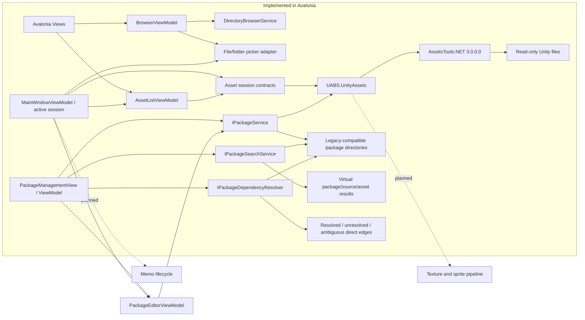

# Project Overview

## What UABS is

UABS is a desktop tool for inspecting and managing content stored in Unity bundles and serialized asset files. The legacy application can browse files, enumerate assets, inspect metadata, preview and export supported textures and sprites, build package indexes, search packages, resolve dependencies, and maintain per-asset memos.

The project is being migrated from a Unity 2021 application to a standalone .NET/Avalonia desktop application. The replacement must not require Unity to be installed.

## Repositories

- `E:\Projects\UABS\UABS`: functional legacy Unity reference, read-only during migration.
- `E:\Projects\UABS\Avalonia`: new standalone application and all active implementation work.

## Migration goals

- Preserve verified workflows and useful data compatibility.
- Remove all Unity Engine, Editor, runtime, scene, and lifecycle dependencies.
- Isolate Unity file-format processing behind UI-neutral .NET contracts.
- Use Avalonia Views and ViewModels for desktop presentation.
- Make resource ownership, cancellation, error handling, and testing explicit.
- Keep source game files read-only and retain real asset identities/provenance.
- Migrate incrementally rather than attempting a broad rewrite.

## Current high-level architecture

The solid path below is implemented. Dashed components are planned migration areas, not current functionality.

## Current implementation status

Milestones 1 through 7 are complete for their verified scope:

- deterministic core AssetsTools.NET and `classdata.tpk` deployment;
- Unity bundle/serialized-file detection;
- disposable asset sessions and real bundle enumeration;
- neutral asset records containing name, type, class ID, path ID, byte size, logical file, and source path;
- asynchronous Open File workflow and real Avalonia DataGrid binding;
- transactional replacement that retains the last good session on failure;
- focused automated infrastructure and ViewModel lifecycle tests;
- independent filesystem browsing with back/forward/up, refresh, direct path entry, and folder picking;
- cached name/type/path-ID filters, selectable numeric sorting, and stable selection rules;
- cancellable lazy details containing entry and session metadata;
- real bundle and standalone `.assets` fixture coverage and an automated zero-Unity dependency audit;
- UI-independent legacy-schema package load/create/validate/list/save services with cancellation, progress, staged replacement, original-path preservation, and Milestone 7.5 source-relative folder-import compatibility verified against genuine legacy data.
- UI-independent package metadata search with field/result filters, exact Path ID matching, deterministic sorting, cancellation, and virtual original-path results.
- UI-independent direct package-dependency resolution with bounded CAB compatibility, structured ambiguity, duplicate-source deduplication, cancellation, and no source-file I/O.
- an Avalonia package workspace for directory selection, catalog refresh, package contents, metadata search, and direct dependency inspection.
- package creation from an empty state, isolated editing, real-source/selected-asset addition, hierarchy-preserving folder import, reference removal, explicit overwrite/discard confirmation, verified staged saving, and reopen/catalog refresh.

The graphical workflows still need a complete manual Windows interaction pass. A representative multi-serialized-file bundle fixture is also still needed.

## Major feature areas

| Area | Legacy Unity | Avalonia status |
|---|---|---|
| File detection and asset enumeration | Implemented | Implemented; bundle and standalone-file tested |
| File picker and asset list | Implemented | Implemented; graphical interaction not manually verified |
| Folder browsing, history, sorting, filtering, details | Implemented | Milestone 2 implemented and headlessly tested |
| Texture and sprite decoding | Implemented with format gaps | Not migrated |
| Preview and PNG export | Implemented with safety gaps | Not migrated |
| Package indexing and search | Implemented | Backend plus catalog/contents/search and creation/edit/save UI implemented |
| Dependency lookup | Implemented | Direct backend and inspection UI implemented; reverse lookup deferred |
| Memo editing and inheritance | Implemented | Not migrated |

## Technologies

- .NET 9 target framework
- Avalonia 11.3.3
- AssetsTools.NET 3.0.0.0 for standalone Unity-format processing
- xUnit with Microsoft.NET.Test.Sdk
- Vendored `classdata.tpk` for class database resolution

Future image work may use additional standalone .NET/native codecs, but no future dependency may require the Unity runtime.

## Milestones

1. **Functional asset loading:** implemented and tested for the current fixture scope.
2. **Complete browsing/list/details workflow:** implemented and tested for the current scope.
3. **Package infrastructure and management:** backend implemented and tested; search completed in Milestone 4 and read-only package UI completed in Milestone 6.
4. **Package search and discovery:** metadata service implemented and tested; UI deferred.
5. **Direct dependency resolution:** backend implemented and tested; UI and reverse lookup deferred.
6. **Avalonia package management UI:** browse, inspect, search, and direct-dependency UI implemented.
7. **Package creation, editing, and saving UI:** implemented with safe first-package, selected-asset, overwrite, dirty-state, and reopen workflows.
8. **Memo lifecycle.**
9. **Neutral texture/sprite decoding.**
10. **Preview and safe export.**
11. **Hardening, packaging, and retirement readiness.**

See the [migration roadmap](../05_audit/migration-roadmap.md) for acceptance criteria and the [Milestone 07 report](../05_audit/milestone-07-report.md) for exact verification evidence.

## More detail

- [Current Avalonia architecture](../02_architecture/avalonia-architecture.md)
- [Target architecture](../02_architecture/target-architecture.md)
- [Asset loading system](../04_systems/asset-loading.md)
- [Filesystem browser and asset list](../04_systems/filesystem-browser.md)
- [UI and workflow design](../03_design/ui-and-workflow-design.md)
- [Feature comparison](../05_audit/feature-comparison.md)
- [Open questions](../05_audit/open-questions.md)
