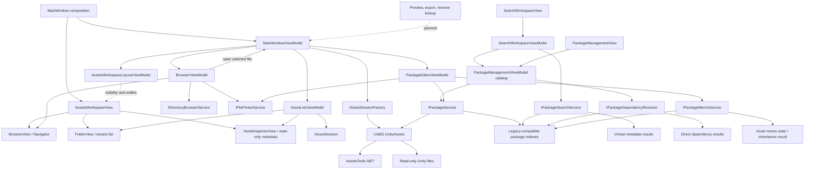

# Avalonia Architecture and Current Status

## Project shape

The solution has three `net9.0` projects:

- `UABS`: Avalonia Views, ViewModels, commands, filesystem service, picker adapter, package workspace, and composition.
- `UABS.UnityAssets`: UI-independent AssetsTools.NET integration, neutral session contracts, package persistence, metadata search, and direct dependency resolution services.
- `UABS.UnityAssets.Tests`: xUnit integration, policy, ViewModel, filesystem, package/search, and dependency-audit tests.

The small `MainWindow` composition root creates the picker, directory service, asset-session factory, and `MainWindowViewModel`. Its code-behind only initializes and disposes the ViewModel.

## Implemented component boundaries

Filesystem browsing and asset-session ownership are deliberately independent. Moving between folders never closes or replaces the active asset session. Opening a file delegates to `MainWindowViewModel.LoadFileAsync`; only a successfully opened candidate replaces the old session.

## Presentation state

`BrowserViewModel` owns current-path state, directory rows, selection, errors, cancellation, and back/forward history. Directory reads are transactional: state and history change only after enumeration succeeds. A new navigation after Back clears the forward branch; refresh does not add a history entry.

`AssetListViewModel` owns the cached source rows, visible immutable snapshot, filters, sort choice, selection, and lazy details. Filtering or sorting performs one in-memory rebuild and one visible-list property change; it never reparses the Unity file. Selection is retained by object identity through sorting, cleared if filtering hides it, and cleared when the session changes.

`AssetsWorkspaceLayoutViewModel` owns only in-memory Navigator/Inspector visibility and remembered widths. `AssetsWorkspaceView` applies those values to five grid columns (panel, splitter, center, splitter, panel), records successful splitter drags, and keeps restore controls outside the collapsible regions. `AssetInspectorView` consumes the same `AssetListViewModel` selection/details as the center list; it creates neither a second selection nor a second session.

`MainWindowViewModel` owns the active `IAssetSession`, load status/errors, and application-lifetime cancellation. It composes the two child ViewModels but does not mix directory history into the asset-session lifecycle.

`PackageManagementViewModel` owns a separate package workspace. It loads resilient catalog entries through `IPackageService`, flattens loaded package metadata into source/asset presentation rows, delegates matching to `IPackageSearchService`, and delegates selected-package direct resolution to `IPackageDependencyResolver`. Catalog, search, and dependency requests have independent cancellation/version guards. Selecting another package replaces contents and prevents stale dependency publication without touching the active asset session.

`SearchWorkspaceViewModel` is a separate long-lived presentation owner composed beside `PackageManagementViewModel`. It observes the package catalog without owning package I/O, preserves explicit package inclusion across catalog refreshes, and delegates matching to the shared `IPackageSearchService`. It owns criteria, merged results, result selection, cancellation, and a generation guard; changing criteria never performs implicit work. `SearchWorkspaceView` renders the retained three-region foundation and metadata-only inspector without opening source files or borrowing the Assets session.

`PackageEditorViewModel` owns an isolated deep clone of an existing package or a new empty root index. It validates the directory-backed package name, adds source/asset references through `IPackageService`, places folder-imported sources in service-provided relative indexes, edits asset memos through `IPackageMemoService`, tracks edit generations and dirty state, requests explicit overwrite/discard decisions, saves a snapshot, and reloads the target before publishing a clean result. `MainWindowViewModel` owns the shared application-lifetime `IPackageWriteCoordinator`; explicit editor Save holds its normalized package-path lock through staged persistence, verification reload, editor publication, and catalog callback. Equivalent normal/extended Windows source paths share a UI-independent identity without rewriting stored path text. Memo inheritance works on source/target snapshots and publishes one completed candidate, so cancellation or a newer edit cannot partially replace the editor. `MainWindowViewModel` transfers only the current neutral `AssetEntry`; no AssetsTools.NET object crosses into presentation.

Workspace tabs retain the same composed ViewModels, including Assets panel state and Search criteria/results. Collapsing panels or switching tabs changes only presentation and cannot dispose the active session, clear the selected asset, or rebuild Search. A transient null package-grid selection is ignored while the editor is active, so visual detach/reattach cannot invoke the explicit abandon workflow. Intentional package switches, reloads, discard, and close still use confirmation. Generation checks protect rapid Search execution, package selection, dependency publication, and asset-session replacement.

## Infrastructure boundary

Public neutral contracts include `AssetEntry`, `AssetDetails`, `AssetSessionMetadata`, `UnityFileKind`, load errors, `IAssetSession`, `IAssetSessionFactory`, and the models behind `IPackageService`, `IPackageSearchService`, `IPackageDependencyResolver`, `IPackageMemoService`, and `IPackageWriteCoordinator`. Avalonia code never exposes AssetsTools.NET objects. `GetDetailsAsync` returns session-backed metadata without eager full-object deserialization.

Only `UABS.UnityAssets` references AssetsTools.NET. An automated audit checks the built application assemblies' references and shipped top-level DLLs for exact `UnityEngine`, `UnityEngine.*`, `UnityEditor`, or `UnityEditor.*` assembly names.

## Resource ownership and concurrency

- Session opening and enumeration run away from the UI thread.
- Candidate session replacement is transactional; failed candidates cannot destroy the last good result.
- `AssetsToolsAssetSession` owns the manager and streams and has idempotent disposal.
- Directory requests cancel superseded requests and ignore stale completions.
- Detail requests cancel on selection/session changes and use a version check before publishing results.
- Asset-file loads share cancellation and generation ownership across picker/browser entry points; late superseded sessions are disposed instead of published.
- The browser does not own or dispose the asset session.
- Package scanning, parsing, and staged persistence use task-based APIs with cancellation and progress; no Avalonia dispatcher is used in infrastructure.
- Folder scans return additive source-relative mappings; transactional editor merge retains existing flat/hierarchical/empty indexes and does not automatically migrate package layout.
- Package replacement rejects implicit overwrite and retains the prior target as a rollback backup during the staged directory swap. The UI requests confirmation before enabling overwrite and reopens the committed package before marking it clean.
- Package writes are mutually exclusive per normalized package path through reference-counted asynchronous locks. Different packages remain independent; cancelled waiters and failed operations release their entries. This is in-process exclusion, not stale-document reconciliation or cross-process locking.
- Package search scans only loaded neutral models, supports cancellation, optionally filters asset candidates to nonempty memos independently from memo matching, and returns read-only identity snapshots without filesystem access or cache copies.
- Direct dependency resolution builds a temporary CAB lookup from a per-call metadata snapshot, supports cancellation, and returns immutable resolved/unresolved/ambiguous results without recursive traversal or source-file I/O.
- Memo editing mutates only the editor clone. Memo copy snapshots both packages, runs against metadata only, reports ambiguous legacy matches, and publishes transactionally; no keystroke or focus event writes a package file.
- Package catalog enumeration returns per-directory success/error entries so one malformed package does not hide valid siblings. The package workspace never opens referenced Unity files merely to browse, search, or resolve metadata.
- UI `AsyncCommand` failures are observed at the `ICommand.Execute` boundary, logged with full exception text, and exposed through an event/reporter. Required window startup/closing `async void` boundaries catch and report their own failures.

## Verification status

- `dotnet build Avalonia.sln --no-restore`: clean, zero warnings/errors.
- Milestone 6 final command evidence is recorded in the [Milestone 06 report](../05_audit/milestone-06-report.md).
- Real fixtures: one compressed Unity bundle and its extracted standalone serialized file.
- Covered: file detection/enumeration, provenance/details, disposal/replacement, filesystem enumeration, history/refresh/failure preservation, numeric sorting, combined filters, selection rules, detail races, browser/session independence, and zero Unity runtime assemblies.
- Not yet fully verified: end-to-end graphical interaction on Windows and a bundle containing multiple serialized files.

See the [Milestone 06 report](../05_audit/milestone-06-report.md), [package system](../04_systems/package-search-dependency-memo.md), and [filesystem browser system](../04_systems/filesystem-browser.md).

## Deferred architecture

Texture/sprite decoding, preview, export, reverse-dependency lookup, rotating/structured logging, and platform app-data paths remain unimplemented. Memo editing is implemented only for verified asset-level fields; the schema has no package/directory/source memo ownership or persisted copy provenance. Milestone 7.4 provides handle-safe local diagnostic text logging with timestamps and stack traces. The old placeholder `FolderViewEntry`, `FolderViewType`, sort panel, and `AssetsViewEntry` are not part of the active workflow.
