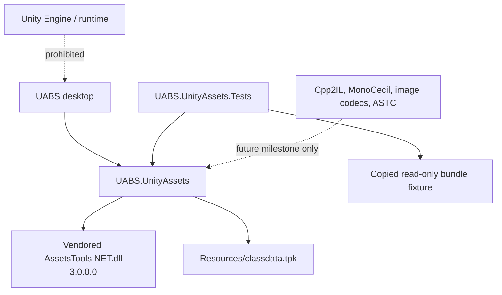

# Dependency Management and Audit

## Unity framework and packages

- Unity Editor/runtime `2021.3.33f1`
- uGUI and TextMeshPro for UI
- Unity Test Framework package present, but project tests are custom scene components
- Newtonsoft.Json-for-Unity `13.0.102`
- StandaloneFileBrowser source/plugin under `Assets/StandaloneFileBrowser`

Most Unity modules listed in `Packages/manifest.json` are default feature-pack modules and are not evidence that UABS business logic needs physics, animation, terrain, audio, XR, etc. The actual source primarily uses `UnityEngine`, UI, event systems, TextMeshPro, image conversion, and asset-bundle-adjacent types.

## Copied third-party binaries

The same binaries appear under Unity `Assets/Plugins` and Avalonia `UABS/Plugins`:

| Assembly | Inspected assembly version | Role | Normal .NET viability |
|---|---:|---|---|
| AssetsTools.NET | 3.0.0.0 | Unity bundle/serialized-file parsing | Yes; core migration dependency |
| AssetsTools.NET.Cpp2IL | 1.0.0.0 | IL2CPP MonoBehaviour type templates | Yes, with companion native/managed dependencies |
| AssetsTools.NET.MonoCecil | 1.0.0.0 | Managed assembly type templates | Yes |
| AssetRipper.Primitives | 3.2.0.0 | Supporting primitives | Likely transitive |
| BCnEncoder | 2.2.1.0 | BCn decode | Yes |
| CommunityToolkit.HighPerformance | 8.4.0.0 | Supporting library | Yes |
| LibCpp2IL | 2022.1.0.0 | IL2CPP analysis | Yes, compatibility/package validation required |
| Mono.Cecil / Rocks | 0.11.6.0 | Managed metadata | Yes |
| SixLabors.ImageSharp | 2.0.0.0 | Image representation/encoding candidate | Yes; old version should be reviewed before release |
| Microsoft.Bcl.HashCode | 6.0.0.0 | Compatibility dependency | Likely unnecessary on .NET 9 if upstream no longer requires it |
| Unsafe | 6.0.0.0 | low-level supporting library | Viable; avoid manual version skew |
| WasmDisassembler | 2022.1.0.0 | LibCpp2IL support | Yes |
| `astc_decoder.dll` | native, version not obtained | ASTC decoding | Platform/architecture-specific blocker |

These libraries do not require the Unity runtime merely because they process Unity file formats. AssetsTools.NET, Newtonsoft.Json, BCnEncoder, Mono.Cecil, LibCpp2IL, and ImageSharp are ordinary .NET libraries. The main migration difficulty is dependency packaging/version compatibility and Unity types embedded in UABS's own image layer.

## Avalonia packages

`UABS.csproj` declares Avalonia `11.3.3` packages and `net9.0`. No MVVM toolkit, dependency injection, logging, JSON, or test packages are declared.

The project contains all copied DLLs under `UABS/Plugins`, but only three AssetsTools assemblies are referenced, and their `HintPath` values point to nonexistent `..\Libs`. The native and transitive managed binaries are not declared for output. This is a confirmed static configuration blocker.

## Recommended dependency policy

1. Prefer NuGet `PackageReference` for available, compatible libraries, with locked versions and license/security review.
2. If AssetsTools.NET/Cpp2IL binaries must remain vendored, place them in one clearly named repository directory and declare every required runtime asset explicitly; do not rely on “DLL happens to be in Plugins.”
3. Put Unity file-format services in an infrastructure project that references AssetsTools.NET. Keep Avalonia Views/ViewModels free of `AssetsFileInstance`, `BundleFileInstance`, and `AssetTypeValueField`.
4. Use `System.Text.Json` for new internal formats unless compatibility with current package JSON makes Newtonsoft materially simpler. Preserve current JSON schema during the first migration.
5. Use ImageSharp or another non-UI image library for RGBA buffers, crop/pad, and PNG output; convert to Avalonia `Bitmap` only at the presentation edge.
6. Treat ASTC/ETC support as explicit capabilities with runtime probes and format-specific tests. Native binaries require Windows/Linux/macOS packaging decisions.

## Data/assets that must be deployed

- `classdata.tpk` is required by `AssetsManager.LoadClassPackage()` and exists only in Unity `Assets/StreamingAssets` today.
- UI icons/fonts are already copied as Avalonia resources.
- ASTC native library needs an architecture-aware deployment plan.
- Mono/IL2CPP inspection needs game `Managed` assemblies or IL2CPP metadata/binary files at runtime; `NextInstance.SetMonoTempGenerators()` searches for them relative to the opened assets file.

## Compatibility risks

- Vendored assembly versions may target older frameworks and include transitive expectations not expressed in the csproj.
- `AssetsTools.NET` object lifetimes and streams need disposal verification on .NET 9.
- `LibCpp2IL` version `2022.1.0.0` may not cover all Unity/game versions the product intends to inspect.
- ImageSharp `2.0.0.0` is old; upgrading can change APIs/output and must be tested.
- `astc_decoder.dll` is native and may only match one OS/architecture.
- Unity currently supplies ETC-family decoding; copied managed libraries do not automatically replace that capability.

## Milestone 1 dependency deployment

The broken `..\Libs` references are removed. The exact inspected `AssetsTools.NET.dll` assembly (version `3.0.0.0`, 224,256 bytes) is vendored at `Dependencies/AssetsTools.NET/AssetsTools.NET.dll` and referenced by `UABS.UnityAssets/UABS.UnityAssets.csproj`. The Avalonia executable references the infrastructure project, not the DLL. Only this core assembly is needed for Milestone 1 detection, bundle/serialized-file loading, and metadata enumeration; Cpp2IL, MonoCecil, image codecs, and the ASTC native library are intentionally not deployed yet.

The inspected `classdata.tpk` (286,635 bytes) is copied to `UABS.UnityAssets/Resources/classdata.tpk`, declared as content, and loaded from `AppContext.BaseDirectory/Resources/classdata.tpk`. Missing or incompatible classdata produces a session warning rather than a crash; type-tree-enabled files can still enumerate with fallback names/types. The UI build output was verified to contain the core AssetsTools assembly and classdata at deterministic relative paths.

Restore/build was verified with the installed .NET 10.0.401 SDK targeting `net9.0`; the host has the .NET 9.0.5 runtime. No package or assembly upgrade was performed.

