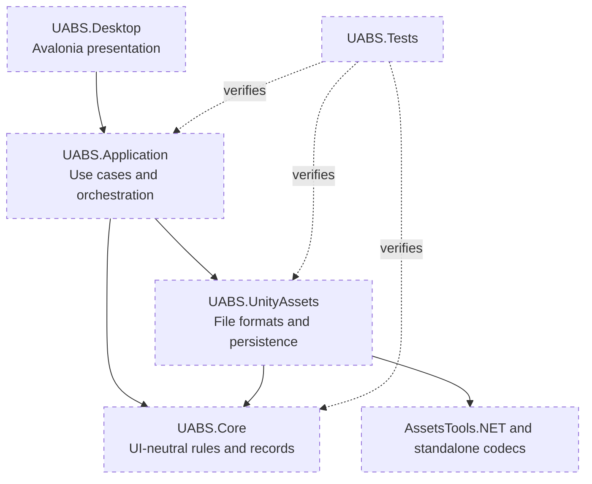
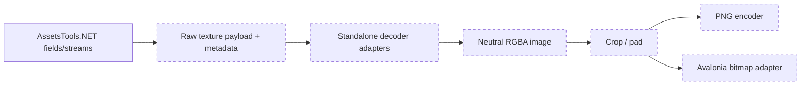

# Recommended Target Architecture

## Recommendation

Milestone 6 implementation note (2026-10-16): the essential separation remains `UABS` (desktop), `UABS.UnityAssets` (infrastructure plus neutral contracts), and `UABS.UnityAssets.Tests`. Package models, `IPackageService`, metadata search, and direct dependency resolution live in `UABS.UnityAssets`; `PackageManagementViewModel` composes those contracts in `UABS` without exposing AssetsTools.NET. Construction uses AssetsTools.NET, while catalog presentation, search, and resolution consume loaded neutral metadata. A Core/Application split remains deferred until additional service breadth justifies it.

Use four projects plus tests when application breadth justifies the split. The following is the **proposed long-term structure**, not the current project list:

If four production projects feel too granular, merge `Core` and `Application`; do not merge `UnityAssets` into the Avalonia UI project. The essential boundary is “file-format processing and persistence do not depend on Avalonia.”

## Core contracts

Define UI-neutral records such as:

- `BrowseEntry`: path/reference, display name, folder vs Unity file, size.
- `AssetDescriptor`: session/file identity, path ID, display name, class ID/type, source path.
- `AssetDetails`: sizes, file identity, source information.
- `DecodedImage`: width, height, RGBA pixel memory, original Unity format.
- `SearchResult`/`DependencyResult`: original path, display name, CAB code, package source.
- Legacy-compatible package records are implemented without a schema-version field. A versioned manifest remains a future opt-in format and must not replace legacy reads/writes silently.

Do not expose `Texture2D`, Avalonia `Bitmap`, controls, or AssetsTools.NET instances in these public application contracts. Internal session handles can wrap AssetsTools.NET objects and must define disposal/lifetime.

## Application services

- `IAssetSessionFactory` / `IAssetSession`: open one file, enumerate assets, read details/image, dispose resources.
- `IBrowseService`: filesystem enumeration and navigation policy.
- `IPackageService`: implemented for build/load/validate/list/save with progress, cancellation, explicit overwrite, and staged replacement.
- `IPackageSearchService`: implemented as a cancellable in-memory query over loaded package models with package/source/asset result snapshots and no copied files.
- `IPackageDependencyResolver`: implemented direct lookup; a reverse-dependency service remains subject to product approval.
- `IPackageMemoService`: implemented for rich asset identity, missing/empty/value state, local editor mutation, and transactional Safe/Overwrite/Force package copy. Disk persistence remains owned by `IPackageService`.
- `IAssetExportService`: export selected assets with collision/error reporting.
- `IAppPathProvider`: user package, cache, logs, and classdata locations.

Use `Task`/`Task<T>`, `CancellationToken`, and `IProgress<T>` for long operations. Services should return structured errors/results rather than log-and-return-null.

## Avalonia presentation

Suggested ViewModels:

- `MainWindowViewModel`: current page/session, global operation status, navigation commands.
- `BrowserViewModel`: current location and `ObservableCollection<BrowseEntryViewModel>`.
- `AssetListViewModel`: asset rows, sorting/filtering/selection, open-detail command.
- `AssetDetailsViewModel`: metadata and future preview loading state; persisted package memo editing currently belongs to `PackageEditorViewModel` because Save is a package transaction.
- `SearchViewModel`, `DependencyViewModel`, `PackageViewModel`, `ExportViewModel`.

Views should contain templates and small UI-only behaviors. File dialogs require a platform service created from the active `TopLevel.StorageProvider`; ViewModels call the abstraction, not Avalonia APIs directly. Use Avalonia collection virtualization rather than manual row pools.

## Navigation and messaging decision

Recommended: explicit state/commands, not a global event bus. `MainWindowViewModel` owns the active page and selected asset session. Child ViewModels communicate through service calls and delegated callbacks/events with clear ownership.

Alternative: a typed messenger can reduce constructor wiring, but risks recreating the legacy synchronous broadcast topology and hidden dependencies. Use it only for rare global notifications (for example, package catalog changed), not rendering commands or navigation.

## Image decision

The following neutral pipeline is **proposed and unimplemented**:

This allows the same decoding code to power preview and export, makes tests deterministic, and prevents Avalonia UI types from entering asset parsing.

## Persistence and paths

- Store app-managed data under the platform's per-user application-data directory, not the process working directory.
- Allow the user to register package locations explicitly if compatibility with existing `External/UABS_UserPackages` data is needed.
- Load package indexes once and search the resulting models; `IPackageSearchService` avoids recursive JSON scans per query. Watching/reload policy remains future work.
- Package directories are written to a sibling staging directory and renamed into place; explicit replacement retains a rollback backup during the swap. Future single-file memo writes should use temp-file + replace.
- Keep source game files read-only. Search/dependency results should reference originals rather than copying them.

## Decisions versus recommendations

Observed requirements: preserve browsing, parsing, preview/export, packages/search/dependencies, and memos from the Unity implementation.

Implemented decisions: virtual original-path package/search references, System.Text.Json with exact legacy output names/case-insensitive reads, unknown-field preservation, ordinal metadata matching, and no schema-version field in legacy output.

Recommended but awaiting approval: project split, an opt-in versioned package format, source-path remapping, ImageSharp-centered decode representation, and dependency catalog caching. Do not add a persistent search index until measurements show the linear in-memory service is insufficient.
