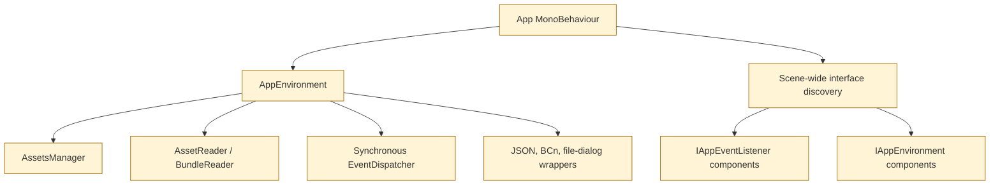

# Legacy Unity Architecture

## Runtime composition

**Observed:** the production scene is `Assets/Scenes/UABS.unity`, selected in `ProjectSettings/EditorBuildSettings.asset`. The project targets Unity `2021.3.33f1`; `Assets/Scenes/Test.unity` contains hand-driven diagnostic components but is not in the build.

`Assets/Script/App.cs` is the composition root. In `Awake()` it:

1. Establishes a static singleton (`App.Instance`).
2. Creates `AppEnvironment`.
3. Finds every active/inactive `MonoBehaviour` implementing `IAppEnvironment` and injects the environment.
4. Finds every `MonoBehaviour` implementing `IAppEventListener` and registers it with `EventDispatcher`.

`Assets/Script/Misc/AppCore/AppEnvironment.cs` owns:

- `AssetsTools.NET.Extra.AssetsManager`
- `AssetReader`
- `BundleReader`
- synchronous `EventDispatcher`
- `AppWrapper`, which constructs Newtonsoft JSON, BCn texture decoder, and StandaloneFileBrowser adapters

It loads `Assets/StreamingAssets/classdata.tpk` immediately through `Application.streamingAssetsPath`. This startup side effect, static singleton, and scene-wide discovery are central Unity lifecycle dependencies and should not be copied into Avalonia.

## Event and state flow

`Assets/Script/Dispatcher/EventDispatcher.cs` sends each `AppEvent` synchronously to a snapshot of listeners. There is no typed subscription, exception isolation, thread-affinity enforcement, or unsubscription lifecycle. The event model nevertheless reveals the application's workflows clearly:

- `FolderReadEvent` → enumerate folders/bundles and update folder view.
- `AssetsReadEvent` / `AssetsRead4DeriveEvent` → publish parsed bundle content.
- `GoBundleViewEvent` / `AssetsRenderEvent` → transition and render asset rows.
- `AssetSelectionEvent` / `AssetDisplayInfoEvent` → selection, metadata, texture preview, and memo display.
- `SortScrollViewEvent`, `FilterTypeEvent`, `ExportAssetsEvent` → asset operations.
- `RequestSearchEvent` and `RequestDependencyEvent` → derive bundle result sets through package indexes.
- `MemoPackageEvent` and `MemoInheritEvent` → select and migrate memo data.

`AssetsDataSource`, `FolderDataSource`, `DependencyDataSource`, and `SearchDataSource` are `MonoBehaviour` facades. They create ordinary C# manager classes and register those managers with the same dispatcher. The delegates in the managers (`GetEntryInfosCallBack`, `SetEntryInfosCallBack`, etc.) form implicit mutable state channels.

## Asset loading pipeline

The main legacy call chain is:

Important files:

- `Assets/Script/UnityFile/FileTypeDetector.cs`: header-based bundle/serialized-file detection; despite its folder name, it only depends on .NET and AssetsTools.NET.
- `Assets/Script/UnityFile/NextInstance.cs`: bundle/assets loading, decompression, class-database selection, fast name/type extraction, Mono/IL2CPP template generation. Its core is reusable but logging is coupled to `UnityEngine.Debug` and global `_hasSetMonoTempGenerators` is process-wide state.
- `Assets/Script/Reader/BundlesRead/AssetsReader.cs`: creates parsed records across every assets file in a bundle.
- `Assets/Script/Reader/BundlesRead/AssetReader.cs`: lazy metadata extraction and MonoScript name mapping.
- `Assets/Script/Reader/BundlesRead/ReadFolderContent.cs`: lists directories and only `.bundle`, `.ab`, and `.assets` files; calculating bundle size loads the bundle.

The code loads all embedded assets files and may decompress an entire bundle into a `MemoryStream`. Most operations are synchronous. These must run off the Avalonia UI thread and need explicit ownership/disposal.

## Folder and navigation workflow

`FolderDataSource` composes three managers:

- `FolderDataPathManager`: path history, folder enumeration, and bundle dispatch.
- `FolderGoBackManager`: unloads the entire `AssetsManager`, restores prior folder/derived result context, and controls the search-cache back button.
- `FolderDataDeriveManager`: overlays original paths on copied search/dependency results.

Search/dependency results are copied into relative `External/UABS_System_Cache/{Search|Dependency}/<number>` directories by `CopyDeriveToSysFolder`, then browsed as folders. `FolderViewInfo.overrideDerivePath` keeps the original source path. This works as a UI workaround but duplicates potentially large bundle files and should be redesigned as a virtual result collection in Avalonia.

## Bundle list, selection, and metadata

- `AssetsDataSortManager`: natural name sorting plus type/path-ID sorting; nearly UI-independent.
- `AssetsDataFilterManager`: filters by `AssetClassID` state.
- `AssetsDataSelectionManager`: single, Ctrl-toggle, Shift-range, next/previous selection; only `Mathf` and `Debug` prevent direct reuse.
- `AssetsDataExportManager`: chooses all, filtered-by-type, or highlighted entries for export.
- `DisplayInfoPanel`: lazily calls `AssetReader.ReadExtraInfoFromAsset()` for path, file ID, and compressed/uncompressed size.

`LoadEntries2ScrollView` implements a 13-row manual virtualization pool. Avalonia's `DataGrid`/items controls should own virtualization instead. `AppStateTracker`, `Segue`, and serialized `UnityEvent` callbacks drive page visibility; the state machine is implicit in scene wiring.

## Texture, sprite-atlas, preview, and export pipeline

`Assets/Script/Reader/ImageDecoder/ImageReader.cs` is the most Unity-coupled processing class. It:

- Resolves `Texture2D` and `Sprite` data through AssetsTools.NET.
- Builds sprite-to-atlas relationships using `DumpReader`, `JsonDumper`, and `AtlasDumpProcessor`.
- Reads inline image bytes, external resource files, or `archive:/` bundle entries.
- Decodes RGB/RGBA and BCn via `ITextureDecoder`/`BCnEncoder`.
- Delegates ETC/ETC2/RGBA4444 decoding to Unity `Texture2D`.
- Calls native `astc_decoder.dll` for ASTC.
- Crops/pads with Unity `Texture2D`, `Rect`, `Color`, and `TextureFormat`.

`ExportTextureAsImage2Path` then uses `Texture2D.EncodeToPNG()`. `TextureDisplayForBundle` caches decoded images by path ID and `TextureView` displays them in a `RawImage` with `PanZoomRawImage` interaction.

The asset traversal and raw-byte acquisition can be preserved. The decoded image contract, format enum mapping, cropping/padding, Avalonia bitmap creation, and PNG encoding require redesign around a neutral RGBA buffer or ImageSharp image. Android texture support currently relies directly on Unity and is a migration blocker until an external decoder is selected and tested.

## User packages, search, dependencies, and memos

`UserPackageBuildReader` recursively scans a game-data directory and writes an `index.json` per directory. Each bundle record contains `Name`, original `Path`, a scanned `CabCode`, image `AssetInfos` (Sprite/Texture2D names and path IDs), and `Dependencies`. `WriteUserPackage` runs this work on a raw `Thread`, then posts completion through `UnityMainThreadDispatcher`.

`FindDeriveInfoInPackage` scans every JSON file for each request. It supports case-insensitive include/exclude substring matching, exact name search, optional memo search, and CAB prefix-equivalence. “Search by image” is explicitly only exact filename matching (`SearchBundleByImageButton`); it does not compare pixels.

`ReadDependencyInfo` reads `AssetBundle.m_Dependencies` and resolves CAB codes through package indexes. `DependentReader` implements reverse lookup but does not appear connected to the production UI path inspected.

`MemoReader`/`MemoWriter` find a bundle by stored path and an asset by name. `MemoField` supports only Sprite/Texture2D and writes after a Unity coroutine debounce. `InheritMemoWriter` copies memos between package versions using a bundle-name heuristic and `Safe`, `Overwrite`, or `Force` modes.

These capabilities are mostly ordinary .NET/AssetsTools.NET logic, but the package format embeds absolute paths, repeatedly parses whole JSON trees, and identifies memo targets by non-unique asset name. Preserve format compatibility initially; redesign indexing and stable identity behind interfaces.

## Tests and evidence limitations

`Assets/Script/__Test__` contains scene-driven `MonoBehaviour` checks and a custom coroutine `TestsRunner`; it is not a standard Unity Test Framework suite despite that package being installed. Several tests rely on external fixture paths and perform file copies/deletes. No tests were executed during this analysis.

Therefore “working” in this documentation means a complete and scene-wired source path exists, not that behavior was freshly runtime-verified.
