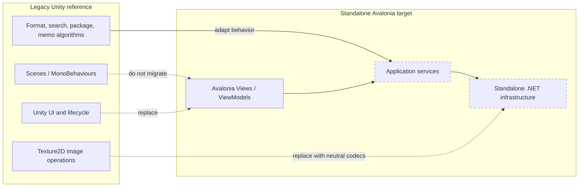

# Unity Dependency Breakdown

## 1. Can likely move almost directly

These files contain ordinary C# or AssetsTools.NET logic. Remove namespace churn, introduce nullable/error contracts, and add tests, but do not rewrite their algorithms without cause.

- `Assets/Script/UnityFile/FileTypeDetector.cs`
- `Assets/Script/DataStruct/_New/FileInstanceLike.cs`
- `Assets/Script/Misc/Streams/FormatFileSize.cs`
- `Assets/Script/Wrapper/TextureDecoder/IColor.cs`
- `Assets/Script/Wrapper/TextureDecoder/ITextureDecoder.cs`
- `Assets/Script/Wrapper/TextureDecoder/TextureCompressionFormat.cs`
- `Assets/Script/Wrapper/TextureDecoder/BcCompressionFormatExtension.cs`
- `Assets/Script/Wrapper/TextureDecoder/ColorRgba32Wrapper.cs`
- `Assets/Script/Wrapper/TextureDecoder/BcDecoderWrapper.cs`
- `Assets/Script/Wrapper/Json/*` (format-compatible first; could later simplify)
- `Assets/Script/DataSource/Manager/AssetsDataSortManager.cs` algorithm
- `Assets/Script/Reader/Search/ReadSearchInfo.cs` parsing rules
- event/data enums and simple records such as `SortProp`, `ExportMethod`, `MemoInheritMode`, and `DeriveInfo`

`RangeObservableCollection<T>` is framework-neutral but appears copied from external code and is used internally only to replace `AssetsTools.NET`'s metadata asset collection. Reassess whether it is still necessary with the target library version rather than automatically moving it.

## 2. Migrate after removing small Unity dependencies

| Code | Unity dependency | Target adjustment |
|---|---|---|
| `NextInstance` | `Debug.Log*` only in most methods | Inject `ILogger`; remove process-global template-generator flag or scope it to a session |
| `AssetsReader` | logging only | Return result/error types; own and dispose streams |
| `DependentReader` | error logging | Inject logger; add cancellation |
| `FindDeriveInfoInPackage` | error logging | Inject logger; validate empty exact-search keys |
| `ReadDependencyInfo` | logging | Return unresolved CABs as structured diagnostics |
| `UserPackageBuildReader` | logging | return progress/errors; avoid reading each full bundle repeatedly |
| `MemoReader` / `MemoWriter` | logging and `AppEnvironment` | inject serializer/package repository directly |
| `InheritMemoWriter` | logging and `AppEnvironment` | inject serializer/logger; harden bundle-name parsing |
| folder/history managers | `Debug`, event dispatcher, environment | convert into application services/state objects |
| selection manager | `Mathf`, `Debug`, event dispatcher | `Math.Min/Max`; return selection changes or expose observable state |
| `PathUtils` | `Debug`, `Application` indirectly via constants | logger + `Path.GetRelativePath`; OS-aware comparer; contain Windows P/Invoke |

## 3. Requires an Avalonia/.NET replacement

| Unity facility | Actual usage in UABS | Replacement |
|---|---|---|
| `MonoBehaviour` lifecycle | startup, dependency injection, event registration | explicit composition in `App`, service lifetimes, ViewModel activation/disposal |
| scene-wide `FindObjectsOfType` | discovers listeners and environment consumers | constructor injection/manual registration |
| Unity uGUI/TMP | every toolbar, folder/asset row, metadata/memo panel | Avalonia Views, typed bindings, DataGrid/ItemsControl, ViewModels |
| serialized fields/prefabs | UI wiring and row templates | AXAML templates/styles and bindings |
| serialized `UnityEvent` | page state and enable/disable wiring | ViewModel properties/commands and navigation state |
| StandaloneFileBrowser | open/save/folder panels | `TopLevel.StorageProvider` behind `IStoragePickerService` |
| `UnityEngine.Debug` | diagnostics throughout | `Microsoft.Extensions.Logging` plus user-visible operation errors |
| coroutines | memo debounce, hover hide, custom test runner | cancellation-token debounce / Avalonia timers / standard test runner |
| `UnityMainThreadDispatcher` | package-build callback | `Dispatcher.UIThread` only at presentation edge; `await` service tasks |
| Unity input keys/events | Ctrl/Shift selection, pointer pan/zoom | Avalonia selection and pointer/key event APIs |
| ScriptableObject icon maps | asset/folder icons | Avalonia resources or immutable mapping service (prototype already does this) |

## 4. Requires substantial redesign

### Image pipeline

`ImageReader`, `AssetImageInfo`, `TextureDisplayForBundle`, and `ExportTextureAsImage2Path` mix Unity asset traversal, compression decoding, Unity texture creation, UI preview needs, and PNG encoding. Split into:

- Unity asset image locator (AssetsTools.NET fields/pointers/streams)
- texture format mapper and decoder returning neutral RGBA data
- sprite/atlas crop service
- image encoder
- Avalonia bitmap adapter/cache

Replace `Texture2D`, `Rect`, `TextureFormat`, `Color`, `Color32`, `RawImage`, and `EncodeToPNG`. BCn and ASTC adapters may survive; ETC-family decoding currently depends on Unity and needs a new library.

### Derived search/dependency results

Do not preserve `CopyDeriveToSysFolder` as the navigation model. It copies whole files, can overwrite same-named bundles, consumes disk, and makes path history dependent on cache folders. Represent results as records containing display name, original path, CAB code, and source package. Open the original path directly.

### Application state and event bus

Do not reproduce global synchronous broadcast dispatch. The legacy event set mixes domain facts, UI commands, navigation, and rendering instructions. Use explicit services and ViewModel state. A small typed messenger can be introduced only for truly decoupled cross-feature notifications.

### Package persistence

Preserve schema compatibility initially, but introduce atomic writes, validation/versioning, stable asset identity, cancellation, progress, and an index loaded once per session. Absolute paths and name-only memo keys are fragile.

## 5. Should probably not be migrated

- Unity scene/prefab files and UI-only components.
- `App` singleton/discovery and `UnityMainThreadDispatcher`.
- manual scroll-entry pooling; Avalonia supplies virtualization.
- hover dropdown components and `ForceToNormalStateAfterClick`.
- ScriptableObject icon assets; PNG resources are already available.
- `CopyDeriveToSysFolder` browsing workaround.
- `AssetContainer` in its current empty form.
- `StartCoreSystem()` placeholder.
- custom `TestsRunner`; replace with standard automated tests.
- the label/claim “search by image” unless true visual matching is implemented.

## Important distinction

The old application processes Unity files, but that does **not** mean it must run inside Unity. The hard dependency is concentrated in UI/lifecycle and image materialization. AssetsTools.NET-based parsing, class database logic, package indexes, search, dependency lookup, sorting/filtering, and memo rules can run in normal .NET once logging, paths, threading, and data contracts are cleaned up.

