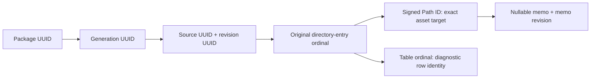
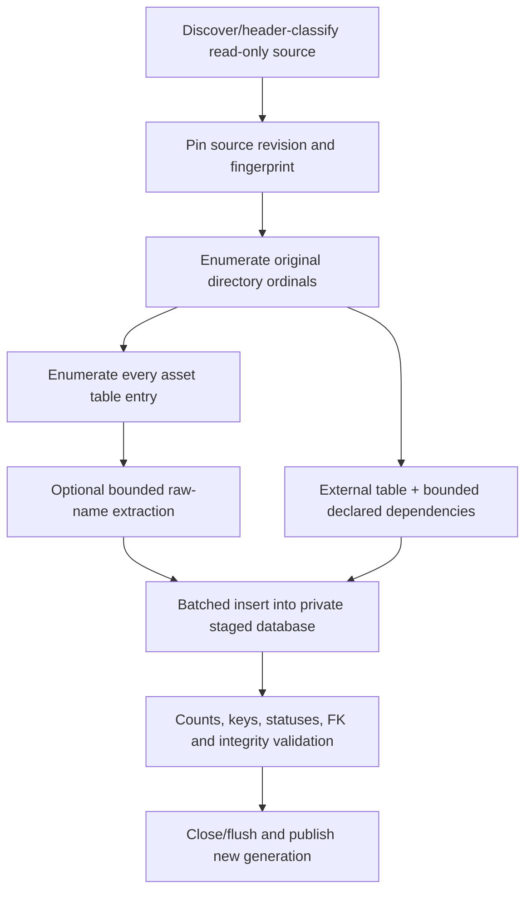

# Package Format V2 — Identity, Schema and Search Contract

**Date:** 2026-10-20. **Inspected baseline:** clean `3159778`.

**Approved architecture contract: D1–D8 approved by the user on 2026-10-20; production V2 is not implemented.** “Must” below defines the approved V2 requirements, not current application behavior or authorization to implement them. The [architecture audit](../05_audit/package-format-v2-architecture-audit.md) and [.NET spike](../05_audit/package-format-v2-dotnet-sqlite-spike.md) remain historical evidence; this specification supersedes their provisional recommendations where they differ. Production packages, services and the experimental implementation remain unchanged by this document. Evidence-dependent implementation details and numeric performance budgets remain subject to the gates below.

## 1. Goals, boundaries and decisions

One portable SQLite file per package; every discoverable serialized asset table entry retained; metadata-first indexing without image/audio/mesh decoding; exact identities; nullable memos; Unicode-correct Search; bounded selected-package queries. Source game files remain external and read-only.

No legacy reader/migration requirement, decoded payload storage, preview implementation, speculative search-provider framework, automatic memo matching across changed content, or production replacement in this task. Normal shutdown draining and crash-recovered drafts remain **deferred Stage 7**, distinct from SQLite transaction durability.

Approved baseline: local-filesystem `.uabs.sqlite` file, DELETE journal/FULL sync, immutable indexed metadata per generation, transactional memo-only writes, and application-side .NET matching as the semantic authority. FTS and persistent Unicode sort caches are optional accelerators, not correctness dependencies. The approval record is in section 10; implementation requires separate authorization under section 11.

## 2. Identity and revisions

### 2.1 Keys and lifetimes

Application UUIDs are opaque 16-byte values in a defined network-byte-order representation; do not use platform-dependent `Guid.ToByteArray()` encoding implicitly. Integer row IDs are local storage/FK keys, not transport identities.

| Identity | Approved key | Stability |
| --- | --- | --- |
| Package | `package_uuid` | Preserved by physical package move/rename and an explicit same-package reindex. Independent creation/fork gets a new UUID. |
| Generation | `generation_uuid` | New for any publication that changes indexed metadata/asset population; unchanged by memo edits or host-local source remapping. |
| Source occurrence | `source_uuid` | Assigned, not a pathname/hash. Preserved for a deliberately remapped same source; different occurrences with equal bytes are not automatically merged. |
| Source revision | `source_revision_uuid` | Preserved only for that same source with verified identical bytes; changed/unknown replacement gets a new value. Full SHA-256 is revision evidence, not the source's identity. |
| Logical serialized file | `(source_uuid, source_revision_uuid, directory_ordinal)` | Bundle ordinal is the **original directory-entry index**, including intervening non-serialized entries. Standalone serialized source uses 0. Never ordinal-after-filtering or CAB/name alone. |
| Addressable asset | `(package_uuid, generation_uuid, source_uuid, source_revision_uuid, directory_ordinal, path_id)` | Signed Int64 Path ID, valid only when exactly one indexed row resolves in that logical file. Name and Class ID are not key components. |
| Search row | Above provenance plus result kind and table ordinal | Distinguishes diagnostics/ambiguous table entries without making them editable asset identities. Package/source result keys contain only applicable immutable components. |

The source revision and package generation are intentionally separate: the former identifies the bytes behind a logical ordinal, the latter invalidates catalog snapshots/drafts on structural publication. Asset integer PKs may change on rebuild; nothing outside a live DB handle may target a memo using that PK alone.



### 2.2 Difficult cases and ambiguity

- Duplicate names, missing names and duplicate CABs do not affect keys. Same Path ID in distinct logical files/sources/packages is valid.
- Malformed duplicate Path IDs **within** a logical file remain separate table-ordinal rows, all marked ambiguous. Missing Path ID is incomplete identity. Search may display them; individual memo writes are unavailable. Never silently drop/merge them or use row PK/table ordinal to bypass ambiguity.
- Bundle directory ordinal is stable only within a verified source revision. Reordered directory entries in changed bytes do not inherit old identities, even if CAB and Path ID still match.
- A package move preserves UUIDs and memos. App registration path/location epoch changes, invalidating active cursors that included package-path matching/sorting. Renaming the file does not rename the stored package display name automatically.
- Source move/rename: confirm a selected source and strong byte fingerprint, then update the **host-local locator mapping**, not the indexed identity or recorded original paths. Changed indexed names/paths require a new generation. If multiple candidates fit, require a choice; a hash match alone never chooses which occurrence was intended.
- Deduplicate repeated selection of the same root/locator and verified identical physical source across overlapping roots. Each root declares Windows-style lexical or POSIX-style case-sensitive path-key policy; preserve exact original strings separately. Cross-root physical deduplication is a builder/validator invariant, not just the per-root SQL UNIQUE key. Reparse-point traversal is off by default. Equal hashes at distinct paths are not proof of one physical occurrence; unproven hard-link/alias cases remain distinct with a diagnostic. Case-policy/root-remap collisions fail validation instead of selecting first.
- Only one physical registration per package UUID may be active. Same-handle aliases deduplicate; a second independent copy—even byte-identical—requires unloading the first or explicit fork to a new UUID. Never merge divergent copied packages' memos.

### 2.3 Authoritative reindex and memo carry-forward policy (D3)

A structural reindex creates a new generation and preserves the package UUID only for an intentional same-package rebuild. Source identity follows section 2.1: preserve its UUID only for the verified same occurrence, and preserve its revision only when identical source bytes are verified. Carry forward **committed** memos, including NULL versus explicit empty, only when source UUID, verified identical bytes/revision, original logical-file ordinal and unique Path ID all match. Duplicate or incomplete targets cannot receive an automatic transfer. Changed bytes or an unverifiable revision means **no automatic carry-forward**, even when names, CABs or Path IDs happen to agree. Comparison-assisted transfer for changed sources is a separate, unapproved feature.

Review/drain active editors and pending drafts before replacement; never silently discard or retarget them. Failed or unresolved pending drafts block replacement unless the user explicitly preserves them as old-generation drafts or abandons them. Preserve the previous package generation as an explicit backup using section 9's coordinated publication/replacement policy. This is the authoritative V2 reindex policy, not legacy migration.

### 2.4 What AssetsTools.NET actually exposes

[AssetsToolsAssetSessionFactory](../../UABS.UnityAssets/AssetsToolsAssetSessionFactory.cs) already loops `DirectoryInfos`, `IsAssetsFile(index)`, `GetFileName(index)`, and `AssetInfos`. Inspection of the vendored DLL confirms directory `Name/Offset/DecompressedSize/Flags`; asset `PathId/TypeId/TypeIdOrIndex/ScriptTypeIndex/ByteOffset/ByteSize`; metadata `TypeTreeTypes/Externals/UnityVersion`; external references `Guid/Type/PathName/OriginalPathName/VirtualAssetPathName`.

There is no demonstrated universally unique CAB or Unity-provided per-bundle logical-file UUID. Ordinal + a verified source revision is the recommended conservative locator, **not a discovered universal Unity identifier**. The current neutral `AssetEntry` loses that ordinal and substitutes display fallback names; a future extractor contract must expose ordinal/table ordinal, raw nullable name/status and per-file versions. The spike's real fixtures each have one logical file; synthetic rows do not close the multi-file fixture gap. The inspected external GUID type is `GUID128`, four UInt32 fields `data0`–`data3`: `guid_bytes` is proposed as their concatenated big-endian 32-bit values (lossless logical-field encoding, **not** assumed on-disk byte order or System.Guid layout). Empty GUID evidence may remain 16 zero bytes but cannot establish a target. Test actual read/write GUID fixtures before enabling GUID resolution; never infer a self GUID from an incoming reference.

## 3. Approved SQLite DDL contract (V2.0)

This is the canonical metadata schema, not the spike's schema. Requires SQLite ≥3.37 for [STRICT tables](https://www.sqlite.org/stricttables.html). All connections enable foreign keys; builders/writers register `uabs_has_text_v1(text)`, returning `.NET !IsNullOrWhiteSpace` as 0/1 under the accepted text profile. Generic tools may read raw data but cannot safely write memos without the required function. No persistent custom text collation or FTS table is required to read this file.

```sql
PRAGMA application_id = 0x55414232; -- UAB2, distinct from legacy/spike
PRAGMA user_version = 20000;       -- major * 10000 + minor
PRAGMA foreign_keys = ON;
BEGIN;

CREATE TABLE package (
    singleton INTEGER PRIMARY KEY CHECK(singleton = 1),
    package_uuid BLOB NOT NULL UNIQUE CHECK(length(package_uuid) = 16),
    generation_uuid BLOB NOT NULL CHECK(length(generation_uuid) = 16),
    schema_major INTEGER NOT NULL CHECK(schema_major = 2),
    schema_minor INTEGER NOT NULL CHECK(schema_minor = 0),
    display_name TEXT NOT NULL,
    created_utc TEXT NOT NULL,
    indexer_version TEXT NOT NULL,
    text_contract TEXT NOT NULL CHECK(text_contract = 'dotnet-ordinal-v1'),
    derived_text_profile TEXT NOT NULL,
    catalog_revision INTEGER NOT NULL DEFAULT 0 CHECK(catalog_revision >= 0),
    index_status TEXT NOT NULL CHECK(index_status IN ('complete','partial'))
) STRICT;

CREATE TABLE source_root (
    root_id INTEGER PRIMARY KEY,
    label TEXT NOT NULL,
    original_base_path TEXT NOT NULL,
    path_policy TEXT NOT NULL CHECK(path_policy IN ('windows-lexical-v1','posix-lexical-v1'))
) STRICT;

CREATE TABLE source (
    source_id INTEGER PRIMARY KEY,
    source_uuid BLOB NOT NULL UNIQUE CHECK(length(source_uuid) = 16),
    source_revision_uuid BLOB NOT NULL CHECK(length(source_revision_uuid) = 16),
    root_id INTEGER NOT NULL REFERENCES source_root(root_id) ON DELETE RESTRICT,
    relative_path TEXT NOT NULL,
    locator_key TEXT NOT NULL,
    original_path TEXT NOT NULL,
    original_name TEXT NOT NULL,
    index_directory TEXT NOT NULL DEFAULT '',
    content_sha256 BLOB CHECK(content_sha256 IS NULL OR length(content_sha256) = 32),
    byte_size INTEGER CHECK(byte_size IS NULL OR byte_size >= 0),
    original_mtime_utc TEXT,
    kind TEXT NOT NULL CHECK(kind IN ('bundle','serialized','unknown')),
    index_status TEXT NOT NULL CHECK(index_status IN ('complete','partial','failed','unsupported')),
    dependency_status TEXT NOT NULL CHECK(dependency_status IN ('complete','partial','unavailable')),
    UNIQUE(root_id, locator_key),
    CHECK(index_status <> 'complete' OR content_sha256 IS NOT NULL)
) STRICT;

CREATE TABLE logical_file (
    file_id INTEGER PRIMARY KEY,
    source_id INTEGER NOT NULL REFERENCES source(source_id) ON DELETE CASCADE,
    directory_ordinal INTEGER NOT NULL CHECK(directory_ordinal >= 0),
    logical_name TEXT,
    cab_name TEXT,
    unity_version TEXT,
    serialized_version INTEGER CHECK(serialized_version IS NULL OR serialized_version >= 0),
    has_type_tree INTEGER CHECK(has_type_tree IS NULL OR has_type_tree IN (0,1)),
    declared_asset_count INTEGER CHECK(declared_asset_count IS NULL OR declared_asset_count >= 0),
    index_status TEXT NOT NULL CHECK(index_status IN ('complete','partial','failed')),
    UNIQUE(source_id, directory_ordinal)
) STRICT;

CREATE TABLE asset_type (
    type_id INTEGER PRIMARY KEY,
    file_id INTEGER NOT NULL REFERENCES logical_file(file_id) ON DELETE CASCADE,
    local_type_index INTEGER CHECK(local_type_index IS NULL OR local_type_index >= 0),
    class_id INTEGER CHECK(class_id IS NULL OR class_id BETWEEN -2147483648 AND 2147483647),
    script_type_index INTEGER,
    type_name TEXT,
    resolution_status TEXT NOT NULL CHECK(resolution_status IN ('resolved','fallback','unavailable')),
    UNIQUE(file_id, local_type_index),
    UNIQUE(type_id, file_id)
) STRICT;

CREATE TABLE asset (
    asset_id INTEGER PRIMARY KEY,
    file_id INTEGER NOT NULL REFERENCES logical_file(file_id) ON DELETE CASCADE,
    table_ordinal INTEGER NOT NULL CHECK(table_ordinal >= 0),
    path_id INTEGER,
    class_id INTEGER CHECK(class_id IS NULL OR class_id BETWEEN -2147483648 AND 2147483647),
    type_id INTEGER,
    byte_offset INTEGER CHECK(byte_offset IS NULL OR byte_offset >= 0),
    byte_size INTEGER CHECK(byte_size IS NULL OR byte_size >= 0),
    identity_status TEXT NOT NULL CHECK(identity_status IN ('addressable','ambiguous','incomplete')),
    name TEXT,
    name_status TEXT NOT NULL CHECK(name_status IN ('present','absent','failed','budgeted','unattempted')),
    name_ascii_key TEXT,
    memo TEXT,
    memo_revision INTEGER NOT NULL DEFAULT 0 CHECK(memo_revision >= 0),
    memo_nonblank INTEGER NOT NULL DEFAULT 0 CHECK(memo_nonblank IN (0,1)),
    UNIQUE(file_id, table_ordinal),
    FOREIGN KEY(type_id, file_id) REFERENCES asset_type(type_id, file_id) ON DELETE RESTRICT,
    CHECK(identity_status <> 'addressable' OR path_id IS NOT NULL),
    CHECK((name_status = 'present' AND name IS NOT NULL) OR
          (name_status <> 'present' AND name IS NULL)),
    CHECK(name_ascii_key IS NULL OR name IS NOT NULL)
) STRICT;

CREATE TABLE dependency (
    dependency_id INTEGER PRIMARY KEY,
    file_id INTEGER NOT NULL REFERENCES logical_file(file_id) ON DELETE CASCADE,
    relation_kind TEXT NOT NULL CHECK(relation_kind IN ('external_file','assetbundle_dependency')),
    declaration_ordinal INTEGER NOT NULL CHECK(declaration_ordinal >= 0),
    declaring_asset_path_id INTEGER,
    raw_path TEXT,
    raw_virtual_path TEXT,
    raw_cab TEXT,
    guid_bytes BLOB CHECK(guid_bytes IS NULL OR length(guid_bytes) = 16),
    external_type INTEGER,
    UNIQUE(file_id, relation_kind, declaration_ordinal)
) STRICT;

CREATE TABLE indexing_issue (
    issue_id INTEGER PRIMARY KEY,
    source_id INTEGER REFERENCES source(source_id) ON DELETE CASCADE,
    file_id INTEGER REFERENCES logical_file(file_id) ON DELETE CASCADE,
    asset_id INTEGER REFERENCES asset(asset_id) ON DELETE CASCADE,
    phase TEXT NOT NULL CHECK(phase IN ('discovery','fingerprint','file','table','name','dependency','validation')),
    code TEXT NOT NULL,
    severity TEXT NOT NULL CHECK(severity IN ('warning','error')),
    message TEXT NOT NULL,
    CHECK((source_id IS NOT NULL) + (file_id IS NOT NULL) + (asset_id IS NOT NULL) <= 1)
) STRICT;

CREATE INDEX ix_file_cab ON logical_file(cab_name) WHERE cab_name IS NOT NULL;
CREATE INDEX ix_source_name ON source(original_name);
CREATE INDEX ix_asset_identity ON asset(file_id, path_id);
CREATE UNIQUE INDEX ux_addressable_path ON asset(file_id, path_id)
    WHERE identity_status = 'addressable';
CREATE INDEX ix_asset_class ON asset(class_id, asset_id);
CREATE INDEX ix_asset_path ON asset(path_id, asset_id) WHERE path_id IS NOT NULL;
CREATE INDEX ix_asset_type_file ON asset(type_id, file_id);
CREATE INDEX ix_asset_ascii_name ON asset(name_ascii_key, asset_id)
    WHERE name_ascii_key IS NOT NULL;
CREATE INDEX ix_asset_with_memo ON asset(asset_id) WHERE memo_nonblank = 1;
CREATE INDEX ix_dependency_guid ON dependency(guid_bytes) WHERE guid_bytes IS NOT NULL;
CREATE INDEX ix_dependency_cab ON dependency(raw_cab) WHERE raw_cab IS NOT NULL;
CREATE INDEX ix_issue_source ON indexing_issue(source_id);
CREATE INDEX ix_issue_file ON indexing_issue(file_id);
CREATE INDEX ix_issue_asset ON indexing_issue(asset_id);

CREATE TRIGGER asset_initial_memo AFTER INSERT ON asset BEGIN
    UPDATE asset SET memo_nonblank = uabs_has_text_v1(NEW.memo)
    WHERE asset_id = NEW.asset_id;
END;
CREATE TRIGGER asset_memo_changed AFTER UPDATE OF memo ON asset
WHEN NEW.memo IS NOT OLD.memo BEGIN
    UPDATE asset SET memo_revision = OLD.memo_revision + 1,
        memo_nonblank = uabs_has_text_v1(NEW.memo) WHERE asset_id = NEW.asset_id;
    UPDATE package SET catalog_revision = catalog_revision + 1 WHERE singleton = 1;
END;
COMMIT;
```

### 3.1 Table/query and integrity rules

| Table | Expected access / integrity beyond DDL |
| --- | --- |
| package | Exactly one manifest, created before imports; version/profile/header must agree. Catalog revision counts changed memos, not save attempts. |
| source_root/source | Resolve host-local mappings, source results, original path/name/index-directory filters. Reject rooted/traversing relative paths and locator-key/policy inconsistencies. Root paths and original strings are provenance, not transport keys. |
| logical_file | All directory occurrences, including failed readable candidates. CAB is nullable/nonunique. Delete child data only while constructing/rebuilding a generation. |
| asset_type | Per-file serialized type metadata, not one global Class-ID→script-type dictionary. NULL local index permits unresolved type observations. |
| asset | One row per readable table entry. Class ID is stored directly for filtering, even unknown numeric IDs; NULL means genuinely unavailable. Type FK cannot point into another logical file. Validate non-null class agreement with type metadata. |
| dependency | Ordered raw declarations including empty/malformed strings; `raw_path` retains original serialized spelling and nullable `raw_virtual_path` independently retains virtual evidence (NULL differs from empty). Preserve `raw_cab`, GUID and external type. Never discard evidence after failed resolution. External metadata ordinal is zero-based; a PPtr external file ID would map through its separately defined 1-based convention. |
| indexing_issue | At most one direct owner; all NULL means package-wide. Stable code plus bounded message, not entire payload/stack dumps. |

`memo NULL` = missing; `memo=''` = explicitly empty; whitespace is retained verbatim. Memos stay on the asset row: a separate 1:1 memo table is not justified by the spike. Derived `memo_nonblank` is recomputed by the registered versioned .NET function. Do not add a pre-update CHECK tying it to the new memo value while relying on an AFTER trigger: such a check rejects clearing a previously nonblank memo before the trigger runs. Its semantic consistency is checked after trigger completion/on admission; supported APIs never update it independently. `name_ascii_key` exists only for printable ASCII raw names and contains ASCII-uppercase bytes; otherwise NULL. It is validated on publication, not computed by Unicode-unsafe `lower()`.

Completeness is explicit: index status describes source/logical/table coverage and revision confidence; optional absent/failing names/type labels do not drop rows or alone make asset-table coverage partial. Name statuses/issues and independent dependency status still report unavailable enrichment. “Complete asset index” must not be displayed as “all names and dependencies known.” Failed/unreadable tables do make coverage partial.

The addressable-path unique index prevents two addressable duplicates but does not by itself forbid a duplicate hidden under `ambiguous`: seal validation must mark **every** duplicate group ambiguous, and writes always count all matching rows. No asset-name/CAB uniqueness. Core schema has no arbitrary JSON-extension bag or decoded payload column; required future fields need an explicit schema revision. Optional accelerators belong to an app-owned disposable cache keyed by package/generation/catalog/text profile, not undocumented tables mixed into V2.0.

Child FKs cascade only with a deliberate generation rebuild; asset→type is RESTRICT. Delete assets before types/files when rebuilding. Supported published-package writers change memos only; structural changes create a new generation. Foreign keys alone do not validate counts/status/fingerprints/derived flags.

### 3.2 Version admission

**Explicitly approved pre-release amendment (Gate 2A, 2026-10-20):** add nullable `dependency.raw_virtual_path TEXT`; external-file `raw_path` comes from Gate 1 `OriginalPath`, never parser-normalized `Path`. AssetBundle dependency strings remain verbatim `Path`. Preserve virtual NULL versus explicit empty and existing CAB/GUID/type/order evidence without recomputing it. Reject a non-null external locator lacking original serialized evidence rather than inventing raw spelling; when both original and locator are unavailable, retain NULL. D1–D8 otherwise remain unchanged.

V2 has not entered production, so this explicitly approved amendment finalizes provisional **V2.0** directly: retain manifest 2.0, application ID and `user_version=20000`. Structural admission rejects pre-amendment files lacking `raw_virtual_path`, even when version markers match. No compatibility fallback, automatic upgrade or legacy migration; disposable pre-release outputs must be rebuilt explicitly.

Open existing files without `ReadWriteCreate`; verify SQLite signature, `application_id`, `user_version=20000`, manifest 2.0, expected tables/columns/constraints/triggers/indexes and text-contract support before exposing editing. Unknown major/minor/features are rejected, not silently opened writable; raw inspection may be a separate explicit tool. A recognized contract with an unsupported `derived_text_profile` is different: correct read-only raw scans remain possible while **all** profile-derived keys/flags/caches are ignored; saving requires explicit derivative revalidation under an approved runtime profile. There is no automatic legacy or future-version migration. Use a structural schema comparison, not a hash of whitespace in `sqlite_schema.sql`. `quick_check` plus FK/semantic validation runs off UI on first admission and after detected file replacement; publication uses full integrity/FK validation. Corruption reports an unavailable package and never auto-repairs/deletes it.

## 4. Metadata extraction contract



Future UI-neutral extractor records must carry source/revision context, original directory ordinal, table ordinal, nullable signed Path ID/Class ID, byte range, per-file Unity/serialized versions, raw logical name/CAB evidence, raw nullable name/status and diagnostics. Additional extractors enrich fields without changing keys. They must never require a preview-capable type or an arbitrary type whitelist.

1. **Discovery:** header-based supported-file classification, cancellation/progress, no symlink recursion by default. Missing/inaccessible explicit sources become failed-source records/issues, not successful zero-asset results.
2. **Revision:** full source-byte SHA-256 plus size and timestamp evidence. Timestamp/length alone are not a strong revision. Reuse the source-open lifecycle; full hashing/decompression costs must be measured. Deny concurrent source writes where the OS supports it; revalidate before/after parsing. Detected mutation discards that staged source. Non-cooperating Unix writes/ABA replacement cannot be ruled out by timestamps/two hashes alone; require an immutable source/snapshot when such writers are in scope, not a false guarantee.
3. **Logical files:** enumerate raw directory entries before filtering `.resS`/other resources; standalone uses ordinal 0. Preserve duplicate/empty logical names, record a failed candidate when its header/table cannot be read. No fabricated rows for an unreadable table; retain declared counts and issue evidence.
4. **Asset tables:** Path/Class IDs and ranges do not need full object deserialization. Keep nameless, unsupported, negative/unknown class and duplicate-path entries. Validate ranges; malformed identity is read-only/ambiguous, not guessed.
5. **Names/types:** type-tree/class-database metadata first; bounded leading `m_Name`/version-validated specialized name readers only. Per-file version selection replaces the current manager's first-database assumption. GameObject display prefixes and “Unnamed asset” are not raw searchable names. No `GetBaseField` on arbitrary textures/audio/meshes to find a name. On failure/budget exhaustion, store NULL plus status and keep the row. Empty actual names remain `''` with present status.
6. **Dependencies:** `Metadata.Externals` supplies ordered path/GUID/type metadata without decoding objects. Separately read `AssetBundle.m_Dependencies` with bounded field traversal; an unavailable type tree/budget failure yields partial dependency status, not “no dependencies.” Do not reopen only the first serialized file or scrape the first printable CAB token as a universal identifier. Resource references are file relationships, not phantom assets.
7. **Insertion:** prepared commands in bounded batches within the private build; class/type metadata and sources normalized, memos initially NULL unless an explicitly verified unchanged-revision rebuild copy applies. Cancellation abandons only invocation-owned staging output.
8. **Seal:** verify declared versus captured counts for complete files, all table ordinals, ambiguity groups, type ownership, memo flags/ASCII keys, source revision checks, FK and integrity. Partial files/sources propagate package partial status. Publish partial output only with explicit incomplete-index acknowledgement; no stale rows copied forward as if newly indexed. A source that yielded no readable table is distinguishable from a genuinely empty source.

Dependency resolution uses a selected catalog revision vector and preserves all occurrences. Referenced external GUID bytes are evidence, not a target's self GUID: the inspected API supplies no demonstrated universal self GUID, and V2.0 deliberately has no invented target-GUID column. A GUID-only edge remains unresolved unless a separate verified mapping supplies its target. Otherwise raw CAB/path/provenance evidence yields zero/one/multiple candidates. Exact contextual candidates may still be ambiguous. Do not import legacy one-character-prefix CAB compatibility into a regenerated V2 index. Cross-package targets are cache results with full immutable keys, **not cross-file foreign keys**. Unload invalidates resolved edges; raw declarations remain.

## 5. Unicode-safe Search semantics

The authority is current [PackageSearchService](../../UABS.UnityAssets/Packages/Search/PackageSearchService.cs) and [request normalization](../../UABS.UnityAssets/Packages/Search/PackageSearchModels.cs), not SQLite defaults or the spike's narrower `Query` API.

| Rule | Approved compatible contract |
| --- | --- |
| Terms | Split on `,` and `，` only; .NET trim, remove whitespace-only/empty terms; deduplicate with OrdinalIgnoreCase. Do not treat `、` as a separator or split internal whitespace. |
| Text | Literal `Contains(term, OrdinalIgnoreCase)`; ExactText uses whole-field `Equals(..., OrdinalIgnoreCase)`. No culture-sensitive casing, NFC/NFKC, accent removal, tokenization, wildcard syntax or implicit filename-stem conversion. |
| Candidate matching | For each requested result kind, selected fields form the candidate's searchable values. Any excluded term in any selected value rejects the candidate; otherwise any include term matching any selected value suffices (OR). |
| Fields | Package name/current registered package path; source name/original path/index directory/CAB/dependency declarations; asset raw name and optional memo. Preserve match-category flags and provenance. Missing/null and empty values do not match text. |
| Search memos | Adds memo to the asset's text fields, OR with name when both selected; ExactText/excludes apply to memo too. Not an implicit AND memo predicate as in the spike's combined benchmark. |
| Memo only | Additional `!IsNullOrWhiteSpace(memo)` gate on asset candidates only; independent of text-field choice. Preserve current package/source-kind behavior rather than silently reinterpreting this as an Asset-only switch. |
| Empty criteria | No include and no Path ID → no query/results; exclude-only or Memo-only without include/Path ID does not enumerate all. No selected fields without Path ID, no result kinds, or no selected packages → empty. |
| Numeric Path ID | Signed Int64 exact; suppress package/source candidates. With includes, an asset must also text-match; excludes still win. UI parsing retains current invariant integer validation. |
| Types | Legacy package Search has no Unity-class filter; ResultKinds is not a type filter. Proposed optional Class-ID and resolved-type-name filters are explicit new AND gates on assets; do not infer from filenames/Path IDs. A request using these gates must explicitly select Asset-only results. |
| Chinese/Unicode | Same literal operations as other valid Unicode. Two-character CJK terms must work. Canonically equivalent combining sequences need not match under ordinal semantics; no silent normalization is added. |

V2 raw-name contents may differ from legacy generated display strings: nameless assets do not acquire searchable “Unnamed asset”; that remains a UI label. This is a metadata-correction decision, not a new case-matching algorithm. Memos preserve all valid Unicode including whitespace/control characters; malformed UTF-16 input must fail pre-commit with retained draft rather than undergo lossy UTF-8 replacement. Extractor decode failure is diagnosed, not substituted as a real name.

`dotnet-ordinal-v1` denotes the accepted reference operations and conformance vectors, not an assertion that `ToUpperInvariant` is equivalent. Each search token binds to the runtime/comparer profile in use. A runtime/comparer change invalidates cursors and derived caches; new releases must run multilingual/non-BMP/combining/I/ß/control-character vectors against the production reference before declaring the same profile compatible. [Microsoft's comparison guidance](https://learn.microsoft.com/en-us/dotnet/standard/base-types/string-comparison-net-5-plus) notes that ordinal-ignore-case behavior can evolve.

`derived_text_profile` identifies the accepted casing/whitespace implementation that produced persisted derived flags (initial validation reference: .NET 9.0.5). It is an implementation-owned, versioned profile, not the current OS culture or a guessed Unicode-version number. A small test vector is regression evidence, not proof of equivalence for every Unicode scalar. Unknown profiles cannot use the `memo_nonblank` partial index: Memo-only falls back to the registered current .NET whitespace predicate. Explicit writable revalidation recomputes derived fields without changing raw names/memos or memo revisions, changes the profile and increments catalog revision atomically; no silent upgrade or mixed-profile memo writes.

## 6. Query planning and Unicode trade-off

**Correctness baseline:** use a connection-registered .NET literal predicate for all unresolved candidates, parameterized values, and the same .NET comparisons for ordering. SQLite built-in `LIKE`, `NOCASE`, `lower()` and FTS tokenization are not the reference. A post-filter cannot fix candidate false negatives.

Baseline V2.0 planner (optimizations still require equivalence evidence):

1. Apply selected-package scope, result kind, exact logical identity/numeric Path ID and Class ID before text. Use B-trees and the partial nonblank-memo index when selective.
2. For an ExactText printable-ASCII name term, use `name_ascii_key` for the printable-ASCII partition **union** a .NET-evaluated non-ASCII/control partition. Never assume an ASCII query cannot have an ordinal-case match in non-ASCII input. Multiple include terms/fields require the union of **all** include branches before excludes/gates, deduplicated by result row key.
3. Non-ASCII, short, punctuation/control and mixed-field terms default to cancellable bounded scans with authoritative predicates. Do not disable all indexing for an entire package merely because one memo contains Unicode; numeric/ASCII-name branches remain usable.
4. Optional trigram cache may accelerate a proven-safe selective subset; it must include uncovered rows/fields or fall back. Use count/statistical estimates, a candidate-work budget and measured selectivity. Broad `asset` or combined predicates must not blindly build intersected `IN(FTS...)` sets. Switching plans before output preserves the same cursor/order; never silently truncate candidates.
5. Name/memo edits update or invalidate affected derived caches before exposing them as complete; lack of an accelerator must never block correct Search. Cache identity includes package/generation/catalog revision, schema and comparer/tokenizer versions. No approximate index may exclude results without a completeness proof.

The spike measured a 100-row direct scan at ~1.4 ms versus ~141 ms with broad FTS candidates at 1M assets, and full broad materialization reached ~2.8 GiB aggregate process peak. FTS is optional for this reason. Trigram MATCH misses <3-character terms; LIKE's default non-ASCII casing differs, and literal wildcard escaping can defeat trigram optimization. [SQLite FTS5](https://www.sqlite.org/fts5.html#the_trigram_tokenizer)

**Explicit D4 trade-off:** preserve Unicode semantics now, accepting scan/external-sort cost until a proven multilingual index exists. Canonical names/paths use SQLite BINARY storage/indexes only. For current user-selected text ordering, register read-query .NET ordinal comparers; do not create persistent custom-collation indexes in V2.0. SQL can spill sorting to bounded temporary disk instead of loading the result universe into application memory. Such text sorts may still scan/sort many rows per page: this is not a latency guarantee. A versioned app-cache sort index or verified sort-key encoder is an independently measured optimization, not silently equating UTF-8 BINARY, SQLite NOCASE, .NET UTF-16 Ordinal and ToUpperInvariant. Numeric/identity-ordered paths remain cheap. [SQLite LIKE rules](https://www.sqlite.org/lang_expr.html)

### 6.1 Performance acceptance protocol

Correctness is a prerequisite, not a latency trade-off. Compare complete identities, nullable values, match categories and ordering with authoritative .NET predicates (and current `PackageSearchService` for equivalent supported requests). Exhaust pages outside first-page timing to prove identical membership/order with no gaps or duplicates; raw-name/type additions need an independent reference oracle. Faster incomplete candidates fail. If correct Unicode queries exceed budget, profile predicates, candidates, sorting, I/O and allocations and require a semantically equivalent optimization—not relaxed matching.

Use disposable seeded corpora at **10k, 100k and 1M total assets**, initially eight packages, following the spike distributions. Add a labeled mixed-language corpus at each size with recorded CJK/Latin/non-ASCII proportions, null/empty names, duplicate names/IDs, Unicode whitespace, long memos and unknown classes. Include real-fixture metadata and, when available, permissioned representative real metadata; synthetic timings do not prove real extraction performance. Proposed many-package stress points are **32 and 128 selected packages**, first holding total rows constant, then scaling rows separately: these are test sizes, not measured support claims. Cover selective, zero-hit and broad membership, all result kinds, both sort directions and late pages.

Record seed/data hash, result counts/digests, code/schema/plan, provider/native/.NET/comparer versions, CPU/RAM/OS/storage, journal/sync, connection lifecycle, concurrency, sort and page size. Run sequentially without competing benchmarks: two untimed warm-ups then **20 measured queries**, reporting median/p95/range; **three fresh-process runs**, separately reporting samples/median (OS-cache-warm, not disk-cold). Build three fresh disposable indexes and report samples/median. Equality hashing stays outside timing consistently. Do not flush OS caches or terminate user processes; physical cold-I/O remains unmeasured unless separately authorized and controlled.

Measure first-page wall time from normalized request through merged DTO readiness, subsequent latency by page position, predicate/native/sort time, scanned/materialized rows, handles, temporary-disk high water, managed allocations and sampled process working set/private bytes/peak including native memory. Record baseline and peak in isolated runs; distinguish explicitly retained UI rows from backend buffers. Keep full-result oracle runs out of bounded-query memory measurements. UI paint latency is a separate later acceptance metric, not inferred from service timing.

### 6.2 Workload gates and budget calibration

Apply section 6.1's sizes/repetitions to each row unless stated otherwise. **All numeric acceptance thresholds are pending calibration** on an agreed reference machine/corpus. Budget names below propose what to bound, not measured values or universal targets. At gate 3, record and obtain approval for numeric median/p95, memory/disk and regression allowances **before performance acceptance**. Unset budgets mean pending, not passed. Retain approved baseline/artifacts for equivalent regression comparisons; unexplained regressions require profiling/review, not silently increasing limits.

| Workload / method | Required success evidence | Proposed budget (numeric value pending calibration) |
| --- | --- | --- |
| Exact name and signed Path ID, separately/combined; duplicates across files/packages | Full reference equivalence; inspect numeric index and Unicode-safe exact-name plan; first page and exhaustion timed separately | `Lookup`: median/p95 and scanned rows, including zero-hit/non-ASCII exact terms |
| Selective ASCII substring, OR includes, punctuation and no match | Equivalent results with/without acceleration; complete candidate coverage; same-data scan comparison | `Selective`: median/p95, candidate amplification and accelerator-size overhead |
| Two-character Chinese substring (e.g. `钩爪`) in names/memos | Matches despite trigram's short-term limitation; full ordered-page agreement | `CjkShort`: first/late-page median/p95 and scan/sort work; no comparable repeated .NET baseline yet |
| Mixed-language/non-ASCII, non-BMP, combining/case vectors; 1/2/3+ character terms | Exact ordinal behavior; Unicode rows do not disable unrelated index paths | `Unicode`: median/p95 by term length/selectivity/profile; profile slow fallbacks |
| Memo-only and memo substring, alone/with name and after memo writes | Valid include or Path ID for memo-only under current request rules; NULL/empty/Unicode whitespace, OR and profile fallback agree | `Memo`: selective/broad median/p95; no changed membership semantics |
| Combined class/Path ID/selected fields and exclusions, exact/substring | Excludes win; include branches complete; package/source behavior preserved; class gate asset-only | `Combined`: median/p95 and candidate work versus equivalent unaccelerated plan |
| 8/32/128 selected packages, equal/skewed populations, workers 1/2/4 | Same order/provenance; unselected packages absent; bounded handles; cancellation/unload release ownership | `Federation`: first/next-page median/p95, registration cost and memory/handle ceilings per scope |
| Pages of 100/500 rows, early/middle/final positions, all sort options | Primary/tie/null order; no gaps/duplicates on exhaustion; stale cursor explicit, no restart | `Paging`: first-page and position-dependent next-page p95; investigate OFFSET-like growth |
| Broad near-all queries (e.g. `asset`); counts timed separately | No eager full result list, silent cap or false completion/count; cancellable external sort respects disk limits | `Broad`: first/late-page/count median/p95, cancellation deadline, temp-disk ceiling |
| Memory: selective versus near-all at fixed scope/workers/page size, 10k→1M | Instrument backend buffering O(packages + workers × page size), not total matches; separate SQLite cache/sort/temp disk and retained UI pages | `Memory`: incremental/peak managed and process bytes, cache/temp ceilings; no million-row snapshot hydration |
| Index creation/size: three fresh builds per size; real extraction separately | Same rows/metadata/diagnostics; validated closed DB; no payload decoding; source hashes unchanged; time discovery/hash/decompress/extract/insert/index/seal/publication | `Build/Size`: end-to-end time, assets/s, MiB/bytes per asset, transient disk/peak memory; optional-index cost itemized |

Historical anchors, **not acceptance thresholds**: the [.NET spike](../05_audit/package-format-v2-dotnet-sqlite-spike.md) at 1M/eight packages measured full-result exact name **20.04 ms**, Path ID **17.07 ms**, selective substring **22.73 ms** with its trigram policy, memo-only **740.78 ms**, and broad **4632.86 ms** with trigram policy. Its direct **single-package** 100-row scan was **1.37 ms**, versus **140.97 ms** forced FTS; neither measures a globally sorted federated page. Worker 1/2/4 selective medians were **23.32/17.06/12.91 ms**. FTS storage was **161.84 MiB**; insert/B-tree/FTS phase medians **6896.9/2730.7/2243.5 ms** are not an end-to-end build median. Aggregate **2828.9 MiB** process peak included baseline/result snapshots and is a warning, not a memory allowance.

The [Python audit](../05_audit/package-format-v2-architecture-audit.md) supplies 10k/100k/1M storage/full-result evidence (1M compact JSON **116.42 MiB**, SQLite **176.91 MiB**, SQLite+FTS **209.54 MiB**), but differs in schema/runtime/result fields/allocation. Neither report measures approved-DDL Search, current global sorts, representative short-Chinese/mixed-language workloads or 32/128-package federation. Reuse comparable methodology/datasets and rerun equivalent plans on the same machine; label non-comparable figures rather than claiming production speedups. No new benchmarks were run for approval.

## 7. Batch federation and pagination

### 7.1 Session and ordering

`SearchSession` captures immutable normalized request, selected registration IDs/locations, package UUID + generation + catalog revision vector, location epochs, comparer profile and cancellation/generation token. Filters on the package selector do not change scope; explicit inclusion/deselection does. Unselected packages cannot contribute results. Default bounded workers = 2, configurable cap 4 pending real-disk measurement; at most one owned connection/command per active worker. Do not use ATTACH as unbounded federation (the spike build permits 10).

Retain existing primary sort options/direction and current tie chain: package name, package path, index directory, source path, asset name, nullable numeric Path ID, result kind. Text comparisons use OrdinalIgnoreCase then Ordinal; null precedes non-null. Only the primary comparison reverses for descending; ties remain ascending, as current code does. Add a final immutable result-row key tie-break (UUID bytes, source/revision, directory/table ordinals). This stabilizes previously equal rows without depending on mutable display labels. Active session snapshot freezes all sort values.

### 7.2 Page contract

`ReadPage(session, opaqueCursor?, pageSize)` returns ordered rows, next cursor, has-more, captured revision vector, count state and coverage/warning summary. Recommended default 100, maximum 500, validated before querying. Cursor includes request/scope/comparer hash, revision/location vector and complete sort/null/direction/immutable tie values; reject mismatches with `StaleCursor`, not OFFSET fallback. Cursor handles are process/session-scoped, not durable across restart; tuple components are typed/length-delimited, never concatenated display strings. A numeric-ID tuple alone cannot paginate a text sort. Use lexicographic continuation with explicit nullable ranks and the same comparers; mixed primary-desc/tie-asc requires expanded comparison predicates rather than a blindly descending row tuple.

Fetch bounded per-package heads/chunks, k-way merge globally, and fetch full memo/metadata for the emitted page only. Keep one lightweight head per selected package plus bounded worker buffers: application buffering O(selected packages + workers × page size), not O(total matched assets). Persist continuation **after the last emitted row**, never after a prefetched but unconsumed row. Failed/cancelled pages advance no public cursor. A resumable `PagePending` requires a real plan checkpoint (for example a scan frontier in known sort order), not an invented cursor over an interrupted sort. Native text-sort deadline exhaustion returns an explicit query-budget failure unless a separately implemented resumable disk-backed plan exists; no apparently empty terminal page or endless restart is acceptable.

Keyset pagination is preferred to repeated OFFSET, whose skipped-row work grows with position. SQLite row-value examples are useful for compatible non-null ascending tuples, not a substitute for our mixed/null/text comparator. [SQLite scrolling windows](https://www.sqlite.org/rowvalue.html)

Per-package read transactions are short, off UI, and closed before user think-time. Capture/check generation/revision before/after each local page and recheck the selected vector before publishing. This is revision-consistent federation across cooperating writers, **not** an atomic multi-database snapshot. No long-held all-package read transactions, unlimited result lists or native handles in a UI cursor. UI virtualization alone does not bound an already materialized service list.

### 7.3 Changes, counts and cancellation

- Memo/catalog revision changes invalidate further pagination/count jobs. Preserve displayed rows/selection/scroll and continue applying verified memo deltas to **all** exact matching displayed rows without re-running, re-filtering, removing or reordering them. Show a noticeable but unobtrusive stale-results state consistent with the existing Search workspace and a clearly labeled **Refresh Search** action that explicitly starts a new session. Reject continuation with `StaleCursor`/stale-session state; never silently restart, skip results or append newer-revision pages to old membership. Invalidate exact-count claims while retaining clearly labeled loaded-row counts and coverage warnings. This is an approved future UI requirement, not implemented Search UI.
- Structural generation change/unload cancels relevant work and marks stale rows/targets unavailable. Move/remap/location change also invalidates cursors. New selections create a new session; old completions cannot publish.
- Default counts are `LoadedAtLeast(n)`, `Exact(n)` only after exhausted enumeration or an explicit cancellable count over the same vector. Exact means matches in the indexed data, not proof about missing sources/unavailable fields; retain coverage/enrichment warnings with zero results too. Counts may be unknown/stale; no compulsory COUNT scan before first page. Optional estimated counts must be labeled estimates, never used to prove end-of-results.
- Cancellation covers semaphore waits, .NET predicate loops, native queries via `sqlite3_interrupt`, sorting and count jobs. Register interruption only against the worker-owned handle; unregister before reuse/disposal. Distinguish cancelled, unavailable package, stale session and malformed cursor. Never publish an apparently complete partial batch after an error.
- Connections close/return to a bounded pool after each page. Unload waits for owned workers to finish/cancel before releasing registration/handles; it does not delete failed drafts. No observed timeout authorizes killing processes or deleting SQLite sidecars.

## 8. Memo persistence and existing Stage 1–6 integration

### 8.1 Request and transaction

Request: full immutable addressable AssetKey, desired nullable memo, expected original nullable memo, expected memo revision, optional strict expected catalog revision, and cancellation. Capture identity before async work; never derive destination from current selection or a row PK supplied without revalidation.

Under the application write coordinator and same-process editor eligibility guard:

1. Open/admit the registered file and begin an immediate write transaction. Recheck package UUID/generation and optional catalog revision. Resolve source UUID/revision + ordinal + Path ID; require exactly one matching row across **all** identity statuses and addressable status.
2. Check expected memo revision and exact original value (SQL `IS` preserves NULL/empty, no trimming/case folding). If unchanged, verify/read and return Unchanged without revision increment.
3. Update only `memo` using all key/precondition gates. The trigger recomputes nonblank and increments memo/catalog revisions atomically. SELECT the updated revision inside the transaction; **UPDATE RETURNING does not include later AFTER-trigger changes**, so do not trust it for that revision. This was exercised against the bundled provider and matches [SQLite's RETURNING caveats](https://www.sqlite.org/lang_returning.html).
4. Honor cancellation before commit by rollback. Once committing, finish/read back without abandoning a partial transaction. Read freshly on an independent connection, verify key/value/revision, then publish while still inside application coordination.
5. Return structured `Saved`, `Unchanged`, `PackageMissing`, `GenerationChanged`, `MissingAsset`, `Ambiguous`, `EditorActive`, `RevisionConflict`, `Busy`, `ReadOnly`, `InvalidText`, `WriteFailure`, `VerificationFailure`, `PublicationFailure` or `CancelledBeforeCommit`, with desired text and committed-state information.

If another process commits between our commit and verification, a newer target revision yields `CommittedButSuperseded` (draft retained; no blind overwrite retry), not a claim that rollback occurred. Verification/publication failure after commit is explicitly “may/already changed disk.” Exact desired memo and committed revision must be verified before green Saved. No automatic merges.

Approved D6: per-asset memo revision + generation for ordinary memo saves, optional whole-catalog precondition for conservative callers; explicit Package Editor Save always checks its base generation/catalog revision in the write transaction. This intentionally differs from V1 whole-tree fingerprints; implementation still requires separate authorization. Trigger-managed counters serialize supported cross-process writers; SQLite locks alone do not prevent stale application clones. Deliberate trigger/schema bypass, arbitrary file replacement or nonconforming editors are unsupported; validate/invalidate on detection rather than claiming counters detect all tampering.

### 8.2 Reuse/adaptation map

| Existing part | Proposed disposition |
| --- | --- |
| `PackageWriteCoordinator` | Reuse serialization/lifetime pattern; adapt canonical registration key and hold through verified publication. Not a cross-process editor lock. |
| `PackageMemoIdentity` / resolver | Redesign key DTO/lookup to include package generation/source revision/logical ordinal, remove name/path identity. Assets lookup requires a unique package linkage; Search retains its producing package key. |
| `MemoDraftCoordinator` | Reuse debounce 1.5 s, shared per-identity draft/state, Save Now/Retry, draft revision/stale-completion guards and navigation flush behavior; adapt key/revision/persistence contracts. Not literally unchanged source because DTOs change. |
| Inspector Views/save states | No new workflow needed; reuse eligibility/status presentation, confirmed versus draft values and full memo display. |
| `PackageMemoPersistenceService` / revision provider | Replace whole-directory reload/hash/rewrite with the transaction above. Preserve structured failures and failed drafts; no direct index-file edits. |
| Package Editor guard | Preserve exclusion while this process has the same package open, clean or dirty. Cross-process Inspector exclusion is not currently guaranteed; base-revision checks prevent lost editor updates. Global editor leases require a separate approval/design. |
| Package Editor and memo copy | Preserve isolated dirty state and explicit Save/Discard/Cancel; adapt snapshot/base-revision transaction. Changed-source memo copy must be explicit, never name-only automatic carry-forward. |
| Catalog/Search row publication | Adapt whole-document replacement to verified, monotonic generation/revision deltas on the UI dispatcher; update all exact matching rows, even if selection moved. Never rerun Search or overwrite a dirty editor clone. |

Drafts for old generations remain recoverable/unavailable rather than retargeted. Missing original Unity files do not prevent editing an unambiguous indexed memo; flag stale/missing source separately. Unloaded/read-only/corrupt packages disable saving and retain failed text for Retry after explicit recovery. Navigation flushing saves the identity being left; later selections cannot receive its completion. Normal application closing/crash-recovered drafts remain deferred and are not solved by these database guarantees.

An unavailable name, Class ID or type label alone never disables a memo on a unique complete asset key. Ambiguous/incomplete identity does; do not recreate the old Texture2D/Sprite eligibility restriction.

Reuse classification: unchanged View bindings/generic command-dispatch behavior and proven timer/state-machine algorithms can remain. Registration, DTO/key/revision and publication **adapters** rewire those behaviors. The persistent reader/writer, full-document catalog and source/logical identity construction need **redesign**. No existing identity-bearing service is promised drop-in binary compatibility merely because its user-facing behavior is reused; Windows path-comparison helpers also cannot silently become POSIX identity rules.

## 9. Portability, publication and reliability

- Canonical package is one `.uabs.sqlite` file; no marker, source copies, preview files or required adjacent manifest. Source roots/relative paths/original absolute strings are in the DB; machine-specific root overrides and registration/cache data live outside it. Loading/searching never opens original sources merely to find metadata.
- Initial creation uses a unique same-directory staging file, builds/validates fully, checkpoints if any experimental WAL was used, closes all handles, flushes and publishes by same-filesystem no-overwrite rename. Existing destinations are refused unless an explicit coordinated replacement operation was authorized. Never hold an open DB across rename/replacement; backup old generation and use a platform-tested atomic replace primitive where supported. If atomic replacement cannot be guaranteed, fail or publish a new destination—do not pretend the legacy two-directory rename gap is atomic.
- Default DELETE journal/FULL sync on supported local filesystems. SQLite temporary `-journal` is legitimate during a write/recovery; never delete it manually. Copy/move only after quiescing all local handles **and other writers**, or use the SQLite backup API to an independently validated file. Live main-file copying is not a backup. WAL is a separate opt-in decision with checkpoint/backup/sidecar policies, not baseline portable packaging. [SQLite WAL constraints](https://www.sqlite.org/wal.html)
- Read-only admission uses a read-only connection and does not build caches inside the package or open with `immutable=1` while another writer may exist. A hot journal that needs recovery but cannot be recovered read-only is an actionable unavailable/read-only-recovery condition; do not bypass it. Concurrent short readers and memo writers use busy deadlines and cancellable worker policies, not UI blocking or unlimited retries.
- Source freshness is an overlay: timestamp/size checks give a cheap warning, full hash provides strong comparison when requested. Missing/remapped/changed/unverified are distinct. Indexed source revisions remain historical facts; metadata Search can continue with warnings. New bytes are not silently relabeled as the old revision.
- App registry/file-handle identity plus manifest/generation checks detect ordinary moves/replacements; file change observation/data-version tokens invalidate caches but are not durable portable revision proofs. Arbitrary external renames/copies while writable handles exist are unsupported; SQLite transactions do not lock directory namespaces on all OSes. In-place schema changes, malicious writers, flaky/removable/network filesystems, disk-full/power-loss durability and platform-specific replace semantics require dedicated fault/RID validation before support.
- UUIDs are not authenticity signatures. Package/schema/foreign-key validation cannot make untrusted SQLite contents safe without resource limits: cap string/diagnostic lengths and page/temporary-disk budgets, disable extension loading, parameterize SQL, and allowlist expected schema objects/triggers/functions. Unknown schema/corruption disables writes, never auto-fixes user data.

## 10. Approved decisions D1–D8

**All eight decisions formally approved by the user, 2026-10-20.** Approval freezes architecture, not evidence still to be collected, numeric performance thresholds or permission to implement. Gate 2A's separately approved pre-release dependency-path amendment is recorded in section 3.2; no other D1–D8 decision changes. Earlier audit/spike recommendations are historical, not competing policy.

| ID | Approved contract | Evidence still required / boundary |
| --- | --- | --- |
| D1 — Approved | One portable local `.uabs.sqlite`, DELETE journal/FULL sync, no mandatory adjacent metadata/WAL sidecars; staged validated publication, never live main-file copying for backup. | Linux/macOS deployment and filesystem/replace/fault behavior need validation. WAL, network support and unsupported storage are not approved baseline capabilities. |
| D2 — Approved | Assigned package/source UUIDs, explicit generation/source revision, original directory ordinal and signed Int64 Path ID; names/CABs never unique keys. Missing/duplicate IDs remain visible but unavailable for individual memos. | Real multi-logical-file and duplicate-CAB fixtures must pass before production reliance. GUID resolution still needs verified evidence. |
| D3 — Approved with clarification | Section 2.3 is authoritative: intentional same-package reindex keeps package UUID, creates generation; committed memos transfer only across verified unchanged source identity/bytes/revision + ordinal + unique Path ID; backup old generation and protect drafts. | No automatic changed/unverified-source transfer. Future comparison-assisted transfer is separate and unapproved. |
| D4 — Approved | .NET OrdinalIgnoreCase and current include/exclude/delimiter/exact/memo/null/Path-ID semantics are authoritative. Correct fallbacks and versioned profiles/caches; only proven-complete equivalent acceleration. | Section 6 performance calibration/conformance must pass; no correctness sacrifice for SQLite LIKE/NOCASE/FTS/normalization. |
| D5 — Approved with clarification | Bounded deterministic global keyset pages with exact provenance; stale revision vector blocks continuation, retains rows/selection/scroll and verified memo synchronization, exposes explicit Refresh Search. Accurate labeled counts/coverage; no silent rerun, removal/reordering or new-revision appends. | UI is a later gate; noticeable/unobtrusive stale feedback. No unbounded result materialization; numeric budgets pending calibration. |
| D6 — Approved | Normal memo conflicts use asset memo revision + package generation + expected original, preserving NULL/empty; stricter editor base-generation/catalog checks and local editor exclusion; transactions, verification, structured failures and Stage 1–6 coordination via adapters. | No silent merge/newer-draft overwrite. Global cross-process editor leases are **not approved**. |
| D7 — Approved | Every discoverable table entry, raw nullable names/status and available unknown Class IDs; no generated searchable fallback or full content decoding. Ambiguous/incomplete identities read-only; partial coverage publication needs explicit acknowledgement and differentiated enrichment warnings. | Real malformed/partial/version fixtures and completeness checks; missing optional enrichment must not be mislabeled missing asset coverage. |
| D8 — Approved | Clean V2.0 admission rejects unsupported schema; no legacy migration, automatic upgrades, speculative compatibility layer, decoder redesign or unrelated UI. | Memo Stage 7 normal-shutdown/crash-recovery safeguards remain deferred by user decision, not solved by SQLite durability. |

## 11. Implementation gates and authorization

Current isolated Gate 1/Gate 2/2A evidence and limitations are recorded in the [Gate 2 storage report](../05_audit/package-format-v2-gate-02-storage.md). Production V2 and Gate 3 have not started; the acceptance requirements below remain applicable, not automatically satisfied by an isolated implementation.

Each gate is separately reviewable and requires its own explicit implementation request. D1–D8 approval authorizes **none** of these implementations. Preserve the working V1 production path until a separately authorized replacement is verified; no implicit conversion, real-data overwrite or removal. Failed/unmet evidence blocks promotion, not a silent scope expansion.

1. **Metadata extraction contracts and real fixtures.** Dependencies: approved identity/raw-name/version contract. Scope: UI-neutral records for original logical/table ordinals, raw names/status, ranges, per-file versions and external evidence; no production loader/writer switch. Tests: real multi-logical-file and duplicate-CAB cases, signed/duplicate/missing IDs, unknown classes, version differences, failed tables, bounded name/dependency reads, GUID evidence and no decoder calls. Performance: separate hash/decompression/table/name costs and peak memory on representative read-only sources. Safety: immutable originals, disposable outputs, source hashes unchanged. **Exit/approval:** review fixture coverage and contract evidence before gate 2; no production reliance while real identity fixtures are missing.
2. **Standalone V2 SQLite builder/reader.** Dependencies: gate 1 verified metadata; approved DDL/admission/publication. Scope: isolated build/read, local DELETE/FULL, generation and D3 carry-forward/backup rules; no app routing. Tests: schema/FK/integrity/ambiguity/count/invalid-text/partial acknowledgement, reindex identity and NULL/empty carry-forward, source-change refusal, cancellation, disk-full/interrupted build/atomic publication faults, duplicate registration, read-only/hot-journal and supported-RID deployment. Performance: section 6 creation/size/memory phases, three builds per scale; separate real extraction. Safety: disposable databases only, invocation-owned staging cleanup, no live copying or real package replacement. **Exit/approval:** review storage/fault/RID evidence before isolated Search work; this does not authorize production registration.
3. **Exact Search translation, Unicode and bounded federation.** Dependencies: gate 2 admitted readers plus current request/reference semantics. Scope: isolated adapter, ordering/keyset cursors, counts/coverage/stale-session contracts and complete candidate plans. Tests: differential membership/provenance/order, Unicode/non-BMP/combining/short CJK, all fields/kinds/empty/excludes, mixed directions/null keys, late pages, scope/revision invalidation, cancellation/unload and bounded handles. Performance: all applicable section 6 workloads, including 32/128 packages; calibrate and approve numeric budgets, compare complete results, instrument native/managed memory and external sorting. Safety: disposable metadata; never source-load or mutate packages while searching. **Exit/approval:** correctness and calibrated performance evidence required before production Search authorization; optimization failures cannot change matching semantics.
4. **V2 memo persistence and editor coordination adapters.** Dependencies: gates 1–3 keys, revisions and publication contracts; existing Stage 1–6 behavior. Scope: isolated V2 transaction/draft/editor/catalog adapters, not UI rollout. Tests: expected original/revision, NULL/empty, trigger timing/rollback, concurrent independent processes, editor clean/dirty exclusion and strict base revision, superseded commit, verification/publication failure, exact-row deltas, stale completions and failed-draft retention. Performance: verified single-memo latency/write amplification plus bounded Search-reader contention; calibrate separate budgets rather than reuse the spike's unintegrated memo timing. Safety: disposable fixtures; no implicit dirty-editor save or automatic conflict merge; Stage 7 still deferred. **Exit/approval:** review transaction/fault/full-regression and zero-Unity evidence before any production composition change.
5. **Production Packages/Search/Assets integration.** Dependencies: gates 1–4 accepted and **separate explicit production-integration approval**. Scope: composition, lightweight registration, creation/loading, inspectors/editor adapters, bounded Search UI and D5 Refresh Search. Tests: full regression, all-exact-row memo synchronization, selection/scroll retention, stale counts/cursors, dirty editor/draft ownership, legacy-path nonregression and Unity dependency audit. Performance: calibrated gates on the actual Debug startup application, including catalog readiness and separately measured UI paint/interaction; visual acceptance is user-driven. Safety: retain working V1 implementation, disposable opt-in V2 outputs, no migration/real-package writes. **Exit/approval:** user accepts production behavior before final retirement evaluation; integration alone cannot remove V1.
6. **Final acceptance, benchmarking and legacy-format retirement.** Dependencies: accepted gate 5 and separate authorization for removal of old production-format code. Scope: equivalent-result performance report, fault/deployment matrix, complete docs and deliberately scoped retirement—not deletion of old user packages or a migration layer. Tests: full regression and zero-Unity audit, native packaging, build/read/search/memo/editor/publication failures and user acceptance. Performance: all section 6 calibrated budgets with retained artifacts, repeated representative real metadata and many-package workloads; explain regressions and unresolved platform limits. Safety: backups and user data untouched; no unsupported-platform or Stage 7 recovery claims. **Exit/approval:** explicit acceptance of evidence and retirement diff; unmet gates stay open and V1 stays available until removal is authorized/verified.

## 12. Design validation record

Gate 2A supersedes the historical unchanged-DDL/hash statements below only for the approved `raw_virtual_path` addition and original-path mapping. The [Gate 2 storage report](../05_audit/package-format-v2-gate-02-storage.md) records current schema equality, admission/round-trip and regression verification; earlier hashes/measurements are not assertions about the amended schema.

- Source/API references were checked against `3159778`, including production Search matching/sorting, package/memo contracts and the actual vendored AssetsTools.NET metadata types. Prior audit/spike timings remain historical evidence, not new benchmarks.
- Executed this document's SQL block in an in-memory database using the existing spike's `Store.Exec`, Microsoft.Data.Sqlite 10.0.12 / native SQLite **3.53.3**, **.NET 9.0.5**. A disposable Debug validator outside the repository passed **27 checks**: header/version/FK/UUID constraints; duplicate CAB/name/Path-ID cases; logical/type ownership; incomplete/ambiguous rows; NULL/empty/Unicode-whitespace memo transitions; no-op/stale updates; revision-trigger rollback; and nullable Unicode keysets with ascending/descending primaries and ascending ties. Integrity/FK checks pass.
- Validation caught and corrected a draft CHECK that blocked clearing a nonblank memo before the AFTER trigger repaired its flag. It also confirmed pre-AFTER-trigger RETURNING values. Those earlier corrections affected the **design SQL text only**, not the existing spike or production writer. Approval finalization leaves that validated SQL unchanged.
- Validator/reproduction scratch: `C:\Users\kolynlin\Documents\Codex\2026-10-16\files-pasted-by-the-user-i\package-v2-contract-validation` (`dotnet run --project Validation.csproj -c Debug --no-restore`). It extracts the current SQL block; no real package/database/source fixture is used or changed. This is design validation, not a shipped V2 test suite or a complete implementation of semantic admission/federation.
- Approval finalization records D1–D8 and the authoritative D3/D5 refinements, adds calibrated performance gates and six independently authorized implementation gates. No material DDL/decision conflict was found. The historical system document includes pre-auto-save wording; it describes V1, not a second V2 contract. Remaining evidence gaps are real multi-file/duplicate-CAB and version/GUID fixtures, short-CJK/mixed-language/global-sort performance, supported RID/filesystem faults and adapter concurrency/publication behavior.
- Final documentation checks pass: **3 documents, 48 local links/anchors**, balanced fences, 2 manually syntax-reviewed Mermaid blocks (no renderer), no conflict markers. The fenced DDL's normalized SHA-256 remains `B61A5F2A3BE1FC743E0D1BB74EC6CBC0970F3BDFB4BE3AC5373AF1A21802E497`. Staged/unstaged and untracked-spec whitespace checks pass; LF/CRLF notices are informational.
- No production/spike source change, new repository dependency, application build, full regression suite, desktop control or screenshot. V2 architecture is approved but production implementation has not started; existing build/test results are historical, not renewed production verification. Git index and all pre-existing work are preserved.

**Unity-exclusive features requiring decisions:** no new findings; metadata parsing remains Unity-runtime-independent. Existing media-decoder decisions are outside this specification.
