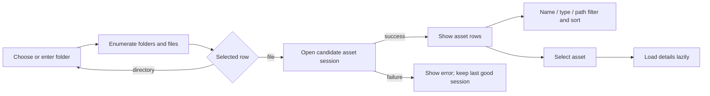
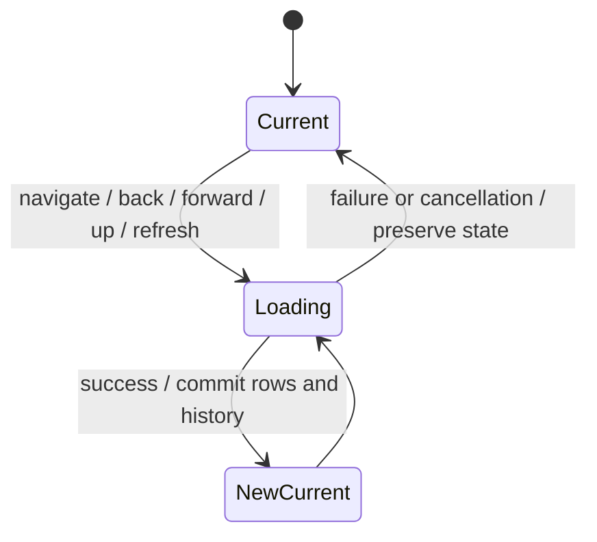
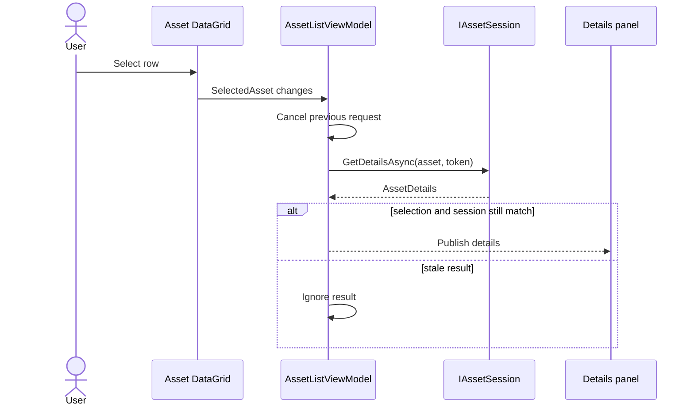
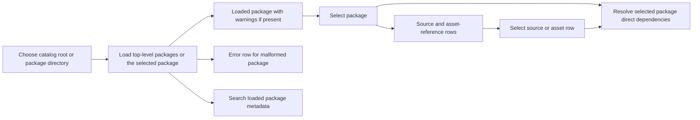
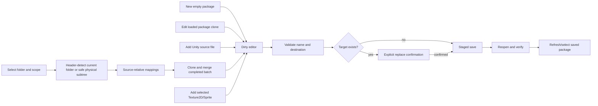

# UI and Workflow Design

## Current Avalonia workflow — implemented

The window uses two top-level tabs. **Assets** retains the filesystem browser and asset list/details workflow and can add the current Texture2D/Sprite selection to the package editor. **Packages** provides package creation/edit/save, package-directory selection, catalog/content browsing, metadata search, and direct dependency inspection. Toolbar Search, Depend, and Package buttons open the package workspace; Export, Filter, and Memo remain disabled.

## Browser behavior

- Initial navigation uses the user-profile folder unless an explicit path is supplied.
- Direct path, folder picker, directory-row open, Up, Back, Forward, and Refresh share one cancellable navigation path.
- Folders appear before files; each row shows name, kind, size, and modified time.
- A failed or inaccessible destination leaves the current rows and history unchanged and displays an error.
- Refresh rereads the current path without creating history.
- Opening a regular file leaves directory state unchanged and attempts asset loading.

## Asset-list behavior

Name and type filters use case-insensitive substring matching. The path-ID filter matches the invariant numeric text. Sort choices are Name, Type, Class ID, Path ID, Size, and Source File, with an optional descending direction. Class ID, Path ID, and Size are sorted numerically.

Filtering and sorting operate on the already enumerated `AssetEntry` records. Sorting preserves the selected instance. A filter that hides the selected row clears selection and details. Loading another file also clears selection and pending details.

## Lazy details

The details panel shows entry identity/provenance plus file kind, Unity version, and logical-file count supplied by the active session. This milestone does not decode previews or export content.

## Package workspace

The package list shows name, source count, and Ready/Warning/Error status. Refresh retains selection by package path when the package is still present. A malformed sibling remains visible as an error row and does not suppress readable packages. Catalog failures preserve the last good catalog.

Contents are metadata-only: one source row plus its asset-reference rows. Available fields are kind, name, source filename/path, CAB, Path ID, memo, and index directory. Path IDs are never treated as globally unique. Selecting a new package clears stale content/dependency selection; selecting a source or asset row filters dependency results by that row's source provenance.

Search delegates to the existing service. The interface exposes include/exclude text, exact text, exact numeric Path ID, result-kind checkboxes, and an All/Names/Paths/CAB/Assets/Memos/Dependencies field selector. It retains comma-separated OR, case-insensitive matching, exclusion precedence, and empty-query behavior from Milestone 4. A later query cancels and supersedes an older one.

Direct dependency rows show requested CAB, explicit status, requesting source, candidate count/paths, and diagnostics. Selecting a dependency shows every candidate occurrence, including all candidates for `Ambiguous`; the UI never chooses one. Resolution remains direct-only and metadata-only.

## Package editor

New Package is available with no catalog or package directory. It opens a valid empty document with one root index. The editor exposes only legacy-supported state: directory-backed package name, destination parent, source references, and Texture2D/Sprite asset references. Add Assets from File identifies supported Unity inputs by file header, not extension. Add Assets from Folder defaults to the current folder. The explicitly two-way-bound **Include subfolders** option appears before the import action so scope is chosen first. Recursive traversal skips links/junctions, preserves relative index placement for supported sources, and publishes the completed import batch transactionally. Existing sources stay in their current indexes, so editing does not silently migrate flat or hierarchical packages. If current-folder mode finds no files while child directories exist, the error identifies the omitted directory count and recommends recursion. Add Selected to Package uses the current single asset selection without introducing multi-select complexity.

Package switching, catalog reload, New Package, Cancel/Discard, and application close protect dirty state with explicit confirmation. Declining leaves the current editor intact. Save failure or cancellation retains unsaved changes. A verified save is marked clean only if no newer edit occurred while its snapshot was writing.

The contents area continuously reports source and asset-reference counts plus saved/unsaved state. Import completion distinguishes rows added to the editor from package indexes persisted on disk and instructs the user to Save. This avoids treating a successful in-memory import as a completed package write.

## Design principles and remaining decisions

The implementation uses normal Avalonia controls and ViewModel state rather than the Unity reference's manual row pool or global event bus. Source files remain read-only, errors remain visible, and a current successful session is retained until replacement succeeds.

Layout polish, accessibility, maximum supported list size, multi-file bundle behavior, platform breadth, package compatibility, memo identity, and export collision policy remain open. See [open questions](../05_audit/open-questions.md).
