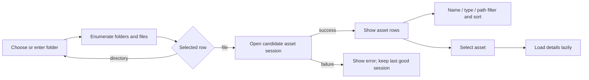
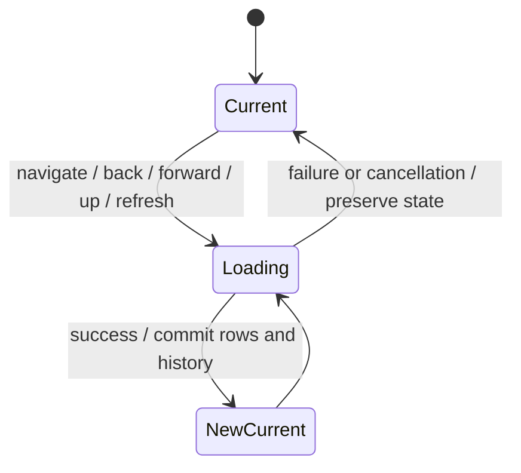
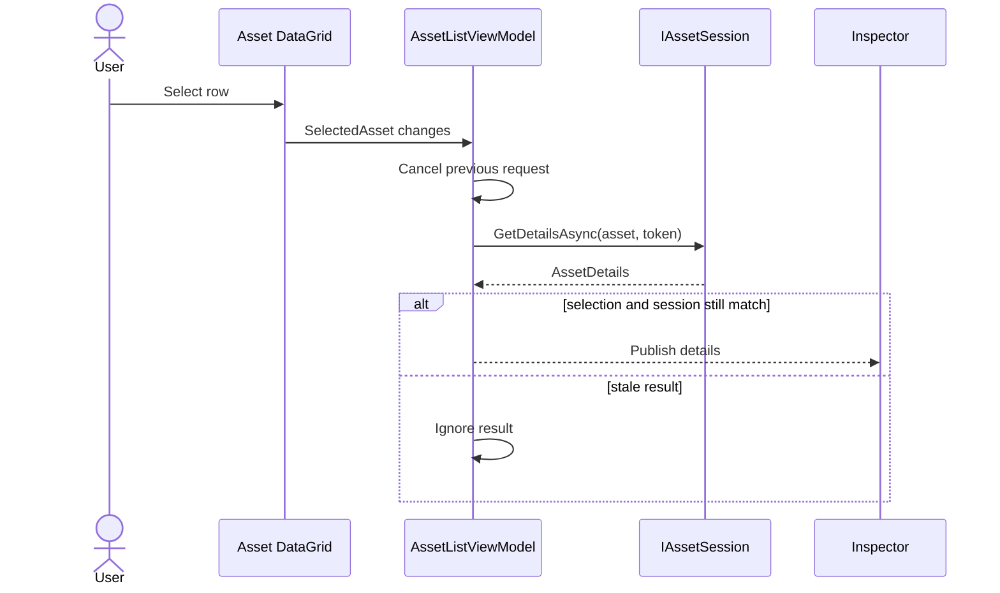
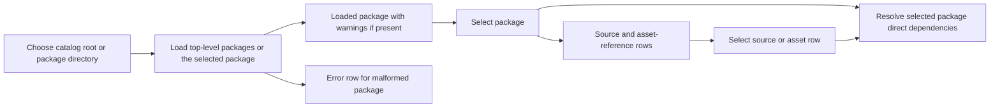
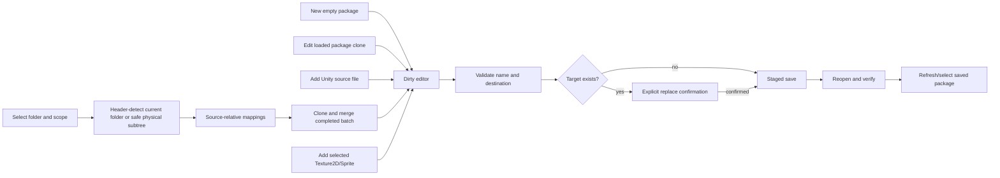

# UI and Workflow Design

This document describes the implemented interface and mandatory development conventions. The standards below are requirements, not a claim that every existing control already complies. The broader four-workspace redesign, behavior audit, text wireframes, and approval gates are maintained separately in [UX redesign foundation and design audit](ux-redesign-foundation.md); proposed behavior there must not be read as implemented.

## Mandatory Debug verification

Routine UI verification must build the startup application with `dotnet build UABS/UABS.csproj -c Debug` from `E:\Projects\UABS\Avalonia` (or explicitly include it in a Debug solution build). Supporting-library builds and successful Release builds do not establish Debug readiness. The manual launch target is `E:\Projects\UABS\Avalonia\UABS\bin\Debug\net9.0\UABS.exe`; confirm its accompanying `UABS.dll` comes from the successful current build before handing off UI changes. Do not direct the user to stale output after a failed build.

If UABS locks Debug output, stop that build attempt, report the lock, and ask the user to close the application normally. Never terminate their process without explicit permission or use Release as a substitute. Release builds remain available when specifically requested. Documentation-only changes do not require application builds.

## Mandatory shared grid conventions

### Kind/icon column

Where an asset-oriented grid includes a Kind/icon column, it must be the first displayed column, use an appropriate icon rather than visible Kind text, have a blank header, and stay fixed at **52 px** with per-column `CanUserResize="False"`. Neighboring columns keep their existing resize behavior and must not change its width. Center icons horizontally and vertically with consistent sizing and spacing; retain meaningful tooltips and accessible names, including an accessible `Kind` header where supported.

Reuse the existing asset-type icon converter/resources and shared icon styles in `UABS/Script/Styles/AssetListStyles.axaml`; equivalent asset types must not acquire independent workspace mappings. Use an accurate neutral icon when type information is unavailable rather than guessing from filenames or Path IDs. This convention applies to the Assets Kind/icon column, Search result Kind, Navigator Kind, Package Contents, Package Editor asset rows, and future equivalent columns. It does not require adding Kind to dependency records, catalog lists, or other grids without meaningful asset-kind information.

### Green zebra rows

Assets grids, Search results, Package Contents, Direct Dependencies, dependency candidates, Package Editor asset grids, and future equivalent grids must reuse the `DataGrid.assetList` rules and dynamic theme resources in `AssetListStyles.axaml`. Do not duplicate local competing overrides or introduce a separate palette for each workspace.

| State | Light | Dark |
| --- | --- | --- |
| Even row (`AssetListRowEvenBrush`) | `#F3F8F3` | `#18231B` |
| Odd row (`AssetListRowOddBrush`) | `#E8F2E9` | `#1E2C22` |
| Hover (`AssetWorkspaceRowHoverBrush`) | `#CCE3D0` | `#2C4633` |
| Selected (`AssetWorkspaceRowSelectedBrush`) | `#39724D` | `#39724D` |
| Selected + hover (`AssetWorkspaceRowSelectedHoverBrush`) | `#2F613F` | `#2F613F` |
| Selected text (`AssetWorkspaceRowSelectedForegroundBrush`) | `#FFFFFF` | `#FFFFFF` |

Visual precedence is **selected + hover → selected → hover → alternating base**. Preserve Fluent keyboard-focus indicators and highlight every selected row where multi-selection is supported. Reapply `assetRowEven` / `assetRowOdd` from each realized row's current displayed index during row loading, clearing old parity classes so sorting, filtering, refreshing, collection replacement, and virtualized reuse cannot retain stale colors. Data and identity must not carry presentation parity.

The Fluent `RowBorder` paints the base stripe; the existing `BackgroundRectangle` layer supplies hover/selection feedback. Cell backgrounds must leave the base visible. A matching style selector or a correct `DataGridRow.Background` value alone does not prove visible rendering. The filesystem Navigator retains its existing softer `navigatorList` companion resources described below; this is an established shared variant, not permission to invent workspace palettes.

### Required verification and current gaps

For every affected grid change, check the applicable Kind/icon position, content, 52 px width, blank header, and resizing behavior; shared zebra resources; selected/hover precedence; and parity through relevant sorting/filtering/refresh/virtualization paths. Build the Debug startup application before reporting readiness for manual UI acceptance. Apply the [risk-based verification policy](../01_core/ai-agent.md#risk-based-verification-and-token-efficiency): focused tests should inspect effective template layers when relevant, and a successful build is compilation evidence, not visual acceptance. Report actual visual observation only when performed under the repository's desktop-control rules or reported by the user.

Known implementation gaps at adoption: `FolderView.axaml` still uses a fixed **42 px** Assets icon column, and `SearchWorkspaceView.axaml` still uses an **85 px**, labeled, textual Kind column. Both differ from the new 52 px icon-only standard and require separately scoped UI corrections. Navigator and Package Contents/Editor already use blank-header fixed 52 px icon columns. The Packages source now opts into the shared zebra style, but manual visual acceptance of the correct current Debug executable remains pending. This documentation change does not modify any controls or mark those gaps resolved.

## Current Avalonia workflow — implemented

The window uses three retained top-level tabs as its compact workspace navigation. **Assets** uses independently resizable and collapsible Navigator, Assets, and Inspector regions and can add the current Texture2D/Sprite selection to the package editor. **Search** provides independent multi-package metadata search and a metadata-only result summary. **Packages** provides package creation/edit/save, package-directory selection, catalog/content browsing, direct dependency inspection, and asset memo editing/copy. The obsolete top toolbar is removed: file/folder opening and browser history controls already live in Assets, workspace navigation already lives in the tabs, and its remaining Export/Filter/Memo controls had no implemented action.

## Browser behavior

- Initial navigation uses the user-profile folder unless an explicit path is supplied.
- Direct path, folder picker, directory-row open, Up, Back, Forward, and Refresh share one cancellable navigation path.
- Folders appear before files; each row shows name, kind, size, and modified time.
- A failed or inaccessible destination leaves the current rows and history unchanged and displays an error.
- Refresh rereads the current path without creating history.
- Opening a regular file leaves directory state unchanged and attempts asset loading.

The filesystem Navigator uses an opt-in companion row style that is slightly softer than the center Asset List. Its light even/odd colors are `#F5F9F5` / `#EEF5EE`; dark even/odd colors are `#1A271E` / `#203024`. Hover (`#CCE3D0` light, `#2C4633` dark), selection (`#39724D` with white text), and selected-hover (`#2F613F`) are shared with the Asset List so interaction feedback is consistent.

Navigator precedence is selected-hover, selected, hover, then alternating base. Realized rows derive parity from their current displayed index during row loading, so column sorting, directory navigation, refresh, and virtualized container reuse cannot leave stale stripes. The Fluent keyboard-focus rectangles remain available, and this presentation layer does not distinguish files from folders by background or alter row activation.

The compact 52 px `Kind` column is leftmost and presents a centered 18 px vector folder or folded-corner document instead of repeating `Directory` / `File` as visible cell text. Its header is visually empty but automation-named `Kind`; the column is fixed-width and cannot be click-sorted, while its retained `SortMemberPath` still supports programmatic Kind sorting. The remaining Name, Size, and Modified columns keep their order and resize behavior. The light palette uses `#A66B00` / `#2563A8`; dark mode uses `#F1B84B` / `#8CB4E8`, and selection changes either icon to white. Tooltips and automation names preserve the `Directory` / `File` meaning, and clicking an icon still selects and activates its containing row through the existing path.

## Asset-list behavior

Name and type filters use case-insensitive substring matching. The path-ID filter matches the invariant numeric text. Sort choices are Name, Type, Class ID, Path ID, Size, and Source File, with an optional descending direction. Class ID, Path ID, and Size are sorted numerically.

Filtering and sorting operate on the already enumerated `AssetEntry` records. Sorting preserves the selected instance. A filter that hides the selected row clears selection and details. Loading another file also clears selection and pending details.

The Assets grid uses the shared semantic row style, palette, precedence, and Fluent focus indicators defined in [mandatory shared grid conventions](#mandatory-shared-grid-conventions). Search results and the Package Contents, Direct Dependencies, dependency candidates, and Package Editor asset grids also opt into this style in the current source.

## Assets workspace panels

The Navigator contains the existing filesystem browser, the center Assets region contains the existing filters and asset grid, and the Inspector presents read-only metadata from the same `AssetListViewModel` selection. Dragging either splitter changes only that panel's width; the center consumes the remainder. Navigator has a 220 px expanded minimum and Inspector has a 260 px minimum so the metadata and future preview controls retain more room.

Dragging to the minimum performs an ordinary resize. Continuing at least 36 px beyond it during the same drag deliberately snaps that panel closed without replacing its previously remembered comfortable width. Compact chevron buttons in the expanded panel headers provide the same collapse action. When collapsed, a slim chevron restore handle remains at the corresponding edge of the Assets region; it is focusable, keyboard-operable, named for accessibility, and has a tooltip. Both sides remain independent and may be collapsed simultaneously.

Collapsing removes the panel and splitter widths. Narrow-window allocation temporarily limits rendered side widths to retain the center's 280 px minimum without changing saved widths or visibility preferences. Window resizing alone never intentionally collapses a panel. These actions do not recreate ViewModels, cancel the active asset session, or clear selection/details. Width and visibility state survives switching among Assets, Search, and Packages for the current process. Cross-launch persistence is not implemented.

## Lazy details

The Inspector shows name, type, class ID, Path ID, byte size, logical file, source path, file kind, Unity version, and logical-file count supplied by the active session. With no selection it shows an explicit empty state. Its Preview area clearly states that asset-specific preview is unavailable; no image, audio, text, or 3D capability is implied.

The Inspector is read-only. It does not duplicate the package memo editor. Future package memo context may be presented through this component only if edits continue to flow through the package editor's isolated document and explicit Save transaction.

Future images must preserve their native aspect ratio and be clipped to the preview viewport. Zoom/pan are independent of panel resizing, while fit-to-view recalculates for viewport changes. Future 3D projection must track the viewport aspect ratio. No image or model should be stretched simply to fill the Inspector, and UX-2B implements no media preview functionality.

## Search workspace

Search is a long-lived top-level workspace over the package catalog already loaded by Packages. Its package checkboxes, package-name filter, criteria, results, selected result, and panel layout are independent from both Assets and Packages and survive workspace switching. The initial available catalog is selected; packages introduced by a later refresh remain unselected until the user explicitly includes them. Select All and Clear apply to the full catalog, not merely the name-filtered subset. The controls scroller retains Fluent's slim auto-hide behavior while a single 20 px content gutter reserves the expanded 16 px overlay track plus 4 px of separation.

Search Controls and Search Inspector resize and collapse independently. Controls stop normally at 240 px and Inspector at 260 px; continuing a splitter drag at least 36 px beyond that minimum snaps only that panel closed. Compact header chevrons and keyboard-accessible edge handles provide explicit collapse and restore. Restoration returns to the last comfortable expanded width (initially 290 px for Controls and 310 px for Inspector), while the Results region retains a 280 px minimum. Collapsing or switching workspaces does not recreate Search controls, so criteria, package selection, results, selected result, and controls scroll position remain intact for the current process.

Include and exclude terms accept English or Chinese commas and retain the service's case-insensitive OR matching with exclusion precedence. **Exact name** uses the backend's whole-field equality for the selected name or metadata field; optional exact numeric Path ID, field group, result-kind filters, **Search memos**, and **Memo only** are explicit. Search memos adds memo text as a match field. Memo only is independent and filters asset candidates to records with nonempty memos; it does not silently enable memo keyword matching.

Search runs only from the Search button or Enter in a criteria text field. Editing criteria preserves the last results and displays **Criteria changed — Search to update results.** Invalid criteria clears results and shows validation. A newer request cancels and supersedes an older request, and stale completion cannot publish. Results from every selected package are merged while retaining package, index, source, CAB, Path ID, memo, and match-category provenance.

The center grid reuses the existing green alternating-row visual states and remains metadata-only. Selecting a row populates the right summary; double-click has no navigation behavior. Source loading, previews, Show in Assets, loose Unity-file search, image filename-stem search, and memo editing are deferred.

## Package workspace

The package list shows name, source count, and Ready/Warning/Error status. Refresh retains selection by package path when the package is still present. A malformed sibling remains visible as an error row and does not suppress readable packages. Catalog failures preserve the last good catalog.

The loaded-packages sidebar resizes independently from the package contents/editor region. Its normal minimum is 260 px; dragging at least 36 px beyond that minimum snaps it closed, while the compact header chevron and keyboard-accessible edge handle provide explicit collapse and restore. Restoration uses the previous comfortable width (330 px initially), and the editor region retains a 520 px minimum. Visibility is layout-only and persists for the current process: collapse, restore, and workspace switching do not change package selection, loaded catalog ownership, dirty editor state, pending edits, or unsaved memos.

Contents are metadata-only: one source row plus its asset-reference rows. Available fields are kind, name, source filename/path, CAB, Path ID, memo, and index directory. Path IDs are never treated as globally unique. Selecting a new package clears stale content/dependency selection; selecting a source or asset row filters dependency results by that row's source provenance.

Direct dependency rows show requested CAB, explicit status, requesting source, candidate count/paths, and diagnostics. Selecting a dependency shows every candidate occurrence, including all candidates for `Ambiguous`; the UI never chooses one. Resolution remains direct-only and metadata-only.

## Package editor

New Package is available with no catalog or package directory. It opens a valid empty document with one root index. The editor exposes only legacy-supported state: directory-backed package name, destination parent, source references, and Texture2D/Sprite asset references. Add Assets from File identifies supported Unity inputs by file header, not extension. Add Assets from Folder defaults to the current folder. The explicitly two-way-bound **Include subfolders** option appears before the import action so scope is chosen first. Recursive traversal skips links/junctions, preserves relative index placement for supported sources, and publishes the completed import batch transactionally. Existing sources stay in their current indexes, so editing does not silently migrate flat or hierarchical packages. If current-folder mode finds no files while child directories exist, the error identifies the omitted directory count and recommends recursion. Add Selected to Package uses the current single asset selection without introducing multi-select complexity.

Package switching, catalog reload, New Package, Cancel/Discard, and application close protect dirty state with explicit confirmation. Declining leaves the current editor intact. Save failure or cancellation retains unsaved changes. A verified save is marked clean only if no newer edit occurred while its snapshot was writing.

Switching among Assets, Search, and Packages is not an abandon action. The composed workspaces and editor remain alive, and transient package-grid deselection during visual detach cannot clear the active package or editor. An active import continues across workspace navigation unless the user explicitly selects **Cancel Operation**; rapid navigation and stale asynchronous completions cannot replace the current editor, Search results, or asset session.

The contents area continuously reports source and asset-reference counts plus saved/unsaved state. Import completion distinguishes rows added to the editor from package indexes persisted on disk and instructs the user to Save. This avoids treating a successful in-memory import as a completed package write.

The memo panel follows the current editor selection. Asset rows expose multiline text editing and a Clear action; package/source rows explain that the legacy schema has no memo field for them. `Absent`, `Empty`, and `Local` labels distinguish omitted values, explicit empty strings, and non-empty stored text. Every keystroke changes only the isolated editor model and dirty indicator. Selection changes and Assets/Search/Packages navigation retain the text; disk persistence still requires the ordinary Save button, while Cancel/Discard restores the saved package state.

Assets and Search Inspectors also share a separate read-only memo presentation. Assets resolves any selected asset across the loaded package catalog using source path, name, and Path ID; Search revalidates the selected asset result's complete package/index/source identity. The UI shows the full memo without truncation and distinguishes missing, explicit-empty, no-match, unsupported, stale, and ambiguous states. These Inspector views never modify the package editor, dirty state, or disk. Existing builders still index only Texture2D/Sprite, so another type is immediately resolvable only when its `AssetInfos` record already exists; broadening package creation/import is a separate backward-compatible indexing change.

Package-to-package memo copy is an explicit editor action. The user selects a loaded catalog package and Safe, Overwrite, or Force mode. Results report changed, unchanged, mode-skipped, unmatched, and ambiguous counts. Conflicts are never resolved by row order. The target remains dirty until Save, and the source package is never modified.

## Design principles and remaining decisions

The implementation uses normal Avalonia controls and ViewModel state rather than the Unity reference's manual row pool or global event bus. Source files remain read-only, errors remain visible, and a current successful session is retained until replacement succeeds.

Layout polish, accessibility, maximum supported list size, multi-file bundle behavior, platform breadth, package compatibility, irreducibly duplicated legacy memo identities, and export collision policy remain open. See [open questions](../05_audit/open-questions.md).
