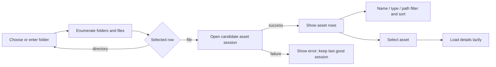
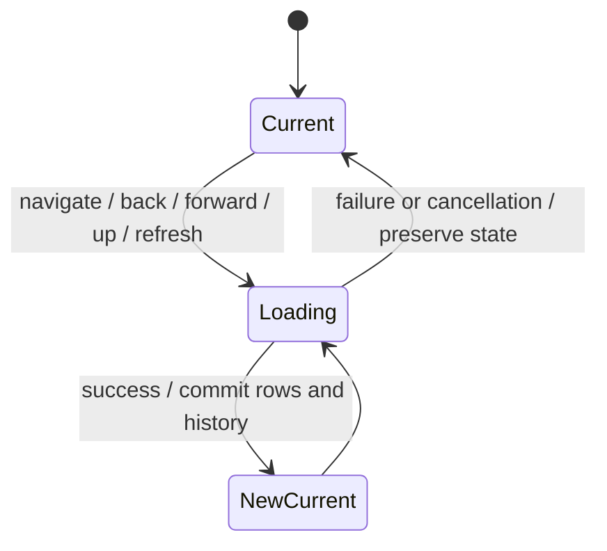
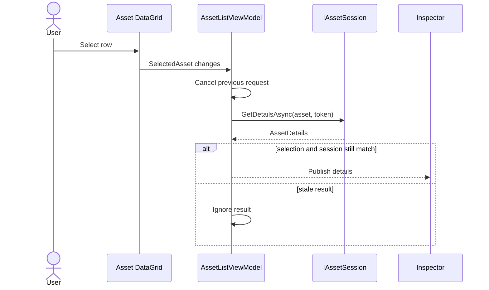
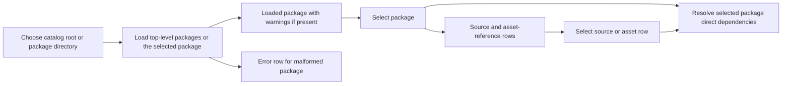
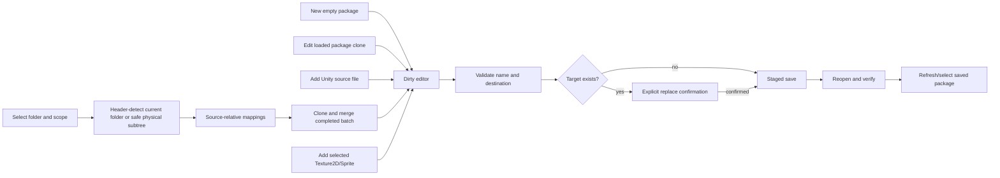

# UI and Workflow Design

This document describes the implemented interface and mandatory development conventions. The standards below are requirements, not a claim that every existing control already complies. The broader four-workspace redesign, behavior audit, text wireframes, and approval gates are maintained separately in [UX redesign foundation and design audit](ux-redesign-foundation.md); proposed behavior there must not be read as implemented.

## Mandatory Debug verification

Routine UI verification must build the startup application with `dotnet build UABS/UABS.csproj -c Debug` from `E:\Projects\UABS\Avalonia` (or explicitly include it in a Debug solution build). Supporting-library builds and successful Release builds do not establish Debug readiness. The manual launch target is `E:\Projects\UABS\Avalonia\UABS\bin\Debug\net9.0\UABS.exe`; confirm its accompanying `UABS.dll` comes from the successful current build before handing off UI changes. Do not direct the user to stale output after a failed build.

If UABS locks Debug output, stop that build attempt, report the lock, and ask the user to close the application normally. Never terminate their process without explicit permission or use Release as a substitute. Release builds remain available when specifically requested. Documentation-only changes do not require application builds.

## Mandatory shared grid conventions

### Kind/icon column

Where an asset-oriented grid includes a Kind/icon column, use the following standard, which supersedes the earlier fixed-width/non-resizable rule:

| Property | Required convention |
| --- | --- |
| Position | First displayed column, far left |
| Header/content | Blank visible header; appropriate icon instead of Kind text |
| Default width | `Width="52"` (pixels, not star/stretch sizing) |
| Maximum width | Per-column `MaxWidth="80"` |
| User resizing | Per-column `CanUserResize="True"`; keep the grid's resize capability enabled |
| Minimum width | Explicit per-column `MinWidth="0"` on Kind only; leave the grid and other columns' minimums unchanged |
| Narrow content | Icon may clip or disappear; never overflow adjacent columns |

Center icons horizontally and vertically at ordinary widths; retain meaningful tooltips and accessible names, including an accessible `Kind` header where supported. Neighboring columns retain their existing resize behavior. The shared `KindIconCellTheme` in `AssetListStyles.axaml` derives from Fluent's standard `DataGridCell` theme and enables cell-bound clipping without replacing its template, focus, or state visuals.

In Avalonia DataGrid **11.3.3**, an unset column minimum inherits the grid's **20 px** `MinColumnWidth`, even though the column minimum property's default reads as 0. Setting `MinWidth="0"` explicitly on Kind overrides that inheritance and enables the native **0–80 px** range. At zero, Kind cells are either arranged at zero width with clipping or virtualized out, so no icon remains visible. To restore Kind, drag the **left edge of the next visible column header (normally Name)** to the right: Avalonia's built-in resize hit testing targets the preceding zero-width column. Headless pointer tests verify hiding and restoration across Assets, Search, Navigator, Package Contents, and Package Editor. No grid-wide minimum override, custom drag handling, or new Hide/Restore control is required.

Reuse the existing asset-type icon converter/resources and shared icon styles in `UABS/Script/Styles/AssetListStyles.axaml`; equivalent asset types must not acquire independent workspace mappings. Use an accurate neutral icon when type information is unavailable rather than guessing from filenames or Path IDs. This convention applies to the Assets Kind/icon column, Search result Kind, Navigator Kind, Package Contents, Package Editor asset rows, and future equivalent columns. It does not require adding Kind to dependency records, catalog lists, or other grids without meaningful asset-kind information.

### Green zebra rows

Assets grids, Search results, Package Contents, Direct Dependencies, dependency candidates, Package Editor asset grids, and future equivalent grids must reuse the `DataGrid.assetList` rules and dynamic theme resources in `AssetListStyles.axaml`. Do not duplicate local competing overrides or introduce a separate palette for each workspace.

| State | Light | Dark |
| --- | --- | --- |
| Even row (`AssetListRowEvenBrush`) | `#F3F8F3` | `#18231B` |
| Odd row (`AssetListRowOddBrush`) | `#E8F2E9` | `#1E2C22` |
| Hover (`AssetWorkspaceRowHoverBrush`) | `#CCE3D0` | `#2C4633` |
| Selected (`AssetWorkspaceRowSelectedBrush`) | `#39724D` | `#39724D` |
| Selected + hover (`AssetWorkspaceRowSelectedHoverBrush`) | `#2F613F` | `#2F613F` |
| Selected text (`AssetWorkspaceRowSelectedForegroundBrush`) | `#FFFFFF` | `#FFFFFF` |

Visual precedence is **selected + hover → selected → hover → alternating base**. Preserve Fluent keyboard-focus indicators and highlight every selected row where multi-selection is supported. Reapply `assetRowEven` / `assetRowOdd` from each realized row's current displayed index during row loading, clearing old parity classes so sorting, filtering, refreshing, collection replacement, and virtualized reuse cannot retain stale colors. Data and identity must not carry presentation parity.

The Fluent `RowBorder` paints the base stripe; the existing `BackgroundRectangle` layer supplies hover/selection feedback. Cell backgrounds must leave the base visible. A matching style selector or a correct `DataGridRow.Background` value alone does not prove visible rendering. The filesystem Navigator retains its existing softer `navigatorList` companion resources described below; this is an established shared variant, not permission to invent workspace palettes.

### Required verification and current gaps

For every affected grid change, check the applicable Kind/icon position, content, 52 px default, blank header, 80 px maximum, enabled resizing, Kind-only zero minimum, fully hidden/clipped icons at zero, and native adjacent-header restoration; shared zebra resources; selected/hover precedence; and parity through relevant sorting/filtering/refresh/virtualization paths. Build the Debug startup application before reporting readiness for manual UI acceptance. Apply the [risk-based verification policy](../01_core/ai-agent.md#risk-based-verification-and-token-efficiency): focused tests should inspect effective template layers when relevant, and a successful build is compilation evidence, not visual acceptance. Report actual visual observation only when performed under the repository's desktop-control rules or reported by the user.

Assets, Search, Navigator, Package Contents, and Package Editor now use the bounded-resizing convention. Direct Dependencies and dependency candidates have no Kind column and gain none. Search uses the existing `AssetTypeIconConvertor` and icon cache/resources: `folder.png` for Package, `file.png` for SourceFile, and `asset-unknown.png` for V1 Asset rows without reliable type metadata. Gate5B V2 assets use available indexed type names through that same converter, falling back to the neutral asset icon. Underlying Kind values and sorting remain intact; no type is inferred from filenames or Path IDs. Assets retains the same converter's existing Unity-type mapping. Manual visual acceptance of these changes remains user-driven.

## Current Avalonia workflow — implemented

The window uses three retained top-level tabs as its compact workspace navigation. **Assets** uses independently resizable and collapsible Navigator, Assets, and Inspector regions and can add the current Texture2D/Sprite selection to the package editor. **Search** provides independent multi-package metadata search and a metadata-only result summary. **Packages** provides package creation/edit/save, package-directory selection, catalog/content browsing, direct dependency inspection, and asset memo editing/copy. The obsolete top toolbar is removed: file/folder opening and browser history controls already live in Assets, workspace navigation already lives in the tabs, and its remaining Export/Filter/Memo controls had no implemented action.

## Browser behavior

- Initial navigation uses the user-profile folder unless an explicit path is supplied.
- Direct path, folder picker, directory-row open, Up, Back, Forward, and Refresh share one cancellable navigation path.
- Folders appear before files; each row shows name, kind, size, and modified time.
- A failed or inaccessible destination leaves the current rows and history unchanged and displays an error.
- Refresh rereads the current path without creating history.
- Opening a regular file leaves directory state unchanged and attempts asset loading.

The filesystem Navigator uses an opt-in companion row style that is slightly softer than the center Asset List. Its light even/odd colors are `#F5F9F5` / `#EEF5EE`; dark even/odd colors are `#1A271E` / `#203024`. Hover (`#CCE3D0` light, `#2C4633` dark), selection (`#39724D` with white text), and selected-hover (`#2F613F`) are shared with the Asset List so interaction feedback is consistent.

Navigator precedence is selected-hover, selected, hover, then alternating base. Realized rows derive parity from their current displayed index during row loading, so column sorting, directory navigation, refresh, and virtualized container reuse cannot leave stale stripes. The Fluent keyboard-focus rectangles remain available, and this presentation layer does not distinguish files from folders by background or alter row activation.

The leftmost `Kind` column defaults to 52 px and presents a centered 18 px vector folder or folded-corner document instead of repeating `Directory` / `File` as visible cell text. Its header is visually empty but automation-named `Kind`; it follows the shared bounded-resizing convention and cannot be click-sorted, while its retained `SortMemberPath` still supports programmatic Kind sorting. The remaining Name, Size, and Modified columns keep their order and resize behavior. The light palette uses `#A66B00` / `#2563A8`; dark mode uses `#F1B84B` / `#8CB4E8`, and selection changes either icon to white. Tooltips and automation names preserve the `Directory` / `File` meaning, and clicking an icon still selects and activates its containing row through the existing path.

## Asset-list behavior

Name and type filters use case-insensitive substring matching. The path-ID filter matches the invariant numeric text. Sort choices are Name, Type, Class ID, Path ID, Size, and Source File, with an optional descending direction. Class ID, Path ID, and Size are sorted numerically.

Filtering and sorting operate on the already enumerated `AssetEntry` records. Sorting preserves the selected instance. A filter that hides the selected row clears selection and details. Loading another file also clears selection and pending details.

The Assets grid uses the shared semantic row style, palette, precedence, and Fluent focus indicators defined in [mandatory shared grid conventions](#mandatory-shared-grid-conventions). Search results and the Package Contents, Direct Dependencies, dependency candidates, and Package Editor asset grids also opt into this style in the current source.

## Assets workspace panels

The Navigator contains the existing filesystem browser, the center Assets region contains the existing filters and asset grid, and the Inspector presents read-only metadata from the same `AssetListViewModel` selection. Dragging either splitter changes only that panel's width; the center consumes the remainder. Navigator has a 220 px expanded minimum and Inspector has a 260 px minimum so the metadata and future preview controls retain more room.

Dragging to the minimum performs an ordinary resize. Continuing at least 36 px beyond it during the same drag deliberately snaps that panel closed without replacing its previously remembered comfortable width. Compact chevron buttons in the expanded panel headers provide the same collapse action. When collapsed, a slim chevron restore handle remains at the corresponding edge of the Assets region; it is focusable, keyboard-operable, named for accessibility, and has a tooltip. Both sides remain independent and may be collapsed simultaneously.

Collapsing removes the panel and splitter widths. Narrow-window allocation temporarily limits rendered side widths to retain the center's 280 px minimum without changing saved widths or visibility preferences. Window resizing alone never intentionally collapses a panel. These actions do not recreate ViewModels, cancel the active asset session, or clear selection/details. Width and visibility state survives switching among Assets, Search, and Packages for the current process. Cross-launch persistence is not implemented.

## Lazy details

The Inspector shows name, type, class ID, Path ID, byte size, logical file, source path, file kind, Unity version, and logical-file count supplied by the active session. With no selection it shows an explicit empty state. Its Preview area clearly states that asset-specific preview is unavailable; no image, audio, text, or 3D capability is implied.

Inspector asset metadata remains read-only. Its package memo section uses the shared Assets/Search editor: exactly one valid indexed identity enables debounced transactional memo persistence, Save Now, and Retry. Loose, ambiguous, stale, missing, or Package-Editor-owned targets remain unavailable with an explanation. See [memo system behavior](../04_systems/package-search-dependency-memo.md#editable-assets-and-search-memo-inspectors).

Future images must preserve their native aspect ratio and be clipped to the preview viewport. Zoom/pan are independent of panel resizing, while fit-to-view recalculates for viewport changes. Future 3D projection must track the viewport aspect ratio. No image or model should be stretched simply to fill the Inspector, and UX-2B implements no media preview functionality.

## Search workspace

Search is a long-lived top-level workspace over the package catalog already loaded by Packages. Its package checkboxes, package-name filter, criteria, results, selected result, and panel layout are independent from both Assets and Packages and survive workspace switching. The initial available catalog is selected; packages introduced by a later refresh remain unselected until the user explicitly includes them. Select All and Clear apply to the full catalog, not merely the name-filtered subset. The controls scroller retains Fluent's slim auto-hide behavior while a single 20 px content gutter reserves the expanded 16 px overlay track plus 4 px of separation.

Search Controls and Search Inspector resize and collapse independently. Controls stop normally at 240 px and Inspector at 260 px; continuing a splitter drag at least 36 px beyond that minimum snaps only that panel closed. Compact header chevrons and keyboard-accessible edge handles provide explicit collapse and restore. Restoration returns to the last comfortable expanded width (initially 290 px for Controls and 310 px for Inspector), while the Results region retains a 280 px minimum. Collapsing or switching workspaces does not recreate Search controls, so criteria, package selection, results, selected result, and controls scroll position remain intact for the current process.

Include and exclude terms accept English or Chinese commas and retain the service's case-insensitive OR matching with exclusion precedence. **Exact name** uses the backend's whole-field equality for the selected name or metadata field; optional exact numeric Path ID, field group, result-kind filters, **Search memos**, and **Memo only** are explicit. Search memos adds memo text as a match field. Memo only is independent and filters asset candidates to records with nonempty memos; it does not silently enable memo keyword matching.

Search runs only from the Search button or Enter in a criteria text field. Editing criteria preserves the last results and displays **Criteria changed — Search to update results.** Invalid criteria clears results and shows validation. A newer request cancels and supersedes an older request, and stale completion cannot publish. Results from every selected package are merged while retaining package, index, source, CAB, Path ID, memo, and match-category provenance.

The center grid reuses the existing green alternating-row visual states and remains metadata-only. Selecting a row populates the right summary and shared memo editor when eligible; double-click has no navigation behavior. Source loading, previews, Show in Assets, loose Unity-file search, and image filename-stem search remain deferred.

Gate5B extends the same workspace to registered V2 packages. Format/status-labeled checkboxes permit multiple V2 packages; mixed V1/V2 execution is explicitly rejected, never partially searched. V2 Class ID/type-name filters require asset-only results. Gate5C adds shared editable memos for exact V2 assets while retaining a read-only metadata summary; V2 never enters V1 persistence. See the [Gate5B report](../05_audit/package-format-v2-gate-05b-search-integration.md) for the original paged lifecycle and the [Gate5C report](../05_audit/package-format-v2-gate-05c-memo-integration.md) for memo identity and conflicts.

Gate5F replaces Next-page UI with automatic near-edge loading in a bounded sliding window:100-row engine requests,600 published rows,128 sparse/local keyset checkpoints, backward replay within the same session, and native pixel-anchor preservation. The scrollbar describes the current window, not an invented total; labels show global displayed positions and discovered-at-least or exhausted-exact indexed counts. One selected occurrence/Inspector/draft remains retained outside an evicted window and is identified explicitly. Recoverable paging errors expose Retry loading without losing the boundary. V2 local fragment sorting is disabled so it cannot contradict the engine's deterministic global order; V1 sorting is unchanged. Kind sizing/icons and shared light/dark zebra/hover/selection/focus remain as specified above. See the [Gate5F report](../05_audit/package-format-v2-gate-05f-search-ux.md) for memory bounds, checkpoint tradeoffs and verification status.

Gate5G.1 restores supported V2 header interactions through **global** sessions, not DataGrid fragment sorts: Package, Source, Path ID and raw Name for Assets-only queries. Kind/Memo and mixed-result Name are intentionally unavailable with explanatory header help. A new mixed query resets an ineligible raw Name order to the existing PackageName ascending default. Headers toggle ascending/descending and display the published order; sort resets the window to its first page while retaining immutable selection/Inspector/draft state. Rapid changes cancel superseded work; catalog changes still require explicit Refresh. Columns, sizing and styling are unchanged. See the [Gate5G sorting follow-up](../05_audit/package-format-v2-gate-05g-search-paging-performance.md#gate5g1--supported-global-header-sorting-2026-10-23) for limitations and manual acceptance.

Verified memo saves update all exact matching retained rows (including the separately retained selection) in place, preserving criteria, draft and viewport, then block newer-revision continuation/replay. The stale message invites explicit **Refresh Search** when ready. Approved D5 still forbids automatic rebase/rerun, even for memo-insensitive criteria; a proposed exception requires separate approval. No refresh runs on keystrokes, saves or while a draft is active. Stale/unloaded/changed-scope sessions retain rows but disable continuation; return to Search verifies evidence without rerunning.

## Package workspace

The package list shows name, source count, and Ready/Warning/Error status. Refresh retains selection by package path when the package is still present. A malformed sibling remains visible as an error row and does not suppress readable packages. Catalog failures preserve the last good catalog.

The loaded-packages sidebar resizes independently from the package contents/editor region. Its normal minimum is 260 px; dragging at least 36 px beyond that minimum snaps it closed, while the compact header chevron and keyboard-accessible edge handle provide explicit collapse and restore. Restoration uses the previous comfortable width (330 px initially), and the editor region retains a 520 px minimum. Visibility is layout-only and persists for the current process: collapse, restore, and workspace switching do not change package selection, loaded catalog ownership, dirty editor state, pending edits, or unsaved memos.

Contents are metadata-only: one source row plus its asset-reference rows. Available fields are kind, name, source filename/path, CAB, Path ID, memo, and index directory. Path IDs are never treated as globally unique. Selecting a new package clears stale content/dependency selection; selecting a source or asset row filters dependency results by that row's source provenance.

Direct dependency rows show requested CAB, explicit status, requesting source, candidate count/paths, and diagnostics. Selecting a dependency shows every candidate occurrence, including all candidates for `Ambiguous`; the UI never chooses one. Resolution remains direct-only and metadata-only.

## Package editor

**Create Package** opens the retained V2 SQLite creation form: select one or more supported Unity source files, choose a name and existing local NTFS destination, inspect the `.uabs.sqlite` destination, then Create. Metadata from all discoverable classes is streamed into a staged database; no legacy intermediate or media payload is created. Progress, cancellation and explicit incomplete-coverage acknowledgement precede publication; verified output registers in the existing catalog and **Open Package** uses normal guarded selection. Closing the form does not abandon a V1 editor draft. Details, limits and manual acceptance are in [Gate5A.1 creation](../05_audit/package-format-v2-gate-05a1-creation.md).

**New Legacy V1** remains available with no catalog or package directory. It opens a valid empty document with one root index. The legacy editor exposes only legacy-supported state: directory-backed package name, destination parent, source references, and Texture2D/Sprite asset references. Add Assets from File identifies supported Unity inputs by file header, not extension. Add Assets from Folder defaults to the current folder. The explicitly two-way-bound **Include subfolders** option appears before the import action so scope is chosen first. Recursive traversal skips links/junctions, preserves relative index placement for supported sources, and publishes the completed import batch transactionally. Existing sources stay in their current indexes, so editing does not silently migrate flat or hierarchical packages. If current-folder mode finds no files while child directories exist, the error identifies the omitted directory count and recommends recursion. Add Selected to Package uses the current single asset selection without introducing multi-select complexity.

Package switching, catalog reload, New Package, Cancel/Discard, and application close protect dirty state with explicit confirmation. Declining leaves the current editor intact. Save failure or cancellation retains unsaved changes. A verified save is marked clean only if no newer edit occurred while its snapshot was writing.

Switching among Assets, Search, and Packages is not an abandon action. The composed workspaces and editor remain alive, and transient package-grid deselection during visual detach cannot clear the active package or editor. An active import continues across workspace navigation unless the user explicitly selects **Cancel Operation**; rapid navigation and stale asynchronous completions cannot replace the current editor, Search results, or asset session.

The contents area continuously reports source and asset-reference counts plus saved/unsaved state. Import completion distinguishes rows added to the editor from package indexes persisted on disk and instructs the user to Save. This avoids treating a successful in-memory import as a completed package write.

The Package Editor memo panel follows the current selection and shows a read-only multiline memo; its ordinary Clear action is removed. Package/source rows explain that the legacy schema has no memo field for them. `Absent`, `Empty`, and `Local` labels distinguish omitted values, explicit empty strings, and non-empty stored text. Apply Memo Copy and existing pending editor edits still affect only the isolated working document and require explicit Save; no editor changes are silently migrated into Inspector drafts.

Assets and Search Inspectors share one application-lifetime draft coordinator and reusable editable memo View (1.5-second debounce, Save Now, Retry and navigation flush). V1 Assets resolves across the loaded catalog by source path, name, and Path ID; V1 Search revalidates complete result provenance. V2 indexed Assets/Search retain full registration/package/generation/source-revision/logical-ordinal/signed-Path-ID identity. Native Unity-file Assets can link to V2 only through captured source SHA256, original path, exact logical name and signed Path ID yielding one addressable indexed occurrence; no name/CAB-only fallback. All require one exact identity and exclude the same package's active Package Editor, even when clean. Shared drafts, failures and confirmed saves follow identity across navigation; verified saves refresh metadata and matching Search rows without rerunning Search or replacing selection. Unload/reopen never retargets an old V2 draft, and conflicts retain text without automatic merging. Save and close Package Editor before individual memo editing; new references must first be persisted/loaded. Legacy V1 builders still index only Texture2D/Sprite (other existing `AssetInfos` remain memo-eligible); V2 indexes all classes, including unknown classes and nullable names. V2 structural Editor saving remains unavailable. Stage 7 shutdown draining/confirmation is not integrated, so pending drafts are not claimed safe at application exit. See [Gate5C](../05_audit/package-format-v2-gate-05c-memo-integration.md) for transaction and lifecycle limits.

Package-to-package memo copy is an explicit editor action. The user selects a loaded catalog package and Safe, Overwrite, or Force mode. Results report changed, unchanged, mode-skipped, unmatched, and ambiguous counts. Conflicts are never resolved by row order. The target remains dirty until Save, and the source package is never modified.

## Design principles and remaining decisions

Gate5D keeps loaded memo/draft presentation immediate and separates it from current-revision readiness. Windows-pinned, same-connection admission can serve targeted memo reads without repeated whole-package scans; external commits invalidate reuse, while every write still performs fresh transaction-local authorization. First registration/save and large-package saves remain slower. See the [Gate5D calibration and safety report](../05_audit/package-format-v2-gate-05d-memo-performance.md); rendered UI/real-corpus acceptance remains user-driven.

The implementation uses normal Avalonia controls and ViewModel state rather than the Unity reference's manual row pool or global event bus. Source files remain read-only, errors remain visible, and a current successful session is retained until replacement succeeds.

Layout polish, accessibility, maximum supported list size, multi-file bundle behavior, platform breadth, package compatibility, irreducibly duplicated legacy memo identities, and export collision policy remain open. See [open questions](../05_audit/open-questions.md).
