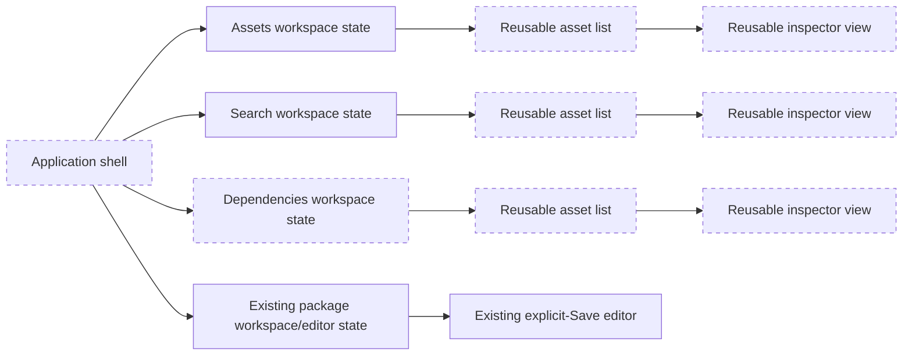
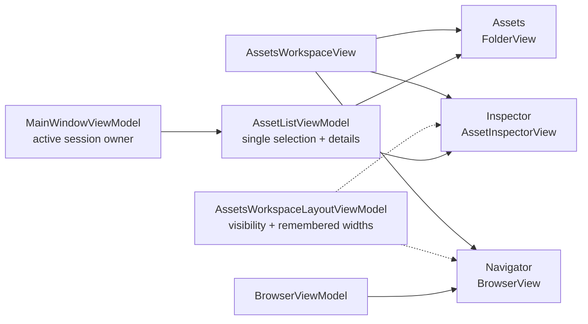

# UX Redesign Foundation and Design Audit

**Date:** 2026-10-17

**Status:** The broader redesign remains proposed. UX-1A through UX-2D and the UX-3A dedicated package-metadata Search foundation are implemented and automatically verified; user desktop acceptance is pending. Dependencies, source inspection, and media preview remain deferred.

## Product direction and boundaries

UABS is primarily an asset-seeking and inspection application. The proposed experience has four persistent workspaces—Assets, Search, Dependencies, and Packages—with reusable asset-list and inspector presentation. Direct asset modding is not in scope. Existing package creation, import, memo, compatibility, explicit-Save, and stability guarantees remain unchanged.

This proposal does not assume media support that does not exist. Current Avalonia functionality stops at neutral asset enumeration and metadata details. Texture, sprite, audio, text, and 3D inspection capabilities are separately identified below.

## Evidence inspected

Current Avalonia behavior was traced through:

- `MainWindow.axaml` and `MainWindowViewModel`;
- `BrowserView`/`BrowserViewModel` and `DirectoryBrowserService`;
- `FolderView`/`AssetListViewModel`, `IAssetSession`, and `UnityFileDetector`;
- `PackageManagementView`/`PackageManagementViewModel` and `PackageEditorViewModel`;
- `IPackageSearchService`, `IPackageDependencyResolver`, and their neutral result models.

Legacy behavior was traced through `FileTypeDetector`, `ReadFolderContent`, `ReadSearchInfo`, `FindDeriveInfoInPackage`, the keyword/memo/image search controllers, `SearchDataSource`, `DependentReader`, `ReadDependencyInfo`, and `DependencyDataSource`.

## Current-versus-desired behavior

| Area | Current verified Avalonia behavior | Desired direction | Gap / implication |
| --- | --- | --- | --- |
| Top-level navigation | Three retained tabs: Assets, Search, and Packages | Four persistent workspaces: Assets, Search, Dependencies, Packages | UX-3A rehosts Search; Dependencies remains deferred |
| Workspace state | Assets, Search, and Packages ViewModels remain composed and retain independent state | Independent navigation, selection, panel, and inspection state per workspace | Search criteria/scope/results are independent; source-inspection state and Dependencies still need owners |
| Folder visibility | All immediate folders are listed, including empty folders | Same | Already satisfied |
| File visibility | UX-1B retains every immediate directory and shows only header-recognized supported Unity files | Only content-recognized supported Unity files should appear | Implemented with bounded, cancellable inspection; desktop acceptance pending |
| File recognition | `UnityFileDetector` recognizes bundles/serialized files by bounded header inspection during browser scans, open, and package import | Use content recognition before showing file rows | Implemented without extension dependence or full asset loading |
| Browser activation | UX-1A connects a row tap and Enter to the existing folder/file activation path; Space remains reserved | Single-click folders to navigate and supported files to load | Implemented and headless-event tested; user desktop acceptance remains pending |
| Navigation actions | Back, Forward, Up, Refresh, Choose, Go exist as text buttons; several are duplicated in the toolbar | Recognizable icons, keyboard access, useful tooltips, and unavailable-action explanations | Command logic exists; presentation and disabled-reason state do not |
| Asset list | Filterable/sortable DataGrid is now the center region of `AssetsWorkspaceView` | Reusable list component across Assets, Search, and Dependencies | Existing `FolderView` remains Assets-specific; extraction for other workspaces is deferred |
| Inspector | UX-2A provides a read-only `AssetInspectorView`; Memo Stage 5 adds safe editable memos to Search only | Shared right-side inspector with common identity, metadata, memo status, and type-specific content | Exact provenance and Search auto-save are implemented; Assets editing and media presenters remain deferred |
| Panel behavior | Assets and Search side panels plus the Packages catalog sidebar resize independently, snap closed only after a deliberate 36 px minimum-width overshoot, and restore remembered widths from compact edge handles | Resizable/collapsible side regions restoring prior widths | Implemented for Assets, Search, and the Packages catalog; cross-launch persistence remains deferred |
| Row styling | UX-2C styles the Assets list; UX-2D gives Navigator a softer palette; UX-3A opts Search results into the Assets-list style | Alternating subtle green rows with distinct hover/selection states | Implemented for Assets, Navigator, and Search results; Dependencies remains deferred and Packages is unchanged |
| Search | UX-3A provides a dedicated workspace over loaded package metadata, explicit multi-package scope, merged results, and metadata-only selection summary | Dedicated core workspace with explicit scope and direct inspection | Foundation implemented; opening original sources is deliberately deferred |
| Search capabilities | Include/exclude, exact text, exact Path ID, fields/result kinds, Search memos, and independent Memo only filtering | Preserve these and expose legacy-relevant options clearly | Implemented by reusing `IPackageSearchService`; loose-file and image-stem search are deferred |
| Search result activation | Selection only displays the result row | Open the original source read-only and inspect the matching asset when identity is sufficient | Needs an inspection request/coordinator and explicit handling for stale/missing paths or ambiguous identities |
| Dependencies | Direct dependency tab inside selected package; resolved/unresolved/ambiguous states and all candidate paths are shown | Dedicated Dependencies workspace with Dependencies and Dependents navigator sections, bundle assets, and shared inspector | Direct resolver is reusable; reverse dependency lookup is not implemented |
| Dependency file access | Resolver returns original `SourcePath` and never opens or copies files | Open resolved original paths read-only; never create a common-folder copy | Already correct at service boundary; presentation needs an explicit inspect action |
| Packages | Central catalog, contents, direct dependencies, editor, import, memos, and explicit Save | Retain centralized management; move general Search/Dependencies out | General Search has moved; package editing and memo ownership remain centralized |
| Memo placement | Package Editor retains explicit Save; Search can edit an exact indexed memo through the coordinated transactional writer; Assets remains read-only | Shared inspector memo editing with explicit eligibility and save state | Stage 5 covers Search; Assets integration and shutdown draining remain deferred |
| Global navigation | Obsolete top toolbar removed; visible tabs navigate Assets, Search, and Packages, while file/folder/history actions remain in Assets | Compact workspace-aware navigation without decorative controls | Dependencies remains deferred; unimplemented Export/Filter/Memo actions are not presented as disabled decoration |
| Texture/Sprite preview | Not implemented | Full texture and correct sprite-region inspection with pan/zoom/fit/reset | Blocked on UE-001/UE-002 and followed by UE-003 |
| AudioClip | Enumerated as metadata only | Interactive playback | No decoder, playback service, ownership model, or supported-codec decision exists |
| TextAsset | Enumerated as metadata only; legacy repository contains a test utility, not an integrated viewer | Readable, scrollable text | Needs bounded byte extraction, encoding/binary detection, and size policy |
| Mesh/3D | Enumerated as metadata only | Eventual interactive viewport | Net-new renderer/camera/material scope; not a foundation task |

## Browser activation defect and UX-1A correction

Before UX-1A, `BrowserView.axaml` bound the DataGrid's `SelectedItem` but defined no row click, double-click, Enter, or activation binding. `BrowserViewModel.SelectedEntry` only refreshed `OpenSelectedCommand.CanExecute`, so navigation/loading required the separate **Open Selected** button.

UX-1A adds one activation route shared by row taps, Enter, and the existing button. A folder uses the existing navigation/history pipeline; a file uses the existing application file-load callback. Space is intentionally not handled. Repeated activation of the same in-flight item reuses the active task, a second item cancels the older activation, and pointer activation suppresses the second tap in the platform double-tap interval. Existing navigation and file-session generation checks remain authoritative, so stale results cannot replace newer state.

Before UX-1B, `DirectoryBrowserService` created a file row for every `FileSystemInfo`. Legacy `ReadFolderContent` hid files by `.bundle`, `.ab`, and `.assets` extension, while legacy `FileTypeDetector` separately supported header recognition. Neither behavior met the content-based requirement. UX-1B now reuses the Avalonia detector during enumeration, so extensions neither grant nor prevent visibility. Inspection remains distinct from a full load: corruption, compression, dependency, or deeper parsing failures can still occur when a recognized row is opened.

## Proposed four-workspace shell

Each workspace remains instantiated while the application is open. Switching workspaces changes visibility, not ownership. A workspace owns its navigator selection, inspected source/session, asset selection, filters, scroll state where practical, and panel layout. Hiding a panel must not clear any of those states.



The diagram is target architecture. Assets, Search, Packages, and the package editor now have retained state owners. Search currently uses a purpose-built result grid and metadata-only summary; the reusable cross-workspace asset list/inspection context and Dependencies state owner remain proposed.

## Text wireframes

### Application shell

```text
┌─────────────────────────────────────────────────────────────────────────────┐
│ UABS     [Assets] [Search] [Dependencies] [Packages]        status / help  │
├─────────────────────────────────────────────────────────────────────────────┤
│ Active workspace content                                                   │
└─────────────────────────────────────────────────────────────────────────────┘
```

Workspace navigation should be explicit and keyboard reachable. Commands that are unavailable in the active context remain visible only when discoverability is useful, with a tooltip or accessible description explaining why.

### Assets workspace

```text
┌ Navigator ───────────┬─ Asset list ───────────────────────┬ Inspector ─────┐
│ [←][→][↑][↻] [folder]│ filter / sort                      │ identity       │
│ location             │ alternating asset rows            │ metadata       │
│ folders               │                                   │ memo context   │
│ supported Unity files │                                   │ type preview   │
│                       │                                   │ fit/zoom/reset │
└─ collapsible/resizable┴───────────────────────────────────┴─ collapsible ──┘
```

Single-clicking a folder navigates. Single-clicking a supported file opens it and populates the center list. Selecting an asset loads metadata and, when implemented, a type-specific preview in the inspector.

### Search workspace

```text
┌ Search scope/options ─┬─ Results / source assets ──────────┬ Inspector ─────┐
│ package checklist     │ result kind, package, source       │ identity       │
│ include / exclude     │ asset, Path ID, matched fields     │ provenance     │
│ field + result kinds  │ inspect original source action     │ memo (context) │
│ exact text / Path ID  │ opened source asset list           │ type preview   │
└─ collapsible/resizable┴────────────────────────────────────┴─ collapsible ──┘
```

UX-3A implements the package checklist, criteria, merged virtual result grid, and metadata-only summary. Its Controls and Inspector panels independently resize and snap closed after a deliberate 36 px minimum-width overshoot (240 px Controls, 260 px Inspector), with compact accessible chevrons, edge restoration, and remembered in-process widths. The Results region keeps a 280 px minimum. Search data, selection, and controls scroll position survive panel and workspace transitions. Results remain virtual metadata references: selection never opens a source, double-click has no navigation behavior, and the Assets workspace is not altered. Opening an original source read-only is deferred to UX-3B.

### Dependencies workspace

```text
┌ Navigator ────────────┬─ Resolved bundle assets ───────────┬ Inspector ─────┐
│ source package/bundle │ selected original source path      │ identity       │
│ ▾ Dependencies        │ asset rows when resolved/openable  │ metadata       │
│ ▾ Dependents          │ unresolved/ambiguous explanation   │ memo (context) │
│ status + candidates   │ candidate chooser when ambiguous   │ type preview   │
└─ collapsible/resizable┴────────────────────────────────────┴─ collapsible ──┘
```

Resolved results can open their original path. Unresolved results expose diagnostics. Ambiguous results require the user to choose a candidate; the application must not silently select one. Dependents remain proposed until reverse lookup is approved and implemented.

### Packages workspace

```text
┌ Package catalog ──────┬─ Contents / editor ────────────────────────────────┐
│ choose / refresh      │ package details and existing editing workflow     │
│ package rows          │ import / remove / memo / explicit Save / discard  │
│ warnings/errors       │ staged persistence status and conflicts           │
└─ collapsible/resizable┴────────────────────────────────────────────────────┘
```

The 260 px package-catalog sidebar uses the established 36 px overshoot, compact collapse control, keyboard edge restoration, and remembered in-process width. Its visibility is independent from package selection and editor lifetime; hiding it leaves the contents/editor region available with a 520 px minimum and preserves dirty edits and unsaved memos. General search and dependency exploration leave this workspace. Package-specific validation, editing, memo copy, and Save remain centralized here. A future read-only inspector may be embedded, but it must not displace or duplicate package memo ownership.

## Shared asset-list and inspector design

### Reusable presentation instances

Reuse component types, not mutable state. Assets, Search, and Dependencies should each own an inspection context while sharing the same views/templates:

- `AssetListView`: filters, sort, asset rows, selection, loading/error/empty states.
- `AssetInspectorView`: common identity/provenance, metadata, memo context, and one type-content presenter.
- proposed `AssetInspectionContextViewModel`: one session, visible rows, selected asset, lazy details, preview request, cancellation/version guards, and disposal.
- proposed UI-neutral inspection request: original source path plus optional logical file, Path ID, class ID, name, package/index provenance, and memo context.

`MainWindowViewModel.LoadFileAsync` and `AssetListViewModel` demonstrate the required safe-replacement and stale-result behavior, but their single global session should not be shared as mutable state across all workspaces. Extract behavior only after characterization tests protect current ownership.

### Inspector sections

1. **Identity:** name, type/class ID, Path ID, logical serialized file.
2. **Provenance:** original source path, package/index origin when applicable, load status and warnings.
3. **Memo context:** editable only when the selection belongs to the active `PackageEditorViewModel`; otherwise read-only or clearly unavailable. All edits still require explicit package Save.
4. **Type content:** a capability-selected presenter with loading, unsupported, failed, and ready states.

| Asset type | Current state | Proposed capability boundary |
| --- | --- | --- |
| Texture2D | Metadata only | Neutral decoded image, then Avalonia preview adapter; UE-001 and UE-003 decisions required |
| Sprite | Metadata only | Resolve texture/atlas geometry into neutral pixels, then reuse image presenter; UE-001/UE-002/UE-003 required |
| AudioClip | Metadata only | Bounded extraction/codec service plus explicitly owned playback session; formats and library must be approved |
| TextAsset | Metadata only | Bounded byte/text reader with encoding, binary, truncation, copy, and scroll behavior |
| Mesh/3D | Metadata only | Separate neutral geometry reader and rendering viewport; defer until renderer/material/camera scope is approved |
| Other | Metadata only | Clear “Preview unavailable for this type” state; never show a blank or misleading panel |

Pan, zoom, fit, and reset belong to the image presenter, not the decoder or general inspector. Preview cache ownership must be bounded and tied to an inspection context or an explicitly designed shared cache.

## Legacy advanced search inventory

| Legacy option/behavior | Verified implementation | Avalonia comparison |
| --- | --- | --- |
| Package inclusion | Toggle any number of valid user packages through `SearchPackageButton`/`HoverSearchDerive` | UX-3A provides an independent checkbox scope with Select All, Clear, name filtering, and safe catalog reconciliation |
| Include terms | English or Chinese comma-separated terms | Preserved |
| Exclude terms | English or Chinese comma-separated terms | Preserved |
| Match logic | Include terms are OR; exclusions take precedence; normal matching is case-insensitive substring | Preserved by the neutral service |
| Exact match | Uses only the first include term; compares bundle or asset names by exact case-sensitive equality; ignores exclusion and memo options | Avalonia exact text is case-insensitive and applies through selected fields; safer but not byte-for-byte legacy behavior |
| Memo search | Separate memo search action using the same include/exclude logic | **Search memos** adds memo text to the selected fields; **Memo only** independently requires a nonempty asset memo |
| “Image search” | User picks PNG/JPEG for display, but search uses only its filename stem as an exact name query | Not exposed; this is filename search, not content or similarity search, and should be labeled honestly if retained |
| Result granularity | Returns matching bundle/source records even when an asset or memo matched | Avalonia can return package, source, and asset results independently |
| Result display | Copies matching source files into a common system search cache, then browses the copy | Avalonia returns virtual results with original paths and must continue avoiding copies |
| Path ID / field filters / sorting | Not present in the traced legacy flow | Avalonia adds exact Path ID, selectable field groups, result kinds, cancellation, and deterministic ordering |

The dedicated Search workspace should start with package metadata because that backend already exists. Searching arbitrary loose sources, current-folder files, or asset contents would require separate source-loading/indexing policy and is not implied by the current service.

## Dependency provenance and inspection

`PackageDependencyResolver` builds candidates from `PackageBundleReference.Path`. `PackageDependencyCandidate.SourcePath` and every occurrence retain that original path, while `PackagePathComparer` is used only to establish safe physical identity. Resolution performs no source-file reads and creates no copies.

The dedicated workspace can therefore pass a resolved candidate's original path to an inspection context. It must first report missing/inaccessible paths, preserve all candidates for ambiguous results, and keep unresolved results non-actionable with an explanation. The legacy cache-copy workflow in `DependencyDataSource`/`CopyDeriveToSysFolder` should not be ported.

Reverse dependency lookup exists only in legacy `DependentReader`; the current neutral resolver is direct-only. A reverse service can reuse loaded package metadata, but its product scope and performance policy require approval.

## Incremental implementation sequence

Each step is independently reviewable and should retain the 196-test Milestone 8 checkpoint before new tests are added.

1. **Browser activation slice (implemented by UX-1A):** one pointer activation and keyboard Enter use one cancellation-aware activation method; Space is reserved; existing navigation/session replacement remains authoritative. Headless routed-event tests and race tests pass; user desktop acceptance is pending.
2. **Browser content classification (implemented by UX-1B):** bounded worker-side header inspection retains all directories and hides invalid, unsupported, or unreadable file candidates. Cancellation/history protections remain in place; no persistent cache or watcher was added.
3. **Assets layout and Inspector foundation (implemented by UX-2A/UX-2B):** compose Navigator, existing Assets list, and reusable read-only `AssetInspectorView`; retain one selection/session owner; keep panel visibility and widths in memory. UX-2B adds deliberate snap-to-collapse, compact accessible controls, edge restoration, and narrow-window width allocation. Rehosting the list/inspector in other workspaces remains deferred.
4. **Workspace/layout shell (partially implemented by UX-3A):** Assets, Search, and Packages are retained top-level workspaces. A dedicated Dependencies host and generalized per-workspace panel state remain deferred.
5. **Search rehosting (foundation implemented by UX-3A):** general package search now owns explicit package scope, criteria, merged results, and metadata-only selection independently from Packages. Original-path inspection remains UX-3B.
6. **Dependency rehosting:** move direct results into Dependencies, add explicit original-path inspection and ambiguous-candidate choice, then implement Dependents only if approved.
7. **Visual system:** replace hard-coded colors with theme resources, add licensed/vector icons and tooltips, alternating green row resources, keyboard focus states, and contrast/high-DPI checks.
8. **Inspector capability slices:** TextAsset can be considered independently; texture/sprite work waits for UE-001/UE-002/UE-003 decisions; AudioClip and Mesh require their own approved contracts and libraries.
9. **Package alignment:** UX-3A removes the verified duplicate general Search presentation. Remove Dependencies only after its replacement is verified; preserve package editing, memo state, explicit Save, and stability tests throughout.

## Risks and decisions requiring approval

| Decision | Why it matters | Recommended default |
| --- | --- | --- |
| Search source scope | Current service searches loaded packages only; “asset sources” could imply loose files or folders | Ship dedicated package search first; design loose-source search separately |
| Reverse dependencies | Legacy has a reader, Avalonia has no neutral reverse service | Retain as a dedicated later slice over loaded metadata |
| Common inspector memo behavior | Asset files have no standalone memo persistence; package memos belong to editor transactions | Read-only/unavailable outside the active package editor; never autosave |
| Panel width persistence | UX-2B preserves comfortable expanded widths through manual or drag collapse during the application lifetime; cross-launch settings add a settings schema/lifetime | Keep the implemented in-memory behavior; approve disk persistence separately |
| Single-click activation details | Pointer selection, keyboard navigation, and accidental opens can conflict | UX-1A uses one row tap plus Enter, reserves Space, and suppresses the second tap of a double-click; user acceptance still decides whether the feel is appropriate |
| Browser detection performance | Header probing every file can be costly or encounter inaccessible files | UX-1B uses at most four concurrent bounded reads, cancellation, and access diagnostics; consider caching only after measurement demonstrates a need |
| Search “image” option | Legacy label implies visual matching but only compares filename stem | Omit or rename to “Search by image filename”; do not imply similarity search |
| Original path unavailable | Packages store absolute paths that may move or be inaccessible | Show stale-path state and offer no silent remap or copy |
| Theme and green palette | UX-2C/UX-2D provide separate light/dark base resources plus shared hover/selection resources and a high-contrast selected foreground | Keep each list opt-in; use the softer `navigatorList` base only for filesystem navigation and verify future Search/Dependencies interactions separately |
| Icon source | Consistency, DPI scaling, and licensing affect distribution | Use one approved vector icon set and record its license |
| Image preview stack | Decoder fidelity, neutral pixels, native dependencies, cache, and rendering are coupled decisions | Resolve UE-001/UE-002 first, then UE-003; do not choose a library implicitly |
| Audio playback | Unity formats/codecs and player lifetime are uncharacterized | Inventory required formats and approve decoder/output library before implementation |
| Text size/encoding | Large or binary TextAssets can freeze or mislead the UI | Bounded preview with encoding/binary detection and explicit truncation |
| 3D viewport | Geometry, materials, animation, camera, GPU backend, and licensing can expand scope sharply | Defer to a separate approved milestone after core seeker workflows |

## UX-1A checkpoint and next boundary

The **Browser activation slice** is implemented. It addresses the verified cause, reuses existing navigation/open behavior, and does not touch packages, persistence, domain models, media decoding, or the four-workspace shell.

Acceptance should require:

- one pointer activation of a directory invokes existing navigation;
- one pointer activation of a supported file invokes existing safe session replacement;
- Enter activates the selection and Space does not;
- selection alone does not trigger duplicate opens during programmatic refresh;
- rapid or repeated activation cannot let an older operation replace newer state;
- navigation history, failed-load retention, and Milestone 7.4/8 state remain passing;
- manual visual verification is performed by the user under the permanent policy.

UX-1A automated acceptance remains covered. UX-1B now adds extension-independent bundle/serialized recognition, invalid/unrelated filtering, directory preservation, bounded cancellation, refresh, stale-result, stream-disposal, and empty-state coverage. Desktop interaction was not run; the user must complete the combined manual checklist. No later UX slice is authorized.

## UX-2A Assets layout checkpoint

`AssetsWorkspaceView` now owns the presentation composition while `MainWindowViewModel`, `BrowserViewModel`, and `AssetListViewModel` retain their existing behavior and lifetimes. `AssetsWorkspaceLayoutViewModel` owns only in-memory panel widths and visibility. It does not own a browser, asset session, asset selection, or details request.



UX-2B replaces the large text toggles with compact chevron buttons in each expanded panel header. A collapsed panel and its splitter consume zero layout width, while a slim keyboard-focusable chevron handle overlays the corresponding edge of the center region. The handle tooltip and automation name identify the restoration action. Restoring uses the last comfortable clamped width; a narrow viewport temporarily caps the rendered widths without overwriting those saved preferences.

Normal splitter movement stops at 220 px for Navigator and 260 px for Inspector. The Inspector minimum is larger because its metadata and future media controls need more horizontal room. Reaching that minimum is still an ordinary resize. Snap-to-collapse is armed only when the pointer continues at least 36 px beyond the minimum boundary during the same drag. Window resizing, workspace switching, and programmatic layout do not change the user's visibility preference.

Future preview presenters must preserve native image aspect ratio and clip content to the preview viewport. Zoom and pan remain independent of panel resizing; fit-to-view recalculates when the viewport changes. A future 3D camera must update its projection aspect ratio for the viewport. Neither images nor models may be stretched merely to fill the Inspector width. UX-2B adds no decoder, playback, text-preview, or 3D-rendering capability.

The center list receives the remaining star-sized space. This state survives Assets/Packages switching because the composed Main ViewModel is not rebuilt, but it is deliberately not written to disk.

The Assets Inspector is metadata-only. It displays the existing neutral asset/session details, an explicit “preview is not available yet” placeholder, and the Stage 1 read-only package-memo presenter. Search uses exact result provenance but, as of Memo Stage 5, delegates eligible edits to the application-lifetime draft coordinator and transactional memo-only writer. Both paths report missing, explicit-empty, unavailable, stale, and ambiguous states without guessing; duplicate logical-file identities remain refused. Neither Inspector decodes content, and Assets memo editing remains deferred.

## UX-2C Assets row-readability checkpoint

The Assets `DataGrid` opts into a reusable `assetList` style without replacing the Fluent row or cell templates. Realized row containers receive even/odd classes from their current visible index whenever `LoadingRow` runs, so sorting, filtering, and virtualized reuse update presentation without adding state to `AssetEntry`.

Light rows use `#F3F8F3` and `#E8F2E9`; dark rows use `#18231B` and `#1E2C22`. Hover uses `#CCE3D0` in light mode and `#2C4633` in dark mode. Selection uses `#39724D` with white text, and selected-hover uses `#2F613F`. State precedence is selected-hover, selected, hover, then alternating base. Every selected row receives the selected treatment when extended selection is active. The existing Fluent cell focus rectangles remain intact above these backgrounds.

The palette and selectors live in `AssetListStyles.axaml` and apply only to a `DataGrid` carrying the `assetList` class. UX-3A opts the Search result grid into that established style and assigns parity from each realized row index. Packages is not restyled; Dependencies remains deferred.

## UX-2D Navigator row-readability checkpoint

The filesystem Navigator remains the existing read-only `DataGrid`; UX-2D opts it into the companion `navigatorList` style without changing selection, activation, navigation, filtering, refresh, history, or session ownership. Its lighter base rows are deliberately quieter than the center Asset List: light even/odd are `#F5F9F5` / `#EEF5EE`, and dark even/odd are `#1A271E` / `#203024`.

Both grids share the interaction palette: light/dark hover is `#CCE3D0` / `#2C4633`, selection is `#39724D` with white text, and selected-hover is `#2F613F`. Precedence remains selected-hover, selected, hover, then alternating base. The existing Fluent cell-focus rectangles, file/folder text and icons, column sizing, and empty-directory message remain intact.

`BrowserView` clears and reapplies `navigatorRowEven` / `navigatorRowOdd` from each realized `DataGridRow.Index` during `LoadingRow`. This follows the displayed order after column sorting, navigation, and refresh, and prevents recycled virtualized containers from retaining stale parity. Packages, Search, and Dependencies are not restyled by UX-2D.

The UX-2D Kind-column polish replaces the `Directory` / `File` cell text with centered DPI-independent folder and folded-corner document geometry, following the legacy Navigator's folder/file visual distinction without copying its Unity sprite dependency. Kind is the first column and remains fixed at 52 px; each icon is 18 px inside a 20 px centered host. Its header content is visually blank but automation-named `Kind`, and user resizing and header-click sorting are disabled to avoid an ambiguous empty control. `SortMemberPath="Kind"` remains available for programmatic sorting. Light icons use `#A66B00` for folders and `#2563A8` for files; dark icons use `#F1B84B` and `#8CB4E8`. Selected icons become white, while each host and icon exposes `Directory` or `File` through a tooltip and automation name. Classification still comes exclusively from `BrowserEntry.Kind`.
