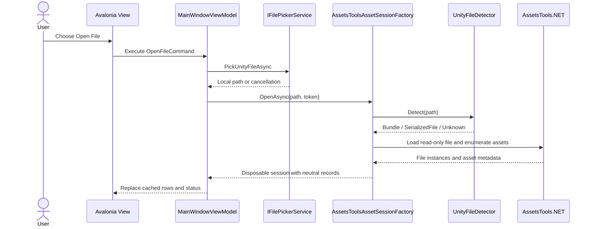
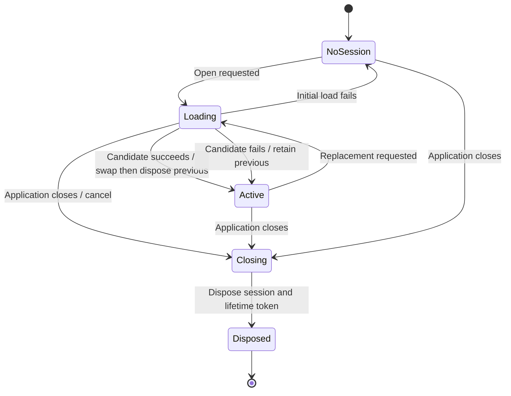

# Asset Loading and Enumeration

## Purpose and status

This subsystem opens a read-only Unity bundle or serialized file, enumerates lightweight asset identity records, and owns all AssetsTools.NET resources through a disposable session. It is verified with a real 17,353-byte bundle fixture and a 216,248-byte standalone serialized file derived from that bundle. Multi-file bundle fixture coverage remains a gap.

## Components

| Component | Role |
|---|---|
| `UnityFileDetector` | Header-based bundle/serialized/unknown classification |
| `IAssetSessionFactory` | Asynchronous session creation contract |
| `AssetsToolsAssetSessionFactory` | AssetsTools.NET loading, classdata selection, decompression, enumeration |
| `IAssetSession` | Metadata, neutral asset rows, warnings, and disposal boundary |
| `AssetDetails` | Neutral lazy entry/session metadata returned for a selected asset |
| `AssetsToolsAssetSession` | Owns `AssetsManager` and source/unpacked streams |
| `AssetEntry` | Neutral name/type/class/path/size/provenance record |
| `MainWindowViewModel` | Transactional session replacement and UI state |

Infrastructure sources are under `UABS.UnityAssets`; presentation orchestration is under `UABS/Script/ViewModels` and `UABS/Script/Services`.

## Loading sequence — implemented

Parsing runs through `Task.Run` inside the factory. The ViewModel awaits from the Avalonia UI context, then replaces the asset-list projection on that context.

## Detection and enumeration

Bundle signatures `UnityFS`, `UnityRaw`, and `UnityWeb` are recognized directly. Serialized-file detection applies the migrated format/version-header heuristic. Unknown input is rejected before AssetsTools.NET loading.

For each contained serialized file, enumeration reads `AssetFileInfo` identity without general object deserialization. Type/name resolution uses embedded type trees first, then a loaded class database, plus targeted GameObject/MonoBehaviour name handling. Failures fall back to the enum/class ID and `Unnamed asset` rather than aborting the session.

## Session lifecycle — implemented

A candidate session never replaces `_session` until loading finishes successfully. Normal and failed-open paths unload AssetsTools state and dispose owned streams. Disposal is idempotent. Source files are opened with read access only.

## Class database and dependencies

`AssetsTools.NET.dll` version 3.0.0.0 is vendored under `Dependencies/AssetsTools.NET`. `classdata.tpk` is deployed from `UABS.UnityAssets/Resources` and located from `AppContext.BaseDirectory`. Missing/incompatible classdata produces warnings; type-tree-enabled input can still enumerate.

No Unity runtime, Cpp2IL, MonoCecil, image decoder, or native texture dependency participates in this subsystem today.

## Verification

The tests in `UABS.UnityAssets.Tests` cover bundle and standalone-file detection/loading, invalid/missing input, real enumeration, names/types/provenance/details, stable path IDs, byte sizes, missing classdata warning, repeated open/close, idempotent disposal, exclusive file reopen, transactional replacement, empty results, and close disposal.

See [Milestone 02 report](../05_audit/milestone-02-report.md) for current commands and results.

## Limitations and next tests

- Add a bundle with multiple serialized files to verify logical provenance.
- Measure and bound memory use for compressed bundles, currently unpacked into `MemoryStream`.
- Add malformed/version-diverse and Mono/IL2CPP fixtures before broad compatibility claims.
- Perform a manual Windows picker-to-grid verification.
