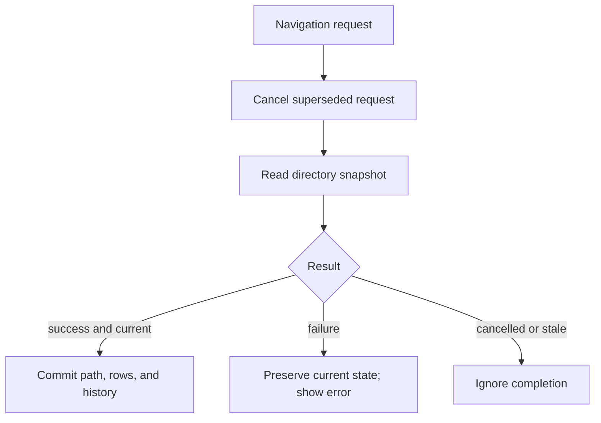

# Filesystem Browser and Asset List

## Scope and status

Milestone 2 implements read-only filesystem navigation, asset-list filtering/sorting/selection, and lazy metadata details. It does not add preview, export, package, search, dependency, or memo behavior.

## Filesystem service and browser

`DirectoryBrowserService` canonicalizes a path and enumerates its immediate `FileSystemInfo` children on a worker task. It returns a `DirectorySnapshot` containing neutral `BrowserEntry` records. Directories sort before files, then by case-insensitive name. The service does not inspect or mutate file contents.

`BrowserViewModel` owns navigation policy. It commits `CurrentPath`, rows, and history only after a successful read. Each new request cancels the preceding one and carries a version number so a stale completion cannot overwrite newer state.

History is stored as independent back and forward stacks. A successful new destination pushes the old path to Back and clears Forward. Back and Forward transfer the old current path to the opposite stack only after the destination succeeds. Refresh changes neither stack.

## Asset-list projection

`AssetListViewModel.ReplaceSession` accepts an already loaded session and caches its `AssetEntry` list. Name, type, and path-ID filters plus one sort choice create a new visible array only when criteria change. This keeps the Unity parse cost outside presentation operations and avoids one collection notification per row.

Selection behavior is based on the `AssetEntry` instance, not Path ID alone, because Path IDs are scoped to their logical serialized file. Sorting retains that instance; hiding it or replacing the session clears selection.

## Details and cancellation

Selecting a row calls `IAssetSession.GetDetailsAsync`. A per-request token and monotonically increasing version prevent results from an old selection or old session from appearing. `AssetDetails` currently contains verified entry/session metadata; it deliberately does not deserialize arbitrary Unity objects.

## Ownership boundary

`MainWindowViewModel` owns and replaces the active session. `BrowserViewModel` can request a file open but does not retain or dispose sessions. `AssetListViewModel` reads from a session but also does not own it. This separation ensures folder navigation cannot invalidate the displayed asset list.

## Verification and limitations

Automated tests cover real directory enumeration, folder-first order, missing-directory errors, history branching, refresh, failure preservation, file-open delegation, browser/session independence, numeric sort, combined filters, selection rules, lazy details, rapid-selection races, and session replacement.

Remaining gaps are full graphical interaction verification, permission-denied behavior on multiple operating systems, performance measurement with very large directories/lists, and multi-serialized-file identity coverage.
