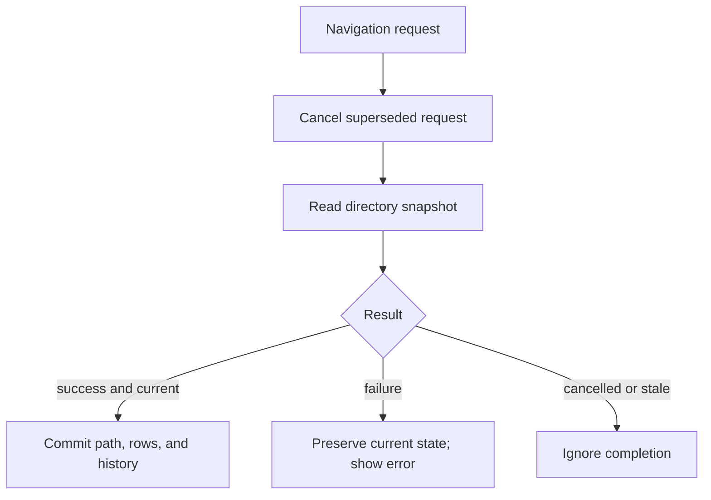
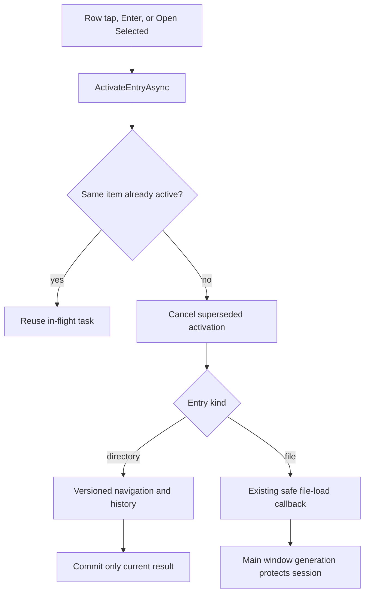

# Filesystem Browser and Asset List

## Scope and status

Milestone 2 implements read-only filesystem navigation, asset-list filtering/sorting/selection, and lazy metadata details. UX-1A adds direct pointer and Enter activation. UX-1B retains all immediate directories while showing only content-recognized Unity bundles and serialized files. It does not add previews, export, package changes, search/dependency redesign, memo changes, or recursive directory classification.

## Filesystem service and browser

`DirectoryBrowserService` canonicalizes a path and enumerates immediate directories and files on a worker task. Every immediate directory is returned without inspecting its descendants. Each file receives one lightweight header inspection per scan; only Supported results become neutral `BrowserEntry` rows. Directories sort before files, then by case-insensitive name. No file is modified.

### Recognition results and signatures

`UnityFileRecognitionService` wraps the existing `UnityFileDetector` and reports four explicit outcomes:

| Outcome | Browser behavior | Meaning |
| --- | --- | --- |
| Supported | Show | A Bundle or SerializedFile signature recognized by the current loader boundary |
| RecognizedUnsupported | Hide | A recognized kind that the loader does not support; retained as an explicit future-safe outcome |
| Invalid | Hide | Header is unrelated, malformed, or not recognized as a supported Unity file |
| Unreadable | Hide and log diagnostic | File disappeared or header access failed with an I/O, access, or security exception |

Bundle recognition reads the seven-byte ASCII signature and accepts `UnityFS`, `UnityRaw`, or `UnityWeb`. Serialized-file recognition reads the big-endian format field at byte `0x08`, then a bounded version string at `0x14` or `0x30` according to the format. The detector reads at most the header/version probe rather than the asset payload. Extensions are ignored: a valid file can use a conventional, unusual, or absent extension, while a fake `.bundle` remains hidden.

Standalone Unity resource sidecars such as `.resS` are not independently loadable sessions and have no general signature supported by this detector. They remain hidden. They may still be consumed indirectly when a supported serialized file or bundle is loaded.

Recognition controls visibility only. A recognized header does not prove the complete file can load: damaged block data, unsupported compression, missing sidecars or dependencies, type metadata problems, and deeper parser failures remain load-time errors handled by the existing safe session-replacement path.

### Responsiveness, cancellation, and refresh

The entire scan runs away from the UI thread. Header work uses a bounded parallel loop with at most four concurrent inspections by default, checks cancellation before and after recognition, and promptly disposes each detector-owned stream. It does not deserialize bundles or enumerate their assets.

`BrowserViewModel` still assigns a generation to every navigation. Switching directories cancels the preceding scan, and a completion can publish rows/history only when its generation remains current. Refresh performs a fresh scan so added, removed, or changed files are reflected. No persistent cache or filesystem watcher is used; this avoids stale identity and invalidation complexity until measurements demonstrate a need.

`BrowserViewModel` owns navigation policy. It commits `CurrentPath`, rows, and history only after a successful read. Each new request cancels the preceding one and carries a version number so a stale completion cannot overwrite newer state.

History is stored as independent back and forward stacks. A successful new destination pushes the old path to Back and clears Forward. Back and Forward transfer the old current path to the opposite stack only after the destination succeeds. Refresh changes neither stack.

When a successful scan has no visible rows, the browser shows “No supported Unity asset files found in this folder.” This is a normal empty state, not an error. A directory access failure continues to preserve the prior state and display an error instead.

## Item activation

`BrowserView` maps a DataGrid row tap to `BrowserViewModel.ActivateEntryAsync`. Enter uses a handled-event-aware tunnel handler so the DataGrid cannot consume the key before activation; Space is intentionally ignored. The existing **Open Selected** button calls the same method.

Directories enter the existing versioned navigation pipeline. Files call the existing `MainWindowViewModel` file-load path, which retains a valid session when replacement fails. A same-item activation already in flight returns the same task. A different activation cancels the prior one, and file activation invalidates pending directory navigation. The second tap inside the platform double-tap interval is ignored, so a double-click does not start a second operation.

## Asset-list projection

`AssetListViewModel.ReplaceSession` accepts an already loaded session and caches its `AssetEntry` list. Name, type, and path-ID filters plus one sort choice create a new visible array only when criteria change. This keeps the Unity parse cost outside presentation operations and avoids one collection notification per row.

Selection behavior is based on the `AssetEntry` instance, not Path ID alone, because Path IDs are scoped to their logical serialized file. Sorting retains that instance; hiding it or replacing the session clears selection.

## Details and cancellation

Selecting a row calls `IAssetSession.GetDetailsAsync`. A per-request token and monotonically increasing version prevent results from an old selection or old session from appearing. `AssetDetails` currently contains verified entry/session metadata; it deliberately does not deserialize arbitrary Unity objects.

## Ownership boundary

`MainWindowViewModel` owns and replaces the active session. `BrowserViewModel` can request a file open but does not retain or dispose sessions. `AssetListViewModel` reads from a session but also does not own it. This separation ensures folder navigation cannot invalidate the displayed asset list.

UX-2A preserves that boundary while changing presentation. `AssetsWorkspaceLayoutViewModel` owns only in-memory Navigator/Inspector width and visibility. `FolderView` remains the center asset-list presentation, while `AssetInspectorView` reads the same `AssetListViewModel.SelectedAsset` and `SelectedDetails`. Collapsing a panel or switching workspaces cannot clear selection or dispose the session.

## Verification and limitations

Automated tests cover real directory enumeration, folder-first order, missing-directory errors, history branching, refresh, failure preservation, file-open delegation, browser/session independence, numeric sort, combined filters, selection rules, lazy details, rapid-selection races, and session replacement. UX-1A adds headless view tests for folder and file row clicks, Enter, Space, double-click suppression, rapid click ordering, and click-path failure reporting. UX-1B adds conventional/unusual/extensionless bundle recognition, serialized-file recognition, fake-extension and unrelated-file rejection, directory preservation, empty and unsupported-only navigation, deleted/unreadable diagnostics, bounded cancellation, refresh after filesystem changes, stream disposal, and headless empty-state coverage.

Remaining gaps are user-driven desktop acceptance, cross-platform permission-denied observation, performance measurement on genuinely large production directories, and multi-serialized-file identity coverage. Header recognition is deliberately conservative and does not guarantee a subsequent complete load.
