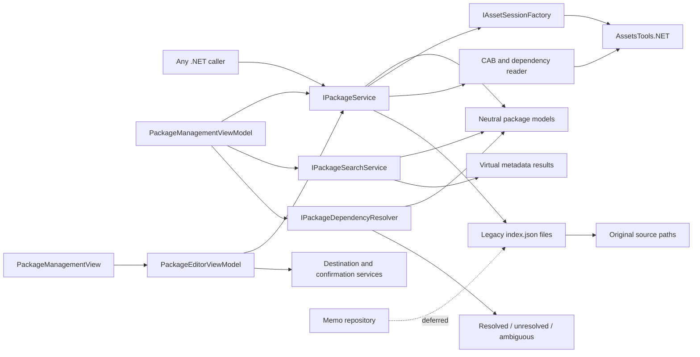
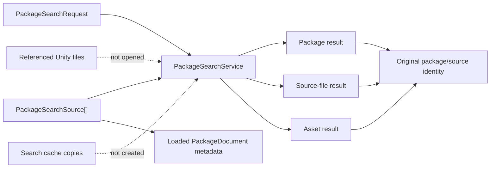
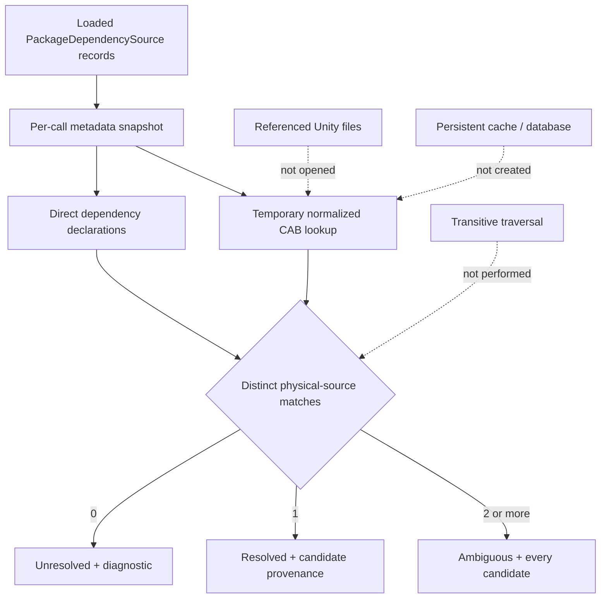
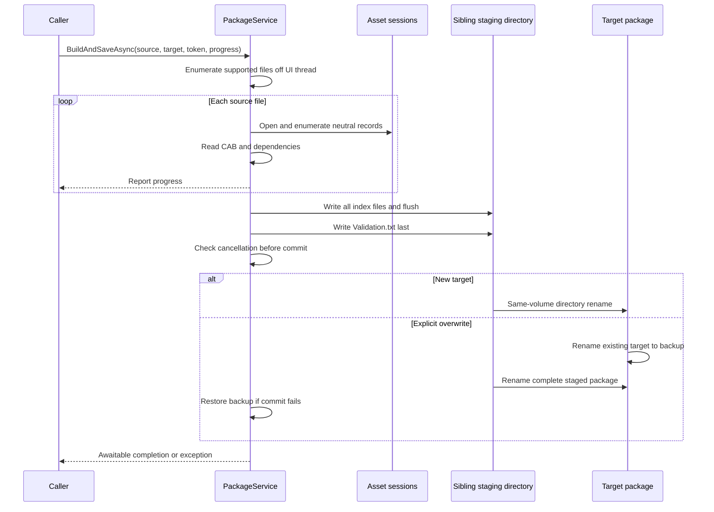

# Package, Search, Dependency, and Memo Systems

## Current status

The Unity-independent package model, reader, validator, builder, safe writer, resilient catalog service, metadata search service, and direct dependency resolver are implemented in `UABS.UnityAssets.Packages`. Avalonia catalog/content/search/direct-dependency presentation and package creation/edit/save are implemented through `PackageManagementViewModel`, `PackageEditorViewModel`, and `PackageManagementView`. Milestones 7.1–7.3 add fresh-service rediscovery, header-based source detection, transactional current-folder or recursive folder import, and explicit scope/save-state diagnostics verified against a real nested bundle tree. Milestone 7.5 preserves source-relative index placement during folder import and introduces non-I/O Windows path identity compatible with stored normal and extended spellings. Reverse-dependency lookup and memo editing/inheritance remain deferred.

## Verified legacy format

A legacy user package is a directory tree, not one manifest file. Its root contains an empty `Validation.txt` marker. Every indexed source directory, including empty directories and the source root, maps to an `index.json` file containing a JSON array with this unversioned schema:

```text
Bundle: Name, Path, CabCode, AssetInfos[], Dependencies[]
AssetInfo: Name, PathId, optional Memo
```

- `Name` is the source filename.
- `Path` is the absolute original bundle or serialized-file path.
- `CabCode` is the first printable `CAB-...` token found in the source bytes; it may be empty.
- `AssetInfos` contains Sprite (class ID 213) and Texture2D (class ID 28) names and path IDs.
- `Dependencies` contains strings from the first serialized file's `AssetBundle.m_Dependencies`.
- Memo writers add `Memo` to an asset object after package creation.
- Package roots conventionally live below `External/UABS_UserPackages`, but that relative location is a legacy UI convention rather than part of the file format.

Newtonsoft.Json used public CLR property names, so casing is significant for existing consumers. The Avalonia reader is case-insensitive for tolerance and the writer emits the exact legacy names. Unknown bundle/asset properties are retained during load/save so later or hand-authored metadata is not discarded.

The schema has no package identifier, schema version, source-root metadata, asset type, or per-serialized-file identity. A Path ID therefore identifies an asset only together with its source `Path`; a legacy index cannot disambiguate equal path IDs in multiple serialized files inside one bundle. Milestone 3 preserves this limitation instead of inventing incompatible fields. Explicit schema versioning remains a future opt-in proposal.

## Implemented service architecture



`PackageService` supports:

- loading every nested `index.json` and validating required fields;
- reporting a missing marker or missing referenced source without discarding readable data;
- creating a package from supported Unity files detected by header, regardless of conventional, arbitrary, or missing filename extension;
- preserving original absolute source paths and selected asset identities;
- adding/removing source references through `PackageDocument`;
- saving and reopening the directory layout represented by the supplied `PackageDocument`;
- listing marked package directories;
- retaining unknown JSON fields and optional legacy memos.
- constructing a single source reference for all supported assets or an exact source/name/Path-ID/logical-file selection without copying the Unity source.
- scanning either the current folder or its physical child-directory tree for supported sources with progress, cancellation, unsupported-file skipping, inaccessible-path/per-file failure reporting, and reparse-point avoidance.

The implementation remains in `UABS.UnityAssets` because both session enumeration and dependency extraction require AssetsTools.NET. It has no Avalonia reference, and the public models expose no AssetsTools.NET objects.

`ReadCatalogAsync` is the UI-facing catalog enumeration path. It accepts either a parent catalog, whose top-level child directories are attempted independently, or one package directory containing root `Validation.txt` or `index.json`. Each `PackageCatalogEntry` contains either a loaded document or an error. An unmarked but readable directory loads with the existing validation issue; malformed JSON or missing indexes produce an error entry. This prevents one damaged package from aborting the entire catalog while supporting direct selection of a saved package.

Folder scanning returns a result snapshot before the editor changes. `PackageEditorViewModel` merges that snapshot into a cloned document and publishes it once, preserving the previous document and dirty state if cancellation or any batch-level failure occurs. Current-folder-only is the default; its result reports how many immediate child directories were deliberately not scanned. An explicit recursive mode walks child directories without following symbolic links or junctions. Files are detected and processed sequentially, and the service never copies, renames, or modifies source files.

Imported rows exist only in the editor's isolated document until an explicit Save completes. The editor therefore keeps source/asset counts and saved/unsaved state visible, and successful folder-import feedback states this persistence boundary. This is distinct from the staged package writer: folder import reads source metadata and mutates editor state; Save writes the legacy package indexes.

`PackageService.CreateAsync` builds source-relative indexes and retains empty directories. Folder scanning also returns source-relative mappings for supported imports, and `PackageEditorViewModel` adds genuinely new sources to those indexes. Existing records remain in their current indexes, including flat layouts, and existing empty indexes survive save/reopen. Scanning does not create new empty indexes. The application therefore targets practical interoperability rather than exact reproduction of every Unity writer quirk.

`PackagePathComparer` provides identity-only comparison for normal and extended Windows drive/UNC paths. It performs lexical normalization with `Path.GetFullPath` only for fully qualified paths, never probes the filesystem or resolves links, and never changes the serialized `Path`. Unsupported device namespaces and malformed input are not collapsed. The same identity is used for editor duplicate detection and dependency-candidate deduplication.

## Implemented metadata search

`PackageSearchService` searches already-loaded `PackageDocument` objects and never opens a package index or referenced Unity file. The synchronous core is wrapped by `SearchAsync`, which runs away from the caller thread, accepts cancellation, and never returns a partial result after cancellation.



Searchable text fields are package name/path, index-relative directory, source filename/path, CAB code, dependency strings, asset name, and memo. Path ID uses a separate exact numeric filter. Asset type and logical serialized-file name are not searchable because the legacy package schema does not contain them; the service does not reopen source files or guess values.

Matching semantics:

- text comparisons use `StringComparison.OrdinalIgnoreCase`, independent of UI culture;
- comma and Chinese-comma input terms are trimmed and combined with OR;
- exclusions are evaluated first within the candidate's selected metadata fields;
- `ExactText` requires whole-field equality; default matching is substring containment;
- Path ID is exact numeric equality and can distinguish results only in combination with package/source provenance;
- an empty text query returns no results unless a Path ID is supplied;
- null/missing optional values never match and do not fail a search;
- package, source-file, and asset result kinds and searchable fields can be filtered explicitly.

Sorting supports package name, index directory, source name/path, asset name, Path ID, and match category in either direction. Path IDs are compared numerically. Stable identity fields provide deterministic tie-breaking. Results are newly allocated read-only snapshots; dependency collections are copied and cannot mutate the package model.

Compared with legacy `FindDeriveInfoInPackage`, the new service aggregates multiple packages in one request and reports the exact match level/category rather than collapsing every match into `DeriveInfo { name, path, cabCode }`. It preserves the useful OR/case-insensitive/exclusion concepts while fixing the empty exact-query crash and avoiding repeated recursive JSON reads.

## Implemented direct dependency resolution

`PackageDependencyResolver` resolves every direct dependency declaration in caller-supplied, already-loaded `PackageDocument` objects. Its synchronous core is exposed through `IPackageDependencyResolver.Resolve`; `ResolveAsync` runs the same work on a worker task. Both accept cancellation. Each operation snapshots the required metadata and builds a temporary lookup that is discarded with the call. There is no persistent index, database, filesystem scan, or source-file load.



Each result retains the requesting package name/path, index directory, source name/path, source CAB value, and the dependency string exactly as stored. Every candidate retains its original source path, all observed normalized CAB values, and every package/index/source occurrence contributing that same physical path. Missing paths are marked as incomplete provenance rather than invented.

Resolution semantics are intentionally narrower than the legacy method:

- CAB identifiers are trimmed and compared with ordinal case-insensitive semantics.
- A valid identifier must start with `CAB-`, contain a non-empty suffix, and contain no internal whitespace.
- Exact matches are preferred by the same candidate set, but the resolver also accepts either side being exactly one trailing character shorter. This preserves the verified legacy writer's off-by-one CAB truncation without retaining arbitrary prefix matching.
- Multiple package records whose source paths differ only by case, slash direction, trailing separators, or safe normal/extended drive/UNC spelling represent one physical candidate; their occurrences are preserved.
- Distinct paths with the same CAB remain separate and yield `Ambiguous`.
- Missing/empty paths cannot establish physical identity, so such records are never deduplicated.
- Null, empty, malformed, and unmatched declarations yield `Unresolved` with a diagnostic instead of throwing or disappearing.
- Resolution is direct only. The service reports declarations found on every input source but never follows a resolved edge to build a transitive graph.

The legacy `FindDeriveInfoInPackage.FindInPackageByCabCode` rereads all package JSON recursively for each dependency, uses either-direction `StartsWith`, and returns the first matching record. Consequently it can accept unrelated long prefixes and silently hide duplicate CABs. The replacement makes all candidates visible and performs no I/O after package loading.

## Implemented Avalonia package workflow

`PackageManagementViewModel` composes `IPackageService`, `IPackageSearchService`, and `IPackageDependencyResolver`; none of their algorithms are duplicated in presentation code. Catalog, search, and dependency operations use separate cancellation sources and generation checks. Results from superseded selection or search requests are ignored.

The ViewModel exposes read-only presentation snapshots for package rows and flattened source/asset content rows. Search results preserve the service's package/source provenance. Dependency presentation wraps, but does not reinterpret, status or candidates. `ResolveForPackageAsync` builds candidate lookup data from the whole loaded catalog while emitting request edges only for the selected package.

No package metadata is changed by browsing. Editing uses a deep copy, so loaded catalog records are unchanged until an explicit save. Source files are opened read-only only when the user adds references; they are never copied, extracted, or rewritten. A dedicated destination picker and confirmation service distinguish destination selection from source selection and prevent silent overwrite.

The editor saves a document snapshot and reloads the target before marking it clean. If edits occur while that snapshot is saving, the verified disk result is reported but the newer editor state remains dirty. Catalog reload and package switching require discard confirmation while dirty. Application closing uses the same confirmation boundary.

## Build and persistence workflow



Overwrite is rejected by default. An explicitly approved replacement is prepared completely beside the target, then committed with same-volume directory renames. The old target is retained as a backup during the swap and restored if the new directory cannot be moved into place. Cancellation and write failures delete staging output; cancellation is honored before commit, not during the final rename sequence. A multi-file directory swap cannot be one filesystem-level `File.Replace`, so a very small gap between the two overwrite renames remains.

## UE-007 replacement

Legacy `WriteUserPackage.CreateAndSaveNewPackage` is `async void`, starts an untracked raw `Thread`, and queues completion through `UnityMainThreadDispatcher.Update`. Failures cannot reliably reach the caller, and `WriteUserPackageButton`'s outer `Task.Run` completes before the raw thread.

`PackageService.BuildAndSaveAsync` instead returns an awaitable `Task<PackageDocument>`, accepts `CancellationToken` and `IProgress<PackageProgress>`, and surfaces exceptions. `PackageEditorViewModel` now awaits these UI-independent persistence operations and publishes progress/error/dirty state on the presentation edge. This verified replacement is tracked as [UE-007](../05_audit/unity-exclusive-features.md).

## Legacy consumers still deferred

Legacy `DependentReader` performs reverse lookup and remains a separate product decision. `MemoReader`, `MemoWriter`, and `InheritMemoWriter` identify memos by source path plus asset name rather than path ID.

Memo behaviors remain unimplemented. Future navigation must use the original paths already present in dependency/search results rather than reproduce the legacy `External/UABS_System_Cache` bundle-copy behavior.

## Remaining risks

- No commercial production package is committed; the committed tests use small schema-faithful structures. A genuine local Unity package completed a disposable save/fresh-load comparison with all 422 indexes and 6,671 source records unchanged.
- Existing packages store absolute paths and currently report moved/missing sources; path remapping is not implemented.
- Package creation performs a second AssetsTools.NET open to read first-file dependencies; large-tree performance is not benchmarked.
- The format cannot retain per-logical-file provenance for multi-serialized-file bundles.
- The legacy CAB reader drops the last printable character due to an off-by-one substring length. The new writer emits the full token; the resolver permits only a one-character length difference, and broader production fixtures should confirm this compatibility rule.
- Concurrent writers are not coordinated with a process-wide/package lock.
- Asset type and per-logical-file provenance cannot be searched until a compatible schema extension exists.
- Search is a linear in-memory scan with per-query result allocation; no large-catalog benchmark has been run.
- Reverse dependencies, memo persistence, and schema upgrades remain separate milestones.

See [Milestone 06 report](../05_audit/milestone-06-report.md), [migration roadmap](../05_audit/migration-roadmap.md), and [open questions](../05_audit/open-questions.md).
