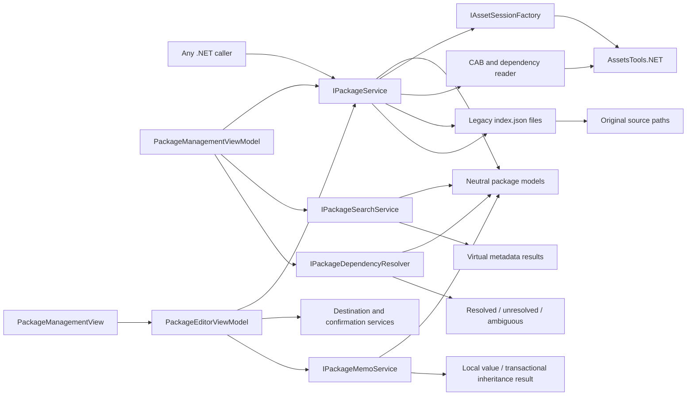
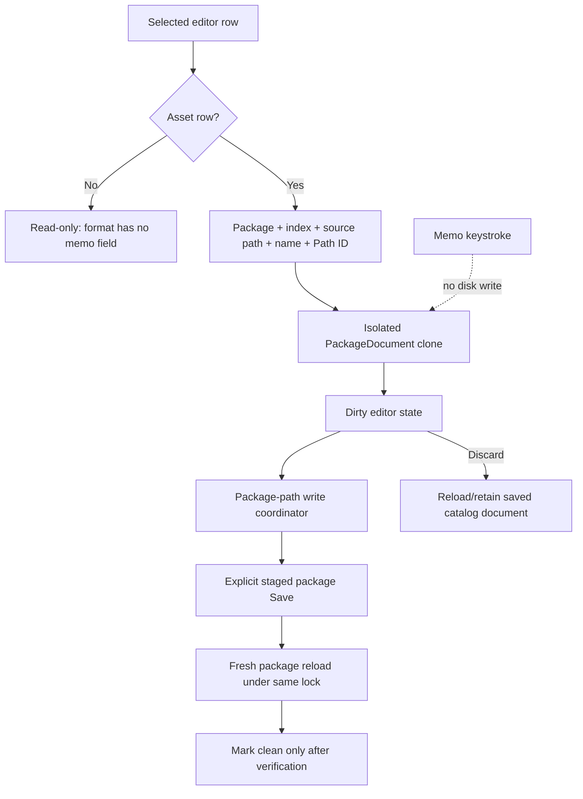
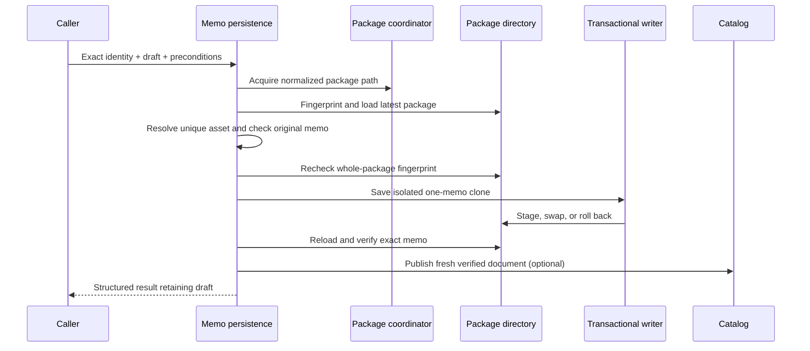
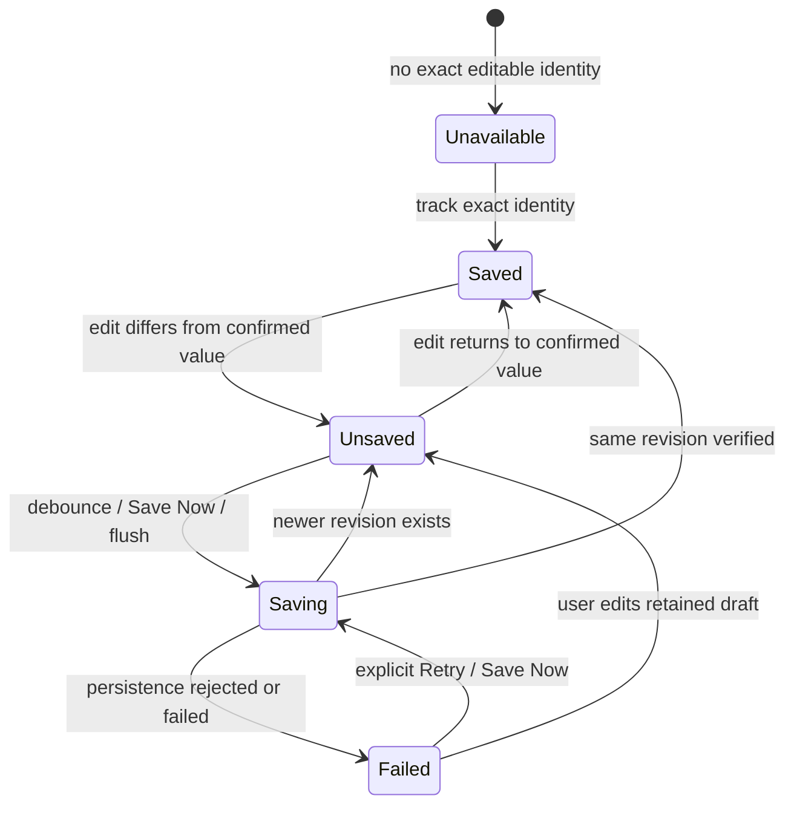
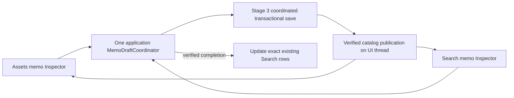
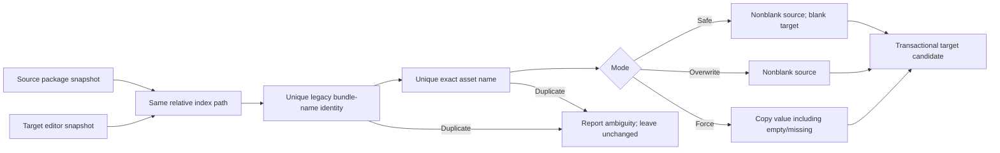
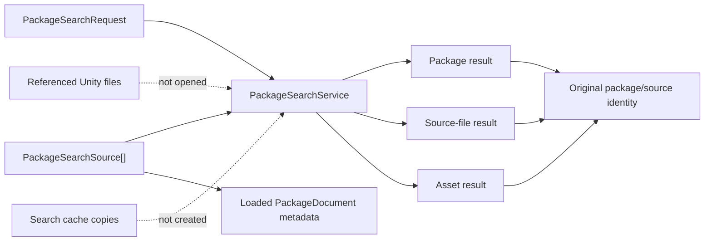
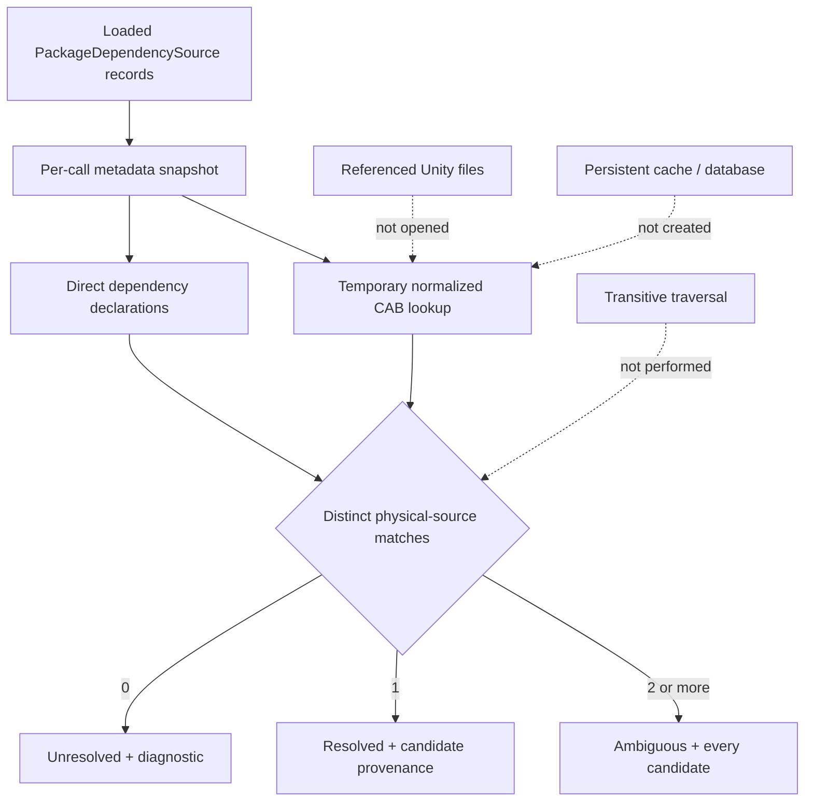
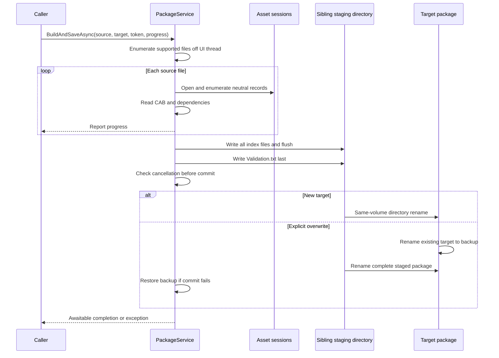

# Package, Search, Dependency, and Memo Systems

## Current status

The Unity-independent package model, reader, validator, builder, safe writer, resilient catalog service, metadata search service, direct dependency resolver, and memo service are implemented in `UABS.UnityAssets.Packages`. Avalonia catalog/content/direct-dependency presentation, package creation/edit/save, asset memo editing, and package-to-package memo copy are implemented through `PackageManagementViewModel`, `PackageEditorViewModel`, and `PackageManagementView`. UX-3A moves general package metadata search into the dedicated `SearchWorkspaceViewModel`/`SearchWorkspaceView` while sharing the existing catalog and search service. Reverse-dependency lookup remains deferred.

## Verified legacy format

A legacy user package is a directory tree, not one manifest file. Its root contains an empty `Validation.txt` marker. Every indexed source directory, including empty directories and the source root, maps to an `index.json` file containing a JSON array with this unversioned schema:

```text
Bundle: Name, Path, CabCode, AssetInfos[], Dependencies[]
AssetInfo: Name, PathId, optional Memo
```

- `Name` is the source filename.
- `Path` is the absolute original bundle or serialized-file path.
- `CabCode` is the first printable `CAB-...` token found in the source bytes; it may be empty.
- `AssetInfos` contains Sprite (class ID 213) and Texture2D (class ID 28) names and path IDs.
- `Dependencies` contains strings from the first serialized file's `AssetBundle.m_Dependencies`.
- Memo writers add `Memo` to an asset object after package creation.
- Package roots conventionally live below `External/UABS_UserPackages`, but that relative location is a legacy UI convention rather than part of the file format.

Newtonsoft.Json used public CLR property names, so casing is significant for existing consumers. The Avalonia reader is case-insensitive for tolerance and the writer emits the exact legacy names. Unknown bundle/asset properties are retained during load/save so later or hand-authored metadata is not discarded.

The schema has no package identifier, schema version, source-root metadata, asset type, or per-serialized-file identity. A Path ID therefore identifies an asset only together with its source `Path`; a legacy index cannot disambiguate equal path IDs in multiple serialized files inside one bundle. Milestone 3 preserves this limitation instead of inventing incompatible fields. Explicit schema versioning remains a future opt-in proposal.

## Implemented service architecture



`PackageService` supports:

- loading every nested `index.json` and validating required fields;
- reporting a missing marker or missing referenced source without discarding readable data;
- creating a package from supported Unity files detected by header, regardless of conventional, arbitrary, or missing filename extension;
- preserving original absolute source paths and selected asset identities;
- adding/removing source references through `PackageDocument`;
- saving and reopening the directory layout represented by the supplied `PackageDocument`;
- listing marked package directories;
- retaining unknown JSON fields and optional legacy memos.
- constructing a single source reference for all supported assets or an exact source/name/Path-ID/logical-file selection without copying the Unity source.
- scanning either the current folder or its physical child-directory tree for supported sources with progress, cancellation, unsupported-file skipping, inaccessible-path/per-file failure reporting, and reparse-point avoidance.

The implementation remains in `UABS.UnityAssets` because both session enumeration and dependency extraction require AssetsTools.NET. It has no Avalonia reference, and the public models expose no AssetsTools.NET objects.

`ReadCatalogAsync` is the UI-facing catalog enumeration path. It accepts either a parent catalog, whose top-level child directories are attempted independently, or one package directory containing root `Validation.txt` or `index.json`. Each `PackageCatalogEntry` contains either a loaded document or an error. An unmarked but readable directory loads with the existing validation issue; malformed JSON or missing indexes produce an error entry. This prevents one damaged package from aborting the entire catalog while supporting direct selection of a saved package.

Folder scanning returns a result snapshot before the editor changes. `PackageEditorViewModel` merges that snapshot into a cloned document and publishes it once, preserving the previous document and dirty state if cancellation or any batch-level failure occurs. Current-folder-only is the default; its result reports how many immediate child directories were deliberately not scanned. An explicit recursive mode walks child directories without following symbolic links or junctions. Files are detected and processed sequentially, and the service never copies, renames, or modifies source files.

Imported rows exist only in the editor's isolated document until an explicit Save completes. The editor therefore keeps source/asset counts and saved/unsaved state visible, and successful folder-import feedback states this persistence boundary. This is distinct from the staged package writer: folder import reads source metadata and mutates editor state; Save writes the legacy package indexes.

`PackageService.CreateAsync` builds source-relative indexes and retains empty directories. Folder scanning also returns source-relative mappings for supported imports, and `PackageEditorViewModel` adds genuinely new sources to those indexes. Existing records remain in their current indexes, including flat layouts, and existing empty indexes survive save/reopen. Scanning does not create new empty indexes. The application therefore targets practical interoperability rather than exact reproduction of every Unity writer quirk.

`PackagePathComparer` provides identity-only comparison for normal and extended Windows drive/UNC paths. It performs lexical normalization with `Path.GetFullPath` only for fully qualified paths, never probes the filesystem or resolves links, and never changes the serialized `Path`. Unsupported device namespaces and malformed input are not collapsed. The same identity is used for editor duplicate detection and dependency-candidate deduplication.

## Implemented memo semantics

Legacy source tracing establishes a narrower model than a general hierarchical note system:

- only `AssetInfos[]` entries own `Memo`;
- package directories, index directories, and source records have no memo field;
- a missing/JSON-null value and an explicit empty string are distinct persisted states;
- clearing the legacy text field writes `"Memo": ""`;
- direct legacy lookup uses source `Path` plus asset `Name`; and
- legacy “inheritance” copies values between two package versions at the same relative index path. It is not parent-to-child directory inheritance.

`PackageMemoService` uses package path, index-relative directory, normalized source-path identity, asset name, and Path ID for direct editing. This prevents equal Path IDs in different sources from colliding without adding any persisted identifier. If the complete identity is duplicated, the operation reports ambiguity and changes nothing.

Stage 1 read-only Inspector integration adds `PackageMemoResolver` over the same neutral metadata. Search asset results are revalidated by their complete package provenance rather than trusting a stale result snapshot. Assets selections search the loaded catalog by normalized source path, exact asset name, and Path ID without restricting Unity class ID. Exactly one match is required: no match, duplicate package records, incomplete/stale provenance, non-asset Search results, and duplicate logical-file identities are shown as distinct unavailable states. The shared Inspector presenter displays the complete stored memo and package context while preserving missing versus explicit-empty storage. Resolution is synchronous, performs no I/O, never edits a package document, and remains independent in Assets and Search.

The unversioned `AssetInfos` shape is already type-agnostic: `Name`, `PathId`, and optional `Memo` can represent any indexed Unity asset without a schema revision, and source/index/package provenance supplies the rest of the resolver identity. Current package creation, folder import, and Add Selected intentionally enumerate only Texture2D (28) and Sprite (213), however. Supporting newly indexed arbitrary types therefore requires a separate indexing change: remove those creation/editor filters, enumerate every session asset into the existing `AssetInfos` fields, preserve the current logical-file selection check, and retain ambiguity rejection where a bundle has duplicate name/Path-ID identities across logical files. No new serialized field is required for unambiguous records; a future schema field would be required only to represent otherwise ambiguous logical-file identities.



Memo text is written to the isolated editor document as the user types, so row selection and Assets/Packages workspace changes cannot lose it. No package file is written on a keystroke or focus change. The existing package Save transaction snapshots all pending edits, writes a sibling staging directory, swaps only after successful preparation, reloads the result, and retains newer or failed edits as dirty.

### Package write coordination

`MainWindowViewModel` owns one application-lifetime `IPackageWriteCoordinator` and injects it through the Packages workspace into `PackageEditorViewModel`. Directly composed editors receive their own coordinator by default. The coordinator keys a reference-counted asynchronous semaphore by `PackagePathComparer.GetIdentity`, so normal/extended Windows spellings of the same path serialize while different package paths remain independent. Entries include holders and waiters and are removed and disposed when their final user leaves; there is no global package lock or unbounded per-path registry.

The editor acquires coordination only after explicit Save validation and overwrite confirmation. Its exclusive operation includes staged `IPackageService.SaveAsync`, uncancelled verification reload, current-generation publication, and the catalog-saved callback. Cancellation while waiting never invokes the operation, and every success, failure, or cancellation path releases the entry. `PackageService` continues honoring cancellation during staging and immediately before commit; once its destructive directory-swap sequence begins, it performs rollback or completes without another cancellation checkpoint. The coordinator itself has no disposal lifecycle, so application shutdown cannot dispose a semaphore still used by an active operation; existing editor shutdown cancellation remains unchanged.

This coordinator provides in-process mutual exclusion, not freshness merging or cross-process filesystem locking. It does not save automatically or reconcile stale working documents.

### Transactional memo-only persistence

`PackageMemoPersistenceService` is the Stage 3 backend for changing one asset memo without deriving a target from UI selection. Its immutable request carries the complete Stage 1 identity, desired text, expected original memo (including the distinction between `null` and empty), and an optional whole-package revision. Under the shared package-path coordinator it fingerprints the complete package directory, reloads the latest document, resolves exactly one asset, verifies both revision and expected memo, edits an isolated clone, checks the fingerprint again, and uses the existing staged `PackageService` overwrite transaction. It then reloads the package without cancellation, verifies the exact value and stable saved revision, and invokes an optional catalog-publication callback before releasing coordination.



Outcomes distinguish saved, unchanged, missing package/asset, ambiguous identity, revision conflict, active Package Editor, write failure, verification failure, catalog-publication failure, and cancellation before commit. The result retains the request so a later UI can preserve and retry a failed draft; verification or publication failures also identify that the disk transaction already completed. Cancellation is honored while waiting and throughout pre-commit staging. Once `PackageService` enters its directory-swap sequence it completes or restores the backup before returning.

`PackageEditorSessionGuard` records the Package Editor's active package independently of dirty state. Memo-only persistence rejects that same path even when the editor is clean, while other packages remain eligible. It never publishes into or replaces the editor's working clone, so unrelated dirty state and the editor's explicit-Save semantics remain unchanged. Both Inspectors use this guard for eligibility: opening, replacing, saving, or successfully closing Package Editor rechecks eligibility without discarding coordinator-owned drafts. Close Editor still offers Save / Discard / Cancel for dirty sessions; failed Save and Cancel retain the editor and its guard.

The revision is a SHA-256 fingerprint over every regular file's normalized relative path, length, and content plus directory paths; reparse points are excluded. It detects package changes outside any single `index.json`, but it is not an operating-system lock. An external process that ignores UABS coordination can still modify the directory after the final pre-commit check and race the transactional replacement. The service reports conflicts rather than merging or silently retrying, and cross-process locking remains deferred.

### Application-lifetime memo drafts

Stage 4 adds one application-owned `MemoDraftCoordinator`; Stage 5 connects Search and Stage 6 connects Assets to that same instance. Drafts are keyed by normalized package/source paths plus index directory, exact asset name, and Path ID, so changing selection or workspace cannot retarget a pending save. Each entry retains draft and confirmed text, the confirmed package fingerprint, a monotonic draft revision, structured failure details, and an observable snapshot. Missing (`null`) and explicitly empty memo text remain distinct. Revision capture also observes the entry before awaiting I/O: if another Inspector, edit, or save advances that entry while capture is pending, the earlier catalog value cannot reset the current draft/confirmed state.



The internal debounce is 1.5 seconds through injectable `IMemoDraftDelay`. Each edit cancels the preceding delay; timer cancellation never supplies the transaction token, so it cannot cancel a save that already started. Per-asset gates coalesce equivalent overlapping requests, while `PackageWriteCoordinator` remains the authoritative same-package disk serialization boundary. Stage 3 `Saved` or `Unchanged` results update confirmed content. A verified disk save followed by catalog-publication failure also advances the confirmed baseline but remains Failed until explicit Retry republishes the already-persisted snapshot. A completion for an older draft revision may update that revision's confirmed baseline but cannot mark newer text Saved.

`SaveNowAsync` bypasses the delay, `RetryAsync` is the explicit recovery path for a Failed draft, and `FlushForNavigationAsync` saves pending work for the identity being left without consulting the new selection. A previously Failed draft is retained during ordinary navigation rather than entering an automatic retry loop. Package Editor exclusion is surfaced as an actionable Failed snapshot while drafts for other packages remain eligible.

`DrainForShutdownAsync` stops new timers, waits for in-flight work, attempts remaining drafts once, and returns `AllSaved` plus the retained failure snapshots. It does not alter the current close-confirmation flow: Stage 7 must call and present this result before application teardown. Synchronous disposal still cancels pending timers without claiming that drafts were flushed.

### Editable Assets and Search memo Inspectors

Stage 6 uses `EditableMemoInspectorViewModel` and `EditableMemoInspectorView` in both Assets and Search, backed by the single coordinator owned by `MainWindowViewModel`. `AssetListViewModel` reuses its Stage 1 lookup over normalized source path, exact asset name, and Path ID to obtain exactly one complete package/index/source/name/Path-ID identity. Duplicate matches across packages or logical serialized files are refused. Search revalidates its full result identity. Loose unindexed assets, package/source results, incomplete or stale identities, missing/unloaded packages, and editor conflicts remain disabled with an explanation. Eligibility is type-agnostic for existing index records; Texture2D/Sprite creation/import policy is unchanged.



Selection calls `TrackAsync`, which captures the current whole-package fingerprint before exposing the multiline editor. Text changes update the shared coordinator, inherit its 1.5-second debounce, and surface Unavailable, Saved, Unsaved, Saving, Failed, Save Now, and Retry states. Leaving an asset/result or replacing an Assets session flushes the identity being left while presenting the next selection independently; leaving either workspace also requests a flush. Failed drafts remain available across Inspectors and require explicit Retry. Completion events are identity-filtered and applied on the UI thread using the coordinator's current snapshot, so queued notifications cannot restore an older draft for the same identity or change a different selection.

Package Editor's ordinary selected-asset memo field is now a one-way, read-only multiline display; its direct Clear button is removed. Backend memo mutation APIs remain available to existing operations, and Apply Memo Copy still updates only the isolated editor clone until explicit Save. Pending editor changes are not migrated or discarded. New/imported references must first be saved, loaded in the catalog, and closed in Package Editor before individual Inspector editing can become eligible. Permanently ambiguous or incomplete identities cannot safely be individually edited; the UI explains this limitation, and existing safe bulk-copy operations remain available without bypassing ambiguity checks.

The Stage 3 catalog publisher marshals the verified `PackageDocument` to the UI thread and replaces only the matching catalog item. Search revalidates the selected result against that fresh document but does not rerun, reorder, or remove snapshot results; criteria, package scope, result selection, and pending coordinator drafts remain intact. Package Editor's working clone and dirty state are never refreshed by this path.

Search result rows retain their original identity and ordering, but their memo presentation is observable rather than permanently frozen. A coordinator completion updates every existing row with the same complete package/index/source/name/Path-ID identity only when the completion reports verified `Saved` or `Unchanged` persistence. Failed or conflicted attempts leave the last confirmed row memo unchanged. The update is marshalled to the UI thread and does not replace the result collection, rerun matching, or change selection; missing (`null`) and explicit-empty (`""`) values remain distinct in the row model.

### Package-to-package memo copy

The source package and mode are explicit in the editor. The service clones the target, computes the complete result away from the UI thread, and publishes it only if the editor generation is still current. Cancellation or failure publishes nothing.



The legacy bundle identity removes the file extension and suffix following the last underscore. The replacement preserves that compatibility heuristic, handles names without underscores, and refuses duplicate bundle/asset matches instead of selecting the first filesystem result. Copied values become ordinary local asset memos; the unversioned schema has no inheritance-provenance field.

## Implemented metadata search

`PackageSearchService` searches already-loaded `PackageDocument` objects and never opens a package index or referenced Unity file. The synchronous core is wrapped by `SearchAsync`, which runs away from the caller thread, accepts cancellation, and never returns a partial result after cancellation.



Searchable text fields are package name/path, index-relative directory, source filename/path, CAB code, dependency strings, asset name, and memo. Path ID uses a separate exact numeric filter. Asset type and logical serialized-file name are not searchable because the legacy package schema does not contain them; the service does not reopen source files or guess values.

Matching semantics:

- text comparisons use `StringComparison.OrdinalIgnoreCase`, independent of UI culture;
- comma and Chinese-comma input terms are trimmed and combined with OR;
- exclusions are evaluated first within the candidate's selected metadata fields;
- `ExactText` requires whole-field equality; default matching is substring containment;
- Path ID is exact numeric equality and can distinguish results only in combination with package/source provenance;
- an empty text query returns no results unless a Path ID is supplied;
- null/missing optional values never match and do not fail a search;
- package, source-file, and asset result kinds and searchable fields can be filtered explicitly.
- `RequireNonEmptyMemo` filters only asset candidates and is independent from whether `Memo` is included as a searchable text field.

### Dedicated Search presentation

`SearchWorkspaceViewModel` observes the successfully loaded package catalog and builds an explicit multi-package scope. The first nonempty catalog is selected by default; later additions are left unselected so a refresh cannot silently broaden an already understood scope. Package name filtering affects only presentation, while Select All and Clear affect the complete scope.

An explicit Search command creates one immutable request snapshot. Editing criteria preserves the existing results and marks them stale until the next explicit run. Each run cancels the prior token and uses a generation check before publishing merged results, errors, or completion state. Invalid criteria clears the result set and reports validation instead of invoking the service. Search memos adds the memo field; Memo only maps separately to `RequireNonEmptyMemo`.

The dedicated View uses the established `assetList` DataGrid styling and retains package/source identity in every row. The right side remains source-metadata-only, but eligible indexed asset results now expose the Stage 5 multiline memo editor after exact catalog revalidation. Package/source results clearly report that they do not own asset memos, and unloaded, changed, incomplete, ambiguous, or Package-Editor-owned identities remain unavailable. It does not open referenced Unity files, create cache copies, navigate Assets, or decode media; those remain explicit deferred scopes.

Sorting supports package name, index directory, source name/path, asset name, Path ID, and match category in either direction. Path IDs are compared numerically. Stable identity fields provide deterministic tie-breaking. Results are newly allocated read-only snapshots; dependency collections are copied and cannot mutate the package model.

Compared with legacy `FindDeriveInfoInPackage`, the new service aggregates multiple packages in one request and reports the exact match level/category rather than collapsing every match into `DeriveInfo { name, path, cabCode }`. It preserves the useful OR/case-insensitive/exclusion concepts while fixing the empty exact-query crash and avoiding repeated recursive JSON reads.

## Implemented direct dependency resolution

`PackageDependencyResolver` resolves every direct dependency declaration in caller-supplied, already-loaded `PackageDocument` objects. Its synchronous core is exposed through `IPackageDependencyResolver.Resolve`; `ResolveAsync` runs the same work on a worker task. Both accept cancellation. Each operation snapshots the required metadata and builds a temporary lookup that is discarded with the call. There is no persistent index, database, filesystem scan, or source-file load.



Each result retains the requesting package name/path, index directory, source name/path, source CAB value, and the dependency string exactly as stored. Every candidate retains its original source path, all observed normalized CAB values, and every package/index/source occurrence contributing that same physical path. Missing paths are marked as incomplete provenance rather than invented.

Resolution semantics are intentionally narrower than the legacy method:

- CAB identifiers are trimmed and compared with ordinal case-insensitive semantics.
- A valid identifier must start with `CAB-`, contain a non-empty suffix, and contain no internal whitespace.
- Exact matches are preferred by the same candidate set, but the resolver also accepts either side being exactly one trailing character shorter. This preserves the verified legacy writer's off-by-one CAB truncation without retaining arbitrary prefix matching.
- Multiple package records whose source paths differ only by case, slash direction, trailing separators, or safe normal/extended drive/UNC spelling represent one physical candidate; their occurrences are preserved.
- Distinct paths with the same CAB remain separate and yield `Ambiguous`.
- Missing/empty paths cannot establish physical identity, so such records are never deduplicated.
- Null, empty, malformed, and unmatched declarations yield `Unresolved` with a diagnostic instead of throwing or disappearing.
- Resolution is direct only. The service reports declarations found on every input source but never follows a resolved edge to build a transitive graph.

The legacy `FindDeriveInfoInPackage.FindInPackageByCabCode` rereads all package JSON recursively for each dependency, uses either-direction `StartsWith`, and returns the first matching record. Consequently it can accept unrelated long prefixes and silently hide duplicate CABs. The replacement makes all candidates visible and performs no I/O after package loading.

## Implemented Avalonia package workflow

`PackageManagementViewModel` composes `IPackageService`, `IPackageSearchService`, and `IPackageDependencyResolver`; none of their algorithms are duplicated in presentation code. Its catalog and dependency operations use separate cancellation sources and generation checks. `SearchWorkspaceViewModel` shares the same search service and consumes the catalog as a read-only scope source; superseded Search requests are ignored.

The ViewModel exposes read-only presentation snapshots for package rows and flattened source/asset content rows. Search results preserve the service's package/source provenance. Dependency presentation wraps, but does not reinterpret, status or candidates. `ResolveForPackageAsync` builds candidate lookup data from the whole loaded catalog while emitting request edges only for the selected package.

No package metadata is changed by browsing. Editing uses a deep copy, so loaded catalog records are unchanged until an explicit save. Source files are opened read-only only when the user adds references; they are never copied, extracted, or rewritten. A dedicated destination picker and confirmation service distinguish destination selection from source selection and prevent silent overwrite.

The editor saves a document snapshot and reloads the target before marking it clean. If edits occur while that snapshot is saving, the verified disk result is reported but the newer editor state remains dirty. Catalog reload and package switching require discard confirmation while dirty. Application closing uses the same confirmation boundary.

## Build and persistence workflow



Overwrite is rejected by default. An explicitly approved replacement is prepared completely beside the target, then committed with same-volume directory renames. The old target is retained as a backup during the swap and restored if the new directory cannot be moved into place. Cancellation and write failures delete staging output; cancellation is honored before commit, not during the final rename sequence. A multi-file directory swap cannot be one filesystem-level `File.Replace`, so a very small gap between the two overwrite renames remains.

## UE-007 replacement

Legacy `WriteUserPackage.CreateAndSaveNewPackage` is `async void`, starts an untracked raw `Thread`, and queues completion through `UnityMainThreadDispatcher.Update`. Failures cannot reliably reach the caller, and `WriteUserPackageButton`'s outer `Task.Run` completes before the raw thread.

`PackageService.BuildAndSaveAsync` instead returns an awaitable `Task<PackageDocument>`, accepts `CancellationToken` and `IProgress<PackageProgress>`, and surfaces exceptions. `PackageEditorViewModel` now awaits these UI-independent persistence operations and publishes progress/error/dirty state on the presentation edge. This verified replacement is tracked as [UE-007](../05_audit/unity-exclusive-features.md).

## Legacy consumers still deferred

Legacy `DependentReader` performs reverse lookup and remains a separate product decision. Memo editing and copy are implemented; there is deliberately no directory-parent inheritance, memo autosave, or invented package/source memo field.

## Remaining risks

- No commercial production package is committed; the committed tests use small schema-faithful structures. A genuine local Unity package completed a disposable save/fresh-load comparison with all 422 indexes and 6,671 source records unchanged.
- Existing packages store absolute paths and currently report moved/missing sources; path remapping is not implemented.
- Package creation performs a second AssetsTools.NET open to read first-file dependencies; large-tree performance is not benchmarked.
- The format cannot retain per-logical-file provenance for multi-serialized-file bundles.
- The legacy CAB reader drops the last printable character due to an off-by-one substring length. The new writer emits the full token; the resolver permits only a one-character length difference, and broader production fixtures should confirm this compatibility rule.
- UABS package writes sharing the application coordinator serialize by normalized path, but external processes are not locked and can race after the memo service's final pre-commit fingerprint.
- Asset type and per-logical-file provenance cannot be searched until a compatible schema extension exists.
- Search is a linear in-memory scan with per-query result allocation; no large-catalog benchmark has been run.
- Reverse dependencies and schema upgrades remain separate milestones.
- The legacy format cannot record memo provenance, logical serialized-file identity, or resolve genuinely duplicated complete asset identities.
- Production `OWL` packages contain no memos; compatibility evidence combines source tracing, a minimized representation of the genuine legacy memo test package, and disposable save/reopen automation rather than a production-memo corpus.

See [Milestone 06 report](../05_audit/milestone-06-report.md), [migration roadmap](../05_audit/migration-roadmap.md), and [open questions](../05_audit/open-questions.md).
