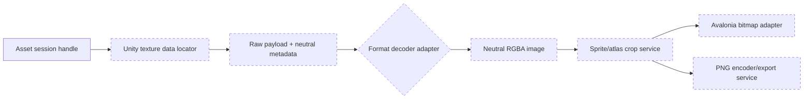

# Texture and Sprite Processing

## Migration status

**Legacy observed; not implemented in Avalonia.** This document records verified source structure and the proposed non-Unity boundary. It must not be read as current Avalonia capability.

## Legacy implementation

The Unity pipeline is centered on `Assets/Script/Reader/ImageDecoder/ImageReader.cs`. It resolves Texture2D and Sprite fields through AssetsTools.NET, follows external or `archive:/` data, maps sprite-atlas relationships, decodes formats, creates Unity `Texture2D` objects, crops/pads sprites, displays them through `RawImage`, and exports with `Texture2D.EncodeToPNG()`.

Reusable or partially reusable pieces include:

- AssetsTools.NET field/pointer traversal and raw-byte acquisition;
- `DumpReader`, `JsonDumper`, and atlas mapping concepts;
- BCn decoder abstraction;
- ASTC native adapter, subject to platform/architecture validation.

Unity-dependent pieces include ETC-family/RGBA4444 decoding, `Texture2D`, `Rect`, `Color`, crop/pad operations, preview widgets, and PNG encoding.

## Proposed standalone pipeline — not implemented

This split keeps AssetsTools.NET traversal, codec selection, image manipulation, UI bitmap ownership, and file export independently testable. No stage may use Unity types or require Unity installation.

## Dependencies and open decisions

- BCn formats have an existing ordinary .NET wrapper.
- ASTC uses a native DLL and needs RID/architecture packaging plus golden tests.
- ETC/ETC2 and some uncompressed conversions currently rely on Unity and need a standalone replacement.
- Sprite atlas rotation/tight packing and cross-file pointers require representative fixtures.
- Image representation/encoder choice, orientation/color parity, cache ownership, and export collision policy remain open.

See [Unity dependency boundary](../02_architecture/unity-dependency-boundary.md), the tracked [Unity-exclusive findings](../05_audit/unity-exclusive-features.md), [migration risks](../05_audit/migration-risks.md), and [open questions](../05_audit/open-questions.md). Findings UE-001 through UE-004 must be resolved or explicitly scoped before Phase 6/7 implementation claims.

## Testing requirements before claiming support

- Golden decoded pixels for every advertised format.
- Inline, external resource, and archive payload fixtures.
- Standalone sprite and atlas sprite fixtures, including malformed references.
- Orientation, color, crop, padding, and alpha verification.
- Cancellation and memory/disposal tests for previews.
- Collision-safe deterministic export and partial-failure reporting.
