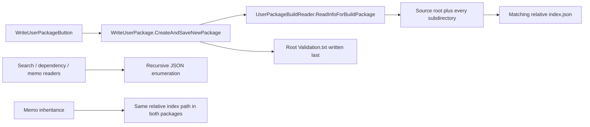

# Legacy Package Format Compatibility Audit

**Date:** 2026-10-17

**Status:** Milestone 7.5 practical-interoperability correction implemented and verified; no existing package was migrated or overwritten.

**Compared data:**

- Avalonia-created/maintained package: `E:\Media\UABS_Packages\OWL`
- Genuine Unity-created reference: `E:\Projects\UABS\UABS\UABS_Cache\OWL_Unity`

## Assessment

The implementations are now **practically interoperable under the approved Milestone 7.5 policy**. They use the same unversioned JSON field schema, the Avalonia reader loads the genuine Unity package, and recursive editor folder imports now retain each imported source's directory relative to the selected import root. Existing hierarchical indexes, empty indexes, flat packages, serialized path strings, CAB strings, memos, and unknown JSON fields are preserved on load/save.

The policy is deliberately not byte-for-byte Unity writer emulation. New imports create indexes only for directories that contain supported imported sources; they do not manufacture indexes for empty directories. New records retain normal .NET full paths and complete CAB tokens rather than introducing the legacy Windows-prefix and CAB-truncation quirks. Safely equivalent normal, `\\?\` drive, UNC, and `\\?\UNC\` paths compare as one physical identity internally while the exact serialized spelling remains unchanged. Existing flat packages are not automatically reorganized.

## Evidence from the real packages

| Property | Avalonia `OWL` | Unity `OWL_Unity` | Consequence |
| --- | ---: | ---: | --- |
| Package marker | Empty root `Validation.txt` | Empty root `Validation.txt` | Same discovery marker |
| Index files | 1 root `index.json` | 422 recursive `index.json` files | Structural mismatch |
| Package subdirectories | 0 | 421 | Avalonia loses source-tree partitioning |
| Non-empty indexes | 1 | 323 | Different partitioning |
| Empty indexes | 0 | 99 | Avalonia UI import does not preserve empty source directories |
| Source records | 6,671 | 6,671 | Same source population |
| Asset references | 175,132 | 175,132 | Same asset population |
| Dependency strings | 15,771 | 15,771 | Same dependency population |
| Distinct stored CAB values | 6,671 | 6,670 | Legacy truncation creates one collision |
| Additional package files | None | None | Neither package contains copied Unity sources |

For all 6,671 matched source records:

- `Name` matches exactly.
- The source path matches after removing only the Unity record's `\\?\` prefix.
- Dependency sets match exactly.
- Asset `(Name, PathId, Memo)` sets match exactly.
- The Avalonia CAB is exactly one final character longer than the Unity CAB. This matches the legacy scanner's source-verified `end - start - 1` defect; there were no other CAB differences.
- Every Unity record's index directory equals its source directory relative to `...\StreamingAssets\aa\StandaloneWindows64`.

Neither production data set contains a `Memo` value. Milestone 8 supplements source tracing with the genuine read-only Unity test package under `External_Test/UABS_TestResources`, where asset `hook` stores `"Memo": "钩爪"`, plus a minimized committed representation used for disposable save/reopen verification. This establishes legacy memo shape without claiming a production-memo corpus.

## Legacy format specification

The Unity creation path is:



For each source directory, the writer selects top-level `.bundle`, `.ab`, and `.assets` files and serializes an array. An empty index is simply an empty array; it contains no separate memo or metadata object, so its meaningful information is its location in the tree. The public JSON shape is:

```text
Bundle: Name, Path, CabCode, AssetInfos[], Dependencies[]
AssetInfo: Name, PathId, optional Memo
```

The format has no package ID, schema version, source-root field, asset type, or logical serialized-file identity. `Path` is absolute. The real Unity package uses Windows extended paths (`\\?\E:\...`). `CabCode` is truncated by one printable character. `Dependencies` retain the full strings read from `AssetBundle.m_Dependencies`.

The package itself is metadata, despite the inspected directory being named `UABS_Cache`. Legacy source defines copied preview/search results separately under `External/UABS_System_Cache/{Search,Dependency,Dependent}`. `WriteUserPackage` does not copy source bundles into a user package.

## Current Avalonia format and workflows

`PackageService.CreateAsync` is capable of building a hierarchical document: it enumerates the source root and every child directory, retains empty indexes, and assigns each reference to a relative `PackageIndex`. `SaveAsync` writes each `PackageIndex` to its relative directory and writes `Validation.txt` last.

The desktop editor now carries an additive `PackageFolderImportReference` for every successfully imported source. Each mapping contains the source directory relative to the selected import root. `PackageEditorViewModel` merges a genuinely new source into that mapped index. A duplicate source is merged in its existing index and is never moved merely because another path spelling was used.

The older flat `References` result remains available for backward-compatible callers and test doubles; when no mapped data is supplied, it retains root-index behavior. Single-file and current-asset additions also remain in the root index because they have no selected folder root. Existing flat packages stay flat unless a new folder import adds genuinely new sources in subdirectories. Existing empty and nested indexes survive clone, save, and reload; new empty directories are intentionally not materialized.

Avalonia intentionally differs in two other ways:

- It stores normal full paths rather than forcing the Windows `\\?\` spelling.
- It stores the complete CAB token rather than reproducing the legacy off-by-one truncation.

Both choices preserve more information. The legacy dependency comparator accepts either-direction prefixes, and the Avalonia resolver explicitly accepts the verified one-character truncation variant. Exact path spelling is more sensitive because legacy `PathUtils.ArePathsEqual` does not remove the extended-path prefix.

## Consumer compatibility

| Direction / feature | Finding | Evidence |
| --- | --- | --- |
| Avalonia loads Unity package | Confirmed compatible on this machine | Production `PackageService.LoadAsync` loaded 422 indexes, 6,671 sources, and 175,132 assets with zero validation issues |
| Avalonia loads Avalonia package | Confirmed | Same production loader loaded 1 index, 6,671 sources, and 175,132 assets with zero issues |
| Unity discovers Avalonia package | Compatible if placed below the legacy package root | Marker and root-directory convention match; current `E:\Media` location itself is not auto-discovered by the legacy relative-path UI |
| Unity search | Source-compatible | Reader recursively enumerates `*.json` and expects the same field names |
| Unity direct dependency lookup | Source-compatible, with legacy ambiguity | Full Avalonia CAB values satisfy the legacy prefix comparator; the legacy reader returns the first match |
| Unity memo read/write | Schema-compatible; Avalonia identity comparison corrected | Avalonia treats safe normal/extended path variants as equal without changing stored text; the unchanged Unity implementation still has its own exact-spelling behavior |
| Unity memo inheritance | Compatible for matching relative indexes with explicit safety hardening | Milestone 8 retains Safe/Overwrite/Force and the legacy bundle-name heuristic, handles underscore-free names, and reports duplicate bundle/asset matches instead of selecting the first |
| Exact Unity writer reproduction | Deliberately not a goal | New empty indexes, forced extended paths, and truncated CAB output remain excluded from the practical policy |

The Unity application was not executed against `OWL`; Unity-consumer findings above are based on direct source tracing and the verified serialized fields. They must not be described as a completed Unity UI acceptance test.

## Existing test confidence

The committed `Fixtures/LegacyPackage` is handwritten and schema-faithful. It verifies a root index, one empty nested index, a memo, dependencies, and unknown-field preservation. Real `aigirl.ab` and `aigirl.assets` fixtures verify AssetsTools.NET creation. Writer/reader round trips verify Avalonia's own assumptions and safe persistence.

Milestone 7.5 adds focused coverage for:

- recursive folder-import mappings and editor save/reopen hierarchy;
- mixed flat, hierarchical, and empty-index preservation without moving existing records;
- duplicate relative-index rejection;
- safe normal/extended drive and UNC path equivalence, original-string preservation, malformed inputs, and unsupported device namespaces;
- duplicate-source and dependency-candidate deduplication across equivalent path spellings; and
- exact, one-character legacy CAB matching plus a synthetic truncation collision that remains explicitly ambiguous.

The production `PackageService` also loaded the genuine legacy package, saved it to a unique disposable directory, loaded that copy through a fresh operation, and compared every identity-keyed record. All 422 indexes, 99 empty indexes, 6,671 sources, 175,132 assets, and 15,771 dependencies survived; there were zero missing, extra, or changed records. The disposable output was deleted. Commercial game metadata was not committed.

## Implemented practical compatibility policy

- Preserve source-relative index placement for supported sources found by folder import.
- Preserve every existing index, including empty indexes, during editing and save/reopen.
- Do not create indexes for newly scanned empty directories.
- Do not migrate or reorganize an existing flat package automatically.
- Treat only safe Windows normal/extended drive and UNC spellings as equivalent internally; perform no filesystem lookup or symlink resolution and retain the original serialized text.
- Emit complete CAB tokens for new records, preserve stored legacy truncation, and accept only the verified one-character compatibility form during resolution. Multiple physical candidates remain ambiguous.

Exact legacy reproduction would additionally require decisions about:

- emitting `\\?\` absolute paths;
- deliberately truncating CAB tokens, including accepting collisions; and
- limiting source detection to the three legacy extensions rather than header detection.

Those losses and Windows-specific behaviors should not become the default merely for byte-level similarity.

## Compatibility boundaries

The existing unversioned schema and meaningful directory semantics remain canonical. If exact legacy quirks are ever required, expose a clearly named **Legacy Unity export** adapter rather than degrading the in-memory model or silently rewriting existing packages.

A future versioned modern format may add source-root metadata, stable asset identity, and path remapping, but it should be a separate format with explicit legacy import/export. It should not silently change existing packages.

Remaining product decisions are whether a separate versioned modern format or an explicit exact-Unity export is ever needed. Neither is required for Milestone 7.5.

## Package integrity during the audit

Initial fingerprints, computed from each relative file path, length, and SHA-256 content hash:

- Avalonia `OWL`: `81E67CD6280DCF08754798E90101ACD43FAC4438D8CD8845FD09268F3DC7CC4C`
- Unity `OWL_Unity`: `CF9BEACF7991B2DD88F5A3C83479B459347070DD6DBC39165770615A9C60631A`

The implementation session did not write either real package. The disposable round trip read only `OWL_Unity` and wrote beneath `Avalonia\.codex-validation`; guarded cleanup removed that output. Final fingerprint verification is recorded in the Milestone 7.5 report.

## Unity-exclusive features requiring decisions

No new Unity-runtime requirement was found. Package construction depends on AssetsTools.NET metadata inspection, which already has a standalone replacement under UE-007. The compatibility decisions here concern persisted layout and legacy quirks, not a requirement to install or run Unity. Milestone 8 resolved UE-008's identity, package-copy, and explicit-save policy in code; the finding remains `PARTIALLY_REPLACED` only until the user completes desktop acceptance of the new controls.

## Implementation status

Critical A is resolved for the approved practical-interoperability scope. The implementation changes folder-import mapping and internal path identity but does not change the JSON schema, automatically migrate packages, rewrite either real package, or modify legacy Unity source. Exact Unity-writer reproduction remains deliberately unimplemented. Milestone 7.4 remains paused and unresolved.
