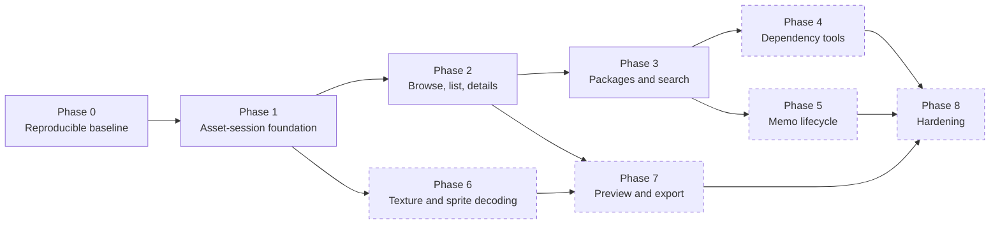

# Migration Roadmap

Statuses in this document describe the Avalonia migration as of 2026-10-17. Milestones 1 and 2 implemented the asset dependency/session and browser/list/details slices. Milestone 3 implemented package persistence, Milestone 4 package metadata search, Milestone 5 direct dependency resolution, Milestone 6 read-only package presentation, and Milestone 7 package creation/edit/save presentation. Milestone 7.1 corrected saved-package rediscovery and header-based import; Milestone 7.2 adds explicit safe recursive folder import and complete zero-result diagnostics; Milestone 7.3 verifies the production import path against a real nested bundle tree and makes scope and unsaved editor state explicit. Milestone 7.5 corrects the audited editor index-layout mismatch under the approved practical-interoperability policy. Milestone 7.4 stability work remains paused at its verified baseline.

## Phase 0 — Establish a reproducible baseline

**Goal:** make the current desktop project and dependency layout understandable and testable without adding product features.

**Unity evidence:** `Assets/Plugins/*`, `Assets/StreamingAssets/classdata.tpk`, `Packages/manifest.json`, `ProjectSettings/ProjectVersion.txt`.

**Avalonia targets:** `UABS.csproj`, solution structure, new test project(s), dependency/runtime asset directory.

**Reuse:** exact known DLL set and classdata asset as a temporary compatibility baseline.

**Rewrite:** dependency declarations, output-copy rules, logging bootstrap, app-data path service.

**Dependency:** none.

**Main risks:** old vendored assemblies on .NET 9, hidden transitive dependencies, native ASTC architecture, licensing/security/version drift.

**Completion criteria:** clean restore/build in a fresh checkout; tests can locate classdata and fixtures; output contains required runtime assets; no reliance on current working directory.

## Phase 1 — Create boundaries and asset-session foundation

**Goal:** open/detect Unity files and enumerate neutral asset records outside Avalonia UI.

**Unity sources:** `FileTypeDetector`, `FileInstanceLike`, `NextInstance`, `AssetsReader`, `AssetReader`, `AssetParser`, `ReadFolderContent`, `AppEnvironment` (requirements only).

**Avalonia targets:** new `UABS.Core`/`UABS.Application` and `UABS.UnityAssets` projects; desktop composition root.

**Move/reuse:** file detection, AssetsTools.NET loading, class database selection, fast display names, directory file filtering.

**Rewrite:** errors/nulls, logging, stream/session disposal, static Mono template state, async wrappers, cancellation/progress, DTO mapping.

**Dependency:** Phase 0.

**Main risks:** library object lifetime, compressed bundle memory, Mono/IL2CPP type trees, malformed files.

**Completion criteria:** tests open representative bundle and `.assets` fixtures, enumerate stable name/type/path-ID records, reject unsupported files safely, and release file handles.

## Phase 2 — First vertical Avalonia workflow

**Goal:** choose a file/folder, browse supported files, open one, and display its asset list/metadata.

**Unity sources:** `OpenFile`, `OpenFolder`, folder data managers, `LoadEntries2ScrollFolderView`, `LoadEntries2ScrollView`, `EntryInfoView`, `DisplayInfoPanel`, `AssetDataSortManager`, `AssetDataFilterManager`, `AssetDataSelectionManager`.

**Avalonia targets:** `MainWindow`, `FolderView`, toolbar, new Browser/AssetList/AssetDetails ViewModels and Views, storage-provider adapter.

**Move/reuse:** sorting/filtering/selection semantics and icon resources.

**Rewrite:** all UI, navigation, picker integration, manual virtualization, page-state events.

**Dependency:** Phase 1.

**Main risks:** accidentally blocking UI, session lifetime during navigation, selection differences, huge lists.

**Completion criteria:** real data replaces hard-coded rows; open/back/sort/filter/select work; details load asynchronously; errors/cancellation are visible; no code-behind application workflow.

## Phase 3 — Package catalog and search

**Status:** package persistence, metadata search, read-only catalog/content/search/dependency presentation, and safe package creation/edit/save presentation are implemented and verified. Package removal remains deferred.

**Goal:** build/load compatible package indexes and support keyword, filename, and memo queries without copying result bundles.

**Unity sources:** `UserPackageBuildReader`, `WriteUserPackage`, `ReadUserPackage`, `ReadSearchInfo`, `FindDeriveInfoInPackage`, search controls, `CopyDeriveToSysFolder` (behavior to replace).

**Avalonia targets:** `IPackageService`, `ISearchService`, Package/Search ViewModels and result navigation.

**Move/reuse:** current JSON schema and search semantics for compatibility.

**Rewrite:** async pipeline, progress/cancellation, index caching, schema validation/versioning, result aggregation, virtual original-path results.

**Dependency:** Phases 1–2.

**Main risks:** large scans, stale absolute paths, CAB extraction correctness, compatibility with existing indexes.

**Completion criteria:** build a package from fixtures; load an existing legacy package; queries match characterization tests; opening a result never modifies/copies the source unless explicitly requested.

**Unity-exclusive decision gate:** [UE-007](unity-exclusive-features.md) is resolved by the verified task/cancellation/progress/staged-output implementation. Future UI integration must keep dispatch at the presentation edge.

## Phase 4 — Dependency and reverse-dependency tools

**Goal:** resolve a selected bundle's dependencies through loaded package catalogs; add reverse lookup only if confirmed.

**Unity sources:** `ReadDependencyInfo`, `DependentReader`, `DependencyDataSource`, dependency dropdowns/events.

**Avalonia targets:** `IDependencyService`, Dependency ViewModel/result view.

**Move/reuse:** `m_Dependencies` extraction and CAB prefix-equivalence behavior.

**Rewrite:** structured unresolved results, multi-package conflict handling, no copied-cache navigation.

**Dependency:** Phase 3.

**Main risks:** missing/ambiguous CAB mappings, packages from different game versions, first-AssetBundle assumptions.

**Completion criteria:** direct dependencies resolve or report why not; navigation preserves source identity; conflict cases have deterministic UI.

## Phase 5 — Memo lifecycle

**Goal:** read/write memos and inherit them between package versions safely.

**Unity sources:** `MemoReader`, `MemoWriter`, `InheritMemoWriter`, `MemoField`, memo package/mode controls.

**Avalonia targets:** `IMemoRepository`, memo editor state, package-selection and inheritance UI.

**Move/reuse:** safe/overwrite/force semantics and legacy JSON compatibility.

**Rewrite:** identity model, atomic writes, async debounce, validation, concurrency, undo/backups as approved.

**Dependency:** Phase 3; asset details from Phase 2.

**Main risks:** duplicate names, moved source paths, corrupted JSON, inheritance heuristic, unintended overwrite.

**Completion criteria:** characterization tests for all modes; edits survive reload; interrupted write cannot corrupt package; UI makes target package and overwrite mode explicit.

**Unity-exclusive decision gate:** review [UE-008](unity-exclusive-features.md) and decide explicit save versus cancellation-safe autosave, dirty/error UI, and write-recovery policy before implementing memo editing.

## Phase 6 — Neutral texture and sprite decoding

**Goal:** decode supported Texture2D/Sprite assets to neutral image data with format-specific tests.

**Unity sources:** `ImageReader`, `DumpReader`, `JsonDumper`, `AtlasDumpProcessor`, texture decoder wrappers, `AstcDecoderNative`, `AssetImageInfo`.

**Avalonia targets:** Unity texture data reader, decoder adapters, sprite extractor, neutral image record, Avalonia bitmap adapter.

**Move/reuse:** AssetsTools field traversal, external/internal stream extraction, BCn wrapper, atlas mapping logic.

**Rewrite:** Unity texture/rect/format types, ETC path, crop/pad, error/capability reporting, caching/disposal.

**Dependency:** Phases 0–2.

**Main risks:** format/endianness/version variants, native deployment, atlas references across files, memory consumption, color/orientation correctness.

**Completion criteria:** golden-image tests for every claimed format; unsupported formats fail explicitly; preview load is cancellable and does not leak bitmaps/sessions.

**Unity-exclusive decision gates:** resolve or deliberately scope [UE-001 and UE-002](unity-exclusive-features.md) before decoder/sprite implementation. Do not select an ETC-family decoder or image representation without reviewing fidelity, licensing, platform packaging, and performance.

## Phase 7 — Preview and export

**Goal:** provide pan/zoom preview and collision-safe PNG export for all/filtered/selected assets.

**Unity sources:** `TextureDisplayForBundle`, `TextureView`, `PanZoomRawImage`, `ExportTextureAsImage2Path`, `AssetsDataExportManager`.

**Avalonia targets:** preview View/behavior, `IAssetExportService`, export dialog/progress/results.

**Move/reuse:** export scope semantics.

**Rewrite:** interaction, PNG encoder, file naming, overwrite/collision policy, concurrency and cancellation.

**Dependency:** Phase 6, plus selection state from Phase 2.

**Main risks:** very large batch memory/CPU, duplicate/invalid filenames, partial exports.

**Completion criteria:** previews match golden images; export produces deterministic files and a per-item result report; user controls overwrite behavior.

**Unity-exclusive decision gates:** resolve [UE-003 and UE-004](unity-exclusive-features.md) before choosing the preview bitmap/cache architecture or PNG encoder.

## Phase 8 — Hardening and retirement readiness

**Goal:** make Avalonia the reliable replacement and document any intentional feature gaps.

**Unity sources:** production scene behavior and ad hoc tests as acceptance references.

**Avalonia targets:** full app, installer/publish profiles, diagnostics, accessibility, performance tests, migration guide.

**Move/reuse:** validated behavior only.

**Rewrite:** remaining polish/platform integration.

**Dependency:** prior approved feature phases.

**Main risks:** untested game variants, package migration, platform/native distribution.

**Completion criteria:** acceptance fixture matrix passes; large-file performance is acceptable; existing package/memo data migration is documented and verified; Unity app can be retained only as a reference/fallback.

## Dependency-ordered checklist

The phase relationship below is the **planned migration order**. A connection means the downstream phase relies on capabilities established upstream; it does not imply that the downstream phase is implemented.

- [x] **P0.1 Dependency manifest** — Core AssetsTools.NET 3.0.0.0 is vendored under `Dependencies/AssetsTools.NET` and referenced only by `UABS.UnityAssets`; future image/Mono dependencies remain deferred.
- [x] **P0.2 Classdata deployment** — `classdata.tpk` is owned by `UABS.UnityAssets/Resources` and copied relative to `AppContext.BaseDirectory`; tests load that deployed copy.
- [x] **P0.3 Test foundation** — `UABS.UnityAssets.Tests` runs headlessly against a copied 17,353-byte read-only bundle fixture and covers infrastructure plus session ViewModel policy.
- [x] **P1.1 Neutral contracts** — `AssetEntry`, `AssetSessionMetadata`, `IAssetSession`, and error contracts expose no Unity, AssetsTools.NET, or Avalonia types.
- [x] **P1.2 File detection** — `UnityFileDetector` has real bundle and standalone serialized-file fixtures plus unknown/missing-input coverage.
- [x] **P1.3 Disposable asset session** — `AssetsToolsAssetSessionFactory` and `AssetsToolsAssetSession` own manager/streams; tests prove idempotent disposal, exclusive reopen, and repeated open/close.
- [x] **P1.4 Metadata reader** — Fast enumeration returns real name/type/class ID/path ID/byte size/logical file/source path without full object deserialization and is fixture-tested.
- [x] **P2.1 Storage picker adapter** — Avalonia storage-provider file and folder pickers are behind `IFilePickerService`; cancellation leaves state unchanged.
- [x] **P2.2 Browser ViewModel** — Real folder/file rows, direct paths, back/forward/up, refresh, transactional failures, and cancellation are implemented and tested.
- [x] **P2.3 Asset list ViewModel** — Cached real rows support name/type/path filtering, numeric and text sorting, and stable selection with focused tests.
- [x] **P2.4 Details ViewModel** — Selection loads neutral session metadata lazily with cancellation/version guards and race tests.
- [x] **P3.1 Package schema consumption/preservation** — Legacy field names, existing nested indexes, marker, memos, unknown fields, paths, CAB codes, dependencies, and asset references load/save through neutral models; covered by a schema-faithful fixture and genuine-package read-only load.
- [x] **P3.2 Async package builder** — `IPackageService` builds real bundle/serialized fixtures with `Task`, progress, cancellation, explicit overwrite, staged output, rollback backup, and failure cleanup. Directory replacement uses same-volume renames rather than claiming impossible multi-file atomicity.
- [x] **P3.3 Search service** — `IPackageSearchService` aggregates loaded packages, supports field/result filters, OR/exclusion/exact matching, exact Path IDs, deterministic sorting, cancellation, and original-path results without file copies.
- [x] **P3.4 Package/search UI** — `PackageManagementViewModel` and `PackageManagementView` provide resilient catalog loading, source/asset contents, service-backed search, and direct-dependency inspection without copied-result caches.
- [x] **P3.5 Package editor UI** — Empty first-package creation, deep-copy editing, catalog-root or direct-package rediscovery, header-based single-file import, transactional current-folder or safe recursive folder import, actionable import counts/zero-result diagnostics, persistent content and saved-state summary, current-asset addition, reference removal, distinct destination selection, explicit overwrite/discard confirmation, staged save, verification reload, dirty-state protection, and application-close protection are implemented without source copies.
- [x] **P3.6 Legacy creation-layout compatibility** — Editor folder import preserves source-relative placement for supported sources, existing flat/hierarchical/empty indexes and serialized paths survive, safe normal/extended Windows paths share an internal identity, and full-versus-one-character-truncated CAB resolution remains bounded and ambiguity-safe. Genuine 422-index save/reload evidence supplements distributable focused tests. See [compatibility audit](legacy-package-format-compatibility.md) and [Milestone 7.5 report](milestone-07-5-compatibility-report.md).
- [x] **P4.1 Direct dependency service** — `IPackageDependencyResolver` resolves direct CAB declarations over loaded metadata into immutable resolved/unresolved/ambiguous results, preserves original-path provenance, collapses duplicate imports by physical path, and performs no source I/O.
- [ ] **P4.2 Reverse dependency decision** — Source: `DependentReader`; destination: approved service or documented omission; depends on product answer; complete when decision is recorded and tested if retained.
- [ ] **P5.1 Memo repository** — Source: `MemoReader`/`MemoWriter`; destination: atomic repository; depends on P3.1; complete with duplicate/missing/interruption cases.
- [ ] **P5.2 Memo inheritance** — Source: `InheritMemoWriter`; destination: package service/VM; depends on P5.1; complete with Safe/Overwrite/Force tests.
- [ ] **P6.1 Raw texture data reader** — Source: `ImageReader.GetImageData`/pointer logic; destination: infrastructure; depends on P1.3; complete for inline, external, and archive data.
- [ ] **P6.0 Unity-exclusive replacement decisions** — Review UE-001/UE-002; record decoder, neutral image, crop/pad, platform, licensing, fidelity, and performance decisions before implementation.
- [ ] **P6.2 Decoder matrix** — Source: format branches/BCn/ASTC/Unity ETC; destination: decoder adapters; depends on P6.1/P0; complete only for golden-tested formats.
- [ ] **P6.3 Sprite/atlas extraction** — Source: `DumpReader`, `AtlasDumpProcessor`; destination: neutral crop service; depends on P6.2; complete with atlas and standalone sprite fixtures.
- [ ] **P7.1 Preview UI** — Source: texture view/pan/zoom; destination: Avalonia view/behavior; depends on P6; complete with cancellation/cache disposal.
- [ ] **P7.0 Preview/export replacement decisions** — Review UE-003/UE-004 and approve the bitmap/cache and PNG-encoder approach before implementation.
- [ ] **P7.2 Export service/UI** — Source: export manager/writer; destination: application service/VM; depends on P6/P2.3; complete with safe names, collisions, progress, and partial-failure report.
- [ ] **P8.1 Acceptance/performance matrix** — Source: legacy workflows and fixtures; destination: automated/manual release evidence; depends on approved feature phases; complete when supported games/formats/sizes are documented and pass.

## Recommended next implementation task

Resume the paused Milestone 7.4 stability investigation before beginning any new feature milestone. Its first step is composition-level clean/dirty/active-import state-preservation coverage. Keep P4.2 reverse-dependency lookup and UE-008 memo identity/save policy as explicit product decisions.

## Milestone 2 status note

Phase 2 is implemented for the agreed scope. The browser is independent of asset-session ownership, list operations use cached metadata, and lazy details are cancellation-safe. The automated suite includes both bundle and standalone serialized input and a zero-Unity assembly audit. A multi-serialized-file bundle fixture and complete manual graphical pass remain open. See [Milestone 02 report](milestone-02-report.md).

Milestone 3 package infrastructure is implemented for its backend scope. The legacy JSON schema is characterized, `IPackageService` is Avalonia-independent, and safe persistence/cancellation/failure behavior is automated-test covered. Milestone 7.5 subsequently completed practical editor-layout compatibility and genuine-package preservation verification. See [Milestone 03 report](milestone-03-report.md), the [compatibility audit](legacy-package-format-compatibility.md), and the [Milestone 7.5 report](milestone-07-5-compatibility-report.md).

Milestone 4 package search infrastructure is implemented for its backend scope. `IPackageSearchService` searches loaded metadata without opening/copying source files and returns provenance-rich virtual results. Package/search UI remains open. See [Milestone 04 report](milestone-04-report.md).

Milestone 5 direct dependency infrastructure is implemented for its backend scope. `IPackageDependencyResolver` uses a temporary in-memory CAB index and returns explicit resolved/unresolved/ambiguous results without source-file I/O or transitive traversal. Reverse lookup and dependency UI remain open. See [Milestone 05 report](milestone-05-report.md).

Milestone 6 package presentation is implemented for browsing loaded package directories, inspecting source/asset metadata, running catalog search, and viewing selected-package direct dependencies. Reverse dependency lookup remains open. See [Milestone 06 report](milestone-06-report.md).

Milestone 7 package editing is implemented for creating the first empty package, adding real source or selected asset references, editing isolated copies, removing references, explicitly confirming overwrite/discard, saving through staged persistence, reopening for verification, and refreshing the catalog. Milestone 7.1 verifies fresh-service disk round trips, direct-package selection, and header-based arbitrary/extensionless inputs. Milestone 7.2 corrects the nested-file exclusion with explicit current-folder/recursive modes, safe reparse-point handling, and actionable result diagnostics. Milestone 7.3 validates all 15 supplied nested bundles and 1,173 references through the production service/ViewModel path and explicitly distinguishes import scope, unsaved editor rows, and persisted package data. See [Milestone 07 report](milestone-07-report.md).
