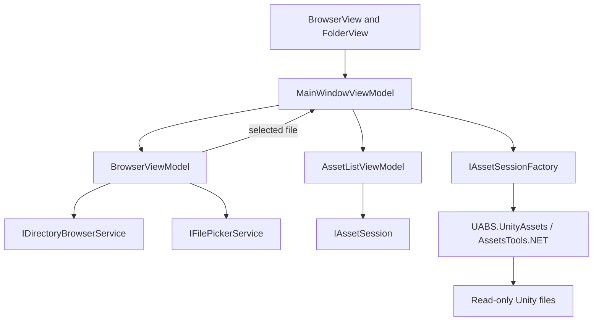

# Milestone 02 Report — Functional Asset Browser

**Date:** 2026-10-16

**Target:** `E:\Projects\UABS\Avalonia`

**Legacy reference:** `E:\Projects\UABS\UABS` (read-only)

## Outcome

Milestone 2 is implemented for the agreed scope. The Avalonia application can enumerate real directories, navigate with Back/Forward/Up and refresh, open selected files through the existing transactional asset-session pipeline, filter and sort cached asset rows, preserve or clear selection predictably, and retrieve safe selected-asset metadata lazily. No preview, decoding, export, package, search, dependency, memo, or editing feature was added.

## Implementation summary

### Filesystem browser

- Added neutral `BrowserEntry` and `DirectorySnapshot` models.
- Added `IDirectoryBrowserService` and a .NET `DirectoryBrowserService` that enumerates on a worker task, canonicalizes paths, and returns folders before files.
- Added `BrowserViewModel` with direct path navigation, folder selection, directory-row open, Back, Forward, Up, Refresh, cancellation, stale-result suppression, and transactional history updates.
- Added `BrowserView` and integrated it into the existing main window and toolbar.
- Extended `IFilePickerService` with Avalonia folder picking.
- Kept filesystem navigation independent from asset-session ownership.

### Asset list and details

- Added `AssetListViewModel` with cached name/type/path-ID filtering and Name, Type, Class ID, Path ID, Size, and Source File sorting.
- Numeric fields use numeric comparisons. Sorting/filtering never reparses the Unity file.
- Selection is retained by entry instance across sorting, cleared when hidden, and reset when the session changes.
- Added neutral `AssetDetails` and `IAssetSession.GetDetailsAsync`.
- Added a details panel and cancellation/version guards for rapid selection and session replacement.
- Added small reusable `ViewModelBase`, `RelayCommand`, and predicate support for `AsyncCommand`; no external MVVM dependency was introduced.

## Implemented architecture



`MainWindowViewModel` remains the asset-session owner. The browser only delegates a file-open request, and the asset-list ViewModel only reads the current session. A candidate session replaces the current session only after a successful open.

## Important files

Added:

- `UABS/Script/Models/BrowserEntry.cs`
- `UABS/Script/Models/DirectorySnapshot.cs`
- `UABS/Script/Services/IDirectoryBrowserService.cs`
- `UABS/Script/Services/DirectoryBrowserService.cs`
- `UABS/Script/ViewModels/BrowserViewModel.cs`
- `UABS/Script/ViewModels/AssetListViewModel.cs`
- `UABS/Script/ViewModels/ViewModelBase.cs`
- `UABS/Script/ViewModels/RelayCommand.cs`
- `UABS/Script/View/Pages/BrowserView.axaml` and code-behind
- `UABS.UnityAssets/AssetDetails.cs`
- browser, asset-list, directory-service, and dependency-audit test files
- `UABS.UnityAssets.Tests/Fixtures/aigirl.assets`
- `docs/04_systems/filesystem-browser.md`
- this report

Modified:

- main-window, toolbar, folder/asset-list UI, composition, picker contract/adapter, commands, session contract/implementation, fixture project configuration, tests, roadmap, architecture, design, feature matrix, risks, overview, and documentation index.

## Legacy behavior decisions

The legacy `ReadFolderContent`, folder path/history managers, sort/filter/selection managers, `AssetReader.ReadExtraInfoFromAsset`, and `DisplayInfoPanel` were used as behavioral references. Unity scene wiring, global events, manual row pooling, and Path-ID-only selection identity were not ported. The Avalonia implementation uses bound controls and focused ViewModels; entry instance plus logical/source provenance avoids treating Path ID as a global identity.

## Fixtures and automated tests

The existing 17,353-byte `aigirl.ab` fixture contains one serialized logical file. Its legitimate 216,248-byte serialized entry was extracted into `aigirl.assets` to add standalone-file coverage. No suitable small multi-serialized-file bundle was found, so that coverage remains explicitly open.

Final automated verification:

```text
dotnet build Avalonia.sln --no-restore
Build succeeded. 0 warnings, 0 errors.

dotnet test Avalonia.sln --no-build
Passed: 30, Failed: 0, Skipped: 0.
```

The 30 tests cover the preserved Milestone 1 behavior plus:

- bundle and standalone serialized-file detection/loading;
- real metadata/details and provenance;
- directory enumeration, folder-first order, and missing paths;
- history branching, Back/Forward, refresh, and failed-navigation preservation;
- file-open delegation and browser/session ownership independence;
- numeric sorting, combined filters, and selection retention/clearing;
- lazy details, rapid selection, and session replacement races;
- built application assembly references and shipped DLL names for forbidden Unity runtime/editor dependencies.

## Unity independence

`UnityDependencyAuditTests` loads the built `UABS.dll` and `UABS.UnityAssets.dll`, checks their assembly references, and checks shipped top-level DLL names. It rejects exact `UnityEngine`, `UnityEngine.*`, `UnityEditor`, and `UnityEditor.*` assembly names while allowing legitimate names such as `UABS.UnityAssets` and AssetsTools.NET. The test passed. No Unity installation or runtime is invoked by the application.

## Performance and lifecycle considerations

- Unity parsing remains asynchronous and list operations use already enumerated neutral records.
- Each criteria change performs one in-memory filter/sort and replaces one visible array rather than raising per-row mutations.
- Details are not fetched until selection and stale results cannot overwrite a newer selection.
- Directory navigation cancels superseded reads and commits only successful snapshots.
- Source files remain read-only; no browser cache copies are created.
- Session and stream disposal remains explicit and transactional.

No large-directory or tens-of-thousands-of-assets benchmark was run. The current design is intentionally simple until measurement justifies paging or caching.

## Manual UI smoke test

This is separate from the automated evidence. In the available Windows graphical environment, the built application was launched and observed to:

- render the toolbar, filesystem browser, asset grid/filter controls, and details area without an immediate XAML/runtime failure;
- populate the browser from `C:\Users\kolynlin`;
- select and open the `.codex` directory;
- update the current path and enable navigation history;
- return to the previous directory with Back and enable Forward.

The manual pass did **not** complete file-picker selection, asset loading into the grid, filtering/sorting, or details-panel interaction. Those behaviors are automated-test verified but remain manually unobserved.

## Known limitations and risks

- No representative multi-serialized-file bundle fixture was available.
- Full graphical asset-load/filter/sort/details interaction remains unverified.
- Permission-denied behavior is handled but was not manually reproduced across operating systems.
- Large-directory/list latency and compressed-bundle peak memory are not benchmarked.
- DataGrid header sorting is available at the control level, while deterministic application sorting is exposed through the explicit sort selector; the two mechanisms are not synchronized.
- The details contract intentionally exposes safe existing metadata only, not arbitrary Unity object fields.

## Deferred functionality

Texture/sprite decoding, image/audio/mesh preview, export, package indexing/search, dependency graphs, memo editing/inheritance, complex MonoBehaviour inspection, asset editing, and Milestone 3 work remain deferred.

## Recommended next milestone

Proceed with Phase 3 package schema characterization and catalog/search foundations only after deciding whether to first obtain a multi-file bundle fixture and complete the graphical asset workflow pass. Keep package work separate from the Phase 6 neutral texture pipeline.
