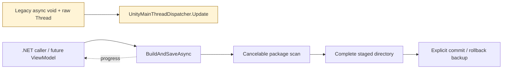

# Milestone 03 Report — Package Infrastructure and Management

**Date:** 2026-10-16

**Target:** `E:\Projects\UABS\Avalonia`

**Legacy reference:** `E:\Projects\UABS\UABS` (read-only)

## Outcome

Milestone 3 is complete for its original backend scope. `UABS.UnityAssets.Packages` can load, validate, create, modify, list, save, replace, and reopen the legacy JSON schema without Avalonia or Unity runtime dependencies. A later production-data audit found that this did not prove every UI creation path reproduced the legacy directory tree; see [Legacy package format compatibility](legacy-package-format-compatibility.md).

> **2026-10-17 correction and resolution:** a genuine-data audit found that the later package editor flattened folder imports. Milestone 7.5 now carries source-relative mappings through that workflow, preserves existing empty/flat/hierarchical indexes and serialized strings, and verifies a 422-index genuine-package save/reload. Exact reproduction of legacy path/CAB quirks remains deliberately outside the approved practical-interoperability scope.

## Legacy format findings

The traced flow is `WriteUserPackage.CreateAndSaveNewPackage` → `UserPackageBuildReader.ReadInfoForBuildPackage` → one `index.json` per source directory → root `Validation.txt`. Each index is an unversioned JSON array:

```text
Bundle { Name, Path, CabCode, AssetInfos, Dependencies }
AssetInfo { Name, PathId, optional Memo }
```

`Path` is an absolute original source path. Package creation indexes `.bundle`, `.ab`, and `.assets` names, selects Sprite and Texture2D entries, extracts a printable CAB token, and reads `AssetBundle.m_Dependencies` from the first serialized file. Empty source directories still receive an empty index. The legacy package UI discovers top-level directories below `External/UABS_UserPackages` and treats `Validation.txt` as the validity marker.

Legacy search and dependency readers recursively scan JSON. CAB equality is a case-insensitive prefix comparison. Memo readers/writers locate a bundle by path and an asset by name; they do not use path ID for memo identity. The package format itself contains no package ID, schema version, source root, asset type, or logical serialized-file name.

The legacy CAB scanner subtracts one from the printable token length, truncating the final character. The replacement emits the full token. Existing prefix comparison accepts both representations. This is source-verified but lacks a production-package compatibility corpus.

## Implemented models and services

- `PackageAssetReference` preserves `Name`, `PathId`, optional `Memo`, and unknown fields.
- `PackageBundleReference` preserves `Name`, absolute `Path`, `CabCode`, assets, dependencies, and unknown fields.
- `PackageIndex` models one relative source directory and its bundle array.
- `PackageDocument` aggregates indexes and validation issues and supports add/remove by source path. Equal path IDs in different source files remain distinct.
- `IPackageService` exposes load, create, save, build-and-save, and list operations with cancellation and progress.
- `PackageService` validates required structure, reports missing markers/sources, builds from real Unity files, and retains legacy property names.
- `PackageException` variants distinguish malformed data, existing-target refusal, and source-build failures.

System.Text.Json replaces Newtonsoft.Json without changing serialized field names. Reads tolerate property casing, comments, and trailing commas; writes use the legacy names and indented arrays. Unknown bundle and asset properties survive a load/save cycle. No schema-version property is injected into legacy output.

## UE-007 replacement



The replacement returns an awaitable task, accepts `CancellationToken` and `IProgress<PackageProgress>`, and surfaces exceptions. Directory enumeration and package processing do not require a UI thread. A future Avalonia ViewModel is responsible only for presenting progress/results on the UI context. The replacement boundary carries the required UE-007 inline annotation in `PackageService.BuildAndSaveAsync`.

## Persistence and recovery behavior

Every save is first serialized and flushed into a uniquely named sibling staging directory. `Validation.txt` is written last. Cancellation is checked before commit. A new package is committed with a same-volume directory rename. Existing targets are rejected unless `overwrite: true`; explicit replacement renames the old target to a unique backup, moves the complete staged tree into place, restores the backup if that move fails, and removes the backup after success. Failed or cancelled staging is deleted.

This is transactional at the package-tree level for the tested failure points, but it is not described as a single filesystem-atomic replacement: during explicit overwrite there is a short interval between directory renames. There is no cross-process writer lock.

## Fixtures and automated tests

The committed `Fixtures/LegacyPackage` is a small schema-faithful package with a root marker, root and nested indexes, a memo, dependencies, and unknown fields. It is based on the traced legacy writer/consumer schema, not copied from a commercial game or claimed to be a production-generated artifact. The existing real `aigirl.ab` and `aigirl.assets` fixtures exercise package creation.

Fourteen new tests cover:

- representative legacy-format reading and unknown-field preservation;
- real bundle and standalone serialized-file package creation;
- awaitable end-to-end build/save completion and progress reporting;
- original path and asset-reference preservation;
- save/reopen with metadata, memo, and extension data;
- explicit add/remove behavior when path IDs collide across sources;
- malformed JSON and missing-source diagnostics;
- pre-cancelled creation and mid-save cancellation;
- refusal to silently overwrite;
- successful explicit replacement and artifact cleanup;
- validation failure preserving an existing package;
- repeated loads/file-handle release;
- listing only marker-qualified packages.

Final automated verification:

```text
dotnet build Avalonia.sln --no-restore
Build succeeded. 0 warnings, 0 errors.

dotnet test Avalonia.sln --no-build
Passed: 44, Failed: 0, Skipped: 0.
```

The suite includes all 30 Milestone 1–2 tests, the 14 package tests, and `UnityDependencyAuditTests`. The audit passed for built application assemblies and shipped top-level DLL names; no Unity runtime/editor dependency was introduced.

## Automated versus manual verification

Package functionality was verified only through automated service tests. No package UI was added, and no manual UI behavior is claimed. The earlier Milestone 2 partial graphical smoke observations are unchanged.

## Compatibility decisions

- Existing field names and the directory/marker structure are preserved.
- Absolute source paths remain references; source files are never copied or modified.
- Missing referenced files produce validation issues while readable index data remains available.
- Path ID is never treated as globally unique; source path remains part of identity.
- Unknown JSON fields and optional memos are retained.
- No new serialized global identity or schema-version field was added.
- Standalone `.assets` creation is supported even though the legacy builder attempted bundle loading for every accepted extension.
- Full CAB tokens are emitted; the legacy prefix comparison remains compatible with previously truncated values.

## Known limitations and risks

- No production-generated, redistributable legacy package fixture is committed. A genuine local Unity package has now been inspected read-only and is documented in the compatibility audit, but its commercial metadata is not copied into the repository.
- The legacy schema cannot represent per-logical-file provenance inside multi-serialized-file bundles.
- Moved absolute source paths are diagnosed but cannot yet be remapped.
- Creation opens each source once for neutral asset enumeration and again for dependency metadata; large-tree performance is unmeasured.
- Scanning is sequential, non-resumable, and has no cross-process writer lock.
- Explicit overwrite uses a recoverable two-rename directory swap, not one atomic filesystem primitive.
- CAB/dependency behavior needs broader Unity version and game fixture coverage.
- Package location/app-data policy and production package discovery are not connected to the desktop composition root.

## Deferred functionality

No package ViewModel/View, drag-and-drop, bulk editing, search service, dependency resolver, result cache, memo writer/inheritance, texture decoding, preview, or export was added. The legacy behavior of copying search/dependency results into a cache remains intentionally excluded.

## Recommended next milestone

Complete the remaining Phase 3 search-service slice over loaded `PackageDocument` instances. Characterize and test include/exclude precedence, exact filename behavior, and optional memo matching; return original-path virtual results and do not add package UI or bundle-copy caching in the same slice. A production-generated legacy package fixture and multi-serialized-file bundle fixture would strengthen compatibility evidence before Phase 4 dependency tools.

## Unity-Exclusive Features Requiring Decisions

UE-007 is resolved and does not block package UI integration. No new Unity-exclusive package dependency was discovered. UE-008 (memo debounce/save interaction) remains unresolved for the later memo milestone, and UE-001 through UE-004 remain deferred image/preview/export decisions; none blocks the recommended search-service work.
