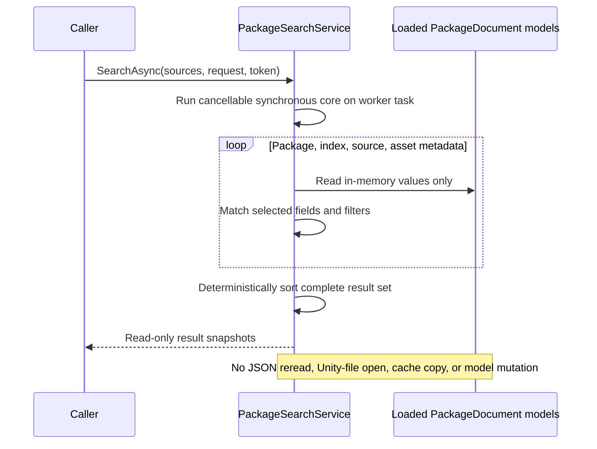

# Milestone 04 Report — Package Search and Discovery

**Date:** 2026-10-16

**Target:** `E:\Projects\UABS\Avalonia`

**Legacy reference:** `E:\Projects\UABS\UABS` (read-only)

## Outcome

Milestone 4 is complete for the requested backend scope. `UABS.UnityAssets.Packages.Search` provides synchronous and asynchronous, cancellation-aware metadata search over already-loaded package models. Results preserve package and original source identity without opening, copying, rewriting, or requiring referenced Unity files. No package/search UI, dependency graph traversal, persistent index, or asset-file content search was added.

## Legacy search findings

The legacy path is `SearchBundleByKeywordsButton`, `SearchBundleByMemosButton`, or `SearchBundleByImageButton` → one `RequestSearchEvent` per selected package → `SearchDataSource` → `ReadSearchInfo` → `FindDeriveInfoInPackage`.

Observed semantics:

- English and Chinese commas split terms.
- Include terms are OR conditions.
- Text containment is case-insensitive; exclude terms are intended to take precedence.
- Standard search checks bundle name and asset name, with optional memo matching.
- “Image search” is exact bundle/asset-name matching after stripping a selected filename extension; it is not image similarity.
- Results collapse to `DeriveInfo { name, path, cabCode }`, losing the matched asset and Path ID.
- Each package recursively rereads JSON for every query, and multi-package requests are dispatched separately.
- `SearchDataSource` copies every matched source file into `External/UABS_System_Cache/Search/<counter>` before navigation. Missing files are silently skipped by the copier.
- Search orchestration and controls depend on `MonoBehaviour`, TMP fields, Unity UI, and the global event dispatcher, but the metadata matching algorithm itself has no Unity requirement.

The replacement keeps the useful term behavior while aggregating packages in one operation, returning richer result identity, making empty/exact requests safe, and eliminating source-file cache copies.

## Implemented contracts

- `IPackageSearchService` exposes `Search` and `SearchAsync`.
- `PackageSearchRequest` contains include/exclude terms, field and result-kind filters, exact-text mode, exact Path ID, and sort selection/direction.
- `PackageSearchSource` pairs an explicit package name with a loaded `PackageDocument`; `FromDocument` derives a name only when package/source-root identity exists.
- `PackageSearchResult` is a read-only metadata snapshot carrying package name/path, index directory, source name/path, CAB/dependencies, optional asset name/Path ID/memo, result kind, and match categories.
- Enums define searchable fields, package/source/asset result kinds, match categories, and sort options.

The contracts contain no Avalonia, Unity, or AssetsTools.NET types.

## Search flow



## Matching, filtering, and sorting

- Text matching uses ordinal case-insensitive comparison, independent of current culture.
- Default text matching is substring containment; `ExactText` uses whole-field equality.
- Comma-separated include terms are OR conditions. Empty/duplicate terms are removed.
- Any matching exclude term rejects that package, source, or asset candidate before inclusion.
- An empty text request returns no results unless exact Path ID is supplied.
- Path ID uses numeric equality, not string matching.
- Null and missing metadata never match and do not fail the operation.
- Searchable fields are package name/path, index directory, source filename/path, CAB code, dependency strings, asset name, and memo.
- Asset type and logical serialized-file identity are not searchable because legacy package records do not contain them.
- Result filters can select package, source-file, and/or asset records.
- Sort fields are package name, index directory, source name/path, asset name, Path ID, and match category. Direction applies to the primary key; stable identity keys provide deterministic ties. Path ID sorting is numeric.

When both text and Path ID are supplied for an asset search, both must match. Equal Path IDs in different packages/source paths produce distinct results.

## Provenance and side effects

Every source/asset result copies the original package metadata values, including source path. Missing referenced files do not prevent matching. The legacy schema has no per-logical-file field, so results leave that provenance absent rather than inventing it.

The service has no filesystem calls. It does not load JSON, inspect Unity files, create cache directories, copy bundles, rewrite paths, or modify package models. Dependency lists are copied into read-only collections so callers cannot mutate the original record through a result.

## Performance

The implementation is a direct linear scan of loaded metadata with cancellation checks at package, index, source, and asset boundaries. It allocates only normalized term arrays, candidate field lists, matches, and the final sorted result set. It performs no file I/O, asset deserialization, database access, background indexing, or persistent caching.

No large-catalog benchmark was run. This deliberately simple implementation should be measured with representative thousands-of-package data before adding indexing, paging, parallelism, or a database.

## Automated verification

Nineteen new focused tests cover:

- package-name and package-path matching;
- asset-name and memo matching;
- source-path, index/CAB/dependency metadata behavior;
- exact Path ID matching and duplicate IDs across different source files;
- ordinal case-insensitive and exact-text behavior;
- English/Chinese comma OR terms and exclusion precedence;
- empty requests and null/missing metadata;
- numeric ascending/descending Path ID sorting and deterministic package order;
- pre-cancellation and mid-search cancellation without successful partial results;
- multiple packages with similar records;
- read-only result collections and unchanged package models;
- no-match behavior;
- the committed legacy-format fixture with a missing source file.

Final automated verification:

```text
dotnet build Avalonia.sln --no-restore
Build succeeded. 0 warnings, 0 errors.

dotnet test Avalonia.sln --no-build
Passed: 63, Failed: 0, Skipped: 0.
```

All 44 Milestone 1–3 tests remain green. `UnityDependencyAuditTests` passed, and no Unity runtime/editor reference or copied-result cache was introduced.

## Automated versus manual verification

Package search was verified through backend tests only. No search UI was implemented or exercised, so no new manual UI behavior is claimed. The existing source fixtures and legacy Unity repository were not modified.

## Known limitations

- No asset type exists in the legacy package schema, so asset-type search is unavailable without a future compatible schema extension or prohibited source-file scan.
- Multi-serialized-file logical provenance cannot be reported from legacy package data.
- Search operates on caller-supplied loaded documents; catalog watching/reload and package selection UI are not implemented.
- Exact text applies to a complete stored field, while the legacy exact “image” mode checks only bundle/asset names and ignores exclusions.
- Exclusions apply within each result candidate's selected fields; they are not a global cross-record package veto.
- There is no ranking, fuzzy matching, tokenization beyond comma splitting, paging, persistent index, or large-catalog benchmark.
- Search results are snapshots; concurrent mutation of package models by another caller is not coordinated.

## Deferred functionality

Package/search UI, result navigation, dependency resolution, reverse-dependency search, memo writes/inheritance, global filesystem search, deep Unity content search, persistent indexing, texture decoding, preview, and export remain outside this milestone.

## Recommended next milestone

Proceed with the roadmap's direct dependency service over loaded package metadata. Reuse package/source provenance and return structured resolved, unresolved, and ambiguous CAB matches without opening/copying source files. Keep reverse-dependency behavior and package UI as separate decisions.

## Unity-Exclusive Features Requiring Decisions

No new Unity-exclusive functionality was discovered. Legacy search presentation uses Unity UI/lifecycle/event dispatch, but the implemented metadata algorithm requires only ordinary .NET and existing neutral models; no new UE finding or replacement decision is needed. UE-001 through UE-004 and UE-008 remain deferred for their existing image/preview/export/memo milestones and do not block direct dependency work.
