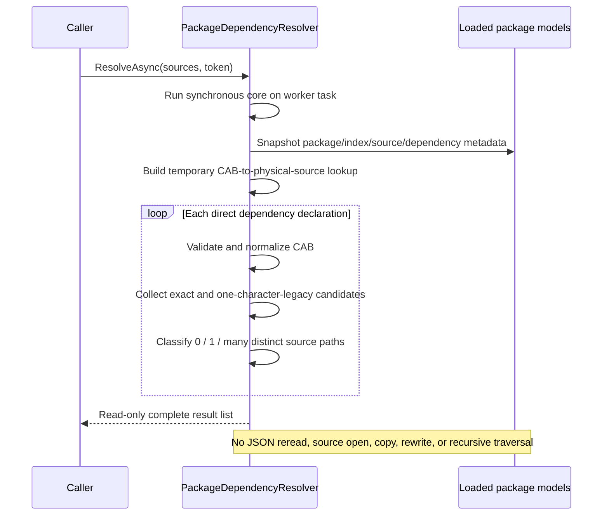

# Milestone 05 Report — Direct Package Dependency Resolution

**Date:** 2026-10-16

**Target:** `E:\Projects\UABS\Avalonia`

**Legacy reference:** `E:\Projects\UABS\UABS` (read-only)

## Outcome

Milestone 5 is complete for the requested backend scope. `UABS.UnityAssets.Packages.Dependencies` resolves direct dependency declarations across already-loaded package metadata and returns immutable `Resolved`, `Unresolved`, or `Ambiguous` results with requesting and candidate provenance. The implementation performs no package/source file I/O, copy, rewrite, source loading, recursive graph traversal, persistent caching, or database work.

Reverse-dependency lookup, package/dependency UI, result navigation, memo work, and Milestone 6 functionality were not implemented.

## Legacy behavior traced

The verified direct path is:

```text
ReadDependencyInfo.ReadInfoFor
  -> AssetsManager.LoadAssetsFileFromBundle(bundle, 0, false)
  -> first AssetBundle object's m_Dependencies
  -> FindDeriveInfoInPackage.FindInPackageByCabCode(packagePath, dependencyCab)
  -> recursive *.json scan
  -> first matching DeriveInfo
```

`FindDeriveInfoInPackage.CompareCabCode` lowercases both values and accepts `left.StartsWith(right) || right.StartsWith(left)`. This helped tolerate the legacy CAB scanner's one-character truncation bug, but it also accepts arbitrarily different prefixes, throws on null CAB values, repeatedly reads package files, and silently discards all matches after the first. `ReadDependencyInfo` also opens the first serialized file in a bundle and assumes an `AssetBundle` object exists.

The replacement consumes the dependencies already stored by `PackageService`; AssetsTools.NET is not needed during resolution.

## Implemented contracts

- `IPackageDependencyResolver` exposes synchronous `Resolve` and cancellation-aware `ResolveAsync` operations.
- `PackageDependencySource` pairs a caller-visible package name with a loaded `PackageDocument`.
- `PackageDependencyResult` contains the requester, original dependency value, status, every distinct candidate, and a diagnostic.
- `PackageDependencyOccurrence` preserves package name/path, index-relative directory, source name/path, original CAB value, and provenance completeness.
- `PackageDependencyCandidate` represents one physical source path, retains every package occurrence importing it, and exposes every normalized CAB observed for that path.

All public contracts are independent of Avalonia, Unity, and AssetsTools.NET.

## Resolution workflow



## CAB matching and ambiguity policy

CAB comparison uses trimmed, ordinal case-insensitive identifiers. A candidate must begin with `CAB-`, contain a suffix, and contain no internal whitespace. Matches are accepted when identifiers are equal or when exactly one side has one additional trailing character. The bounded length rule preserves the verified legacy off-by-one metadata case without reproducing arbitrary prefix matching.

Candidate identity is the normalized physical source path: slash direction, casing, and trailing separators do not create separate candidates. Multiple package imports of the same path collapse to one candidate while all occurrences remain available for diagnostics. Distinct paths with an equal CAB remain distinct and therefore produce `Ambiguous`. Records without a usable path cannot be proven identical and are not collapsed.

Malformed or absent dependency values produce `Unresolved` results with a diagnostic. Malformed candidate CAB values are excluded from lookup. Referenced source files may be missing; resolution still operates entirely from metadata and preserves the stored path.

## Direct-only boundary

The resolver reports one result for each direct declaration stored on every input source. It does not follow a resolved candidate to compute a transitive closure, detect cycles, order loads, copy dependencies, or open Unity content. For example, metadata edges A → B and B → C produce two independent direct results, not an A → B → C graph.

Reverse lookup through legacy `DependentReader` remains P4.2 and requires a separate product decision.

## Performance and concurrency

Each call copies only relevant metadata, constructs dictionaries for exact identifiers and one-character-longer aliases, resolves declarations, and discards the lookup. Expected work is linear in loaded source records plus direct declarations and returned matches. No large-catalog benchmark was run.

Result lists, candidate lists, CAB lists, and occurrence lists are read-only snapshots. Package models themselves remain mutable; callers must not mutate a model concurrently while its initial snapshot is being created. Cancellation is checked during snapshotting, lookup construction, and resolution, and canceled operations do not return a successful partial result.

## Automated verification

The pre-change baseline was verified before implementation:

```text
dotnet test Avalonia.sln --no-build
Passed: 63, Failed: 0, Skipped: 0.
```

Thirty-seven focused dependency test cases cover:

- same-package and cross-package resolution;
- ordinal case-insensitive matching and safe outer trimming;
- exact and either-direction one-character legacy truncation;
- rejection of broader prefix matches;
- unresolved, resolved, and ambiguous classifications;
- distinct equal-CAB paths and duplicate imports of one physical path;
- case/slash/trailing-separator path normalization;
- retained duplicate package occurrences and conflicting metadata for one path;
- null, empty, whitespace, malformed, and missing CAB data;
- sources with no dependencies and multiple dependency declarations;
- empty catalogs and sources without dependencies;
- deterministic requester and ambiguous-candidate ordering;
- missing/incomplete path provenance and missing physical files;
- synchronous/asynchronous calls, pre-cancellation, and deterministic mid-snapshot cancellation;
- immutable returned collections, unchanged package models, byte-preserved source files, and no copied files;
- requester/candidate package, index, path, and CAB provenance;
- direct-only A → B and B → C behavior.

Final solution verification:

```text
dotnet build Avalonia.sln --no-restore
Build succeeded. 0 warnings, 0 errors.

dotnet test Avalonia.sln --no-build
Passed: 100, Failed: 0, Skipped: 0.
```

The zero-Unity dependency audit remains part of the passing suite.

## Automated versus manual verification

Dependency resolution was verified through backend automated tests. No dependency UI exists, so no new manual graphical behavior is claimed. The existing Avalonia application UI was not changed by this milestone. The legacy Unity repository and all source fixtures remained unmodified.

## Known limitations and remaining work

- No production-scale package catalog benchmark has established memory or latency limits.
- The one-character compatibility rule is based on the verified legacy scanner bug and current fixture shape; broader real-world package samples should validate it.
- Missing source paths cannot be physically deduplicated and can create ambiguity.
- Concurrent mutation of input package models during snapshot creation is unsupported.
- No transitive resolution, cycle analysis, reverse lookup, dependency load ordering, or UI is present.
- Absolute package source paths can become stale after a game installation moves; path remapping remains unimplemented.

## Recommended next milestone decision

Decide whether reverse-dependency lookup is required before implementing P4.2. If retained, define whether it should simply invert the verified direct-edge results or expose a separate query contract. Keep UI work and memo persistence as independent slices.

## Unity-Exclusive Features Requiring Decisions

No new Unity-exclusive replacement decision was discovered. Legacy `ReadDependencyInfo` uses AssetsTools.NET plus Unity lifecycle/logging, but direct matching itself is ordinary metadata processing and is now implemented without Unity. Existing UE-001 through UE-004 and UE-008 remain deferred for their image, preview/export, and memo scopes and do not block the completed direct resolver.
