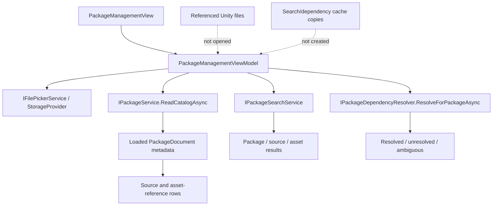

# Milestone 06 Report — Avalonia Package Management UI

**Date:** 2026-10-16

**Target:** `E:\Projects\UABS\Avalonia`

**Legacy reference:** `E:\Projects\UABS\UABS` (read-only)

## Outcome

Milestone 6 is complete for the read-only package-management workflow. The Avalonia application now exposes a Packages workspace where users can choose a package parent directory, refresh and select packages, inspect source/asset-reference metadata, search the loaded catalog, and inspect direct dependency results and every ambiguous candidate.

The workspace uses the existing package, search, and dependency services. It does not open referenced Unity files for presentation, copy files into caches, change package metadata, traverse dependency graphs, or choose an ambiguous dependency candidate.

Package creation/edit/save UI was evaluated and deliberately deferred. The backend can build and stage packages safely, but the current picker contract cannot distinguish source and destination intent or provide explicit overwrite confirmation. The legacy delete control also recursively deletes package directories without confirmation and was not migrated.

## Legacy workflow findings

- `ReadUserPackage.GetPackagesInExternal` lists every top-level directory below the fixed `External/UABS_UserPackages` location and creates that directory when absent; it does not validate entries while listing.
- `WriteUserPackageButton.ClickButton` uses the Unity StandaloneFileBrowser wrapper twice: once for game data and once for a user-created destination folder. It then invokes an `async void`/raw-thread writer path without an overwrite-confirmation contract.
- `UserPackageSearch.ClickButton` dispatches a global `RequestDependencyEvent` for one selected package.
- Search actions dispatch separate events per selected package and copy matches to system-cache directories before navigation.
- `UserPackageRemove.ClickButton` recursively deletes the selected package directory immediately and dispatches a refresh event.
- Unity prefabs, `MonoBehaviour`, TMP, uGUI buttons, serialized fields, and the global event dispatcher provide presentation/orchestration only; the migrated metadata workflows require no Unity runtime behavior.

The Avalonia interface replaces fixed paths and global events with an explicit folder picker, composable ViewModel state, cancellable service calls, and virtual original-path results. Destructive removal and ambiguous two-folder creation were not reproduced.

## Implemented architecture



`MainWindowViewModel` composes `PackageManagementViewModel` beside the existing browser and asset-list state. `MainWindow` presents Assets and Packages as top-level tabs. Toolbar Search, Depend, and Package actions switch to Packages without changing the active asset session.

## Significant files

- `UABS/Script/ViewModels/PackageManagementViewModel.cs` owns catalog, selection, content, search, dependency, cancellation, and stale-result presentation state.
- `UABS/Script/View/Pages/PackageManagementView.axaml` and `.axaml.cs` define the Packages workspace and directory-picker bridge.
- `UABS/Script/ViewModels/MainWindowViewModel.cs`, `UABS/Script/MainWindow.axaml`, and `UABS/Script/View/Options/Toolbar.axaml` compose and expose the workspace.
- `UABS.UnityAssets/Packages/PackageModels.cs`, `IPackageService.cs`, and `PackageService.cs` provide resilient catalog entries and loading.
- `UABS.UnityAssets/Packages/Dependencies/IPackageDependencyResolver.cs` and `PackageDependencyResolver.cs` provide selected-requester direct dependency resolution.
- `UABS.UnityAssets.Tests/PackageManagementViewModelTests.cs`, `PackageServiceTests.cs`, and `PackageDependencyResolverTests.cs` cover the new workflows and integration contracts.

## Catalog and contents workflow

`IPackageService.ReadCatalogAsync` is an additive integration API. It enumerates top-level directories deterministically and returns a `PackageCatalogEntry` for each directory. Readable packages carry their loaded document and validation issues; malformed/missing-index packages carry an error. One damaged directory therefore does not prevent valid siblings from appearing. Existing `ListAsync` behavior remains unchanged.

The ViewModel displays Ready, Warning, and Error states, plus catalog loading, empty, and operation-error messages. Refresh preserves selection by package path. A failed refresh retains the last good catalog. Package selection produces metadata-only source and asset rows containing only fields available in the legacy schema: index directory, source name/path, CAB, asset name, Path ID, and memo.

Selection changes clear stale content/dependency details. Path ID is displayed as source-scoped metadata and is never treated as a global identity.

## Search integration

Search calls `IPackageSearchService.SearchAsync` with the loaded package documents. UI controls expose:

- include and exclude text;
- exact-text mode;
- exact numeric Path ID;
- package/source/asset result-kind toggles;
- All, Names, Paths, CABs, Assets, Memos, and Dependencies field selections.

The ViewModel does not implement matching. Ordinal case-insensitive matching, comma-separated OR terms, exclusion precedence, exact/substring behavior, and empty-query rules remain owned by the Milestone 4 service. Every newer request cancels the previous request, and a generation check prevents an ignored-cancellation result from replacing current results.

## Direct dependency integration

The additive `ResolveForPackageAsync` operation builds candidates from every loaded package but emits dependency declarations only for the selected package. This avoids resolving unrelated requesters on each selection while retaining cross-package candidates.

The UI displays requested CAB, explicit status, requester, candidate count/paths, and resolver diagnostics. Selecting a result shows every candidate package/source occurrence and provenance completeness. Selecting a content source or asset filters results by its original source path. `Ambiguous` remains visible and no candidate is promoted or selected automatically.

## Cancellation and state replacement

Catalog, search, and dependency operations use separate cancellation sources and generation counters. Package selection publishes contents synchronously from the already-loaded document, cancels old dependency work, clears old selection, and only accepts the matching request's result. Disposal cancels all pending operations.

The active asset browser/session remains independent from the package workspace.

## Automated verification

The pre-change baseline was verified at 100 passing tests. Sixteen new tests bring the suite to 116 and cover:

- resilient catalog enumeration with valid, malformed, and incomplete directories;
- missing/empty package parents;
- selected-package-only dependency requests using the full candidate catalog;
- folder-picker catalog selection and package listing;
- empty catalogs, malformed rows, warnings, refresh, and preserved selection;
- package switching and stale content clearing;
- source-scoped dependency filtering;
- search execution, field/result filters, exact Path ID validation, provenance, cancellation, and stale-result suppression;
- resolved, unresolved, and ambiguous dependency presentation with all candidates;
- rapid package changes and stale dependency-result suppression;
- failed refresh preservation of the last good catalog.

Final automated commands:

```text
dotnet build Avalonia.sln --no-restore
Build succeeded. 0 warnings, 0 errors.

dotnet test Avalonia.sln --no-build
Passed: 116, Failed: 0, Skipped: 0.
```

The zero-Unity dependency audit remains in the passing suite. Existing package persistence tests continue to verify unknown JSON-field retention and staged overwrite behavior. No source fixture was modified.

`git diff --check` completed without errors; Git reported only line-ending conversion notices. A repository-wide relative Markdown-link check found no missing targets, all Markdown code fences were balanced, and 27 Mermaid blocks were found. Mermaid CLI rendering could not be run because `mmdc` is not installed; the relevant diagrams were therefore checked statically and against the documented implementation rather than renderer-compiled.

## Automated versus manual verification

Compiled Avalonia bindings and ViewModel workflows are automated-test verified. The application was launched normally; the `UABS` process created a responsive main window titled `UABS` without an immediate startup/XAML failure. Windows UI automation then switched from Assets to Packages and visually confirmed the package workspace, including the package catalog area and Contents, Search, and Direct Dependencies tabs. The native package-directory picker opened successfully.

The picker extended beyond the controllable window geometry in this environment, preventing reliable confirmation of the fixture directory after one recovery attempt. Catalog loading through the picker, package-row/content selection, search execution, dependency-result selection, keyboard behavior, and package creation/save were therefore not manually exercised. The application was closed normally. These observations are not claimed as end-to-end workflow verification; those behaviors remain covered by automated ViewModel/service tests only.

## Known limitations and deferred capabilities

- Package creation/edit/save is backend-only pending distinct source/destination interactions and explicit overwrite confirmation.
- Package removal is not exposed; the legacy immediate recursive delete is unsafe.
- Reverse dependency lookup, recursive traversal, graphs, cycle detection, load ordering, and dependency repair remain absent.
- Memo viewing is supported from stored metadata; memo editing/autosave/inheritance remains deferred.
- Catalog loading is sequential and has no paging or large-catalog benchmark.
- Search and dependency tables show metadata only; they do not navigate to or open referenced Unity files.
- Native picker behavior, keyboard traversal, narrow-window layout, and high-DPI behavior require manual platform verification.

## Recommended next milestone

Proceed to memo lifecycle infrastructure and presentation: define stable memo identity, atomic writes, and safe/overwrite/force inheritance behavior before enabling edits. Keep reverse dependencies and package creation/editing as separate decisions.

## Unity-Exclusive Features Requiring Decisions

No new Unity-exclusive replacement decision was discovered. Legacy package presentation uses Unity UI, TMP, `MonoBehaviour`, global event dispatch, and the StandaloneFileBrowser plugin; these presentation dependencies are already covered by UE-005 and UE-006 and are replaced by Avalonia composition, bindings, commands, and StorageProvider. Existing image/preview/export findings remain deferred and do not block the package workspace.
