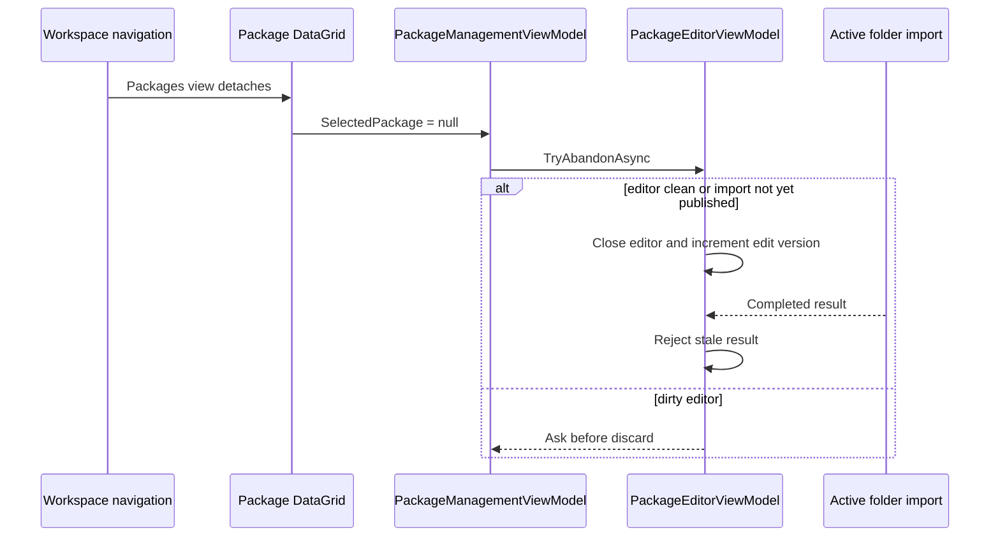

# Milestone 7.4 Report — Application Stability and State Preservation

**Date:** 2026-10-17

**Target:** `E:\Projects\UABS\Avalonia`

**Baseline:** clean squashed `main` checkpoint `68e1615`; 166 passing tests

## Outcome

Milestone 7.4 confirms and corrects package-editor state loss, two exception/crash hazards, and a stale asset-load race. Package workspace navigation now preserves active package/editor state, unsaved content, editor selection, and an in-progress import. Asynchronous command failures are observed and logged with stack traces, logger initialization no longer leaks a file handle, and cancellation-source ownership no longer leaves a disposed object available for later shutdown.

The intermittent-crash report cannot be declared universally eliminated: the corrected faults are covered, but there is no crash dump proving they account for every historical crash. Large compressed-bundle memory pressure and broad real-world runtime coverage remain risks.

## Confirmed state-loss root cause

`MainWindow` already owns one `MainWindowViewModel`, which owns one persistent `PackageManagementViewModel` and `PackageEditorViewModel`. Ordinary tab selection does not recreate these objects.

The destructive path was selection-driven instead. A two-way package `DataGrid` can transiently publish `SelectedPackage = null` as its workspace detaches. That setter previously called the intentional package-switch path:

An active import is still clean until its completed batch is published. It could therefore lose the editor without a discard prompt; its later result was correctly rejected as stale, making the imported contents appear to disappear.

The `SelectedPackage` binding setter now rejects only a transient null while an editor is active and restores the existing selection notification. Explicit catalog reload, explicit `SelectPackageAsync(null)`, real package switches, discard, and application close retain their existing confirmation paths.

## Confirmed crash hazards and corrections

### Disposed dependency cancellation source

Null package selection canceled and disposed `_dependencyCancellation` without clearing the field. Later `PackageManagementViewModel.Dispose()` called `Cancel()` on that disposed source and threw `ObjectDisposedException`. Catalog/search/dependency cancellation fields are now cleared before cancellation and disposal, with completion-race tolerance.

### Async command exception escape

`ICommand.Execute` must be `void`; the prior `async void` implementation used `try/finally` but did not catch faults. Unexpected task failures could therefore escape through the UI synchronization context.

`AsyncCommand` now provides:

- awaitable `ExecuteAsync` that propagates the original exception to direct callers;
- a contained `ICommand.Execute` boundary that observes unexpected faults;
- contextual stack-trace logging plus an `ExecutionFailed` event and injectable reporter;
- restored `CanExecute` state after success, failure, or cancellation; and
- cancellation as an expected outcome rather than an error.

### Logger file-handle leak

`Printer.Print` previously called `File.Create(filePath)` without disposing the returned stream, then immediately attempted `File.AppendAllText`. On a new log this could leave the file exclusively open and fail the append.

Logging now serializes writes, lets append create the file, releases every handle, creates a parent directory when needed, records ISO timestamps and complete exception text, and falls back to `Trace` if the log itself cannot be written. Global task exception handling marks the exception observed after logging.

### Stale asset-load race

Asset loads can be initiated through more than one UI path. Previously, overlapping loads had no shared generation/cancellation owner, so an older late completion could replace and dispose a newer session. `MainWindowViewModel` now cancels the previous load, checks a monotonically increasing version before publication, disposes stale candidates, and updates loading/error state only for the current request.

### Window lifecycle boundaries

Avalonia startup and closing events require `async void` handlers. These boundaries now catch initialization and close-confirmation faults, log complete context, and surface recoverable failures through the main status. Shutdown cleanup failures are logged rather than escaping the closed-window event.

## Automated verification

Added or extended coverage for:

- rapid repeated Assets/Packages switching with a dirty editor;
- package/editor object identity, items, unsaved name, and selected row preservation;
- transient null catalog selection with a clean editor;
- active folder import across navigation, including cancellation state and final publication;
- cancellation-source disposal after null selection;
- async command propagation, UI-bound failure observation, cancellation, and command-state restoration;
- logger create/append/file-release and concurrent writes; and
- superseded asset loads retaining the newest session and disposing the stale candidate.

Final results:

- `dotnet build Avalonia.sln --no-restore`: passed, 0 warnings, 0 errors.
- `dotnet test Avalonia.sln --no-build`: **175/175 passed**, 0 failed, 0 skipped.
- The suite's zero-Unity-runtime dependency audit passed.
- `git diff --check`: passed.
- Documentation check: 31 Markdown files, 33 Mermaid blocks, 0 missing relative links, and 0 unclosed fences.

Milestone 7.5 hierarchy, empty-index, path-equivalence, CAB, memo, unknown-field, and persistence tests remain passing. No package format or Unity-processing dependency changed.

## Desktop verification

The freshly built application was launched and a targetable window titled **UABS** was observed. Before any tab/editor interaction, the Windows automation helper detected concurrent user input. Automation stopped immediately instead of competing for control.

Therefore:

- application startup is directly observed;
- tab switching, editor contents, active import, and close behavior are automated-test verified; and
- no manual/automated desktop interaction beyond startup is claimed for this milestone.

## Remaining stability risks

- Historical intermittent crashes were not reproduced from a crash dump, so unrelated faults may remain.
- Large compressed bundles can still create high transient memory usage; no stress benchmark or memory ceiling was added.
- The log remains a simple local text log rather than a rotating structured logging subsystem.
- Native picker, high-DPI, accessibility, and long-running real-data UI behavior still need an uninterrupted desktop acceptance pass.
- Exceptions thrown by arbitrary property-change subscribers or native Avalonia internals remain outside ViewModel-level containment.

## Data and scope safety

- No existing package was opened as a write target.
- Tests use neutral in-memory records, fakes, committed read-only fixtures, and disposable log directories.
- The Milestone 7.5 package format behavior was preserved.
- The legacy Unity repository was not modified.
- No commit, reset, clean, revert, or branch change was performed.
- Milestone 8 was not started.

## Unity-Exclusive Features Requiring Decisions

No new Unity-exclusive dependency was discovered. These fixes are ordinary .NET/Avalonia lifecycle, cancellation, logging, and ViewModel ownership corrections. UE-005 remains replaced by explicit Avalonia composition/lifetime management, and UE-007 remains replaced by awaitable package operations. UE-008 memo policy remains an unrelated open product decision.

## Suggested commit message

`fix(stability): preserve package editor state and observe async failures`
