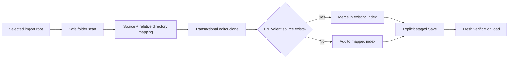

# Milestone 7.5 Report — Legacy Package Layout Compatibility

**Date:** 2026-10-17

**Target:** `E:\Projects\UABS\Avalonia`

**Legacy reference:** `E:\Projects\UABS\UABS` (read-only)

## Outcome

Milestone 7.5 resolves Critical A for the approved **practical legacy interoperability** scope. Recursive editor folder imports now preserve the source-relative index directory for every supported imported source. Existing flat, hierarchical, and empty indexes remain intact, and no automatic package migration or schema change occurs.

The correction deliberately does not reproduce information-losing Unity writer quirks. New records keep complete CAB identifiers and normal .NET paths. Stored legacy CAB/path strings survive round trips unchanged. Safe normal/extended Windows drive and UNC spellings are treated as equivalent only for internal identity and duplicate detection.

## Implemented compatibility improvements

- Added `PackageFolderImportReference`, an additive folder-import result mapping that carries each reference's directory relative to the selected folder. The original flat `References` collection remains for existing callers and test doubles.
- Updated `PackageService.CreateReferencesFromFolderAsync` to calculate source-relative directory mappings without changing source-file handling, cancellation, progress, or failure isolation.
- Updated `PackageEditorViewModel` to merge new sources into mapped indexes transactionally. Equivalent existing sources stay in their current indexes and are not moved.
- Added `PackagePathComparer` as the shared package identity boundary. It recognizes normal versus `\\?\` drive paths and UNC versus `\\?\UNC\` paths, normalizes safe lexical variants, performs no filesystem access or link resolution, and preserves original serialized strings.
- Updated `PackageDocument` duplicate/remove operations and dependency candidate deduplication to use that identity boundary.
- Retained exact-or-one-trailing-character CAB compatibility. Multiple physical candidates, including legacy truncation collisions, remain explicitly `Ambiguous` rather than selecting the first record.

## Legacy format preservation

The unversioned JSON shape remains unchanged: bundle `Name`, `Path`, `CabCode`, `AssetInfos`, and `Dependencies`, plus asset `Name`, `PathId`, and optional `Memo`. Unknown bundle and asset fields continue to round-trip.

The traced legacy writer enumerates the selected source root and every child directory. For each directory it writes the supported top-level sources into an `index.json` at the same path relative to the package root, then writes the root `Validation.txt` marker last. An empty index is an empty JSON array and has no separate memo/metadata envelope; its relative location is the information being preserved.

Existing package layout is authoritative:

- nested and empty indexes survive clone, edit, save, and reload;
- an existing flat package is not reorganized;
- an equivalent duplicate is merged where it already lives;
- new folder-imported sources use the relative directory discovered under the selected root;
- new empty directories are not materialized; and
- single-file/current-asset additions remain in the root index because they have no folder-root mapping.

## Significant files

Added:

- `UABS.UnityAssets/Packages/PackagePathComparer.cs`
- `UABS.UnityAssets.Tests/PackagePathComparerTests.cs`
- `docs/05_audit/milestone-07-5-compatibility-report.md`

Modified implementation:

- `UABS.UnityAssets/Packages/PackageModels.cs`
- `UABS.UnityAssets/Packages/PackageService.cs`
- `UABS.UnityAssets/Packages/Dependencies/PackageDependencyResolver.cs`
- `UABS/Script/ViewModels/PackageEditorViewModel.cs`

Focused tests were extended in `PackageServiceTests`, `PackageEditorViewModelTests`, and `PackageDependencyResolverTests`.

## Verification evidence

Focused rebuilt package service, editor, dependency, and path suites pass **101/101**.

A production-service disposable round trip used the genuine legacy directory `E:\Projects\UABS\UABS\UABS_Cache\OWL_Unity` as read-only input. The package was saved beneath a uniquely named `Avalonia\.codex-validation` directory, loaded again, and compared by normalized physical-source identity. The disposable directory was then removed.

| Measure | Original | Fresh reload | Difference |
| --- | ---: | ---: | ---: |
| Indexes | 422 | 422 | 0 |
| Empty indexes | 99 | 99 | 0 |
| Source records | 6,671 | 6,671 | 0 |
| Asset records | 175,132 | 175,132 | 0 |
| Dependency strings | 15,771 | 15,771 | 0 |
| Missing identity-keyed records | — | — | 0 |
| Extra identity-keyed records | — | — | 0 |
| Changed index/path/CAB/dependency/asset/extension-data records | — | — | 0 |

Final verification:

- `dotnet build Avalonia.sln --no-restore`: passed with 0 warnings and 0 errors.
- `dotnet test Avalonia.sln --no-build`: 166/166 passed, 0 failed, 0 skipped. This includes the zero-Unity-runtime dependency audit.
- `git diff --check`: passed; informational line-ending notices only.
- Documentation scan: 30 Markdown files, 32 Mermaid blocks, 0 missing relative links, and 0 unclosed fences.
- `OWL` final fingerprint: `81E67CD6280DCF08754798E90101ACD43FAC4438D8CD8845FD09268F3DC7CC4C` (matches baseline).
- `OWL_Unity` final fingerprint: `CF9BEACF7991B2DD88F5A3C83479B459347070DD6DBC39165770615A9C60631A` (matches baseline).

## Data safety

- Neither real package directory was a save target.
- The legacy Unity repository was inspected only; no Unity file was intentionally modified.
- No flat package was migrated or rewritten.
- No source Unity file was copied, renamed, or modified.
- No Git commit, reset, clean, checkout, or history operation was performed.

## Known limitations and remaining risks

- This is practical interoperability, not exact byte-for-byte Unity writer reproduction.
- New empty source directories are not represented unless an index already exists in the edited document.
- Existing flat packages do not encode a trustworthy import root, so their original hierarchy cannot generally be reconstructed without guessing. No conversion UI was added; a future explicit conversion would need a user-selected source root and a preview before writing a separate destination.
- The unchanged Unity application's own path comparator may still distinguish path spellings in workflows executed entirely inside Unity.
- Absolute source paths remain installation-specific; path remapping is not implemented.
- The Unity desktop application was not executed against newly generated Avalonia output. Source tracing, focused automation, and the genuine-package round trip are evidence, not a Unity UI acceptance test.
- No new visual controls were required. ViewModel integration and save/reopen behavior are automated-test verified, but this milestone did not perform a new desktop interaction pass.
- Package scans remain sequential and large-tree performance is not benchmarked.

## Critical B status and next milestone

Critical B—application crashes and package editor state loss—remains paused and unresolved. No Milestone 7.4 stability implementation was discarded or replaced. Resume Milestone 7.4 next with composition-level tests covering clean, dirty, and active-import state across tab/view lifecycle changes; fix only reproduced faults.

Do not begin memo lifecycle or another feature milestone before that stability work unless the user explicitly reprioritizes it.

## Unity-Exclusive Features Requiring Decisions

No new Unity-runtime dependency was found. UE-007 remains replaced by the task/cancellation/progress package workflow. UE-008 still requires product decisions for memo identity, save timing, inheritance conflicts, and crash recovery. Exact Unity-writer export and a future versioned modern package format remain optional product decisions, not Milestone 7.5 requirements.
