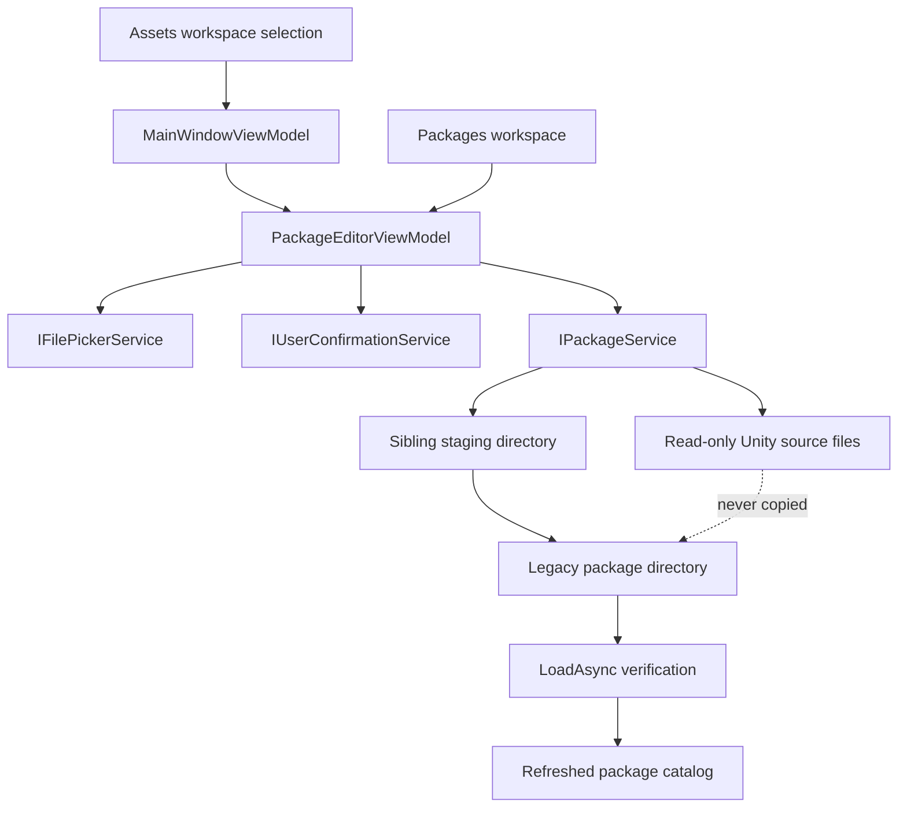
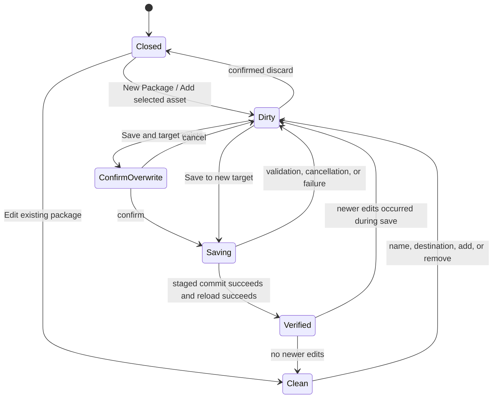

# Milestone 07 Report — Package Creation, Editing, and Saving UI

**Date:** 2026-10-17

**Target:** `E:\Projects\UABS\Avalonia`

**Legacy reference:** `E:\Projects\UABS\UABS` (read-only)

## Outcome

Milestone 7 implements a complete basic package editor in the Avalonia application. A user can begin with no package catalog, create a valid empty package, choose an explicit parent destination, add all supported image references from a Unity bundle or serialized file, add the currently selected Texture2D or Sprite from the Assets workspace, remove source or asset references, save with explicit overwrite confirmation, and reopen the resulting legacy-schema package through the catalog. Milestone 7.5 subsequently corrected the audited folder-import layout mismatch; see the [compatibility report](milestone-07-5-compatibility-report.md).

Existing packages open through an isolated deep editable copy. Loaded records are not mutated before Save. Unknown legacy JSON properties are cloned and preserved by the existing serializer. Package removal, memo editing, and schema expansion remain outside this milestone.

### Milestone 7.1 corrective update

Milestone 7.1 corrected three usability and persistence gaps without changing the legacy package schema:

- A freshly constructed `PackageService` now rediscovers a saved package when the user selects either its parent catalog or the package directory itself. The original reader always enumerated child directories, so directly selecting a saved package yielded an empty catalog.
- Source support is determined by `UnityFileDetector` header detection rather than a filename-extension allowlist. The native file picker defaults to **All Files**, allowing conventional, arbitrary, and extensionless Unity files while rejecting unsupported contents with an actionable message.
- **Add Assets from Folder** scans only the selected folder's top-level files, keeps source files in place and read-only, imports supported files, skips unknown formats, and reports per-file failures. It exposes progress and cancellation. Results are merged into a cloned package document and published once, so cancellation, scan failure, inaccessible folders, or application failure cannot leave a partial editor update.

Folder import preserves source provenance and applies the same source/path-ID duplicate rules as single-file import. Re-importing the same folder is idempotent for existing references.

### Milestone 7.2 folder-import correction

The reported “completed but no assets added” behavior was caused before header detection or asset loading. Milestone 7.1 deliberately hard-coded `SearchOption.TopDirectoryOnly`, and both the picker title and button tooltip described only that behavior. Selecting a normal game/content root whose Unity files lived beneath child directories therefore yielded no candidate files. The downstream path was not the fault: existing root-level integration tests already proved header detection, AssetsTools.NET loading, reference conversion, transactional merge, UI collection refresh, and dirty-state updates.

Milestone 7.2 adds an explicit **Include subfolders** option while retaining current-folder-only as the default. Recursive traversal:

- preserves absolute source paths and detects formats by header regardless of extension;
- processes files sequentially instead of loading their contents as one in-memory batch;
- checks cancellation during discovery and asset processing;
- skips reparse-point files and directories, covering symbolic links and junctions without following them outside the selected tree;
- records inaccessible directories and per-file failures without discarding valid results; and
- accumulates service results before applying one cloned editor document, preserving the Milestone 7.1 transaction boundary.

Completion feedback now reports scope, files scanned, supported files, successfully imported files, source records and asset references added, existing sources and duplicate asset references skipped, unsupported files, file failures, inaccessible-directory failures, and skipped links. A zero-asset result always includes a visible explanation: no files in scope, no supported headers, all supported loads failed, all references already existed, or supported files contained no Texture2D/Sprite references.

### Milestone 7.3 real-world diagnosis

The reported recursive failure was investigated against the exact Otherworld Legends directory and existing `OWL` package without modifying either location. The selected source root contains no files at its top level: all 15 files are `.bundle` files distributed through 16 child directories. Consequently, current-folder mode correctly scans zero files. Recursive mode was then exercised through the production service and through `PackageEditorViewModel`:

| Stage | Verified result |
| --- | ---: |
| Files scanned recursively | 15 |
| Headers detected as Unity bundles | 15 |
| Source references loaded | 15 |
| Eligible Texture2D/Sprite references | 1,173 |
| Unsupported or failed files | 0 |
| Inaccessible directories or skipped links | 0 |
| Duplicates against the existing package source | 0 |

The editor integration added all 15 source rows and 1,173 asset rows to its isolated document and marked it dirty. No Save was invoked during diagnosis, and the on-disk `OWL` package remained unchanged. This rules out bundle detection, AssetsTools.NET loading, asset eligibility, duplicate filtering, transactional merge, collection refresh, and dirty-state propagation in the current implementation. The practical failure boundary is therefore scope and persistence visibility: **Include subfolders** must be enabled before import, and a successful import remains editor-only until **Save** completes.

Milestone 7.3 makes that boundary explicit. Current-folder results count immediate child directories that were not scanned and tell the user to enable recursion. The scope option appears before the import action and uses explicit two-way binding. Successful imports state that the rows are not yet on disk, and a persistent summary reports source count, asset-reference count, and saved/unsaved state. A nested-only regression covers the zero-result current-folder attempt followed by a successful recursive import on the same clean document. No commercial fixture was copied into the repository.

## Editor architecture

`PackageEditorViewModel` owns the editable document, package name, destination, flattened source/asset rows, dirty state, validation, progress, cancellation, and save lifecycle. Views contain only bindings and view-specific picker/dialog composition. `PackageManagementViewModel` coordinates catalog selection and refresh; `MainWindowViewModel` hands the current single asset selection to the editor.

Avalonia confirmation dialogs are behind `IUserConfirmationService`, allowing discard, overwrite, and application-close decisions to be tested without UI automation. Distinct picker methods give the package destination an explicit title instead of reusing an ambiguous source-folder interaction.

## Package workflows

- **First package:** New Package works without a selected catalog and creates one empty root `PackageIndex`, which is valid in the legacy directory format.
- **Add from file:** Add Assets from File opens a Unity-file picker and indexes every legacy-supported Texture2D/Sprite reference from that source.
- **Add from folder:** Add Assets from Folder scans either the current folder or the selected physical subtree, identifies Unity inputs by header, and applies the completed batch transactionally with imported/skipped/failed counts.
- **Folder scope:** Include subfolders explicitly enables safe recursive traversal; current-folder-only remains the default. Links and junctions are reported and skipped.
- **Add current asset:** Add Selected to Package transfers the current asset's source path, name, Path ID, and logical-file discriminator to `CreateReferenceAsync`; it uses the currently selected package when no editor is open, or starts a new editor when no package is available. Unsupported asset classes are rejected visibly.
- **Edit existing:** Edit Package deep-clones the loaded document, including extension data, and derives the destination/name from its current package path.
- **Remove:** removing a source removes its complete source reference; removing an asset removes only that source-scoped asset reference.
- **Save:** the editor validates the name and destination, asks before replacing any existing directory, invokes staged persistence, then reloads the target before marking the editor clean.
- **Reopen:** a successful verified save refreshes the parent catalog and selects the saved package.

## Asset-reference identity

The package service now creates one source reference independently through `CreateReferenceAsync`. Selection matching uses source path plus asset name, Path ID, and logical serialized-file name while the source is open. The persisted legacy schema stores source `Path` plus asset `Name` and `PathId`; it has no logical-file field. Equal Path IDs in different serialized files inside one bundle therefore remain a legacy schema limitation and are not “fixed” with incompatible fields.

References from the same source path are merged. Duplicate Path IDs within that source are not added twice. Existing source-level extension properties remain untouched. Original Unity files are opened read-only and are never copied into a package or cache.

## Save, overwrite, and recovery behavior

The editor never requests `overwrite: true` without an explicit confirmation. `PackageService` retains its sibling staging directory, backup rename, rollback-on-commit-failure, and cleanup behavior. Cancellation is honored before commit; after Save returns, verification reopening completes without cancellation so a committed package is not ambiguously reported as cancelled. Concurrent Save calls are collapsed to one operation. If the user edits while a snapshot is saving, that verified snapshot is reported but the newer editor state remains dirty.

## Unsaved-change lifecycle

New packages start dirty. Name, destination, add, and remove operations increment the editor version and keep the dirty indicator visible. Starting another package, selecting another package, reloading a catalog, discarding, or closing the application requires confirmation while dirty. Declining leaves the editor and package selection intact. Failed or cancelled saves retain the editable document and dirty state.

## Significant files

- `UABS/Script/ViewModels/PackageEditorViewModel.cs`
- `UABS/Script/ViewModels/PackageManagementViewModel.cs`
- `UABS/Script/ViewModels/MainWindowViewModel.cs`
- `UABS/Script/View/Pages/PackageManagementView.axaml`
- `UABS/Script/View/Pages/FolderView.axaml`
- `UABS/Script/Services/IUserConfirmationService.cs`
- `UABS/Script/Services/AvaloniaUserConfirmationService.cs`
- `UABS/Script/Services/IFilePickerService.cs`
- `UABS/Script/Services/AvaloniaFilePickerService.cs`
- `UABS.UnityAssets/Packages/PackageModels.cs`
- `UABS.UnityAssets/Packages/PackageFolderScanner.cs`
- `UABS.UnityAssets/Packages/IPackageService.cs`
- `UABS.UnityAssets/Packages/PackageService.cs`
- `UABS.UnityAssets.Tests/PackageEditorViewModelTests.cs`
- `UABS.UnityAssets.Tests/PackageServiceTests.cs`
- `UABS.UnityAssets.Tests/PackageManagementViewModelTests.cs`

## Automated verification

The pre-change baseline was 116 passing tests. New infrastructure and editor tests cover empty first-package saving, real bundle/serialized inputs, selected-asset provenance, duplicate handling, removal, isolated edits, extension-data preservation, validation, reopen verification, discard/close prompts, overwrite confirmation, cancellation, failure retention, rapid Save suppression, and stale add-result suppression.

Final verification on 2026-10-17:

- `dotnet build Avalonia.sln --no-restore` — succeeded with 0 warnings and 0 errors.
- Original Milestone 7 suite: `dotnet test Avalonia.sln --no-build` — passed 134/134 tests with 0 failures and 0 skipped tests.
- Milestone 7.1 final suite: `dotnet test Avalonia.sln --no-build` — passed 145/145 tests with 0 failures and 0 skipped tests.
- Milestone 7.2 suite: `dotnet test Avalonia.sln --no-build` — passed 152/152 tests with 0 failures and 0 skipped tests. New tests cover both scopes, real nested arbitrary/extensionless fixtures, mixed content, duplicate and zero-result diagnostics, inaccessible/reparse-point paths, cancellation during discovery and processing, UI updates, and save/reopen after recursive import.
- Milestone 7.3 focused checkpoint: the rebuilt package service/editor suite passed 50/50 tests.
- Milestone 7.3 full suite: `dotnet test Avalonia.sln --no-build` — passed 153/153 tests with 0 failures and 0 skipped tests. The solution build succeeded with 0 warnings and 0 errors.
- `git diff --check` — passed; Git reported only the repository's existing LF-to-CRLF working-tree notices.
- The dependency audit found no `UnityEngine`, `UnityEditor`, or `Unity.*` runtime references in the Avalonia source projects.

## Desktop verification

The built Windows application was launched directly from `UABS/bin/Debug/net9.0/UABS.exe`. The following behavior was actually observed:

- the main window started and rendered the existing Assets workspace, including the new **Add Selected to Package** action;
- the Packages workspace rendered its directory, refresh, New Package, Edit Package, and three read-only detail-tab controls;
- **New Package** opened the editor with name/destination fields, add/remove/save/discard actions, an empty contents grid, and the dirty indicator;
- saving a temporary empty package succeeded, closed the editor, refreshed the temporary catalog, selected the new package, and displayed `0 source record(s), 0 asset reference(s)`;
- **Edit Package** reopened the saved package in a clean state;
- changing the name made the editor dirty;
- **Cancel / Discard** displayed the custom confirmation dialog; **Keep Editing** preserved the edit, and a second prompt followed by **Discard Changes** returned to the catalog without altering the saved package;
- the **Add Assets from File** action opened the native Unity asset/bundle file picker.

Asset selection through that native picker was not completed: the picker extended beyond the desktop automation geometry, so a fixture path could not be submitted reliably. Add-from-file, selected-asset transfer, overwrite, cancellation, and failure behavior are covered by automated tests but are not claimed as manually observed desktop interactions. The application closed normally after the smoke test.

The Milestone 7 observations above predate the 7.1 corrective update. Any 7.1 desktop observations are recorded separately after the final smoke pass; automated coverage alone is not represented as manually observed behavior.

### Milestone 7.1 desktop verification

Desktop verification was attempted on 2026-10-17 through the supported computer-use interface. The environment returned no native application inventory and exposed neither application launching nor window enumeration, so the Avalonia executable could not be launched or observed through that interface. No Milestone 7.1 UI interaction is claimed. Startup, visibility of the revised catalog and folder-import controls, native folder selection, and an end-to-end folder import remain manually unverified in this session; their underlying commands and state transitions are covered by automated tests.

Milestone 7.2 desktop verification was subject to the same environment limitation. No current-folder or recursive interaction is claimed as manually observed; the controlled real-fixture workflow is verified through the ViewModel/service integration tests instead.

### Milestone 7.3 desktop verification

The rebuilt application was launched through the supported Windows computer-use interface. The following behavior was directly observed:

- startup completed and the Assets workspace rendered;
- the Packages workspace rendered and the native package-directory picker accepted `E:\Media\UABS_Packages\OWL`;
- the catalog loaded `OWL` as Ready with 1 source record and 100 persisted asset references, and its content rows rendered;
- **Edit Package** opened a clean editor with the expected package name and destination;
- **Include subfolders** rendered before **Add Assets from Folder**, with the scope tooltip available through accessibility metadata; and
- the persistent summary rendered `1 source(s), 100 asset reference(s) in editor — saved`.

Another desktop input opened a file picker while the smoke pass was in progress, so automation stopped instead of competing for control. The 15-bundle recursive import and subsequent Save were not completed by Codex through the visible UI and are not claimed as Codex-observed interactions. The service/ViewModel path is verified against the exact real data as described above, and Codex's diagnostic did not invoke Save.

After that automation stopped, the user independently reported that their manual folder-add test now succeeds. A subsequent read-only disk check found 16 source records and 1,273 asset references in `OWL`: exactly the original 1 source/100 assets plus the diagnosed 15 sources/1,173 assets. This confirms persisted output from the user's test, while remaining distinct from Codex's directly observed UI interactions and automated service/ViewModel verification.

## Compatibility decisions and limitations

- The package name is the target directory name because the unversioned legacy JSON schema has no package-name field.
- Renaming while editing saves to the newly named target and does not silently delete the old package.
- The editor exposes only name, destination, source references, and asset references. It does not invent schema fields.
- Only Texture2D and Sprite references are persisted because those are the asset classes stored by the legacy package builder.
- Multi-selection was not added; the existing single asset selection is used deliberately.
- Package deletion remains absent because the legacy immediate recursive delete has no safe confirmation/recovery contract.
- Source hierarchy for individually added files is stored in the root index. Existing packages retain all original nested index directories.
- Folder imports preserve each supported source's directory relative to the selected root. Existing indexes, including empty and flat indexes, are retained; scanning does not create new indexes for empty directories. Individually added files remain in the root index because no folder-relative context exists.
- Large-source performance and multi-serialized-file identity collisions need broader fixtures.
- Folder import is sequential and optionally recursive. Large-tree responsiveness has no dedicated performance benchmark. Unsupported files are reported by count, while failed and inaccessible paths expose the first visible diagnostic; there is not yet a full per-path results panel.
- The real-world diagnosis proves the current production service/ViewModel path for the supplied data, but native picker operation and clicking Save after that import still require a desktop-capable manual smoke test. If an older running binary predates Milestone 7.2, it must be rebuilt/restarted before these controls and diagnostics are available.

## Unity-Exclusive Features Requiring Decisions

No new Unity-exclusive dependency was introduced. UE-006 remains replaced by Avalonia `StorageProvider`; UE-007 remains replaced by awaitable task/cancellation/progress and staged persistence. Package editing uses normal Avalonia composition and confirmation dialogs under UE-005. Memo editing still requires the UE-008 identity/save-policy decision. Image decoding, preview, and export remain governed by UE-001 through UE-004.

## Recommended next milestone

Proceed to memo lifecycle infrastructure only after deciding UE-008: stable memo identity, explicit save versus cancellation-safe debounce, inheritance conflict policy, and atomic write recovery. Keep reverse dependency lookup and image decoding separate.
