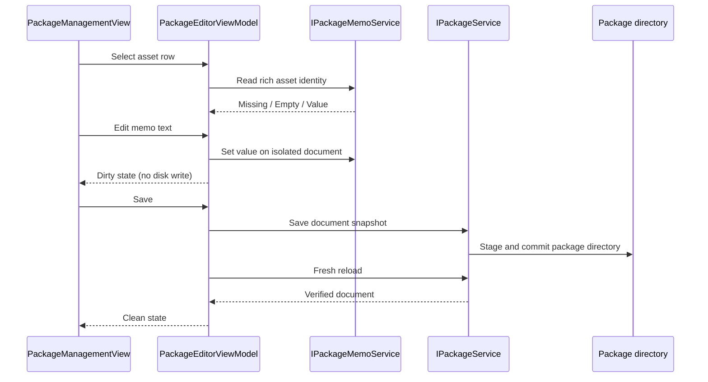

# Milestone 8 Report — Memo Editing, Inheritance, and Persistence

**Date:** 2026-10-17

**Target:** `E:\Projects\UABS\Avalonia`

**Legacy reference:** `E:\Projects\UABS\UABS` (read-only)

## Outcome

Milestone 8 implements the verified legacy asset-memo workflow without adding a schema or automatic disk writes. Users can select an asset in the existing package editor, view whether its memo is absent, explicitly empty, or locally stored, edit or clear it, navigate between rows or workspaces without losing the edit, and persist it through the existing explicit staged Save transaction.

The legacy operation named “inheritance” is implemented as explicit package-to-package memo copy with Safe, Overwrite, and Force modes. Source and target snapshots are processed transactionally; cancellation, a newer editor change, or a conflict cannot partially replace current editor state.

Package-, directory-, and source-level memo editing was not invented because the actual unversioned format contains `Memo` only on `AssetInfos[]` objects. Likewise, there is no parent/child directory inheritance: relative index paths only align two package versions for bulk copy.

## Verified legacy semantics

Read-only tracing covered `MemoField`, `MemoReader`, `MemoWriter`, `InheritMemoWriter`, `MemoInheritMode`, their Unity tests, and the JSON wrapper.

| Concern | Verified behavior |
| --- | --- |
| Memo owner | Individual asset record only |
| Serialized field | Optional `AssetInfos[].Memo` string |
| Direct lookup | Source `Path`, then first exact asset `Name` in legacy code |
| Missing value | `null` to the reader; omitted by the Avalonia legacy writer |
| Empty value | Distinct explicit `"Memo": ""`; produced when the user clears the legacy field |
| Package copy alignment | Same relative `index.json` path |
| Source matching during copy | Filename without extension/suffix following the last underscore |
| Asset matching during copy | Exact asset name |
| Safe | Copy non-whitespace source only when target is missing/empty/whitespace |
| Overwrite | Copy non-whitespace source regardless of target |
| Force | Copy source including empty or missing |

Legacy direct lookup and copy silently take first duplicate matches. The replacement does not: direct editing uses package path, index-relative directory, normalized source path, asset name, and Path ID; duplicate complete identities or copy keys are reported and left unchanged. Bundle names without an underscore use their complete stem instead of triggering the legacy slice exception.

Production `OWL` and `OWL_Unity` contain no memos. Genuine memo evidence comes from the read-only Unity test package in `External_Test/UABS_TestResources`, where `hook` (Path ID `-9195836073069537342`) stores `钩爪`. A minimized representation of that verified structure is committed as a test fixture and round-tripped only to disposable output.

## Architecture and editing lifecycle

`PackageMemoService` is UI-neutral and has no Avalonia, Unity, or AssetsTools.NET dependency. It operates only on already loaded neutral package metadata. `PackageEditorViewModel` remains the transaction owner: direct edits mutate its isolated clone, memo copy works from clones, and only the existing package service writes files.

The memo panel intentionally reports unsupported ownership for package/source rows. It exposes a multiline editor, a legacy-compatible Clear action, storage-state text, an explicit catalog source, and a copy mode. Copied values become ordinary local asset memos because the schema has no provenance field.

## UE-008 replacement

The Unity implementation used `MonoBehaviour`, TextMeshPro focus/events, and a 0.4-second coroutine debounce that wrote JSON after typing stopped. Avalonia replaces this with two-way MVVM state on the isolated package document and explicit Save. There is no coroutine-style timer, focus-loss save, background write queue, or package-file write on each keystroke.

UE-008 is `PARTIALLY_REPLACED`: the implementation and automated behavior are verified, but the new memo controls have not yet completed a desktop interaction pass. The inline annotation is on `PackageMemoService`, the closest neutral replacement boundary.

## Significant changes

New implementation:

- `UABS.UnityAssets/Packages/Memos/PackageMemoService.cs`
  - rich identity and missing/empty/value state;
  - local memo mutation;
  - transactional Safe/Overwrite/Force copy;
  - cancellation and structured ambiguity diagnostics.

Modified presentation:

- `UABS/Script/ViewModels/PackageEditorViewModel.cs`
  - selection-aware memo state, dirty tracking, clear behavior, stale-result protection, and transactional copy publication.
- `UABS/Script/ViewModels/PackageManagementViewModel.cs`
  - source-package/mode selection and copy command.
- `UABS/Script/View/Pages/PackageManagementView.axaml`
  - asset memo panel, storage state, memo column, and package-copy controls.

Tests and fixtures:

- `UABS.UnityAssets.Tests/PackageMemoServiceTests.cs`
- expanded `PackageEditorViewModelTests.cs` and `MainWindowViewModelTests.cs`
- `Fixtures/LegacyMemoPackage`, a minimized representation of verified genuine legacy memo data.

## Automated verification

- `dotnet build Avalonia.sln --no-restore`: passed with 0 warnings and 0 errors.
- `dotnet test Avalonia.sln --no-build`: **196/196 passed**, 0 failed, 0 skipped.
- Focused memo/editor/workspace tests: **51/51 passed**, 0 failed, 0 skipped.
- Focused zero-Unity-runtime dependency audit: **1/1 passed**.
- `dotnet build Avalonia.sln --no-restore -c Release`: passed with 0 warnings and 0 errors.
- `dotnet test Avalonia.sln --no-build -c Release`: **196/196 passed**, 0 failed, 0 skipped.
- The full suite also includes the zero-Unity-runtime dependency audit.
- Memo coverage includes missing/empty/value loading, package/source ownership rejection, rich identity and duplicate Path IDs, local edits, row/workspace switching, save/fresh reopen, discard isolation, save failure, all copy modes, local overrides, Force clearing, ambiguity, cancellation, unknown fields, empty indexes, underscore-free names, and the verified legacy memo representation.

The first Debug attempt was blocked by a pre-existing running `UABS` process holding the Debug copy of `UABS.UnityAssets.dll`; no user process was terminated. After the lock cleared naturally, the required Debug build and tests passed as recorded above.

## Desktop verification

No Milestone 8 memo interaction is claimed. Per the permanent user-driven UI verification policy, this continuation used no computer-control tools, screenshots, native pickers, or UABS-window interaction. Automated tests verify selection/workspace retention and lifecycle behavior; they are not manual UI observation.

### Manual verification checklist

Use a disposable target package rather than either real package:

1. Open Packages, create or load the disposable target, select an asset row, and confirm the memo editor becomes available only for that row.
2. Enter Chinese and multiline text, change rows and workspaces, return, and confirm the unsaved text and dirty state remain.
3. Save explicitly, reopen the package, and confirm the value persists; then use Clear, save, and confirm the stored state is explicitly empty rather than missing.
4. With prepared disposable source/target packages, exercise Safe, Overwrite, and Force and confirm the changed/skipped/ambiguous counts match the selected mode.
5. Cancel a copy operation if a sufficiently large disposable fixture is available and confirm no partial target result is published.
6. Confirm keyboard focus, scrolling, accessibility labels, long text, and high-DPI layout are usable.

## Compatibility and data safety

- No new persisted identifier or schema field was added.
- Existing `Memo`, unknown bundle/asset fields, nested indexes, and empty indexes survive clone/save/reopen.
- Original source paths remain unchanged; path normalization is identity-only.
- Save uses the established sibling staging directory, rollback backup, and fresh reload verification.
- Failed/cancelled Save retains the editor memo and dirty indicator.
- Memo copy modifies only a target candidate and never the source package.
- Neither `E:\Projects\UABS\UABS\UABS_Cache\OWL_Unity` nor `E:\Media\UABS_Packages\OWL` was a write target.
- The legacy Unity repository was inspected only and was not modified.

## Known limitations and risks

- The format cannot attach memos to a package, directory, or source record.
- There is no persisted inheritance provenance; after copy, a memo is simply local target data.
- A legacy bundle containing multiple logical serialized files cannot encode that logical-file component in its memo identity.
- Genuinely duplicated complete asset identities cannot be disambiguated without a future versioned format; the editor refuses to guess.
- Moved absolute source paths remain a broader package limitation.
- Production packages available for verification contain no memo corpus.
- Large package copy is metadata-only and cancellation-aware but has not been benchmarked.
- The new controls still require uninterrupted desktop interaction, accessibility, keyboard, high-DPI, and long-text observation.

## Unity-Exclusive Features Requiring Decisions

UE-008 no longer has an unresolved save-policy decision: explicit package Save is implemented. It remains partially replaced solely pending desktop acceptance of the Avalonia interaction boundary.

No new Unity-exclusive dependency was discovered. The next likely feature phase—neutral texture/sprite decoding—still requires UE-001/UE-002 decisions covering codec support, fidelity, licensing, native deployment, neutral pixel ownership, and crop/padding behavior. Reverse dependency lookup remains an independent product decision rather than a Unity dependency.

## Next milestone

First complete the user-driven desktop acceptance checklist for the memo panel and copy modes. After that, the recommended feature milestone is neutral Texture2D/Sprite decoding, but only after the UE-001/UE-002 replacement decisions are approved. Do not fold preview/export into that decoder milestone.

## Suggested commit message

`feat(memos): add explicit-save memo editing and legacy inheritance`
