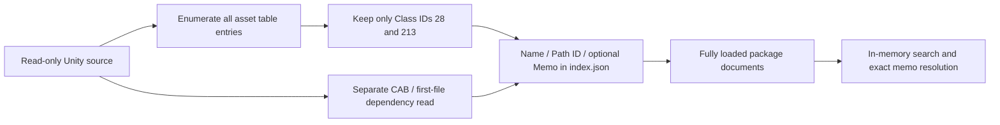
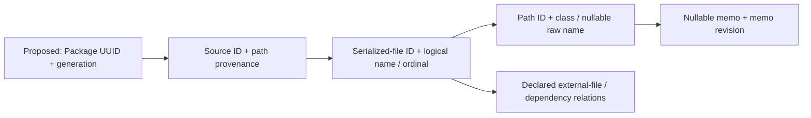

# Package Format V2 — Architecture Audit and Storage Benchmark

**Date:** 2026-10-20. **Baseline:** clean `593fd10`.

**Scope:** source inspection and disposable storage experiments only. No production format, application behavior, dependency, existing package, or Unity source is changed. V2 may replace the legacy format without a reader/migration requirement; existing files remain untouched. Designs below are proposals, not implemented behavior.

## Decision status

**Audit complete; implementation not approved.** Recommend independent SQLite packages with lightweight catalog registration, B-tree identity/exact filters, optional selective trigram acceleration and bounded federated queries. Compact JSON wins size and broad preloaded scans in this prototype; SQLite is recommended for lazy metadata ownership and frequent transactional memo updates, **not** because it wins every query. Require a .NET/provider/real-metadata spike and the decisions below before production implementation.

## Verified current architecture

- [Package models](../../UABS.UnityAssets/Packages/PackageModels.cs): root `Validation.txt`, recursive source-relative `index.json` arrays; bundle `Name`, original absolute `Path`, `CabCode`, `Dependencies`, `AssetInfos`; asset `Name`, signed 64-bit `PathId`, nullable/omitted `Memo`. Unknown JSON members are retained. Package path/source root and relative index directories exist in memory, not as a versioned manifest.
- [Package service](../../UABS.UnityAssets/Packages/PackageService.cs), `CreateReferenceAsync`: opens an asset session, separately reopens metadata through `LegacyPackageMetadataReader`, filters **Class IDs 28/213**, then writes name and Path ID only. Class/type, logical file, size and version are lost. Selecting other asset types cannot make this writer persist them.
- [Session factory](../../UABS.UnityAssets/AssetsToolsAssetSessionFactory.cs), `EnumerateAssets`/`ReadIdentityFast`: already enumerates every serialized asset table entry, carrying class ID, Path ID, byte size, logical file and original path without preview decoding.
- [Search service](../../UABS.UnityAssets/Packages/Search/PackageSearchService.cs): scans fully loaded package objects, materializes virtual results, then deterministically sorts. Search does not reopen Unity sources. There is no persisted class/type filter.
- [Memo persistence](../../UABS.UnityAssets/Packages/Memos/PackageMemoPersistenceService.cs): coordinated latest-document read, full-tree revisions, exact targeting, isolated memo edit, staged whole-package save, reload verification and controlled catalog publication.

### Reading, identity and search details

`PackageService.Load` deserializes all recursive indexes. `ReadCatalogAsync` discovers a package root or its child packages and fully loads each document; malformed siblings become error catalog entries rather than hiding valid siblings. Search, dependency lookup and memo resolution operate over these loaded objects. Missing original game files do not prevent metadata searching.

Current immutable memo identity is `(package path, relative index directory, normalized source path, exact asset name, signed Path ID)` in `PackageMemoService.cs:24`. It rejects duplicate complete matches instead of selecting the first. It cannot distinguish equal names/Path IDs from two serialized files in one bundle; `PackageMemoResolver` blocks known ambiguity. Arbitrary pre-existing asset records can already carry memos, but the new-reference writer still excludes non-image classes.

This diagram represents the current implementation, not V2.

`LegacyPackageMetadataReader` scans for the first printable `CAB-` token and reads `AssetBundle.m_Dependencies` from the **first** serialized file. These are source-level fields, not authoritative per-serialized-file identities. The dependency resolver builds an in-memory CAB lookup, reports resolved/unresolved/ambiguous candidates and deduplicates physical source paths. CAB alone is not a globally unique asset key.

| Current search behavior | Verified implementation |
| --- | --- |
| Includes/excludes | Trimmed comma/Chinese-comma terms; includes OR together; any exclude matching a selected field rejects that candidate |
| Exact / substring | Whole selected-field equality / literal substring; both `OrdinalIgnoreCase`, not token or wildcard search |
| Search memos | Adds Memo to text-match fields; independent from `RequireNonEmptyMemo` |
| Memo only | Rejects null/empty/whitespace asset memos; does not itself supply an include term or restrict package/source candidates |
| Empty request | No includes and no Path ID yields no results; Path ID is numeric exact and combines with any supplied text/excludes |
| Types | No class/type field or class filter exists in the persisted package/search request; result-kind filters mean Package/SourceFile/Asset, **not** Unity class |
| Batch scope | `SearchWorkspaceViewModel` passes selected loaded packages to one service call; first catalog scope starts selected, newly added packages later do not auto-select |
| Results | Package/source/asset virtual references retain provenance; materialized and deterministically sorted, with no Unity-source loading |

Legacy evidence: [UserPackageBuildReader.cs](../../../UABS/Assets/Script/Reader/UserPackage/UserPackageBuildReader.cs), lines 39/132/140, filters Sprite/Texture2D in the first serialized file and calls `GetBaseField` for **each indexed asset** to access `m_Name`; this is full structured-object deserialization, not the lightweight browser enumeration. It is not proof of image pixel decoding. [AssetsReader.GetAssets](../../../UABS/Assets/Script/Reader/BundlesRead/AssetsReader.cs) separately uses `NextInstance.GetDisplayNameFast`; do not attribute that optimization to the package writer. Legacy CAB scanning allocates the complete source file and truncates the last printable character. [WriteUserPackage.cs](../../../UABS/Assets/Script/Writer/UserPackage/WriteUserPackage.cs) serializes indented JSON and writes the empty marker last. Legacy [FindDeriveInfoInPackage](../../../UABS/Assets/Script/Reader/Search/FindDeriveInfoInPackage.cs) rereads recursive JSON for each search and returns source bundles, not equivalent asset-result rows; its exact branch checks only the first include and bypasses memo/exclude handling.

Historical architecture/system documents still contain pre-Stage-4 statements such as “no memo autosave.” For current memo behavior, the inspected Stage 3–6 source below is authoritative; this audit does not rewrite unrelated historical sections.

## Metadata-first all-asset indexing — proposed

### What is cheap, and what is not measured

**Source-established, not timed on OWL:** serialized `AssetInfos` provides Path ID, class/type ID and byte size without constructing every object's field tree. Enumerating is linear in table entries after loading the file metadata. `ReadIdentityFast` resolves a type-tree/class-database type label; it reads a leading `m_Name` string where supported, special-cases GameObject component layout and MonoBehaviour offsets, and falls back to `Unnamed asset`/`Class N`. It performs no texture/audio/mesh decoding. However, opening a compressed bundle currently unpacks it into a `MemoryStream`: decompression and peak memory can dominate before the table scan. “Metadata-only” does **not** mean zero bundle decompression or random-access cost.

The present reader's class database is loaded once per manager; mixed serialized-file Unity versions need per-file schema selection. GameObject prefixes are display labels, not raw stored names; fixed MonoBehaviour offsets are version-sensitive. V2 must retain a row when names/types fail, store nullable raw names plus name-resolution status, and keep fallback display labels out of identity. Bound string lengths/seeks against the object's byte range; do not expand `GetBaseField` to arbitrary objects just to find names. Optional bounded type-tree field skipping needs representative version/MonoBehaviour tests before claiming broader name coverage.

Remove the **package writer** whitelist, not just UI restrictions. Reuse one source-open lifecycle for table enumeration and dependency extraction rather than opening twice. Record per-source/logical-file success, warnings and fatal errors; distinguish complete, partial, unsupported and failed indexing. A corrupt logical file must not masquerade as an empty successful source; readable siblings and nameless/unknown-class entries should survive. No arbitrary class whitelist and no requirement for a preview/export handler.

### Recommended logical schema

| Entity | Proposed stored fields / constraints |
| --- | --- |
| Package | Format/schema version, package UUID, index-generation UUID, name, creation/indexer version, monotonic catalog revision, completion state |
| Source | Stable package-local source ID, source-root alias plus relative path, original path spelling, file kind, size/version/change evidence, indexing state/diagnostics |
| Serialized file | Stable source-local ID and directory-entry ordinal, logical name/CAB where available, Unity/serialized format versions, type-tree availability; handle duplicate logical names explicitly |
| Asset | Source/serialized-file FK, **signed Int64** Path ID, numeric class ID, nullable raw name, resolved/fallback type label and resolution status, byte size/optional offset, nullable memo and memo revision |
| Relationships | Raw CAB declarations, serialized external-file references/GUIDs and provenance; optional resolved links kept separate from declarations and ambiguity |

Exact persisted key: `(package UUID, index-generation UUID, source ID, serialized-file ID, Path ID)`, unique within a package generation. Class ID is a validation/search field, not a guessed identity; name is mutable/nullable metadata, never the key. Preserve original source strings but resolve through the registered package location/root mapping. Duplicate package UUID/generation copies loaded at different locations must be flagged or explicitly treated as separate registrations—not silently merged. A full regenerate creates a new generation and invalidates old drafts/results; memo carry-forward across regeneration is a separate decision, not an invented name match.

Assets-to-package lookup still requires a unique registered package/source/logical-file match; the same source indexed by two packages remains ambiguous without an explicit package choice. Search results already know their package and must retain that provenance. Carry logical-file ordinal/key through the source-session contract before enabling V2 memo targeting; a display name alone is insufficient. MonoBehaviour script names are optional richer metadata, not something inferred from filenames or generic Class ID 114.

This proposed ownership chain intentionally separates physical identity, display names and dependencies.

## Storage candidates

| Concern | A: nested JSON | B: compact normalized JSON | C: per-package SQLite (+ optional trigram) |
| --- | --- | --- | --- |
| Creation/size | Simple, readable, repeated keys/large files | Smallest prototype; positional rows require versioned column definitions | Bulk insert plus explicit secondary-index build; more overhead than compact JSON |
| Load/search/memory | Fully hydrate then scan; dictionaries add cost | Reduced parse/object cost; still scan unless building RAM indexes | Lazy connection/catalog headers; B-trees for exact/type/identity; optional substring index; result materialization still costs |
| Single memo | Reload/rewrite package, full-tree conflict/verification overhead | Same fundamental rewrite unless adding a journal | Atomic row update, null-safe preconditions and index maintenance within one transaction |
| Multi-package | Merge loaded object scans | Same, or build a separate cache | Federate bounded connections and merge ordered results; do not assume unlimited ATTACH |
| Validation/version | Explicit manifest/validator and staged publication needed | Same plus column/type/count validation | `application_id`/`user_version`, metadata version, FK/unique/check constraints and integrity checks |
| Safety/platform | Existing staged directory writer; external-process race | Needs equivalent staging; append journal complicates recovery | Native provider deployment, busy handling, transactions, journal/backup policy; managed UI remains Unity-free |
| Complexity | Lowest near-term, poor scaling for frequent memo edits | Modest schema change; secondary cache creates two stores | Higher initial repository/query work, simpler durable fine-grained memo transactions |

**D, conditional hybrid:** compact JSON plus a disposable application-wide SQLite search cache is useful only if portable human-readable canonical packages are a product requirement. It avoids attachment limits but duplicates metadata, adds cache-generation invalidation and requires memo writes to canonical JSON plus verified cache publication. It does not fix canonical JSON's single-memo rewrite cost. Do not add it by default or use two writable authorities.

## Disposable benchmark

### Method and reproducibility

Disposable artifacts: `C:\Users\kolynlin\Documents\Codex\2026-10-16\files-pasted-by-the-user-i\package-v2-benchmark` (`benchmark.py`, `finalize.py`, `results-{size}.json`, `secondary-index-builds.json`, `tables.md`). Run with the bundled Python executable returned by the workspace dependency locator, not the empty system `py` launcher. Reproduce with `benchmark.py --size 10000`, then `100000`, then `1000000`, **sequentially**; `finalize.py` records supplemental index/header measurements and final isolated repetitions. This directory is not tracked or required by UABS. No package source path is a benchmark destination and no permanent dependency was installed.

**Measured runtime:** Python 3.12.14 x64, SQLite 3.53.1 with FTS5/trigram, Windows 11 build 26200, AMD64 Family 23 Model 113, 12 logical processors. CPU marketing model/RAM capacity were unavailable through restricted CIM; no settings were changed to obtain them. These are Python storage prototypes, **not** production System.Text.Json/Microsoft.Data.Sqlite/.NET benchmarks or actual Unity extraction timings.

Each size has eight packages, 1,000 assets/source, two logical files/source, repeated names, repeated signed Path IDs across sources, 8 class labels including unknown, ~2.7% null names, 60% null/10% empty/10% whitespace/20% nonempty memos of varied lengths. Nested JSON is a **V2 all-types analogue** of current-style source nesting, not byte-identical legacy JSON; compact JSON uses source tables and positional asset rows. SQLite uses the same data, source joins, B-trees on folded name/class/Path ID, and optionally external-content trigram `detail=none` over names/memos. Prototype FTS maintenance covers memo updates; it is not a complete production insert/delete implementation.

Creation, hydrated JSON reopening, warm queries, index builds and changed-memo updates use three repetitions and medians. SQLite creation includes B-tree insertion upkeep; FTS build is separately reported and must be **added** to its create time. The separately timed post-load B-tree rebuild reuses freed pages; do not subtract it from creation or treat it as the same bulk-load plan. SQLite default DELETE journal/FULL sync is retained; JSON flushes and atomically replaces a sibling file. Memo timings include loading/updating one selected package and readback, not the current Stage 3 full-tree hashes, editor guards, catalog/UI publication or fault-injection verification. Thus neither writer is a production implementation or a durability equivalence proof.

Every query fully materializes and sorts identical **12-field** asset/provenance tuples including nullable memo, source path, CAB and dependencies, not just database IDs. Counts and SHA-256 hashes of every full result agree for all 13 queries at all three sizes. Query timing excludes the equality hash equally for all candidates. JSON preloads metadata and reuses existing strings; SQLite materializes joined strings per result. That is a real prototype allocation difference, not a claim that production .NET has identical overhead. Asset-only queries cover current literal/OR/exclude behavior; class-only and memo-only-without-text are explicitly proposed V2 workloads, not existing UI capabilities. Package/source-result matching is source-audited, not benchmarked here.

Fresh-process opening/first substring and resident-memory samples are reported separately from three-run warm medians. They are **OS-cache-warm process-cold**, not physical cold-disk measurements: filesystem caches were not flushed. SQLite connection-only open is labeled separately from header/schema/source-count readiness and from full JSON hydration. First-query samples are single observations, not cold medians. Win32 process working-set/peak counters include native SQLite memory; result-heavy peaks are not attributed solely to an index. Preliminary overlapping runs were replaced by isolated affected reruns before reporting final numbers.

### Results

All times below are milliseconds; creation/index/query/update figures are medians of three runs. `nested` = current-style all-types JSON, `compact` = positional normalized JSON, `sqlite` = B-tree variant, `fts` = same SQLite plus trigram. Creation covers all eight packages; memo update touches one package (about one-eighth of the rows at 100k/1M), not the entire multi-package corpus.

| Assets | Prototype | MiB | Create ms | Extra FTS build ms | One memo ms |
| ---: | --- | ---: | ---: | ---: | ---: |
| 10,000 | nested | 3.18 | 200.4 | 0.0 | 48.4 |
| 10,000 | compact | 1.13 | 85.0 | 0.0 | 28.1 |
| 10,000 | sqlite | 1.93 | 233.9 | 0.0 | 5.7 |
| 10,000 | fts | 2.46 | 248.1 | 125.9 | 6.3 |
| 100,000 | nested | 31.97 | 1704.9 | 0.0 | 270.2 |
| 100,000 | compact | 11.45 | 680.9 | 0.0 | 94.8 |
| 100,000 | sqlite | 17.62 | 775.5 | 0.0 | 5.9 |
| 100,000 | fts | 21.04 | 803.0 | 334.6 | 6.3 |
| 1,000,000 | nested | 321.59 | 17842.6 | 0.0 | 2534.2 |
| 1,000,000 | compact | 116.42 | 7063.1 | 0.0 | 940.1 |
| 1,000,000 | sqlite | 176.91 | 9096.1 | 0.0 | 6.7 |
| 1,000,000 | fts | 209.54 | 9111.0 | 2387.2 | 6.5 |

Million-asset warm queries, including full result materialization and deterministic ID ordering:

| Query | Results | Nested ms | Compact ms | SQLite ms | Trigram ms |
| --- | ---: | ---: | ---: | ---: | ---: |
| Exact name `HeroIcon` | 965 | 169.4 | 144.8 | 4.2 | 4.5 |
| Substring `hero` | 965 | 172.7 | 148.0 | 396.4 | 6.1 |
| Include `hero` OR `0499` | 1160 | 620.8 | 623.0 | 607.0 | 8.8 |
| Include `texture`, exclude `0040` | 121307 | 270.8 | 248.7 | 716.9 | 793.3 |
| Class ID 43 | 125000 | 160.8 | 166.2 | 451.1 | 453.0 |
| Path ID -77 | 1000 | 59.1 | 74.8 | 4.6 | 5.0 |
| Memo contains `approved` | 100000 | 204.9 | 227.4 | 579.4 | 766.8 |
| Non-whitespace memo | 200000 | 273.2 | 271.0 | 983.4 | 1051.6 |
| Name `asset` + Class 43 + memo `approved` | 24301 | 159.5 | 149.4 | 274.8 | 551.5 |
| `asset` in selected packages 1/3 | 242994 | 163.1 | 155.7 | 697.3 | 1148.1 |
| Large result: `asset` | 972007 | 634.9 | 609.3 | 2885.2 | 4566.9 |
| No match: `impossible_needle` | 0 | 180.4 | 155.4 | 478.1 | 3.0 |
| Short substring `as` | 972007 | 627.3 | 597.1 | 2816.2 | 3030.7 |

Class lookup is indexed but low-selectivity (12.5% of all assets); returned-row cost dominates. FTS memo and selected-package workloads are broad and slower here. A scan fallback for two-character terms preserves results but does not make that query indexed. Current UABS sort/tie rules differ from this benchmark's common ID order; validating production sort/paging is a separate gate.

| Assets | Post-load B-tree rebuild ms | SQLite header/schema/source-count open ms | Nested hydrated open ms | Compact hydrated open ms |
| ---: | ---: | ---: | ---: | ---: |
| 10,000 | 108.6 | 10.9 | 29.1 | 10.9 |
| 100,000 | 257.3 | 12.9 | 325.8 | 98.5 |
| 1,000,000 | 1985.1 | 12.4 | 4060.7 | 1137.7 |

SQLite header readiness deliberately does not load every asset or perform a full integrity scan; the JSON prototypes must hydrate their searchable rows. Query measurements above include database reads and complete results, avoiding a connection-only speed claim.

Single fresh-process observations at 1M assets, OS cache warm:

| Prototype | Resident MiB after open | Resident MiB with 972,007 results | Peak MiB | Open ms | First substring ms |
| --- | ---: | ---: | ---: | ---: | ---: |
| nested | 554.6 | 700.5 | 715.2 | 3905.6 | 179.3 |
| compact | 524.2 | 667.0 | 681.8 | 1210.2 | 144.9 |
| sqlite | 22.4 | 722.8 | 737.6 | 4.3 | 408.3 |
| fts | 22.6 | 723.1 | 737.8 | 3.9 | 23.5 |

The last table's SQLite **open** is connection-only (use the preceding table for header readiness). Process baseline was about 22 MiB. Lazy databases avoid permanent full-catalog hydration, but **do not** guarantee low memory when almost a million joined result records are retained. The broad materialized database results actually consume more memory than the JSON prototype's reused strings here. Bounded fetching and UI result virtualization/paging—not just a new format—are necessary for that workload.

Benchmark script SHA-256: `275feeccce95a63387f5fbae51ce6b5ecc9d3b9f3a0e527ec92694bf30e77775`. Raw results retain per-query counts, hashes, first-run samples and warm medians at all sizes. Million-record coverage completed; physical cold-cache, real Unity ingestion, .NET provider performance, concurrent writers and hundreds-of-packages scaling remain **unmeasured**.

### FTS semantics and interpretation

Selective trigram candidates help; broad queries can cost more than scans plus result materialization. Use a query planner, not FTS for every predicate. B-trees serve exact/type/identity filters; use scans for short or unsupported terms. A token search is not a substitute for literal substring matching. Probe results: `hero` matches `HeroIcon`; two-character `as` and Chinese `钩爪` have no trigram MATCH hit but do match LIKE; `äpf` MATCH finds `Äpfel`, while default LIKE does not. Literal `%`/`_` need correct handling. FTS LIKE with ESCAPE cannot use the trigram optimization, and `detail=none` limits MATCH tokens. [SQLite FTS5](https://www.sqlite.org/fts5.html#the_trigram_tokenizer)

Main equivalence datasets use ASCII case/whitespace. SQLite's default ASCII-only casing is **not** .NET `OrdinalIgnoreCase` over Unicode; SQL `trim` is not .NET `IsNullOrWhiteSpace`. Preserve the current contract through tested normalized keys/derived flags and conservative candidates plus authoritative matching, or obtain approval for changed semantics. A post-filter cannot repair false negatives in the candidate generator. Parameterize queries and distinguish literal punctuation from SQL/FTS operators. [SQLite expression semantics](https://www.sqlite.org/lang_expr.html)

## Multi-package recommendation — proposed

Use independent SQLite packages as the sole durable authority and a lightweight application registry of package IDs/locations/generations/counts/revisions, not fully loaded `PackageDocument` graphs. Selection/deselection changes a query scope; unload cancels relevant work, closes/returns connections safely and marks detached drafts unavailable without deleting them. Limit concurrent readers with an LRU/bounded pool, one connection per active worker, parameterized queries and busy timeouts. Search generations and cancellation reject stale scope results; merge deterministically by user sort plus full provenance key. Large-result paging/keyset streaming needs UI acceptance; do not silently truncate a search.

ATTACH is not the unlimited fan-out solution: the default limit is 10 databases and the compile-time ceiling is 125. Independent connections/federation avoid that ceiling, but per-package startup and merge costs still need a many-package .NET benchmark. [SQLite limits](https://www.sqlite.org/limits.html)

Publish verified memo deltas with package/generation/asset identity and committed revisions. Invalidate matching metadata/query caches, update all matching observable rows on the UI dispatcher without rerunning Search or replacing selection/scroll, and reject an older delta. Existing rows remain snapshots of the explicit query: a memo edit need not silently re-evaluate filters. A shared global read cache is a later measured optimization, never the first canonical store.

## Memo Stage 2–6 compatibility — proposed adaptation

| Existing component | Reuse / change required |
| --- | --- |
| `PackageWriteCoordinator` | Retain application serialization through verification/publication, but key canonical registered package locations; it is not a database cross-process lock |
| `PackageEditorSessionGuard` | Retain initial clean-or-dirty active-editor exclusion; opening/editor guard transitions must share the same coordination boundary |
| `MemoDraftCoordinator` | Retain 1.5 s debounce, per-identity drafts, Save Now/Retry, stale completion gates and failed text; replace identity/revision adapter, not with selection-derived writes |
| Stage 3 persistence/revision | Replace whole-tree SHA-256 + directory rewrite with a SQLite transaction and conditional row update; structured failures and reload verification remain contractual |
| Catalog publisher | Replace whole-document reload/replacement with verified revisioned metadata deltas; retain UI-thread dispatch and coordination boundary |
| Assets/Search presenters and row sync | Reuse UI save states and shared coordinator; resolve by new full immutable key, update **all** exact rows using confirmed values, never draft text |
| Package Editor / memo copy | Keep isolated working transaction and explicit Save; validate base revisions on commit, no overwrite of intervening memo saves; copy matching policy must be designed for all types/generations |

Current Stage 3 fingerprints all package directory/file names, lengths and contents multiple times; clones the latest document, checks expected original memo and optional package revision, saves every index with flushed sibling staging, renames target to backup then staging to target, reloads/verifies, then publishes inside coordination. The final external-write check and rename still have a race; the two renames have a brief missing-target gap. These costs are not captured by a JSON serialize-only metric.

For V2: acquire coordinator and editor eligibility, open the registered database, `BEGIN IMMEDIATE`, validate generation/schema/revision, select exact unique key, compare expected memo **including NULL versus empty** and row revision, apply only memo/revision plus FTS maintenance, then commit. Verify a fresh read and publish under the coordination boundary. Use expected package revision initially for conservative conflicts; relaxing to row-only concurrency is a product decision. Preserve request text and distinguish missing/ambiguous/conflict/busy/write/verification/publication failures; commit success with publication failure is not a “nothing written” retry. Cancellation before commit rolls back; once committing, finish/verify without abandoning the transaction. External SQLite writers obey file locks, but arbitrary file replacement/tampering still requires identity checks and a documented unsupported-writer policy.

Never hash an active SQLite database plus WAL/SHM as the legacy revision mechanism. A transaction revision is authoritative only for writers following the contract. Keep memo revision/index generation distinct from source-content freshness. New package generation is staged and validated before publishing; replacing a database with active readers/writers must explicitly drain handles, not reuse the old directory-swap code blindly. WAL adds sidecars/checkpoint/backup policy; it is unsuitable for network filesystems and has per-database—not multi-package—atomicity. [SQLite WAL](https://www.sqlite.org/wal.html)

Uncooperative SQLite editors can change other fields without incrementing UABS revisions. Do not claim the counter detects them: define external writes as unsupported initially, or add a separately tested connection-local change token/revalidation strategy. `data_version` is not a portable persisted revision across connections. Arbitrary replacement/corruption still needs safe rejection and backup/recovery decisions; this audit does not solve Stage 7 by choosing SQLite.

`Microsoft.Data.Sqlite` async methods execute synchronously; preserve off-UI worker ownership and implement provider-appropriate cancellation rather than assuming `ExecuteReaderAsync` makes scans nonblocking. Native runtime/FTS capability deployment must be verified on each supported platform. [Provider async limitations](https://learn.microsoft.com/en-us/dotnet/standard/data/sqlite/async)

**Stage 7 remains deferred:** no new shutdown drain integration, crash-recovered draft store or automatic retry guarantee is implemented or implied by database transactions.

## Approval decisions and incremental implementation

The measurements support the recommendation under the stated prototype limits, not unconditional SQLite superiority. If portable files/small size and broad searches dominate while memo edits are rare, compact JSON remains a credible alternative. Required decisions before implementation:

1. Approve SQLite per package versus compact JSON, supported OS/architectures and package locations (local-only initially versus network/removable storage).
2. Preserve .NET literal case-insensitive semantics or adopt a specified Unicode normalization/casefold contract; approve FTS fallback policy and index-size budget.
3. Approve generation invalidation, package-copy collision policy, source remapping, and whether regeneration should preserve memos (not part of this no-migration audit).
4. Approve partial-index publication and diagnostics; no hidden class/name exclusions.
5. Approve bounded/paged result presentation, expected-revision granularity and continued editor exclusion; no silent search-result cap or implicit editor save.

Proposed independently verifiable stages:

1. **Contracts:** versioned schema and identity/null-memo/search semantics fixtures; no reader switch. Cover duplicate source/logical names, signed IDs, unknown classes, generation mismatch and incomplete indexes.
2. **Indexer:** reuse one metadata-open session; all classes, bounded names, per-file versions/failures. Test multi-serialized-file fixtures, nameless assets, no decoder calls and compressed-bundle memory/cancellation.
3. **Storage spike:** standalone .NET provider deployment, bulk build and integrity/rollback tests; repeat this benchmark with representative real metadata and many packages. Approve final format only after this gate.
4. **Read/search integration:** lazy catalog, federated exact/substring/type/memo queries, Unicode parity and cancellation/order/pagination tests. Keep old packages untouched and explicitly unsupported or separately recognized, not migrated.
5. **Memo/editor integration:** adapt Stage 2–6 contracts; concurrent/editor/stale/revision/null/verification/publication/copy tests and disposable fault-injection packages. Full regression and zero-Unity audits apply to this production persistence change.

No implementation stage has begun. New Unity-exclusive replacement decisions: **none**; AssetsTools.NET metadata processing and SQLite do not require Unity Engine. Existing decoding/preview replacement decisions remain outside this audit.

## Final verification and limits

- Automated prototype verification: all 39 dataset/query combinations agree across four candidates on full result counts/hashes; repeated storage/search/update measurements and supplemental index builds completed.
- Documentation: three changed/new documents, **45 local links/anchors**, balanced fences and two reviewed Mermaid flowcharts. No Mermaid renderer or desktop UI was launched; rendered appearance is not claimed.
- Git: staged and unstaged whitespace checks plus the new untracked report's whitespace check pass (informational LF/CRLF notices only). Index unchanged; changes are restricted to this report, the documentation index and session handoff. No legacy Unity paths changed and no operations wrote real packages/source data.
- No production code/dependency changed, so no application build, full regression suite or new compiled Unity-dependency audit was run. This report does not renew prior application verification results. No production V2 implementation, migration or Stage 7 work is complete or authorized.
