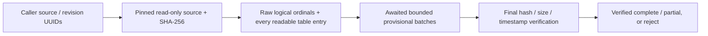

# Package Format V2 — Gate 1 metadata extraction

**Date:** 2026-10-20. **Baseline:** clean `9f39b6d`. **Status:** isolated implementation and automated verification complete; genuine multi-file/duplicate-CAB identity acceptance remains open. No Gate 2 or production integration is authorized or implemented.

The [approved V2 contract](../03_design/package-format-v2-design.md) remains unchanged. Earlier [architecture](package-format-v2-architecture-audit.md) and [SQLite spike](package-format-v2-dotnet-sqlite-spike.md) results are historical context, not evidence that the new extractor handles every Unity version.

## Components and consumer contract

- [V2MetadataContracts.cs](../../UABS.UnityAssets/Metadata/V2MetadataContracts.cs): immutable, UI-neutral source evidence, logical-file/type/asset/dependency/diagnostic records, progress, options, metrics and final verdict. No SQLite or package UUID/row-ID dependency.
- [AssetsToolsV2MetadataExtractor.cs](../../UABS.UnityAssets/Metadata/AssetsToolsV2MetadataExtractor.cs): read-only source ownership, fingerprints, raw bundle-directory traversal, standalone ordinal 0, all-class table enumeration and final verification. Not composed into V1 creation/browser/catalog/memo paths.
- [V2ReadWindow.cs](../../UABS.UnityAssets/Metadata/V2ReadWindow.cs): non-owning, cancellable read-only byte windows prevent logical-file/asset readers escaping declared ranges.
- [V2MetadataEnrichment.cs](../../UABS.UnityAssets/Metadata/V2MetadataEnrichment.cs): bounded schema-backed leading `m_Name` reads and AssetBundle dependency-field skipping; per-file type-tree/class-database evidence. No `GetBaseField`, image/audio/mesh decoder or full object-value graph.
- [Focused tests](../../UABS.UnityAssets.Tests/V2MetadataExtractionTests.cs) and [disposable fixture builder](../../UABS.UnityAssets.Tests/V2MetadataFixture.cs). The [test project](../../UABS.UnityAssets.Tests/UABS.UnityAssets.Tests.csproj) explicitly references the already-vendored parser solely for synthetic fixture construction; no new application dependency or solution project.

`ExtractAsync(request, receive, options, progress, token)` runs on a background worker, awaits each callback and emits deterministically ordered, immutable batches (default 256, maximum 4096 records). A batch belongs to the caller's source/revision IDs. Logical-file summary records follow their assets/declarations; directory/table/type/declaration ordinals retain original order within each category.

**All streamed records are provisional.** A future consumer must stage them under that invocation and admit them only after the returned `CommitEligible` verdict. Failed, unsupported, changed-source, cancelled or callback-failed invocations must discard their staged records. Partial but verified sources are eligible only for staging: package publication must still enforce the approved explicit incomplete-coverage acknowledgement. Gate 1 does not publish packages.



## Identity, metadata and failures

- No names, CABs, paths or hashes are assigned identities. The caller supplies nonempty source/revision UUIDs; reusing a known revision requires its expected full SHA-256. A request without an expected hash represents a caller-assigned candidate revision, not evidence of unchanged old bytes. Equal hashes never merge separate source occurrences.
- Source evidence keeps the caller's exact original path spelling separately from the full resolved path used for I/O; neither becomes an asset identity.
- The same pinned stream is hashed fully before and after parsing; size and last-write timestamp are checked. Cooperative writes/deletes are denied by Windows sharing. `ExpectedSha256` mismatch rejects before any asset emission; final mismatch rejects all provisional output. This is not a guarantee against uncooperative POSIX writers, same-evidence ABA/path replacement or mutable filesystem snapshots.
- Bundles are visited by **original unfiltered directory index**; skipped resources do not renumber files. No manager filename cache is used to merge duplicate/empty logical names. Compressed bundles unpack once to an invocation-owned, auto-deleted disk-backed file; enrichment does not reopen/redecompress the source.
- Every readable asset-table row carries original table ordinal, signed Path ID, available Class ID/type index/script index and absolute logical-file byte range. Unknown numeric classes survive. Duplicate Path IDs within one file remain separate and all ambiguous; different logical occurrences remain independent. Invalid ranges are incomplete with diagnostics, not invented identity. Unavailable class/type metadata does not itself drop a row.
- Names preserve NULL versus actual empty string. Only a schema-confirmed leading string `m_Name` is read, with byte/UTF-8/range limits. Non-leading/version-sensitive layouts remain unattempted rather than guessing offsets or storing generated display labels. Failure/budget exhaustion retains the row with status and a bounded diagnostic.
- External declarations preserve original order, path spellings available from the parser, original/virtual path properties, type and GUID logical fields. GUID hex encodes `data0..data3` as four concatenated big-endian UInt32 values, not System.Guid bytes or an inferred self GUID. Parser `OriginalPathName` is its preserved serialized path, not a second independent serialized path field.
- Optional AssetBundle dependency arrays use bounded metadata traversal (default 1 MiB window / 16,384 visits/items). Empty/malformed/duplicate strings are not resolved or merged. Unsupported layouts/budgets yield partial dependency status and diagnostics, not a false empty list. No cross-package resolution.
- Coverage (`Complete/Partial/Failed/Unsupported/RevisionMismatch`) is separate from optional name/type/dependency availability. Unreadable tables have unknown declared count, not a successful zero count; readable corrupt siblings survive. An invalid serialized header is rejected. Supported header admission is version 5–22, but **only version 22 is genuinely fixture-validated**; admission is not a cross-version support claim.

## Actual fixture coverage

| Evidence | Verified findings | Limits |
| --- | --- | --- |
| Genuine `aigirl.ab`, 17,353 bytes | One logical file at ordinal 0; 43 assets, all retained | No genuine multi-logical-file/duplicate-CAB case |
| Genuine `aigirl.assets`, 216,248 bytes | Standalone ordinal 0; Unity 2022.3.57f1 / serialized version 22, type tree present, five serialized types | No mixed-version/class-database-only real corpus |
| Both genuine inputs | Class 213 ×34, 28 ×2, 74 ×5, 91 ×1, 142 ×1; 43 raw names present; two declarations in full enrichment mode | No arbitrary-type preview/decode support implied |
| Synthetic derived serialized bytes | Unknown Class 1234567, negative/max Int64 IDs, duplicate names/Path IDs, empty/absent/failed names, ranges/type indices, two ordered externals, nontrivial/zero GUID fields | Constructed using the vendored writer, not genuine legacy/game output; its writer sorts rows before serialization |
| Synthetic UnityFS bytes | Two logical files at ordinals 1/3 with resource gaps; duplicate CAB and empty logical-name cases; corrupt sibling preserves six readable rows and partial verdict | Does not close the real-fixture identity gate |
| Other deterministic tests | 10k asset rows with maximum emitted batch 31, awaited sink, receiver failure, cancellation before work/hash phase/scan, expected-hash mismatch, controlled changed-final-timestamp evidence, dependency skipping/budget, missing class data | Timestamp mutation uses an internal evidence seam; no original fixture is modified, no claim of an actual concurrent game-file mutation |

Real fixture SHA-256 remained unchanged in before/after tests and matches the committed inputs:

```text
2C9621C84FA0E9B543ACDC5506A755957A75B527F897A3AFAAA435861711BBE7  aigirl.ab
6923B4AB87A10F0B092E2F715F9BC48E771F4CAA58C6C05454E6D5EFB21FDAAE  aigirl.assets
```

## Cost observations (not performance acceptance budgets)

Reproduce `ExtractionCostProbe_ReportsSmallFixtureCostsNotProductionBudgets` in the focused test class, Debug / .NET 9.0.5 on this Windows host. Each mode uses three sequential, process-local extractions; table cells are independent medians, not additive totals. OS caches are warm; no fixed warm-up or isolated hardware calibration. These tiny, same-content fixtures do not represent large game bundles or the approved Search benchmark corpus.

| Source / mode | Total ms | Two hashes ms | Structural ms | Names/type enrichment ms | Dependencies ms | Approx. allocated bytes |
| --- | ---: | ---: | ---: | ---: | ---: | ---: |
| Standalone / structure only | 1.567 | 0.373 | 0.728 | 0.006 | 0.000 | 380,008 |
| Standalone / names | 37.421 | 0.408 | 0.640 | 35.829 | 0.000 | 11,337,480 |
| Standalone / full | 27.988 | 0.398 | 0.671 | 26.433 | 0.040 | 11,364,280 |
| Bundle / structure only | 12.780 | 0.163 | 12.017 | 0.006 | 0.000 | 1,627,424 |
| Bundle / names | 38.386 | 0.194 | 9.146 | 25.519 | 0.000 | 12,602,352 |
| Bundle / full | 42.044 | 0.165 | 12.640 | 28.317 | 0.058 | 12,614,392 |

Structural phase includes file metadata reading, ambiguity/range checks and bundle decompression where applicable: roughly 59k rows/s standalone versus 3.6k rows/s bundle on these 43-row observations, not scalable throughput guarantees. Class-package loading/per-file schema preparation is charged to optional name/type enrichment; source open, sink/progress and other bookkeeping also contribute to total. Names-only versus full differences reflect run-order/noise, not a dependency speedup.

Reported test-process lifetime peak was approximately 76–96 MB across the probe; it includes test host/JIT/provider history and is **not isolated per-extraction memory**. Allocation deltas use process-wide managed counters and may include other threads. Bounded sink buffers do not imply constant total memory: AssetsTools.NET materializes bundle/file metadata and the extractor holds O(current logical-file asset count) duplicate-ID counts plus per-file shapes. No decoded object graph is retained; disk-backed unpacking can require substantial temporary disk. Large/malicious metadata and decompression still need representative resource-limit/fault validation before production reliance.

One deterministic batch-triggered cancellation observation was **1.317 ms** to the exception; this is not a worst-case bound. Hash loops and metadata traversal check cancellation; synchronous library metadata/decompression work can delay observation until it returns or reads through the cancellable stream. No user process was terminated.

## Verification and next gate

- Baseline full regression: **340/340**. New focused coverage: **22/22**. Final full suite: **362/362**, including existing V1/UI/memo regression and zero-Unity assembly/output audit.
- Sequential Debug builds of `UABS.UnityAssets/UABS.UnityAssets.csproj` and the actual `UABS/UABS.csproj`: **0 warnings, 0 errors**. Final full suite used `dotnet test Avalonia.sln -c Debug --no-build --no-restore --logger 'console;verbosity=minimal' --verbosity minimal` after the final raw-path provenance adjustment; all 362 pass.
- Quiet compound invocations that returned without a test summary are not counted as verification; individually completed commands with explicit output establish the results above. A later audit-only invocation did not finish and was cancelled; its queued cost probe did not run. The audit is verified by the completed full suite, not that standalone attempt. A separately completed cost-probe run supplies the figures above.
- Documentation checks pass: **3 documents, 53 local links/anchors**, balanced fences and one manually syntax-reviewed Mermaid block (no renderer). Staged/unstaged/new-file whitespace and conflict checks pass; LF/CRLF notices are informational. Protected-path diffs confirm V1, approved schema, original fixtures and legacy Unity unchanged; Git index remains empty.
- Scope: only the four new infrastructure files, two new test files, test project parser reference, this report/index and handoff. No existing production implementation, approved DDL, original fixture, package, legacy Unity or UI changed. No staging, commit, desktop control or screenshot.
- Gate 1 implementation is verified, but **production identity acceptance is not complete** without genuine multi-file/duplicate-CAB fixtures. Broader Unity versions, stripped/class-database-only name layouts, malformed count recovery beyond parser capabilities, GUID-target interpretation, uncooperative mutation and large-source resource costs remain explicit limitations.
- Before Gate 2: obtain read-only genuine fixtures with multi-logical-file/duplicate-CAB evidence, verify original ordinals and every identity/diagnostic, and review the current-record staging/final-verdict boundary. Request separate authorization for the standalone SQLite builder/reader; do not alter the approved schema or switch production paths automatically. Stage 7 remains deferred.

**Unity-Exclusive Features Requiring Decisions:** none added; AssetsTools.NET metadata processing is standalone. Existing decoder decisions remain outside Gate 1.

Suggested commit: `feat(packages): add V2 all-asset metadata extraction contracts`.
