# Package Format V2 — Gate 2 standalone storage

**Date:** 2026-10-20. **Baseline:** clean `921de5f`. **Status:** isolated implementation verified; acceptable as a limited checkpoint, not unrestricted V2 input/production acceptance. No V1, Search, memo, UI or schema replacement. External-path schema approval and real multi-file identity acceptance remain open.

## Components and boundaries

- [UABS.PackageV2](../../UABS.PackageV2/UABS.PackageV2.csproj) is a separate net9.0 library using Microsoft.Data.Sqlite 10.0.12 / native SQLite 3.53.3 as in the prior spike. It references only the neutral Gate 1 infrastructure, never AssetsTools.NET directly or the application.
- [StorageContracts.cs](../../UABS.PackageV2/StorageContracts.cs) provides caller-assigned package/generation/root/source requests, structured outcomes/metrics, immutable asset provenance and bounded metadata pages.
- [Schema.sql](../../UABS.PackageV2/Schema.sql) embeds the **unchanged approved DDL**, including every table, constraint, FK, index and trigger. [StorageSql.cs](../../UABS.PackageV2/StorageSql.cs) owns parameterized reusable commands, UUID network-byte encoding, text profile, path-policy and semantic validation.
- [PackageBuilder.cs](../../UABS.PackageV2/PackageBuilder.cs) consumes Gate 1 batches in private staging and implements initial creation only. [PackageReader.cs](../../UABS.PackageV2/PackageReader.cs) admits read-only files and provides local row-ID continuation pages; it is not Gate 3 Search/global pagination.
- [V2StorageTests.cs](../../UABS.UnityAssets.Tests/V2StorageTests.cs) adds deterministic disposable storage/fault/corruption tests and an explicitly opt-in benchmark. The solution includes the library and tests reference it. **UABS.csproj has no V2/SQLite reference**, so normal startup/V1 workspaces do not load these packages or gain this native dependency.

## Build, verification and publication lifecycle

```mermaid
flowchart LR
    Request["Explicit new package / generation UUIDs"] --> Stage["Unique same-directory private SQLite file"]
    Stage --> Ingest["Canonical DELETE / FULL database + bounded Gate 1 batches"]
    Ingest --> Source["Final Gate 1 source verdict"]
    Source -->|rejected| Discard["Drop provisional rows; retain failed source / diagnostics"]
    Source -->|verified| Seal["Integrity + identity / coverage validation"]
    Discard --> Seal
    Seal --> Ack["Require partial coverage acknowledgement"]
    Ack --> Close["Commit, close and flush"]
    Close --> Publish["Same-directory File.Move: overwrite false"]
```

The builder awaits each Gate 1 batch, rejects batches over 4096 records and keeps only per-source file/type maps, not an asset collection. Logical summaries may follow their assets; private placeholder files/types are resolved before sealing. A source's final captured count, logical summaries and full fingerprint/size evidence must agree. Changed/unverified/failed sources lose **all** provisional assets, types, logical files and dependencies; their issues are retained under the failed source with an explicit rejection diagnostic. Such a package is partial and cannot publish without `AcknowledgePartial`.

Missing names/type labels and partial dependency enrichment do not independently mark asset coverage partial. A readable zero-entry table retains declared count 0; an unreadable source retains failed status, not a complete zero. Dependency enrichment status is aggregated on sources and noncomplete per-file enrichment is represented by an issue (the approved logical-file table has no dependency-status column).

Path checks reject traversal, rooted/noncanonical relative locators, invalid root policies, mismatched native root/relative source mappings, duplicate source UUIDs and repeated normalized source paths. Windows lexical locator keys normalize separators and invariant uppercase; original strings remain stored. Ambiguous casing/key collisions fail rather than merging records. No equal-hash deduplication, invented package IDs, generated names or source-content copying. Unproven physical aliases/hardlinks and platform-specific path semantics still need production validation.

Duplicate Path IDs are retained: before inserting another occurrence, all existing matches and the incoming row become ambiguous, avoiding the addressable-only unique-index conflict. Final semantic validation independently checks every duplicate group. Types remain per-file; available labels/script evidence without a local index can use the approved nullable local-type-index row, not an invented index.

An existing destination is always refused. Publication closes all owned connections/handles, flushes the staging file and calls same-directory `File.Move(..., overwrite:false)`. A destination appearing at publication wins; its bytes are preserved. Cancellation before mutation discards private staging; once publication succeeds, success is reported rather than claiming rollback. Deterministic hooks cover schema, batch, validation and publication boundaries. Cleanup deletes only the invocation's closed main staging file; if journal/WAL/SHM recovery artifacts remain, it retains staging and returns its path, never blindly deleting sidecars. No replacement, carry-forward, live copy, unsafe two-rename fallback or new crash-recovery guarantee.

## Admission and metadata reads

Admission checks the SQLite signature, application ID, user version, manifest/text contract, canonical tables/constraints/indexes/triggers, STRICT schema and foreign keys. Schema comparison combines SQL **tokens** (literal-sensitive, whitespace-insensitive) and PRAGMA column/FK/index signatures; it is not a whitespace hash. Unknown/extra schema objects or unsupported versions are rejected, never repaired/upgraded.

Publication uses full integrity checking plus semantic validation; admission uses quick checking plus the same semantic invariants. These cover UUIDs, per-file type/class ownership, table ordinals/counts, duplicate identity groups, source coverage/evidence, dependency ordering and path policies. Admission is a consistent short read transaction. The accepted profile is implementation-owned and runtime/RID-specific; unsupported derived profiles admit **raw reads only**, ignoring ASCII keys/nonblank flags. No cache or write API is exposed.

Reader pages are 1–500 rows (default 100), asynchronously off the caller thread, with serialized connection ownership and cancellable native queries. Assets carry package/generation/source/revision/logical ordinal/Path ID/table ordinal provenance. Other metadata pages expose source UUID/revision and applicable occurrence context alongside storage-local IDs. Package info includes counts, index status and profile compatibility. NULL and explicit empty names/memos remain distinct. Initial builds set memos to NULL; tests use disposable direct SQLite edits solely to validate existing empty-memo/trigger/read semantics, not a new memo persistence API.

Each page checks the admitted package/generation/catalog revision in a short transaction; changed revisions require explicit readmission. No Unity source is reopened. These local page IDs are not portable cursors or uniquely addressable memo targets. No matching, sorting UI, cross-package federation, original-source inspection or writable reader is implemented.

### Explicit Gate 1 / schema mismatch

Gate 1 can expose distinct `OriginalPath`/`VirtualPath` external-reference evidence, but approved V2.0 stores only `raw_path`, CAB, GUID and external type. Empty virtual paths and an original path identical to the declared raw path are losslessly compatible; **distinct nonempty extra paths reject creation with a schema-review message**. They are not truncated into a diagnostic, silently dropped or hidden in a new JSON column. Both genuine fixtures pass; broader inputs with such evidence need an explicit schema/contract decision before acceptance. This limitation does not authorize a DDL change.

**Verified parser behavior:** inspecting `AssetsTools.NET.AssetsFileExternal.Read/Write` IL in the existing vendored DLL shows two serialized strings: `VirtualAssetPathName` before GUID/type, then the declared path. `Read` copies that second string to `OriginalPathName`, then may rewrite `PathName`: `resources/unity_builtin_extra` becomes `Resources/unity_builtin_extra`, and `library/unity default resources` / editor-resource variants become `Resources/...`. The three getters are independent backing fields. `Write` writes the virtual path separately and preserves the original spelling for recognized built-in paths. Gate 1 forwards all three properties in [its external-declaration loop](../../UABS.UnityAssets/Metadata/AssetsToolsV2MetadataExtractor.cs). Therefore `OriginalPathName` is preserved **raw serialized evidence**, not a third independently serialized string; `PathName` can be a derived normalized locator. Nonempty virtual paths are separate raw evidence and cannot generally be recovered from the declared path or GUID.

**Smallest proposed amendment — NOT approved or implemented:** add one nullable `raw_virtual_path TEXT` column to `dependency`, and explicitly define existing `raw_path` as the exact serialized `OriginalPathName` for external-file records (AssetBundle dependency strings remain verbatim). The adapter would preserve NULL versus explicit empty virtual paths and stop substituting the parser-normalized locator for raw evidence. A normalized lookup path could be derived under an explicit versioned rule or kept in a disposable cache; a third canonical `normalized_path` column is unnecessary unless persisting the observed derived locator is separately required. Merely adding virtual path while continuing to put normalized `PathName` into `raw_path` would still lose original evidence.

This is a **separate approval decision**, not a patch to `Schema.sql` or the approved design. A schema change must identify its version/admission contract explicitly (for example a separately approved V2.1 / `user_version=20001`, with corresponding manifest CHECK/admission changes); do not silently add a column to V2.0 or auto-migrate existing files. The current builder continues rejecting both distinct-original-path and nonempty-virtual-path inputs until that decision is approved. Broad input acceptance is blocked by this mismatch; subset round-trips remain useful as an isolated checkpoint.

## Tests and actual evidence

- Genuine Gate 1 bundle/standalone inputs each round-trip **43 assets / five Class IDs** without changing original files. This remains one logical file each, not real multi-file/duplicate-CAB evidence.
- Streaming synthetic metadata covers unknown classes, nullable/empty/duplicate names, signed/max IDs, duplicate Path IDs, logical ordinals 1/3, duplicate CABs, type/range/provenance and ordered raw dependencies/GUIDs.
- Safety cases cover missing revision evidence, count mismatch, readable empty versus failed sources, partial acknowledgement, rejected-source discard, six injected boundaries, cancellation during ingestion and before publication, publication races and byte-for-byte preservation of an existing valid database.
- Admission cases cover invalid/missing files, unknown versions, missing triggers, FK/type/count/identity/path/derived corruption, raw unknown-profile fallback, read-only file hashes, stale revisions and bounded reads with nonexistent original source paths. Explicit storage-reference audit finds no Unity/application dependency.

## Measurements

Disposable streaming synthetic metadata, one source/logical file per package, repeated names, six-row edge-case pattern then sequential IDs; no payloads. Three fresh package builds per scale; independent medians, process/OS-cache warm .NET 9.0.5 Windows. Build includes always-on canonical indexes, trigger maintenance, full and post-hook quick semantic validation, close/flush/publication. Admission separately performs quick/FK/semantic validation. Read-all streams 500-row pages, checking exact row counts; first/next measurements use 100 rows. No Search timing or speedup claim versus different spike schemas.

| Assets | Build ms | Schema ms | Ingestion ms | Seal validation ms | Publication ms | Bytes | Admission ms | First 100 ms | Next 100 ms | Read all ms |
| ---: | ---: | ---: | ---: | ---: | ---: | ---: | ---: | ---: | ---: | ---: |
| 10,000 | 803.42 | 10.66 | 663.08 | 126.00 | 1.57 | 1,806,336 | 30.55 | 0.84 | 0.66 | 37.30 |
| 100,000 | 8048.62 | 11.77 | 6856.10 | 1177.46 | 1.61 | 18,083,840 | 267.34 | 0.78 | 0.59 | 373.85 |
| 1,000,000 | 80974.98 | 14.42 | 68618.73 | 12286.14 | 1.37 | 185,876,480 | 2653.48 | 1.01 | 0.55 | 3155.40 |

All three million-row repetitions completed and exact streamed read-back counts passed; their results were recovered from the completed command and **not rerun**. 10k/100k/1M builds reported process-wide managed allocation deltas about 38.7/373.3/3722.0 MB (allocation churn, **not retained memory**) and lifetime process peaks 50.6/53.0/55.7 MB. Ingestion max batch was 128; builder maps scale with files/types, not asset count. Native SQLite cache/validation, field sizes, metadata count and temporary disk still require representative production budgets. Admission deliberately scans semantic invariants, so its cost is not connection-only or constant-time. These measurements precede final manifest-DTO/allowlist refinements; schema, index and ingestion workloads are unchanged, so expensive scale runs were not repeated.

Reproduction uses the opt-in benchmark test (`UABS_V2_STORAGE_BENCHMARK=1`; `UABS_V2_STORAGE_MILLION=1` selects only 1M without rerunning smaller scales). `UABS_V2_TEST_ROOT` can select an explicitly authorized ignored fixture directory; here `UABS.PackageV2/artifacts` was granted after OS-temp publication was denied. Fixtures clean only their own generated directories. A disposable external console harness at `C:\Users\kolynlin\Documents\Codex\2026-10-16\files-pasted-by-the-user-i\v2-storage-verification` invokes these same public tests without VSTest transport; it is not a production dependency.

## Verification, limitations and next action

- Final sequential Debug builds of the storage library, test project and actual `UABS/UABS.csproj`: **0 warnings, 0 errors**. The first resume attempt lacked scoped filesystem access for generated outputs; the normal Avalonia write grant was renewed, and the same builds passed. No output-target substitution, security-setting change or user-process termination.
- **VSTest:** initial **33/33** passed before later checks were added (32 functional cases plus inactive opt-in entry). A later attempt reported a **90-second runner/testhost connection timeout** before execution; local communication permission was not granted. Per the resume request, focused VSTest was tried **once**, stalled without a result, then cancelled; it was not retried. There is **no final expanded VSTest pass**.
- **Standalone focused harness:** final **41/41 functional checks pass**, including the schema allowlist case for an unexpected `sqliteevil` table; matching only the reserved literal `sqlite_` prefix avoids accidentally ignoring that user table. The harness invokes the actual public test methods/assertions but is not VSTest or full regression.
- **Full in-process xUnit:** the existing test assembly's standard `XunitTestFramework.GetExecutor(...).RunAll(...)` completed **404 run, 0 failed, 0 skipped**, in **12.61 s**. This executes the existing discovery/test cases, including Avalonia headless cases and both Unity audits, without VSTest's transport. It is the full regression evidence, explicitly **not a VSTest result**. One passing opt-in benchmark entry does no timing work in this run; separate completed scale measurements provide benchmark evidence. The scratch runner was compiled outside Git and did not modify tests or create a new repository test framework.
- Single-node offline restore/build uses `-m:1 -nr:false`; no package source was added and no new network permission was granted. Set `UABS_V2_TEST_ROOT`, `TEMP` and `TMP` to the authorized ignored artifact root for sandboxed disposable fixtures, never real package paths. Ordinary test fixtures keep their default OS-temp behavior when no override is supplied.
- Independent reference/output audit checked **three managed assemblies**: no UnityEngine/UnityEditor references; no `UABS.PackageV2`, Microsoft.Data.Sqlite or SQLitePCLRaw DLL was added to the actual startup application output. Embedded SQL matches the approved fenced DDL after newline normalization. Genuine fixture SHA-256 remains the Gate 1 values; protected production/legacy paths are unchanged.
- Final Debug solution build also passes with **0 warnings/errors**. Documentation checks pass for **3 documents / 54 local links and anchors**, balanced fences and one manually syntax-reviewed Mermaid block (no renderer). Staged/unstaged/new-file whitespace/conflict and protected-file checks pass; Git index remains empty. The full-suite-created `uabs_log.txt` was verified as test output and removed; no pre-existing work was deleted. Disposable fixture directories are cleaned and no benchmark staging/journal remains.
- Real multi-file/duplicate-CAB and broader Unity-version/source-change evidence remain Gate 1 production identity prerequisites. Cross-platform native loading, filesystem durability/power-loss faults, uncooperative external file replacement, hardlink identity and hostile huge metadata limits are not proven. SQLite revisions apply to cooperating writers, not tamper resistance.
- Gate 3 requires a separate explicit request: exact production Search request translation, Unicode conformance, bounded federation/sort/cursor/count behavior and calibrated performance gates. Do not integrate V2, add memo adapters, migrate packages, retire V1 or implement Stage 7 here.
- **Acceptance:** suitable to accept/commit as an isolated, buildable Gate 2 checkpoint with tested rejection of unsupported evidence. General all-input acceptance is blocked by the external-path decision; genuine multi-file/duplicate-CAB production identity validation and the normal VSTest transport route remain outstanding. The full in-process regression pass does not remove those limitations. No Gate 3 work is started.

**Unity-Exclusive Features Requiring Decisions:** none new; standalone SQLite and neutral metadata require no Unity runtime.

Suggested commit: `feat(packages): add isolated V2 SQLite builder and reader`.
