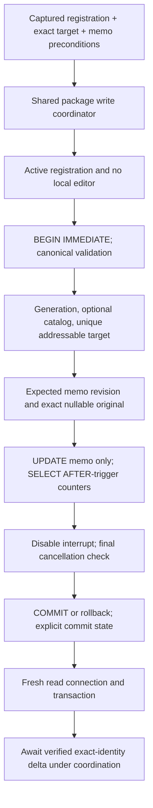

# Package V2 Gate 4 — isolated SQLite memos

**Date:** 2026-10-21. **Baseline:** clean `e656b00`. **Status:** isolated implementation verified; recommend Gate4 checkpoint acceptance subject to limitations below. No production composition, V1 behavior, D1–D8 or canonical DDL changes.

**Recovery review:** 2026-10-22. Completed the previously interrupted documentation/Git safety checks without changing implementation or rerunning the full suite. Portable-PDB SHA-256 document hashes match all three memo source files and `V2MemoTests.cs`, corroborating that the saved Debug binaries cover the current source. The build/test results below remain the verified 2026-10-21 results, not new test runs.

## Components and ownership

- [Memo contracts](../../UABS.PackageV2/Memos/MemoContracts.cs): immutable addressable `MemoTarget` = package UUID + generation UUID + source UUID/revision + original logical directory ordinal + signed Int64 Path ID. Table ordinals/local row IDs/names/CABs are not writable identities. `From(StoredAsset)` refuses diagnostic identities; persistence independently verifies all key components and exactly one addressable match across **all** identity statuses. Unknown classes, missing names and missing original Unity files do not prohibit indexed memo writes.
- [Persistence service](../../UABS.PackageV2/Memos/V2MemoPersistenceService.cs): one application-lifetime isolated registration owner; duplicate package UUID admission refused. Registrations have immutable paths/IDs and captured generation. Unload is serialized; queued old-registration requests cannot retarget a newly registered copy/move. `Info` is admission metadata, not a mutable current catalog snapshot. Reopening after move/replacement is explicit, never path search/fallback.
- Reuses the existing [PackageWriteCoordinator](../../UABS.UnityAssets/Packages/PackageWriteCoordinator.cs) directly. Inject the **same coordinator and guard** into every future V2 caller/editor path. Per-path exclusion spans transaction, fresh verification and awaited publication; different packages progress independently. Coordinator path normalization is currently Windows-oriented; hardlink/physical aliases and additional platform semantics are not established.
- [Editor guard](../../UABS.PackageV2/Memos/V2PackageEditorGuard.cs): local package-UUID session lease, independent of clean/dirty state. Admission takes the shared writer lock and validates base package/generation/catalog in a read transaction. Only explicit lease disposal releases exclusion; save failure/cancellation does not. Unloading does not abandon editor ownership. No production editor interface, structural writer or generation replacement was added.

## Transaction and conflict boundary

Register read-only using canonical validation; each save opens ReadWrite (never Create), requires DELETE journal, sets FULL synchronization, and validates schema/semantic/profile invariants again inside the immediate write transaction. Unsupported derived profiles are refused rather than silently upgraded/mixed. Full admission validation currently scans metadata/derived values; a memo UPDATE is single-row, but overall save validation is **not O(1)**.

The request requires expected memo revision and original nullable value; optional strict catalog revision adds a whole-catalog precondition. NULL differs from empty, whitespace/control characters and valid Unicode are retained, malformed UTF-16 is rejected before writing. Exactly one asset is resolved using full provenance; only then may a local row ID implement the conditional UPDATE. No index rewrite, package rebuild, guessed target, automatic conflict merge or retry.

Unchanged values do not UPDATE/increment counters, but are freshly verified/published. After an UPDATE, SELECT target memo/revision and catalog revision within the same transaction and check their increments. Never rely on UPDATE RETURNING for AFTER-trigger values. Before commit cancellation rolls back; disable the token's native interrupt and perform a final token check before attempting commit. Once commit begins, finish verification/publication without the caller's cancellation token. Busy timeout is configurable0–30 seconds (default1); native lock wait cancellation may be delayed by that timeout.

Commit state is `NotCommitted`, `Committed` or `Uncertain`, separate from outcome. Rollback failure/uncertain commit never becomes green success or falsely canceled-before-commit. Exceptions before mutation remain structured; errors after commit explicitly retain committed/uncertain state. SQLite owns journal cleanup; this service never deletes journals.

Fresh read verification checks canonical validity, package generation, exact target, desired memo, memo revision and nondecreasing catalog revision. Newer target revision returns `CommittedButSuperseded`, with no falsely verified delta. A different-asset writer may advance catalog revision without conflicting with an ordinary memo request. Replacement after commit, failed verification and publication failure do not claim rollback. Verified content is a snapshot at that read transaction, not a promise that a later external writer cannot supersede it.

## Results and publication

Outcomes include Saved/Unchanged, missing package/asset, generation changed, ambiguous identity, editor active, registration changed, revision conflict, Busy/ReadOnly, invalid text/package, write/verification/publication failure, canceled before commit and committed-but-superseded. Every result retains its original request/desired nullable text and commit state. No failed outcome is successful merely because SQL executed.

`VerifiedMemoChange` carries full `MemoTarget` (including generation), persisted nullable memo, trigger-managed memo/catalog revisions and verification flag. Await the optional publication callback while still holding coordination. Publication failure includes the verified delta and commit state; caller must retain the draft and reconcile/read the committed value before retrying, not blindly reuse stale preconditions. Callback must not reenter same-package writes or unload (non-reentrant coordinator).

Gate5 consumers must marshal UI-bound notifications, apply monotonic generation/revision deltas to **all** displayed exact-identity matches, preserve selection/criteria/scroll and not execute Search automatically. Existing isolated Search checks its captured catalog vector and returns StaleCursor after memo changes; no production Search notification or UI dispatcher was added.

## Draft reuse and future editor Save

The V1 [shared draft coordinator](../../UABS.UnityAssets/Packages/Memos/MemoDraftCoordinator.cs) hardcodes path/index/source/name/Path ID keys and string package revisions. Encoding V2 UUIDs into those fields would invent misleading identities. Gate4 therefore adds only a **stateless** `V2MemoDraftAdapter`: captured save attempt, persistence delegation and completion eligibility based on exact request, local draft revision and unchanged current draft text. Failed/conflicted or older completions cannot mark newer edits Saved. No second draft map, debounce timer or UI coordinator.

Gate5 must adapt the existing coordinator's key/revision/persistence boundary to `MemoTarget` plus memo/catalog revisions; retain its shared application lifetime,1.5-second debounce, Save Now/Retry, identity-bound navigation flushing, failure retention and stale-completion algorithm. Assets and Search must resolve the same key. Until then V2 is **not wired to auto-save or editable Inspectors**. Normal shutdown/crash recovery remains deferred Stage7.

`EditorBaseRevision.Check` provides a strict package/generation/catalog check. A future structural/explicit V2 editor Save must call it with values loaded **inside its immediate write transaction** under the shared coordinator; an earlier eligibility check alone is not sufficient. Editor dirty clones are neither accepted nor mutated by this service. Cross-process editors are not excluded globally: their stricter base checks prevent stale saves if they obey D6. No global lease or hidden editor Save/Discard behavior.

## Verification and limitations

Focused disposable fixture coverage and final build/audit results are recorded at the final checkpoint below. Deterministic boundary callbacks/barriers distinguish pre-commit rollback, post-commit verification, external connection contention and publication failures. No arbitrary test sleeps, real-package writes, original source reads or desktop automation.

SQLite transactions serialize cooperating external writer connections; per-asset preconditions allow unrelated changes, optional catalog checks are conservative. Trigger/schema bypass, same-UUID/generation/counter ABA replacement, arbitrary path renames while handles are open, hardlinks, malicious writers and network filesystems are not guaranteed safe. File namespace identity is not portably locked by SQLite. Ordinary detected replacement/move/generation changes fail explicitly. Fault/RID/disk-full/power-loss and actual independent-process editor behavior require additional validation; a transaction test is not a Stage7 recovery guarantee.

Gate5 prerequisites: explicit production approval; shared draft identity/revision adaptation; composition with one registration owner/coordinator/guard; authoritative move/unload lifecycle; dispatcher/monotonic publication/reconciliation including committed publication failures; strict editor base checks inside future writer transaction; production-scale save validation/contention calibration. No new Unity-exclusive dependency decisions were introduced.

## Read-only save-performance diagnosis (2026-10-22)

`PersistAsync` takes the shared coordinator, then `SaveCoordinated` calls [StorageSchema.Validate](../../UABS.PackageV2/StorageSql.cs) **twice per successful or unchanged save**: inside `BEGIN IMMEDIATE` before mutation, and inside a fresh read transaction after commit. Registration separately validates once; it is not repeated registration on every save. Editor admission also validates when explicitly opened.

Each save-time validation repeats:

- Application/user version, canonical schema SQL-token/PRAGMA signatures (tables, constraints, indexes, FKs and triggers), singleton manifest, UUIDs, generation and text/profile checks. The reference canonical signature is lazily constructed once per process; the actual database signature is recomputed on each validation.
- **`PRAGMA quick_check`, not `integrity_check`** (`full=false`), plus `foreign_key_check`.
- Package-wide duplicate identity/table-ordinal, type/class, dependency-order, declared-count and source/completeness queries; root/source locator validation and source/asset/issue counts.
- For the supported writable profile, every asset's name/ASCII key/memo/nonblank flag is read and recomputed in managed code. Unchanged saves do not skip this scan.

The exact target is additionally read before UPDATE, after its AFTER trigger and on the fresh verification connection. The small memo update does not rebuild or rewrite the whole package. Repeated package-wide validation is a concrete scale-dependent cost consistent with the ~854ms/100k sample; individual phase timings were **not** measured, so no precise percentage or exclusive bottleneck attribution is claimed. Coordinator waiting, connection setup, FULL-sync commit and callback time can add latency; the callback is application-supplied and has no total deadline here.

**Necessary protections:** retain coordination/editor eligibility, trusted schema/profile admission, in-transaction manifest/generation and exact addressability checks, expected nullable value/revisions, conditional UPDATE, trigger-counter SELECT, durable commit/rollback, fresh persisted-target verification and verified publication. These must not be traded away for faster timings.

**Later opportunities, not implemented or approved by this recovery:** profile the two validator passes separately; distinguish structural admission from transaction-local target checks; avoid unrelated counts/derived-text reconstruction on every memo if immutable-generation/derived-field invariants are already reliably established. A validated admission cache would need physical registration/file identity, generation, schema/trigger/profile checks and robust replacement/invalidation rules; neither catalog revision, timestamps, `schema_version` nor short-lived-connection `data_version` alone proves the file unchanged. Any reduction in repeated quick/FK/global checks needs a separately reviewed trust/revalidation policy and corruption/replacement/concurrent-writer regressions. Keep the fresh connection and exact target/revision verification. This recovery changes no validation or persistence behavior.

## Final verification checkpoint

- [V2 memo tests](../../UABS.UnityAssets.Tests/V2MemoTests.cs): **45/45 focused cases** passed. Covers nullable/Unicode/embedded-NUL transitions, unchanged counters, invalid UTF-16, full keys, duplicate/incomplete identity, unknown classes and missing sources, revision/original/catalog conflicts, generations/source revisions, editor exclusion/release/unload/other packages, queued cancellation, cancellation before/after commit, separate SQLite writer connections and busy timeout, different-asset updates, target supersession, verified publication/failure, retained/newer drafts, Search stale-vector behavior, removed assets, registration ownership/moves/replacement, read-only files and schema/version/profile/journal mismatch.
- Existing isolated storage **49/49** focused checks passed. Full standard in-process xUnit executor **511 passed,0 failed,0 skipped,32.56s** including V1/headless regressions and zero-Unity test. These are **not VSTest** results; known local test-host communication restriction was not retried/bypassed. No desktop application was launched/controlled.
- Debug library/test/startup builds: **0 warnings/errors**. Initial test-only registration property-name error and public diagnostic-helper analyzer warning were corrected; final source builds cleanly. Full Debug solution confirmation and final documentation/Git checks are recorded in the handoff.
- Dependency audit: V2,neutral assets and startup assemblies contain no Unity references; startup output has no V2/SQLite/Unity binaries. Canonical DDL equals the approved design SQL; schema file and all protected production/V1/legacy/genuine fixture paths have no Git changes. Genuine fixture SHA-256 values match the Gate3B checkpoint. New-file whitespace/conflict checks pass; Markdown local links/anchors/fences and five Mermaid diagrams checked (syntax review, not rendered).
- **Bounded diagnostic, not performance acceptance:** five real service saves each to owned10k/100k synthetic packages; medians **99.60/854.06ms**, observed ranges87.51–103.92/829.24–910.61ms on the same Windows/.NET9.0.5 reference machine as Gate3B. File lengths unchanged at2,224,128/22,945,792 bytes;4 changed4KiB logical blocks per package across five saves. This is logical file comparison, **not physical I/O/journal write amplification or p95**. A previous diagnostic yielded102.24/857.76ms. Final registration-only replacement-policy check does not alter the measured transaction. No million-row benchmark or real data used.
- Validation scans dominate scale: the small UPDATE is per-asset but canonical admission/semantic validation and fresh verification inspect the wider index. Production-sized memo latency, sustained Search-reader contention, physical write amplification, cross-process/RID/fault matrix and uncertain-COMMIT/rollback I/O-fault injection remain uncalibrated. Connections/transactions close via disposal; SQLite manages journals, never manual sidecar deletion. Busy timeout is a bound on lock waiting, not a total save latency guarantee.
- Changed files: three new `UABS.PackageV2/Memos` files, one new test/measurement file, this report, documentation index and session handoff. No package indexing, production draft state machine, Inspector XAML or editor persistence changes. The external scratch runner is not repository/application infrastructure. No commits/staging/reset/clean/branch operation.
- Recovery safety checks: canonical DDL equality, three-assembly zero-Unity/startup isolation and both genuine fixture hashes rechecked; staged/unstaged Git whitespace, conflict and protected tracked paths pass, with no staged files. All five untracked files are the expected three memo sources, test and report; their whitespace/conflict checks pass. Six documents/82 local links and anchors validate with balanced fences; five Mermaid blocks syntax-reviewed, not rendered. The normal authorized Git checks now succeed; the earlier usage-limit approval-review failure was not bypassed. Worktree is safe to review and commit as this isolated checkpoint.

**Recommendation:** accept the isolated Gate4 transaction/coordination/publication foundation as a buildable checkpoint. This is not production rollout or full fault/performance acceptance. Gate5 must adapt—not duplicate—the existing shared draft coordinator and explicitly verify monotonic dispatched publication and editor lifecycle before connecting V2 to workspaces. No Gate5 implementation or deferred Stage7 safeguards were started.
