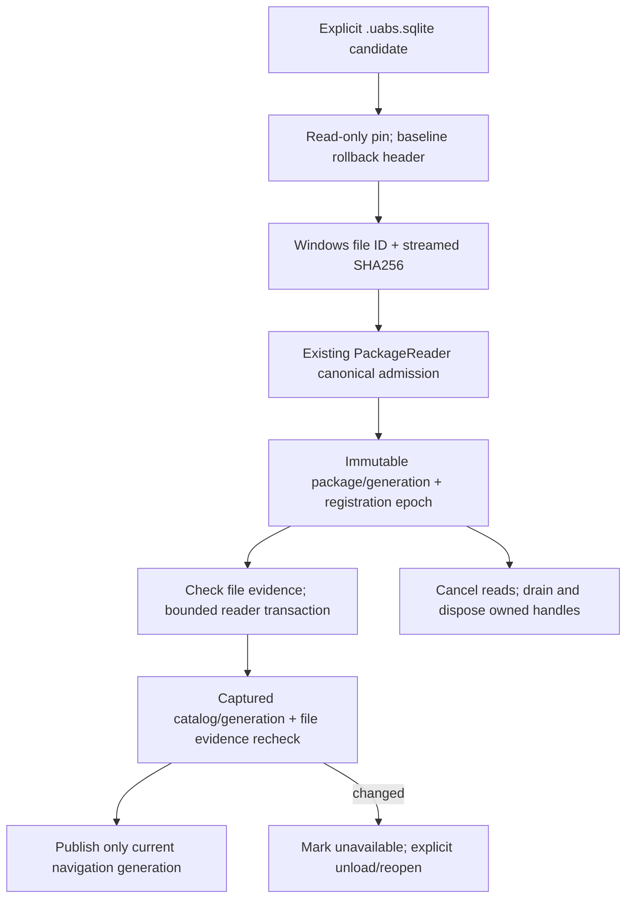

# Package V2 Gate5A — production registration and read-only browsing

**Date:** 2026-10-22. **Baseline:** clean `d42da6d`. **Status:** implementation and automated verification complete for supported V2 packages; user visual acceptance pending. Gate5A only; no V2 Search, memo editing, structural saves, migration or shutdown/crash recovery.

## Entry points and compatibility boundary

- Startup [UABS.csproj](../../UABS/UABS.csproj) now references the existing V2 library and ships its SQLite/native dependencies. Prior Gate2–4 reports describing application isolation are historical; this explicitly authorized gate changes production **read-only** composition only.
- [V2BrowseCatalog](../../UABS/Script/Services/V2BrowseCatalog.cs) uses `PackageReader`, not another SQLite data reader. [Presentation records](../../UABS/Script/Models/V2BrowseModels.cs) preserve nullable values and immutable occurrence identity without exposing storage types in grid templates or coercing them into V1 models.
- Packages offers **Open V2...**, a filtered native file picker, top-level `.uabs.sqlite` discovery in a chosen catalog, V2 entries in the existing loaded-packages sidebar, and read-only asset/evidence tabs in its existing center region. Invalid discoveries surface diagnostics. Existing V1 directory registration and creation/editor transactions remain separate and functional; New/Edit tooltips identify their V1 scope. V2 cannot be edited or sent to memo-copy/V1 Search providers. Clean break means no conversion or invented V1 documents, not destructive V1 retirement.
- Filesystem Navigator lists `.uabs.sqlite` candidates; activation goes through the same main open route and actual V2 admission, never Unity parsing. Assets Navigator also lists retained registered V2 packages, with Open/Browse/Unload and an explicit Filesystem assets return. No Texture2D/Sprite decoding or original source-file open occurs.
- [MainWindowViewModel](../../UABS/Script/ViewModels/MainWindowViewModel.cs) retains its normal Unity session when showing V2. The same long-lived [V2BrowseViewModel](../../UABS/Script/ViewModels/V2BrowseViewModel.cs) is used by both existing workspaces. View components reuse shared [asset grid styles](../../UABS/Script/Styles/AssetListStyles.axaml), type icon converter/resources and existing panel layout/splitters. No additional top-level workspace or unrelated browser.

## Admission, lifetime and invalidation

The adapter opens existing files read-only, never Create or initialize. Before native SQLite admission, SQLite header read/write-format bytes must identify rollback journaling; WAL/invalid headers are unsupported, not converted. `PackageReader` validates application ID/version, exact canonical schema, quick/FK checks, semantic/count/path invariants and derived profile once per registration. Unknown derived profiles permit authoritative raw reads with a warning, not writable revalidation. Partial indexing/issues and unsupported previews/writes are explicit.

Cancellation before admission publication disposes its candidate reader/pin. Once admission has completed, ownership is placed in the visible registered list before honoring selection cancellation, so no handle is stranded invisibly; a late-canceled selection publishes no asset rows and the loaded entry remains available for explicit browsing/unload. This boundary is covered by a deterministic cancellation hook test.

Canonical full paths reuse a registration/epoch. Another path/copy with the same package UUID is refused; no merging divergent copies. Physical/junction/hardlink alias deduplication beyond canonical paths is not claimed. A Windows read pin denies delete/rename until unload while still allowing cooperating SQLite writers. Copy/move requires quiescing other writers as well; the pin is not a global cross-process lease.

Windows file ID (volume/file index) and a streamed full-file SHA256 are captured around admission and rechecked **before and after every asset/evidence read**, and when returning to an active V2 workspace. This is deliberately conservative O(database bytes), not a timestamp/path-only admission cache. Readers also check package UUID/generation/catalog revision inside each short transaction. Detected replacement, corruption, disappearance or metadata/memo change returns unavailable/stale rather than publishing an empty successful page. Explicit unload/reopen is required; there is no blind refresh/retry or retargeting. Valid workspace rechecks retain existing collections, selection and scroll rather than rerunning queries.

No duplicate full `StorageSchema.Validate` call occurs per page or selection. No validation was weakened and the Gate4 writer is unchanged. Full admission still scans metadata; file hashing and connection work run off the UI thread. On non-Windows the physical file-ID check is unavailable; content/revision checks remain, but equivalent namespace/rename guarantees need RID validation. Malicious ABA/tampering, arbitrary noncooperating file changes during reads and network/removable filesystem faults remain unsupported under the approved contract.

## Bounded browsing, identity and Inspector

- Asset and evidence pages fetch101 rows and publish100. Continuations use `row_id > after`, not OFFSET. Storage-local row IDs are only generation-scoped paging positions; selection uses package/generation/source/revision/original directory ordinal/signed nullable Path ID/table ordinal. This preserves diagnostic/ambiguous/incomplete rows without making them writable.
- One visible asset page and one evidence page are retained, plus at most128 lightweight Previous cursors. First remains available after history eviction. New pages replace the window, never accumulate the entire package. Column sorting is explicitly **current-page only**; backend paging remains deterministic occurrence order. This gate implements no Search/filter engine.
- Package, page, metadata-kind and Inspector changes have cancellation and generation checks; unload cancels waiting/active reads, drains the registration and disposes its reader/pin. Late completions cannot populate a different selection. UI continuations originate from the app dispatcher; storage work uses asynchronous/off-thread reader operations. No native handles are placed in rows/cursors.
- Shared read-only grid/Inspector components render all indexed classes, including audio/unknown and incomplete occurrences; type names come only from metadata. NULL, empty and actual values remain distinct; unknown class labels are not guessed from names/Path IDs. Existing memos are displayed fully, with explicit value state, no editable binding, Save Now, Retry or V1 persistence route. Original signed IDs/ordinals, exact identity and selected source/logical evidence are visible. The only reader extension is a bounded exact-occurrence source/logical-evidence query; no Search or schema change.
- Evidence selector exposes SourceRoots, Sources, LogicalFiles, Dependencies and Issues. Bounded rows retain every raw field and provenance; selected evidence shows full text. Original and virtual paths, CAB/GUID/external type and declaration ordinals are independent fields, never collapsed labels. Empty/loading/error states are explicit. No direct dependency-resolution integration is added.
- New asset Kind is first, blank-header,52px default,0 minimum,80 maximum, native user resizing and clipped cells, using the existing shared icon converter. Name remains the adjacent restore edge. Green zebra rows use the Fluent state-layer resources with even/odd classes reapplied on loading/reuse; selection/hover/focus templates are not replaced. Other columns remain resizable.

## Verification and performance evidence

Final current-source verification: **26/26 focused integration cases** and **537/537 full standard in-process xUnit cases**,0 failures/skips (full38.69s). Debug reader/startup/test/runner builds have0 warnings/errors. These are not VSTest results; known transport limitation was not retried/bypassed. Tests use owned disposable synthetic databases; original fixtures are read-only references. Headless control tests are automated wiring/layout evidence, **not visually observed desktop behavior**. No desktop automation/screenshots or user-process termination.

Coverage includes explicit/corrupt/application-version/schema/WAL admission, canonical duplicate/UUID-alias handling, partial issues/raw dependencies/repeated logical labels, all-class/nullable metadata and exact identity, deterministic keyset exhaustion/window bounds, cancelled admission before/after publication, in-flight cancellation/unload and superseded navigation, external replacement/catalog changes, workspace revalidation without replacing valid selection, unavailable V2 writes, retained dirty V1 editor, and real Assets/Packages container visibility. Light/dark headless rows use the shared green rules; read-only Inspector and Kind52/min0/max80/resizing configuration are asserted. One initial test-only Search property-name compile error and exception/fixture assumptions were corrected; no validation was weakened.

Three-assembly zero-Unity reference and startup-output audits pass. **Now expected:** `UABS.PackageV2.dll`, `Microsoft.Data.Sqlite.dll`, SQLitePCLRaw and `runtimes/win-x64/native/e_sqlite3.dll` ship with Debug startup; earlier isolation checks must not incorrectly reject this authorized dependency. Canonical DDL equals the approved design, genuine fixture hashes match prior evidence, and protected Unity/V1 core/V2 Search/memo-writer/schema paths remain unchanged. Full solution/startup confirmation, documentation and final Git checks are recorded in the handoff; no commits/staging/config/branch operations.

The benchmark helper creates one synthetic package per requested size, clears its V1 oracle before measurement, and separates fixture setup from registration, first asset+roots page, next page and selected evidence. Managed allocation churn differs from retained heap. Rows are bounded by100, but a very large individual memo/evidence value can still be expensive; there is no new total payload-byte/whole-process cap or truncation. No universal latency or cold-disk/peak-memory guarantee is claimed.

### Completed disposable observations

One fresh process and one owned single-file package per size, Windows/.NET9.0.5 reference machine; one timing observation per operation, **not medians/p95 or approved budgets**. Provider/file caches are already warm from fixture creation. No original Unity content was opened. Source code after these samples changed only late-cancellation ownership bookkeeping/test hook, not the measured read plans.

| Assets | File bytes | Admission ms | First assets + roots ms | Next100 ms | Selected evidence ms | Managed churn during measured operations |
| ---: | ---: | ---: | ---: | ---: | ---: | ---: |
| 10,000 | 2,224,128 | 48.93 | 22.98 | 5.77 | 5.32 | 4,800,056B |
| 100,000 | 22,945,792 | 430.56 | 91.40 | 37.59 | 38.31 | 32,895,248B |
| 1,000,000 | 237,584,384 | 3945.44 | 742.14 | 357.07 | 358.65 | 315,488,264B |

Every run asserted **100 visible asset objects,1 evidence object**, and the actual package asset count, including the single1M package. The entire fixture-generation phase (1.41/13.56/133.72s) is excluded from these timings and was disposed afterward; no completed scale run needs repeating. The negative forced-GC live-managed deltas (-1,045,200/-11,131,248/-111,931,248B) show reclamation of other baseline objects, not a negative UI footprint or isolated retained-heap/peak measurement. Allocation churn includes full admission validation; it is not100 rows' memory cost. Process/UI paint/RSS/native peaks and physical device I/O were not isolated.

Raw logs remain in the external verification scratch workspace `C:\Users\kolynlin\Documents\Codex\2026-10-16\files-pasted-by-the-user-i\gate5a-browse-<size>.log`. These are read-only browsing diagnostics, not reruns of Gate3B Search or Gate4 memo benchmarks. Admission remains O(metadata), each operation's evidence hashes remain O(file bytes), and long-lived reader/pin count is O(registered packages). A future cheaper cache or connection-pooling design requires separately reviewed physical identity/revision/namespace invalidation, rather than removing checks in this gate.

## Manual Debug acceptance

Launch `UABS/bin/Debug/net9.0/UABS.exe` after the successful Debug build (close any older instance normally first).

1. Open a **disposable supported** V2 package using Packages/Open V2 or the Assets Navigator. Confirm name, complete/partial status, counts and read-only warning; repeated canonical opening must not duplicate it.
2. Select audio/unknown/nameless/empty-name assets; inspect signed IDs, source/revision/logical/table ordinals and full memo/value states. Confirm no preview claims or memo/editor write actions for V2.
3. Page forward/back/First; sort the current page and scroll. Check muted green alternation, selection/hover/focus, Kind hiding to zero and restoration from Name's left header edge, other-column resizing and narrow-window layout.
4. Inspect roots, repeated logical/CAB labels, ordered dependencies and separate original/virtual fields, and issues. Select a second package and switch workspaces; confirm no stale rows or loss of valid selection.
5. Unload before moving a file; reopen explicitly. Exercise missing/invalid/unsupported packages and external changes using disposable copies; expect clear errors/stale state, not an empty success or silent repair.
6. Verify a V1 catalog/editor/Search/memo workflow still works; a dirty V1 editor must not be saved/discarded merely by read-only Assets browsing or V2 unload.

## Gate5B /5C prerequisites and limits

Gate5B needs separate authorization for V2 Search/federation adapters and stale-results/explicit Refresh Search UX, preserving V1 behavior and exact-row provenance. Gate5C needs shared draft identity/revision adaptation (not another coordinator), editor exclusion and monotonic verified UI publication before editable memos. Structural reindex/editor saves, legacy migration and Stage7 shutdown/crash safeguards are not part of Gate5A. Remaining production acceptance includes user visual checks, RID/native packaging, file-fault matrix, payload-byte budgets and measured registration/hash costs. No new Unity-exclusive dependency decisions.

## Final scope and acceptance recommendation

Changed production entry points: startup project reference; file picker and filesystem candidate recognition; main Assets-mode routing/lifetime; Packages catalog union/discovery and write guards; existing Assets/Packages XAML regions. New adapter/DTO/retained VM plus three small read-only view components (each XAML/code-behind), integration tests and opt-in measurements. `PackageReader` adds only bounded exact-occurrence source/logical evidence. Report/index/handoff track the gate;23 files total. Existing shared styles, V1 core, approved DDL, V2 Search and V2 memo writer are unchanged.

Recommend accepting Gate5A as the supported read-only production implementation checkpoint, subject to the manual Debug checklist. Not universal platform/fault/performance acceptance or authorization for Gate5B/5C. Keep provisional Gate3B targets and Gate4 write-validation costs separate. All working changes remain unstaged/uncommitted for user review.
