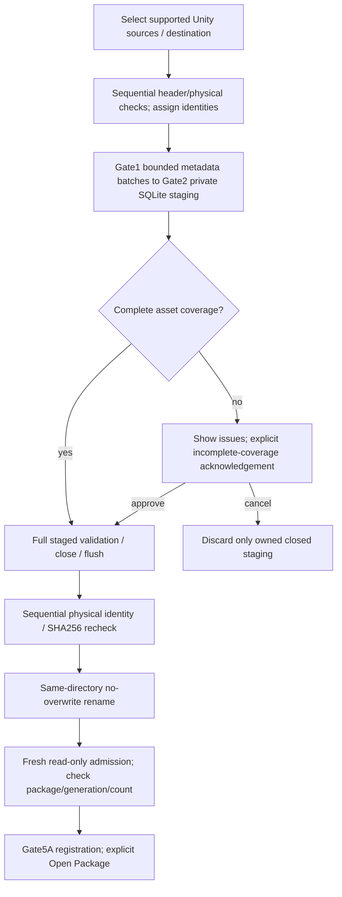

# V2 Gate5A.1 — production package creation

**Date:** 2026-10-22. **Status:** implementation and supported-path automated verification complete; user visual acceptance and physical-hardlink fixture verification pending. Preserve the already-staged Gate5A checkpoint; this gate stays unstaged. No Gate5B Search, Gate5C memos, reindexing, migration or Stage7 recovery.

## Workflow and components

Packages / **Create Package** opens a retained V2 form inside the existing Packages workspace. **New Legacy V1** remains explicit; no legacy document is used as an intermediate. A creation form does not own or abandon the V1 editor's dirty clone. **Open Package** uses the existing guarded package selection, including Save/Discard/Cancel when required.

- [V2CreationViewModel](../../UABS/Script/ViewModels/V2CreationViewModel.cs) and [view](../../UABS/Script/View/Pages/V2CreationView.axaml): multiple sources, name/destination preview, Create/Cancel/Close/Open, progress and explicit incomplete-coverage decision. Input/actions are disabled while creating; workspace switching retains the form. Progress is coalesced to one pending dispatcher notification, not queued per asset.
- [V2PackageCreationService](../../UABS/Script/Services/V2PackageCreationService.cs): off-thread input preparation, physical source pins, immutable operation identities, existing extractor/builder orchestration and fresh published-file admission. Structured result distinguishes publication, verification and later registration.
- [PackageBuilder](../../UABS.PackageV2/PackageBuilder.cs): additive optional progress and async partial-approval callback. Existing callers and approved DDL/version/DELETE/FULL policy remain intact. Partial approval resumes the same private staged build, not a second extraction.
- [PackageManagementViewModel](../../UABS/Script/ViewModels/PackageManagementViewModel.cs): existing Gate5A catalog registration and explicit opening. Registration failure reports the already saved path; never deletes a published file or claims rollback.

## Identity, evidence and resource bounds

Selection order defines source order. Each creation assigns fresh package/generation UUIDs and distinct source/revision UUIDs. Root directories are grouped by Windows lexical path using a dictionary; relative locators are filenames, while exact selected original path strings remain evidence. Duplicate names in different directories, identical content, duplicate CAB/logical labels and signed Path IDs never merge occurrences. Canonical duplicate paths and same physical Windows volume/file IDs (including hardlinks) are rejected. Linked/reparse paths are refused. There is **no fixed total-source cap**. Only the current source is pinned during preparation/extraction/recheck; cooperative writes/deletes are denied while that source is actively read. Equal hashes alone never identify a duplicate source.

Gate1 retains all discoverable classes, unknown IDs, raw NULL/empty names, original logical directory ordinals, type metadata, source SHA256 and independent dependency original/virtual/CAB/GUID/type/order evidence. No filename-based type inference or payload decoding. Bounded extractor batches flow directly into SQLite, not an asset collection on the UI. Gate1 still retains O(current-file metadata); disk-backed decompression and large metadata are not whole-process resource caps. Full hashes before/after extraction remain; preflight reads only headers. Before publication, a sequential extra physical-ID/SHA256 pass validates released sources against their actual extraction evidence, using one reused64KiB buffer. Cancellation is checked throughout this pass.

### Source-selection limit follow-up

The original256-file restriction was introduced in Gate5A.1, not inherited from Unity/V1: a literal XAML label, `V2CreationViewModel.AddSourcesAsync` count validation, and `V2PackageCreationService` input-count validation. The native multi-file picker (`AllowMultiple=true`) and `PackageBuilder` had no such count limit. The reason was the original service retaining every source pin until publication; merely deleting validation would have left O(source-count) open handles. All three count restrictions are removed; unrelated256 uses (extractor batch size, SHA256 and Search flags) remain unchanged.

Large selections retain only O(selected paths) lightweight strings/identity/fingerprint/metrics, with no full-source buffering or progress-history collection. A fixed-height ListBox uses standard virtualization; repeated Add Sources accumulates in order, duplicates remain visible and are rejected at Create under the unchanged policy, Remove Selected removes exactly that occurrence, and Clear resets count. Selection merge is cancellable/off-thread, publishes once, and a cancelled/late picker cannot append stale paths. Extraction stays sequential regardless of selection count; preparation/rechecking use one source handle, extraction ordinarily two (outer pin plus Gate1 stream), excluding SQLite/classdata/unpack handles. No source-count-sized worker/pin pool, new DB statement parameter list, or arbitrary replacement cap is introduced. Counts remain .NET collection Int32, asset counts Int64; practical memory/filesystem/native-picker limits still apply and failures are reported, not treated as successful creation.

**Source freshness boundary:** releasing completed source handles allows a cooperating external writer to change them later. Final rechecking rejects detected replacement/hash changes and aborts staged publication. This is not a group filesystem snapshot: an earlier rechecked source can still change after its handle closes, including before publication. Source revisions are verified historical evidence, not a promise that all external files remain unchanged simultaneously forever. An immutable/quiesced source corpus is required when that stronger guarantee matters; all-source snapshots/locks are not silently implemented here. Staged DB validation, output no-overwrite, explicit partial approval and post-publication verification are unchanged. V1 behavior/schema/Search/memo persistence are untouched.

Final follow-up verification: focused **40 passed,1 skipped,0 failures** (41 cases,12.31s); full standard in-process xUnit **577 passed,1 skipped,0 failures** (578 cases,49.13s). These are not VSTest results; the known transport restriction was not retried. Debug startup/storage/tests/runner and final solution builds pass0 warnings/errors. Tests include selection-only256/257/1000/5000 paths; accumulation, duplicate preservation, removal/counts, cancellation preserving500 prior paths despite late picker completion and actual headless virtualization; actual257/1000-source SQLite builds using tiny disposable supported-header files plus a deterministic metadata extractor; serial extraction and noncurrent exclusive handle access; processing cancellation and final changed-source rejection. These synthetic zero-asset builds validate orchestration/storage/resources, not parsing1000 real game bundles. Existing genuine43+43 asset parsing, V1 editor and safe-publication tests remain. The one existing physical-hardlink fixture permission skip is unchanged. No desktop or native-picker acceptance is claimed.

Follow-up scope is six files: `V2PackageCreationService.cs`, `V2CreationViewModel.cs`, `V2CreationView.axaml`, `V2CreationTests.cs`, this report and `codex-session-handoff.md`. Three-assembly/shipped-output zero-Unity, canonical DDL equality, genuine fixture hashes, protected legacy/V1/metadata-extractor/Search/memo/schema paths, whitespace/conflict and9-document/104-link/fence checks pass. Owned disposable creation fixtures were removed by their test owners; unrelated ignored artifacts were preserved. The23-file Gate5A index and all pre-existing work remain intact; no staging/commit/config/history actions.

Manual acceptance: launch current Debug, Add Sources with more than256 files (including repeated adds), check count/order and Remove Selected/Clear, cancel a picker or processing operation, then create and browse a disposable package. Native picker limits and real-corpus throughput still require user/platform acceptance. Do not edit source files while building when a quiesced corpus is required. The prior10k timing below is historical and was not rerun for this follow-up.

### Add Folder and subfolder follow-up

**Root cause:** the initial V2 form implemented Add Sources/file picking only; it had no folder command or selection-only discovery adapter. V1's [PackageEditorViewModel.AddFolderAsync](../../UABS/Script/ViewModels/PackageEditorViewModel.cs) calls `PickUnityFolderAsync` and [PackageService.CreateReferencesFromFolderAsync](../../UABS.UnityAssets/Packages/PackageService.cs), which uses [PackageFolderScanner](../../UABS.UnityAssets/Packages/PackageFolderScanner.cs) then builds legacy references. That scanner sorts a breadth-first file/directory traversal, checks cancellation, skips reparse points, and reports inaccessible paths; editor merging suppresses already-imported source/asset references. Header detection is extension-independent, but resulting V1 asset references are Texture2D/Sprite-only. Actual V1 code defaults to **current folder only**, with opt-in Include subfolders; V2 defaults to **Include subfolders enabled** as explicitly requested. V1 behavior is unchanged.

**Reused:** existing `IFilePickerService.PickUnityFolderAsync` / Avalonia native folder picker and exact V2 header/physical-source checks. **New:** [V2FolderDiscoveryService](../../UABS/Script/Services/V2FolderDiscoveryService.cs), a selection-only worker; no V1 reference creation, Gate1 extraction or package writing during discovery. The V2 form now exposes Add Folder and an explicitly two-way Include subfolders checkbox alongside the existing file-selection controls. Folder operations share selection cancellation/command disabling; creation is unavailable until discovery completes.

Discovery streams one directory's entries at a time and opens at most one header handle. No payload extraction/decompression or all-bundle pinning occurs. It retains necessary selected paths/dedup IDs plus pending/visited directory paths (O(discovered sources/directories), not a constant total-memory guarantee), but not every unsupported filename, open directory-enumerator tree, or unbounded warning history. Counts are64-bit; diagnostic samples are limited to50, with a separate first-error message. Progress is coalesced to one pending UI update. There is no source-count ceiling.

Reparse-point files/directories are skipped before opening/traversal; a selected root with any linked ancestor is refused. Directory ancestors are checked again before enumeration, with lexical root containment checked before inspecting entries. No external link is followed to increase coverage. Ordinary static links/cycles are guarded; malicious namespace replacement races are not an atomic filesystem snapshot guarantee. Returned supported paths are sorted by ordinal-ignore-case, then ordinal. Canonical and physical duplicates are suppressed against existing manual selections and within the scan; physical aliases inside a new batch choose the lexically first path regardless of enumeration order, while prior selections retain their original positions. Equal content at distinct physical files is not deduplicated. Manual duplicate-selection behavior itself is unchanged and Create still validates all identities.

Only a successful completed discovery merges one new batch into the existing selection. Cancellation, missing/inaccessible directories or unreadable/header-inspection failures leave the prior collection untouched (no partial append). Unsupported files and skipped links are nonfatal, explicitly counted with sample paths. Repeated/overlapping folders add no duplicates; a zero-new-source scan does not reset the collection/selection. Removal and accurate counts remain available afterward. Late progress/results are checked against the owning operation; a cancelled picker/scan cannot modify a newer selection. Native dialogs retain their own Cancel behavior; cancellation never forcibly controls the desktop.

Final focused folder verification **14/14 passed** (7.39s); existing creation **40 passed,1 skipped** (41 cases,11.96s). Full standard in-process xUnit **591 passed,1 skipped,0 failures** (592 cases,55.75s), including existing V1 folder and V2 publication regressions. Debug startup/storage/test/runner and final solution builds0 warnings/errors. These are not VSTest results; known transport restrictions were not retried. The existing physical-hardlink fixture permission skip is unchanged. Initial fixture path-separator expectations were corrected; no existing tests were weakened.

Coverage includes nested recursion/current-only, extensionless bundles, misleading unsupported extensions, actual257/1200 lightweight disposable sources, deterministic ordering, simulated physical aliases, overlapping/manual merge and removal, actual headless button/checkbox bindings,1000 unsupported files with bounded diagnostics, cancellation, simulated inaccessible file/directory and reparse-cycle/root/escape guards. Native ACL/junction/cycle behavior is simulated via the filesystem seam, not claimed as OS-level acceptance; no external targets are followed. The largest directory scan was1200 real disposable header files, not1200 real-game bundle parses. Actual parsing remains covered by the existing genuine fixture creation tests.

Seven files changed for this follow-up: new discovery service and folder tests; creation VM/view, a read-only selection-inspection helper in the creation service, this report and handoff. Canonical DDL, genuine fixture hashes, three-assembly/shipped-output zero-Unity, protected legacy/V1/Gate1/Search/memo/schema paths, Git/new-file whitespace/conflict and9-document/108-link/fence checks pass. Owned folder/creation fixtures disposed; prior ignored data preserved. Existing23-file staged Gate5A index and all prior work remain unchanged; no staging/commits/config/history operations or desktop control.

Manual Debug acceptance: Add Folder to a disposable tree with nested/extensionless inputs and unsupported text files; confirm default recursion, then uncheck it for current-only mode. Add an overlapping folder/manual file, verify counts/order/removal, cancel a scan, and create/browse a disposable V2 package. Native picker behavior, visual layout, live junction/ACL faults, hostile namespace changes and real large-game-corpus throughput remain user/platform acceptance items. No schema, sequential creation, final integrity recheck, partial acknowledgement, transactional publication, registration, V1, Search or memo behavior changed.

## Completeness, cancellation and publication

### Real-corpus extraction correction

The [Gate1 real-corpus investigation](package-format-v2-gate-01-extraction.md#real-corpus-follow-up--2026-10-22) traced the user package's46 issues to19 false `.resS` table candidates,19 consequent Unavailable summaries,4 enrichment-budget warnings and4 Partial summaries. A bounded header check replaces the permissive V2 vendor candidate probe; actual failed tables still require incomplete-coverage acknowledgement. All23 affected source copies match recorded hashes and re-extract100,242 assets with unchanged per-source counts and complete actual tables. No genuinely malformed source or missing asset rows was established for these issues.

The four optional dependency warnings remain: `m_PreloadTable` array counts exceed16,384; descriptive diagnostics replace a misleading inherited generic IOException message. No budget, V2 schema, no-overwrite publication or V1 path changed. Current Debug builds pass0 warnings/errors; extractor29/29 and creation40 passed/1 existing skip. Full standard in-process xUnit **598 passed,1 existing permission skip,0 failed** (599 cases,55.81s), not VSTest. Zero-Unity, canonical DDL, genuine fixture integrity, protected paths, documentation and Git checks pass; see the current handoff for scope/limitations. Final recovery made documentation-only updates without rerunning the validated suite.

The original825,730-asset SQLite package is untouched. To obtain corrected completeness/issue records, create a **new filename**, never overwrite the real package. A new full-corpus build was not performed; affected-source evidence predicts unchanged asset totals and8 remaining enrichment/summary issues, not a guaranteed rebuild result. Do not treat an optional dependency limit as lost asset-table coverage. Further budget optimization and other Unity versions remain separate work.

Optional enrichment failures remain warnings without mislabeling complete asset coverage. Unsupported headers/unreadable sources fail with diagnostics. Final source-verification failure aborts production creation rather than asking permission to retain uncertain bytes. Missing asset-table coverage pauses the private transaction and shows counts plus first50 issue details. Only the explicitly labeled incomplete-coverage action allows partial publication; Cancel preserves details, and no callback means no publication. All issues remain in a successfully published package for browsing.

Production creation currently accepts only existing fixed local Windows NTFS destinations without reparse components. Other filesystems/network paths fail explicitly, rather than claiming tested atomic publication. Existing destination files and destination SQLite recovery sidecars are refused and never deleted. The existing builder owns a unique staging file in the destination directory, validates full integrity/FKs/semantics, closes/flushes, then uses no-overwrite rename. A competing destination wins without replacement. Only owned closed staging is removed; uncertain recovery sidecars retain staging and must be reported, not manually removed.

Cancellation is checked during preparation/extraction/SQLite work and immediately before rename. After publication, verification and registration finish without the user's operation cancellation token; the saved file is never deleted or described as rolled back. Fresh read-only admission verifies UUID/generation/source count and canonical metadata validation. Published-but-unverified and saved-but-unregistered are distinct from no output. External namespace tampering, power loss, malicious writers and arbitrary filesystem faults remain outside this gate's acceptance; ordinary sharing is not a cross-process namespace transaction.

## Original Gate5A.1 verification and measurements (historical)

These measurements predate the bounded-handle follow-up and extra final source hash pass. They are not current throughput claims; completed scale benchmarks were not rerun.

Current-source focused standard in-process xUnit: **29 passed,1 skipped,0 failures** (3.06s). Full standard in-process xUnit: **566 passed,1 skipped,0 failures**,567 discovered/run (38.89s). These are **not VSTest results**; the previously blocked transport was not retried. Debug startup, affected storage/test projects, scratch runner and final solution build pass with **0 warnings/errors**. A temporary generic-return inference/XAML data-context error and a measurement-helper analyzer warning were fixed before final verification; no existing tests were weakened or deleted.

[V2CreationTests](../../UABS.UnityAssets.Tests/V2CreationTests.cs) uses only owned disposable source/output fixtures, including copies of genuine bundle/serialized inputs. These genuine files each contain43 assets (86 across two independent selected sources); synthetic multi-file/duplicate-CAB fixtures do not close the genuine multi-file acceptance gap. Coverage includes multi-source order/identity, all types/raw nullable names/signed IDs/original ordinals, independent Unicode virtual/original dependency paths, optional enrichment versus partial approval/refusal, canonical duplicate selection, invalid/unreadable inputs, source revision rejection, cancellation and failures at schema/batch/validation/publication, destination/sidecar/cross-publication collisions, fresh verification failure, late cancellation, actual headless form command states, registration and registration failure, dirty V1 editor protection. Existing Gate1/2 tests also cover raw dependency NULL/empty/GUID/order and staged semantic faults.

**Skipped physical-alias fixture:** native `CreateHardLink` returned Win32 error5 (access denied) when constructing the disposable test input. No permission bypass or further native attempts; this new environment-dependent test is explicitly skipped. The production volume/file-ID duplicate guard is present, but actual hardlink rejection needs verification on an authorized host before claiming that case accepted. Canonical/normalized duplicate tests pass. The genuine fixture hashes remain unchanged.

One bounded disposable **10,000-asset** synthetic serialized-file observation (Debug/.NET9, warm fixture/provider setup; not median/p95 or a production budget): end-to-end preparation/build/fresh verification **1.736s**; builder **1.681s**, ingestion **1.241s**, staged validation **142.72ms**, publication/flush **2.10ms**; file **1,818,624B**. Gate1 extraction-plus-awaited-sink **1.230s**, two hashes **6.48ms**, structure **8.13ms**, names **51.97ms**, dependencies **0.58ms**. Extraction and builder ingestion overlap; these are not additive independent insertion/extraction timings. Managed allocation churn **56,508,472B** during builder, observed process-lifetime peak **70,733,824B**, maximum batch256. These are not isolated native/retained/UI memory caps. The result registered successfully and browsing retained100 rows; fixture/source generation was excluded from timing. Owned inputs/output were disposed; no large/million-row benchmark rerun. Raw observation: external scratch `gate5a1-creation-10000.log`.

Canonical DDL equality, three-assembly/shipped-output zero-Unity audit, unchanged genuine fixture hashes and protected legacy/V1 core/V2 Search/memo/schema scope pass. Nine-document internal links/anchors and fences pass; the new Mermaid flow was syntax-reviewed, not rendered. Staged/unstaged and new-file whitespace/conflict review passes. The pre-existing23-file Gate5A index remains unchanged. This gate adds16 changed/new files: builder/contracts; picker interface/adapter; Packages VM/view; creation service/VM/view/code-behind; creation tests plus optional synthetic-fixture virtual-path parameter; UI design/report/index/handoff. No package-index fields, V1 persistence changes, automatic staging or commits.

No desktop automation/screenshots. Headless tests establish wiring/state, not visually observed rendering. VSTest transport remains historically unavailable; standard in-process xUnit results must be labeled separately. No new Unity-exclusive decisions.

## Manual Debug acceptance

Launch `E:\Projects\UABS\Avalonia\UABS\bin\Debug\net9.0\UABS.exe` after a successful current Debug build.

1. Packages / Create Package: add several disposable supported files (including equal filenames in distinct directories), choose an existing local NTFS output directory and name. Check full destination preview, responsive progress, disabled inputs and Cancel/Close behavior.
2. Create, then Open Package. Confirm complete/partial status, counts, all asset types and Issues/evidence. Browse in Packages and Assets; confirm shared green rows/Kind behavior and read-only V2 Inspector.
3. Exercise invalid sources, duplicate selection and output collisions with disposable files; existing content must stay untouched. Cancel before publication and during an incomplete-coverage pause. Only the explicitly labeled acknowledgement may publish incomplete coverage.
4. Keep a dirty V1 editor, create V2, then Open Package: verify explicit Save/Discard/Cancel; cancelling preserves both the dirty editor and created output. Switch workspaces and return: creation form state remains retained.

Recommend accepting this as the limited, buildable Gate5A.1 implementation checkpoint, subject to the manual checklist and explicitly open physical-alias acceptance. Other RID/filesystem/power-loss/resource-limit and genuine multi-file coverage remain open; this is not universal fault/performance acceptance. Remaining gates require separate authorization. No new V2 Search/memo adapter, structural editor or shutdown/crash guarantee is implied.
