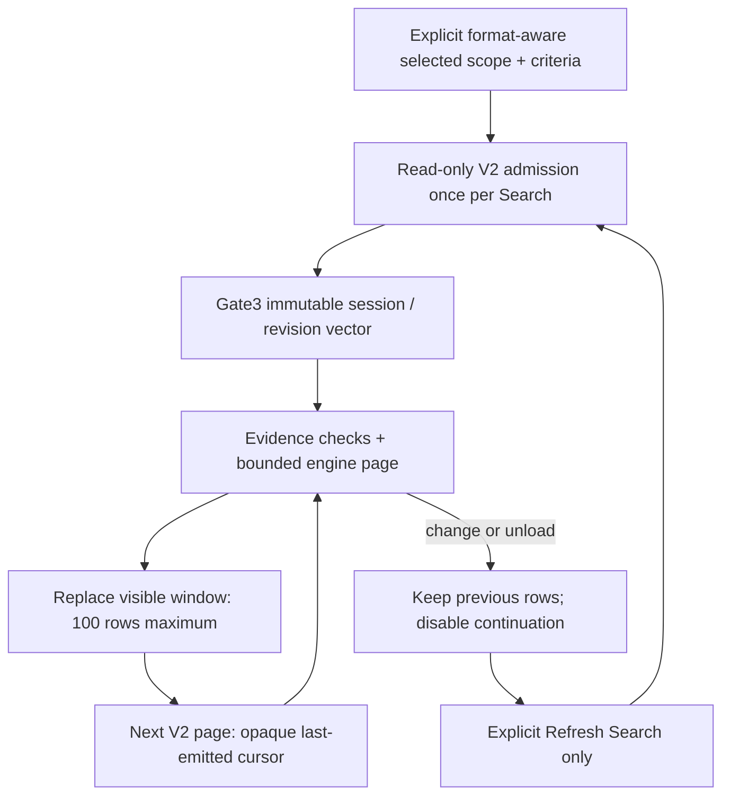

# V2 Gate5B — production multi-package Search

**Date:** 2026-10-23. **Baseline:** clean `01e2ac8`. **Status:** scoped implementation and automated verification complete; user Debug visual acceptance pending. No Gate5C memo editing, structural saves, migration or shutdown recovery.

## Production boundary and package selection

The existing [SearchWorkspaceViewModel](../../UABS/Script/ViewModels/SearchWorkspaceViewModel.cs) and [Search view](../../UABS/Script/View/Pages/SearchWorkspaceView.axaml) now support registered V2 packages alongside V1. No second Search page or V2-to-V1 document conversion exists. Checkboxes show format/name and V2 index status. Existing initial-selection, name filtering, Select All/Clear and later-package-unselected behavior remain. V1 scopes retain their package-path identity; V2 scopes use the exact retained registration epoch, never a display name.

**Mixed policy:** one format per execution. A mixed selection shows an explicit error and preserves the last rows; it never silently ignores packages or concatenates full V1/V2 result universes. V1 uses its existing service/memo path. V2 uses [V2SearchOperation](../../UABS/Script/Services/V2SearchOperation.cs), a narrow immutable operation around the existing Gate3 engine. Explicit Search/Refresh admits only selected registered packages, at most128, with2 default workers (engine cap4). Browse registration lifetime and a monotonic location epoch prevent unloaded/replaced occurrences from becoming current targets. V1 remains otherwise unchanged.

## Criteria and results

Existing include/exclude, English/Chinese commas, OrdinalIgnoreCase literal/whole-field matching, fields, result kinds, signed Int64 Path ID, Search memos and Memo only map directly to Gate3 requests. No LIKE/NOCASE/FTS substitution or source-file reads. V2 Class ID and exact type-name fields are optional asset-only AND filters; non-asset kinds or V1 selection with those fields show validation rather than silently ignoring them. Empty include/no Path ID remains invalid; exclude-only and Memo-only do not enumerate all.

The existing row wrapper retains either genuine V1 provenance or an immutable V2 result plus its registration/location/catalog revision. V2 package/generation/source/revision UUIDs, original logical ordinal, signed nullable Path ID, diagnostic table ordinal, Class ID/type, raw nullable name, identity status, memo/value state/revision remain distinct. An explicit V1 `Result` accessor rejects V2 rows rather than inventing a V1 identity. Package/source rows keep their own row keys and never acquire asset identities.

The existing Kind-first52/min0/max80 resizable clipped column, green zebra states and grid selection are retained. Known V2 type names reuse the shared icon converter; unknown metadata uses the neutral asset icon, not filename/Path ID guessing. Column sorting is **current-page only**; backend federation remains deterministic global package ordering.

Selecting V2 displays full read-only metadata/memo text in the same Inspector; it hides the V1 memo editor and presents an unsupported resolution to its coordinator. Missing versus empty memo/name values remain explicit. No source loading, previews, writable Inspector, V2 draft coordinator or memo persistence route is added. V1 verified-delta row updates explicitly exclude V2 rows.

## Paging, consistency and ownership

The UI requests100 rows per page; the operation retains the engine's1–500 page contract. Next **replaces** the page, not an ever-growing collection. Loaded-at-least and exact indexed totals are distinguished; exact means exhaustion of indexed metadata, not verified complete source coverage. No eager COUNT/full result materialization. Warnings remain visible and grouped by code/message, within a bounded-height scroller.

Each explicit Search/Refresh performs full Search admission once per selected package, separate from the earlier browse admission. Pages use Gate3 transaction/vector checks and conservative full-file identity/hash checks before/after, not repeated full schema validation. This is intentionally not an unreviewed validation cache: admission remains O(metadata), page evidence checks O(database bytes). A future shared admission/cache policy needs separate correctness review.

Criteria and selected scope are captured before asynchronous work. Cancellation/generation/reference checks reject old completions; unload cancels the exact operation and drains engine registrations. Replaced/generation-changed packages require explicit unload/reopen; a valid same-generation catalog change may be readmitted on Refresh. A failed/cancelled page preserves prior rows/cursor and never appears as successful exhaustion. Query-budget errors stay errors, not zero matches. Package evidence changes mark the session stale, retaining rows/selection and blocking Next; no automatic rerun or mixing revisions.

Staleness is detected on page requests, registration unload/scope change and return to Search. No idle file watcher/polling is implemented; an external edit while sitting idle may not display stale until the next check. Workspace departure cancels active Search work and preserves retained controls/layout/results. Return verifies current evidence without executing a new query. Main-window lifetime disposes Search before package ownership.

## Verification checkpoint

Final Debug solution/startup/tests/runner build **0 warnings/errors**. Focused production Search **18/18**, browse **26/26**; final full standard in-process xUnit **616 passed,1 existing permission skip,0 failed** (617 cases,49.14s). This includes the final admission-scope publication guard and deterministic boundary regression. The original Gate5A assertion excluding all V2 Search scopes was replaced with exact V2 scope/no fabricated V1 result, read-only memo, no-source-loading and actual shell-retention assertions; no existing write guard was removed. Initial nullable API/analyzer/test-access issues were corrected, not suppressed or covered by fake passing tests. These are not VSTest transport results; the historically restricted runner path was not retried or bypassed. Headless tests are not user visual acceptance. Disposable SQLite fixtures only; no real OWL package/source writes.

Three-assembly/shipped-output zero-Unity, canonical DDL equality, original genuine-fixture SHA256, protected-path and documentation checks pass (11 documents/134 local links/anchors;14 balanced Mermaid blocks syntax-reviewed, not rendered). Staged/unstaged/new-file whitespace/conflict checks pass; index empty. Eleven changed/new files are scoped to this gate. The existing hardlink-fixture permission skip remains, with no bypass or repeat native attempt. No desktop application/automation/screenshots or user-process termination.

Verification used sequential `dotnet build Avalonia.sln -c Debug --no-restore -m:1 -nr:false --verbosity minimal` and the external verification runner's standard xUnit executor (`integration`, `browse`, `full`), not a claim that `dotnet test` transport passed. Recommend this as a **verified buildable Gate5B checkpoint ready for review/commit**, subject to the manual checklist and disclosed performance/platform limitations. No staging/commit performed; Gate5C remains separate authorization.

## Disposable performance observations

One Debug/.NET9.0.5 process, two synthetic50k-asset packages (100k total); fixture setup12,928.47ms excluded, OS/provider caches warm. Single broad scope uses only one50k package; all other rows select both. Each query's Search admission is separate from page retrieval and from browse registration (two-package browse admission419.88ms). These are **single observations**, not median/p95, physical-cold I/O, UI-paint measurements or approved Gate3B acceptance budgets. Real OWL825k search was not executed.

| Request | Search admission ms | First page ms / rows | Next page ms / rows |
| --- | ---: | ---: | ---: |
| Single-package broad |185.16|150.53 /100|138.51 /100|
| Signed Path ID |368.00|40.25 /2|not needed|
| Exact name |367.13|55.01 /4|not needed|
| Two-character Chinese |370.47|93.24 /4|not needed|
| Multi-package broad |366.34|178.42 /100|154.88 /100|
| Include/exclude |381.48|176.20 /100|190.32 /100|

Actual Search VM broad first-page wall time **531.60ms including Search admission**; next **177.77ms**; retained rows **100**, not100k. Small-result queries report Exact; broad pages report LoadedAtLeast. Triggered cancellation returned in3.44ms and unload in1.65ms, both with0 emitted rows. These deterministic trigger-to-return samples do not bound arbitrary physical-I/O stalls.

Code inspection identifies additional production costs: admission repeats canonical full validation once per explicit query and page evidence checks hash every selected database before/after the engine call. No full schema/integrity admission runs inside each page. The paired adapter/VM broad observations do not indicate a major extra row-publication cost, but timing noise and different paths preclude subtracting them as an isolated UI-overhead measurement. No validation was weakened or new cache introduced. Raw log: external scratch `gate5b-search-100000.log`; the helper disposed its owned databases. The later scope guard changes only publication eligibility, not SQL plans, source data, workers or page sizes; this completed measurement was not repeated.

## Files and scope

- New production [V2SearchOperation](../../UABS/Script/Services/V2SearchOperation.cs); additive lifetime/epoch and current-feature summary in [V2BrowseCatalog](../../UABS/Script/Services/V2BrowseCatalog.cs).
- Existing Search VM/view and [MainWindowViewModel](../../UABS/Script/ViewModels/MainWindowViewModel.cs) workspace activation/cancellation hooks.
- New [integration tests/opt-in measurements](../../UABS.UnityAssets.Tests/V2SearchIntegrationTests.cs); updated [browse regression](../../UABS.UnityAssets.Tests/V2BrowseIntegrationTests.cs).
- This report, [UI design](../03_design/ui-and-workflow-design.md), documentation index and [handoff](codex-session-handoff.md):11 files total. No library/schema/writer/extractor/V1 service change; no package/source mutation or staging/commit.

## Manual Debug acceptance and Gate5C prerequisites

After the final successful Debug build, launch `E:\Projects\UABS\Avalonia\UABS\bin\Debug\net9.0\UABS.exe` (close any older instance normally).

1. Register disposable V1/V2 packages in Packages. In Search, confirm format/status labels, filtering, retained selections and explicit rejection of mixed scope.
2. Select several V2 packages; exercise commas, CJK, excludes, exact name, signed Path ID, memo options and asset-only Class ID/type filters. Check warnings and accurate page/count labels.
3. Page through results; confirm100-row windows, Kind hiding/restoring, green rows/selection/hover, scroll and panel state. Inspector must show exact metadata/full read-only memos with no V2 edit actions.
4. Change criteria without Search; retain rows and show criteria-changed. Cancel/repeat searches, switch workspaces, unload a selected package, and change a **disposable** package revision. Retain old rows as stale, disable continuation and use explicit Refresh.
5. Verify normal V1 Search and memo editing still work. No real package overwrite or automatic search is expected.

Gate5C requires separately authorized identity/revision-aware reuse of the existing draft coordinator, editor exclusion and verified monotonic memo publication. No new draft architecture or writer is implied here. User desktop acceptance, other RID/filesystem faults, whole-process/temp-disk/payload bounds and real825k-corpus production latency remain unverified. Gate3B engineering targets remain provisional, not universal guarantees.

**Unity-Exclusive Features Requiring Decisions:** none newly introduced.
