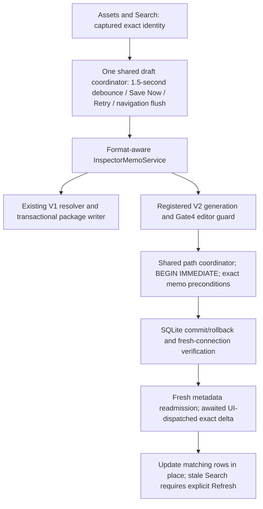

# V2 Gate5C — production Inspector memo integration

**Date:** 2026-10-23. **Status:** implementation and automated verification complete; recommend scoped Gate5C acceptance subject to user-operated Debug visual acceptance and limitations below. Existing uncommitted Gate5B work is preserved; no Git mutations, real-package writes or legacy Unity changes.

## Reported error and exact identity

The user confirmed that `No loaded package contains this asset identity` occurred after opening a **Unity file through the filesystem Navigator**. [AssetListViewModel](../../UABS/Script/ViewModels/AssetListViewModel.cs) previously used the V1 [PackageMemoResolver](../../UABS.UnityAssets/Packages/Memos/PackageMemoResolver.cs) over `Packages.Where(Package != null)`. SQLite registrations have no V1 document and were absent from that catalog. Indexed V2 Assets/Search also intentionally lacked editable memo routing after Gate5B. This was a format-routing gap, not evidence of a missing memo or a reason to weaken identity validation.

The native session does not carry V2 UUIDs. [AssetsToolsAssetSessionFactory](../../UABS.UnityAssets/AssetsToolsAssetSessionFactory.cs) now captures SHA256 before and after actual metadata enumeration under a loading-interval read pin. The bridge requires matching original source path, captured source hash, exact logical-file name and signed Path ID. Bounded SQLite lookup must yield exactly one addressable occurrence across the loaded indexes; multiple packages, duplicate logical occurrences, stale/unverifiable evidence or nonaddressable rows remain unavailable. A name/CAB/Path-ID-only match is never accepted. Hashing adds two sequential source reads to native opening; parser and session ownership are unchanged. Missing original sources do not block **indexed** editing.

Indexed Assets and Search retain package UUID, generation, source UUID/revision, original logical directory ordinal and signed Path ID. [V2MemoIdentity](../../UABS.UnityAssets/Packages/Memos/V2MemoIdentity.cs) adds the immutable registration epoch to that address. V1 and V2 draft keys are domain-separated; an unloaded identity never rebinds to a package reopened at the same path. Names, Class IDs, table/local row IDs and display labels are not writable identities. Unknown classes and nullable names remain eligible when identity is addressable.

## Ownership, drafts and transactions

[InspectorMemoService](../../UABS/Script/Services/InspectorMemoService.cs) is the narrow format facade composed by [MainWindowViewModel](../../UABS/Script/ViewModels/MainWindowViewModel.cs). It owns V2 writer registrations and exposes the Gate4 guard, not another draft store or timer. One application-lifetime [MemoDraftCoordinator](../../UABS.UnityAssets/Packages/Memos/MemoDraftCoordinator.cs) serves native Assets, indexed Assets and Search.

V1 resolution, writes and catalog publication retain their original path. V1 persistence explicitly rejects a V2 identity. V2 uses [V2MemoPersistenceService](../../UABS.PackageV2/Memos/V2MemoPersistenceService.cs), never a V1 package rewrite. Fresh draft basis capture reads the actual nullable memo, memo revision and catalog revision, rather than trusting displayed text. Save requests carry immutable identity and expected original nullable value/revision; catalog revision is evidence, not a forced global precondition for unrelated-asset changes.

Gate4 validation and transaction algorithms are unchanged: canonical admission, generation/addressability checks, expected memo revision/value, conditional one-row UPDATE, trigger-managed counter verification, durable commit/rollback and fresh-connection verification. No schema/index changes, unsafe admission cache, automatic merge or journal deletion. NULL, empty and Unicode round-trip independently. An unchanged save is still verified/published. Cancellation before commit rolls back; once commit starts, verification/publication finishes without caller cancellation. Committed/uncertain outcomes never claim a clean rollback.

Shared drafts keep newer local edits when older saves finish. Failures/conflicts retain text and expose Save failed or Conflict plus diagnostic feedback. A committed publication failure stays Failed; Retry uses the verified revision to reverify/republish rather than reporting Saved through the equal-text shortcut. A real revision conflict does not automatically rebase/overwrite external content. Navigation flushes captured identities, not current selection. No new normal-shutdown flush or crash recovery was added.

## Editor exclusion, publication and lifecycle

An active Package Editor excludes Inspector writes for that package even when clean. V1 exclusion is preserved; Gate4 V2 writer/guard enforce equivalent exclusion independently of dirty state. Other packages remain writable. Only explicit lease release restores eligibility. Production V2 structural editing cannot currently be opened; disposable service-level tests exercise this guard and explicit eligibility refresh. Future structural UI must use the same guard/coordinator and transactional base-revision policy; it is not part of Gate5C.

After verified persistence, controlled [browse readmission](../../UABS/Script/Services/V2BrowseCatalog.cs) refreshes the reader/evidence without clearing visible rows. Publication carries full immutable target, persisted nullable memo, memo revision and catalog revision under package coordination. Dispatcher-bound handlers update all matching Search rows and indexed Assets rows with property notifications; shared drafts update the corresponding selected Inspectors. Registration epoch and full identity prevent cross-package/source collisions, including duplicate names/Path IDs. Older/equal revision deltas cannot overwrite newer memo text.

Criteria, displayed collections, selection and scroll are retained; Search is **not** rerun. An affected older Search revision is marked stale, continuation is invalidated/cancelled and explicit **Refresh Search** is required. A fresh publication checks that its value was not superseded before publishing. External supersession before Gate4 verification yields `CommittedButSuperseded`; supersession detected during publication is an explicit failed-publication diagnostic with the draft retained, never successful publication.

Unload cancels pre-commit work and drains registration ownership without retargeting it. A flush that awaits persistence cannot clear a newer package selection: removal captures its package/open version and unloads only that owner. Failed browse verification clears memo eligibility. After commit, unload/publication failure may leave a persisted memo while the retained draft reports failure; no false rollback. Old drafts remain in application memory under their old epoch. Reopen creates a new epoch, not automatic draft migration. External generation/location replacement is refused; Windows browse pins prevent ordinary rename/delete while loaded, and physical file identity is rechecked. These are snapshot/ordinary-writer protections, not guarantees against malicious same-generation/counter ABA replacement, noncooperating namespace changes or subsequent external edits after publication. Cross-platform/native fault acceptance remains limited.

## Save latency: proven checks retained

The [Gate4 diagnosis](package-format-v2-gate-04-memos.md#read-only-save-performance-diagnosis-2026-10-22) remains applicable: writer registration validates once; each successful/unchanged save validates twice, inside the immediate transaction and on the fresh verification connection. Each pass recomputes actual canonical schema signature, `quick_check` (not `integrity_check`), foreign keys, global identity/ordinal/count/type/dependency/completeness invariants, source locators, counts and every supported-profile name/memo derived field.

Gate5C additionally uses fresh reader admission for draft basis/native identity lookup and verified publication, plus full package evidence hashing around readmission/location checks. Thus a successful production save currently adds a **third full validation** during publication. Target UPDATE remains one row; this is not a database rewrite. Connection/lock/FULL-sync cost and UI dispatcher waiting also contribute.

One bounded opt-in disposable100k diagnostic: fresh reader admission **364.11ms**, browse registration359.91ms, writer registration337.68ms, fresh draft basis383.47ms and **production save1314.71ms**. BeforeTransaction41.76ms, BeforeCommit599.45ms, AfterCommit601.89ms, BeforeVerification603.04ms and publication1312.26ms from save start. The558ms transaction interval combines first validation, target checks and update; the709ms verification-to-publication interval combines Gate4 fresh verification and Gate5C readmission/evidence/dispatch. These are not isolated validator timings or p95. Database length stayed22,945,792 bytes;4 logical4KiB blocks differed, not a physical-I/O/journal amplification measurement. Single warm-process synthetic observation, not real OWL or UI latency. Raw log: external session scratch `gate5c-memo-100000.log`; owned fixtures disposed. [Measurement helper](../../UABS.UnityAssets.Tests/V2MemoIntegrationMeasurements.cs) is not an automatically run performance test. No million-row rerun.

**Later optimization proposal only:** registration-scoped structural admission reuse requires a separate trust/invalidation design. Invalidate on unload/reopen/location identity or file replacement, generation/catalog/schema/profile changes and external commits. A persistent connection's `data_version` can detect other-connection commits but is not a portable content identity or standalone admission proof; memo/catalog counters alone cannot cover nonconforming writers. Revalidate transaction-local generation/addressability/original value/revision under `BEGIN IMMEDIATE` and preserve fresh persisted-target verification. No cache or validation removal is implemented here.

## Verification and files

- [Integration tests](../../UABS.UnityAssets.Tests/V2MemoIntegrationTests.cs): genuine disposable-source error reproduction and native/indexed/Search shared editing; exact immutable/registration keys; nullable/empty/Unicode; unknown classes; duplicate package/source identities; unavailable/ambiguous/missing/generation changes; deterministic debounce/Save Now/Retry/navigation; editor exclusion/release/other packages; cancellation/unload before and after commit; external conflicts/supersession; publication retry; stale completion and all matching-row synchronization on the UI dispatcher. No arbitrary concurrency sleeps or writes to real data.
- Existing Gate4 transaction/rollback/failure and V1 memo/editor regressions remain in the full suite. [Browse integration tests](../../UABS.UnityAssets.Tests/V2BrowseIntegrationTests.cs) now distinguish read-only metadata from editable memos, including disabled unconfigured controls; no prior safety assertion is silently removed.
- Core files: `AssetSessionMetadata.cs`, `AssetsToolsAssetSessionFactory.cs`, `Packages/Memos/{V2MemoIdentity,MemoDraftCoordinator,PackageMemoPersistenceService,PackageMemoResolver,PackageMemoService}.cs`. V2 library files: `PackageReader.cs`, `Memos/MemoContracts.cs`. The Gate4 writer, schema and V1 package transaction implementation are unchanged.
- App files under `UABS/Script`: `Services/{InspectorMemoService,V2BrowseCatalog}.cs`, `Models/V2BrowseModels.cs`, `ViewModels/{MainWindowViewModel,AssetListViewModel,EditableMemoInspectorViewModel,V2BrowseViewModel,SearchWorkspaceViewModel}.cs`, `View/Pages/{SearchWorkspaceView,V2InspectorView}.axaml`. No grid columns, palette, indexing or package schema changes.
- Test files: `V2MemoIntegrationTests.cs`, `V2MemoIntegrationMeasurements.cs`, `V2BrowseIntegrationTests.cs`. The measurement helper is explicit opt-in, outside test discovery.
- Documentation: this report, [UI workflow](../03_design/ui-and-workflow-design.md), [index](../README.md), [handoff](codex-session-handoff.md). Pre-existing Gate5B operation/tests/report and their edits remain uncommitted and must be reviewed together.

Final sequential Debug solution/startup/tests/runner builds passed with **0 warnings/errors**. Focused production memo integration **23/23 passed** (2.22s); browse integration **26/26 passed** (3.10s). Final standard **in-process xUnit:639 passed,1 existing permission-related skip,0 failed** (640 cases,51.40s), including the final unload-selection race test. VSTest transport remains historically unverified and was not retried/bypassed; these are not VSTest results. Initial runs exposed the obsolete no-buttons assertion and a test's raw versus effective command-enabled distinction; both were replaced with specific behavior checks before the final green run.

Zero-Unity references in startup/Core/V2 assemblies and Debug output pass. Canonical DDL matches the approved design exactly; both genuine fixture SHA256 hashes match the earlier checkpoint. Schema, StorageSql validation, Gate4 writer, V1 package transaction, fixtures and legacy tracked paths are unchanged. Combined staged/unstaged/new-file whitespace/conflict/scope checks pass; index remains empty,29 combined changed/new files include prior Gate5B work. Twelve relevant documents' local links/anchors/fences pass;15 Mermaid blocks syntax-reviewed, not rendered. No real OWL package/source was used for writing, no user process terminated, and no desktop interaction or visual verification performed. The worktree is buildable and safe to review/commit together, not automatically committed or visually accepted.

## Manual Debug acceptance and scope

Launch `E:\Projects\UABS\Avalonia\UABS\bin\Debug\net9.0\UABS.exe`. Use a **disposable package copy**, never the original OWL database:

1. Register V2; open the corresponding unchanged Unity source through Navigator. Select an addressable asset and confirm memo eligibility; an unmatched/duplicate occurrence must explain why editing is unavailable.
2. Edit Unicode text, observe Unsaved/Saving/Saved after1.5 seconds, and use Save Now. Select the same indexed asset in Assets/Search and confirm shared draft/confirmed value.
3. Save from Search, switch selection/workspace during a pending save and confirm only exact corresponding rows update, selection/criteria/scroll stay retained, Next is disabled and Refresh Search is explicit.
4. Clear a stored value, reopen the disposable package and verify the empty memo. Verify ordinary V1 Inspector saving still works and clean/dirty V1 editor exclusion/Close Editor remains intact.
5. Unload a disposable package with a pending/failed draft; expect retained failure/unavailability, not retargeting on reopen. Close the app only after manually confirming saves; shutdown/crash recovery is deferred.

**Remaining limits:** whole OWL corpus latency/visual acceptance, persistent draft recovery, normal-shutdown draining, structural V2 editor saves, migration/reindexing and broader I/O/platform fault testing remain outside this gate. No new Unity-exclusive feature decisions. No Gate6 or deferred Stage7 work. Suggested commit: `feat(memos): integrate V2 SQLite memo editing into Inspectors`.
