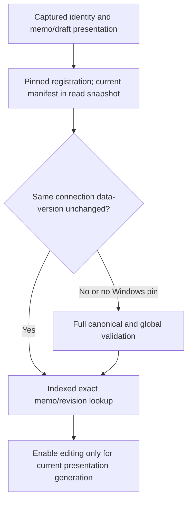
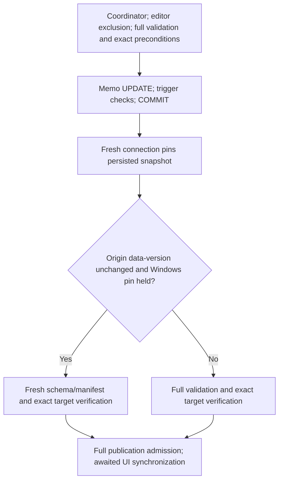

# V2 Gate5D — memo lifecycle performance

**Date:** 2026-10-23. **Status:** scoped implementation, calibration and automated verification complete; user-operated Debug acceptance pending. Prior Gate5B/5C work preserved. No schema/D1–D8 changes, real-package/source writes or Git mutations.

## Confirmed costs and scope

The baseline re-admitted and hashed the database for each revision read/native lookup; first selection also admitted a writer. At100k, warm selection spent318–343ms in full validation and54–59ms hashing; its exact memo query took0.11–0.20ms. Saves performed three full validations: transaction, fresh verification and publication admission. UPDATE/COMMIT usually took milliseconds, although one1M UPDATE outlier exceeded100ms. The1.5-second debounce is separate from revision loading. Original Unity-source SHA is captured during initial loading, not recalculated per selection.

Loaded memo/draft text was already presented synchronously while revision readiness kept editing disabled. Gate5D removes redundant authorization delay, not a nonexistent text-loading delay. Existing unsaved drafts take precedence; displayed text alone never authorizes a save. [Gate5C](package-format-v2-gate-05c-memo-integration.md) remains the identity/transaction foundation.

## Calibration and instrumentation

[MemoTrace](../../UABS.UnityAssets/Packages/Memos/MemoTrace.cs) is opt-in, with no activity allocation without listeners and no memo/path/identity payload. It distinguishes identity, selection, basis, hashing/physical identity, admission, schema/global validation, coordinator wait, transaction opening, exact target lookup, UPDATE, COMMIT, fresh verification, debounce and publication/dispatch. Durations are inclusive/nested, not additive exclusive CPU costs. Canceled Save Now timers produce short debounce spans, not a1.5-second delay.

The [lifecycle helper](../../UABS.UnityAssets.Tests/V2MemoLifecycleMeasurements.cs) creates equivalent disposable10k/100k/1M packages. Each fresh process records cold admission/selection, three subsequent selections, three Save Now attempts, one real auto-save completion, allocations and surviving managed-memory delta. Names, signed IDs, unknown Class IDs and initial nullable memo distribution are equivalent; UUIDs are independently generated. No arbitrary concurrency sleeps or timing assertions.

External runner mode: memo-lifecycle &lt;count&gt; &lt;baseline|optimized&gt;. Six raw gate5d-{baseline|optimized}-{count}.jsonl logs are retained in the task scratch directory; owned databases were disposed. **Real OWL performance is unverified.** These are service/presentation-model measurements using inline publication dispatch, not rendered UI or actual dispatcher latency. Actual headless TextBox binding/eligibility is separately tested. Genuine native linkage remains integration-tested; native filesystem selection/legacy ambiguity scanning and initial source hashing were not separately calibrated.

Only three warm samples support medians/ranges, not p95/universal guarantees. One optimized1M save overlapped a1.82-second incremental solution build: large-package timings are not isolated-system measurements. No million-row rerun was made merely to polish numbers. The final cleanup-error handling amendment does not change the measured SQL/admission path.

| Assets | Cold admission before → after | Cold selection after admission | Warm revision-ready median | Save Now median,3 attempts | Auto-save including debounce,1 attempt |
| --- | --- | --- | --- | --- | --- |
|10k|63.35 →46.99ms|90.11 →15.36ms|45.58 →0.92ms|151.05 →95.01ms|1638.26 →1620.72ms|
|100k|444.75 →421.78ms|774.30 →15.58ms|393.85 →0.78ms|1310.55 →897.68ms|2791.89 →2430.88ms|
|1M|3695.05 →3597.52ms|7182.66 →16.78ms|3829.37 →0.87ms|12597.37 →9340.29ms|14015.07 →10375.17ms|

Authoritative basis warm medians after optimization are0.63/0.44/0.72ms. Warm model-visible text was already0.02–0.05ms; first JIT/presentation6–8ms. Exact memo queries are roughly0.04–0.23ms; indexed identity usually takes microseconds. The first save now includes lazy writer admission:149.70/1290.21/12328.91ms. That cost previously occurred during selection; first-save latency has **not** materially improved. Warm saves perform two full validations instead of three; first admission or an intervening external commit can require a third.

Fresh verification now typically takes3–4ms. Publication remains356–383ms at100k and3.6–3.8s at1M, because its full admission/hashes remain. Auto-save retains the1.5-second quiet period. These are observed costs, not guarantees.

| Assets | Warm-read allocated bytes, median before → after | Save allocated bytes, median before → after |
| --- | --- | --- |
|10k|4,093,856 →8,184|11,948,944 →8,660,464|
|100k|32,201,600 →8,184|96,266,984 →64,721,632|
|1M|314,800,704 →8,144|944,066,240 →629,927,360|

Allocation counters include all managed allocations during the operation, including diagnostics. Surviving workflow deltas were roughly69–102KiB before and93–113KiB after. Fixture memory was allocated before that baseline. Native SQLite caches, GPU/UI/process peak and production leak testing are excluded; modeled dispatcher notifications can remain queued, so these are not precise production retained-memory figures.

## Read admission and invalidation

[PackageReader](../../UABS.PackageV2/PackageReader.cs) exposes opt-in memo reuse. Windows registration/publication retains a read handle denying rename/delete and the same read-only SQLite connection; a data-version is recorded after full canonical admission. Each current memo read starts a transaction, pins its snapshot through the manifest query, verifies the captured package/generation and checks that connection's data-version. External commits, including catalog/memo/schema changes, force full integrity/FK/global-semantic/derived validation within the snapshot before exact lookup. Errors invalidate reuse. Unknown writable profiles are refused. Normal metadata browsing retains its frozen revision/paging rules.

Unload cancels/drains reads and disposes connection/pins; reopen has a new epoch/admission, never an old draft target. [V2BrowseCatalog](../../UABS/Script/Services/V2BrowseCatalog.cs) also checks physical Windows file identity, not pathname equality. Location-only checks no longer hash every byte. Native linkage still requires captured source hash/path/logical evidence plus a unique signed-ID occurrence. Non-Windows/non-pinned reads retain full-validation fallback.

[SQLite data-version semantics](https://www.sqlite.org/pragma.html#pragma_data_version) permit comparison only on the same connection: other-connection commits change the token; own commits do not. No token comparison across connections, TTL, durable revision or content-authenticity claim. Hostile raw-byte writes, namespace/counter ABA and broken filesystems remain unsupported; detected corruption/schema/semantic failures reject reads/writes. Full admission and transaction validation are not globally disabled.

The shared presenter displays existing memo/draft text immediately, cancels superseded revision loads and uses presentation generations. Editing remains unavailable until exact authoritative readiness. Modified filesystem/SQLite paths use asynchronous worker work, not added synchronous UI I/O waits. One coordinator still owns debounce, Save Now/Retry, navigation flush and failed drafts.

## Attempt-local save reuse

[V2MemoPersistenceService](../../UABS.PackageV2/Memos/V2MemoPersistenceService.cs) still takes the shared coordinator, excludes clean/dirty editors and fully validates inside BEGIN IMMEDIATE. Generation/addressability, expected nullable original value, memo revision and optional catalog precondition are fresh transaction-local checks. Conditional UPDATE, trigger counter SELECT, FULL-sync commit/rollback and cancellation boundaries remain.

Only the duplicate global post-commit scan is conditionally reused. The validated origin connection remains open for this attempt under a Windows file pin. A fresh verification connection pins its persisted read snapshot **before** comparing the origin's data-version. With unchanged external state, the sole committed mutation since validation is the canonical memo UPDATE; fresh schema/manifest and exact persisted value/revisions are still checked. Any intervening external commit takes full validation. This ordering uses [SQLite isolation](https://www.sqlite.org/isolation.html), not UI snapshots. No long-lived writer admission cache exists.

Publication retains full re-admission, exact supersession checks and awaited dispatcher synchronization under coordination. Exact matching rows update in place; Search becomes stale without rerunning. Old completions cannot replace newer drafts. Verification/publication/commit uncertainty retains text. Cleanup failure is structured with the known commit state, never misreported as a pre-commit rollback. SQLite owns journal cleanup.

Transaction validation and publication global scans deliberately remain. Removing them needs a wider trust/admission design; saving is **still O(package size)**. Provisional engineering budgets for this machine: warm admitted revision readiness below10ms and warm100k saves around1s;1M saving still needs work. These are calibration targets, not portable guarantees or timing-test thresholds.

## Verification and files

- Debug startup/runner builds0 warnings/errors. Final new [performance tests](../../UABS.UnityAssets.Tests/V2MemoPerformanceTests.cs):10/10 (1.11s). Existing production integration23/23 (2.11s). Final standard **in-process xUnit649 passed,1 existing permission skip,0 failed** (650 cases,51.93s), including V1/Gate4/5C regressions. Not VSTest; transport restrictions were not retried.
- Deterministic new coverage: warm reuse, exact identity, nullable/empty/Unicode/catalog changes, external schema/derived/generation rejection, Windows replacement prevention/pin release, fresh verification/full fallback, committed corruption failure, canceled/stale loads, actual headless input visibility/eligibility/draft precedence and unload mid-lookup. Existing integration covers shared native/indexed Assets/Search, conflicts, editor exclusion, commit cancellation and verified synchronization.
- Initial Debug DLL locks caused MSB3027/MSB3021; user closed UABS normally before successful rebuilding. A resumed turn's missing scoped filesystem access caused reference-resolution failures, resolved through the normal grant without changing project paths. No process termination, Release substitute, security bypass or desktop control.
- Core/library files: new MemoTrace.cs; trace-only MemoDraftCoordinator.cs change; PackageReader.cs, StorageSql.cs, Memos/V2MemoPersistenceService.cs. App: InspectorMemoService.cs, V2BrowseCatalog.cs, EditableMemoInspectorViewModel.cs. Tests/diagnostics: new V2MemoPerformanceTests.cs and V2MemoLifecycleMeasurements.cs. Documentation: this report, index, UI workflow and handoff. Prior Gate5B/5C files remain intact.
- Canonical DDL, zero-Unity, genuine fixture hashes and final Git/document/protected-path evidence are recorded in the handoff. No package schema, V1 transaction, source bundle, real package or legacy Unity writes; no staging/commits/reset/clean/branch operations.

## Manual Debug acceptance and limits

Use current E:\Projects\UABS\Avalonia\UABS\bin\Debug\net9.0\UABS.exe with a **disposable package copy**:

1. Browse indexed Assets/Search and native Navigator matches. Check immediate memo/draft text and prompt revision eligibility after admission.
2. Switch rapidly between assets/workspaces. Confirm no memo leakage, shared drafts and retained failed/conflicted text.
3. Use Save Now/debounce. Confirm exact row updates, retained selection/criteria and explicit Refresh Search with invalidated paging.
4. Verify ordinary V1 saving and clean/dirty editor exclusion. Do external-edit conflict checks only on disposable copies; never blindly overwrite newer text.
5. Expect first registration/save and large saves to remain slower. Save explicitly before exiting; shutdown/crash recovery remains deferred.

No rendered desktop, production OWL, power-loss/disk-fault, broad RID/cross-process or persistent-draft recovery acceptance. No new Unity-exclusive decisions. No structural V2 editor saving, migration, reindexing or deferred Stage7 work. Suggested commit: perf(memos): optimize V2 memo loading and transactional saves.
