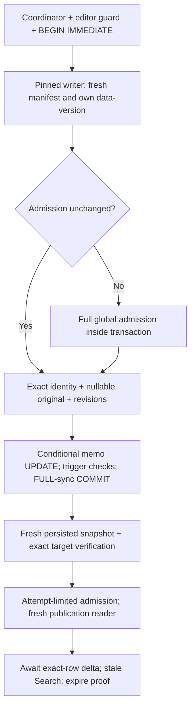

# V2 Gate5E — transactional memo-save performance

**Date:** 2026-10-23. **Baseline:** clean committed `3491933` (Gate5D). **Status:** scoped implementation and automated verification complete; recommend isolated checkpoint acceptance with the limitations below. User-operated Debug visual acceptance remains pending. No real packages or Unity sources used for writing.

## Confirmed bottleneck

The production Save Now path, not a direct SQL benchmark, was profiled using disposable equivalent10k/100k/1M fixtures. Additional spans separate canonical schema/manifest, quick-check, foreign keys, global semantic and derived-text validation. Existing spans cover coordinator wait, registration, physical identity/hashes, transaction acquisition, exact target lookup, update, commit, fresh verification and publication. Original nullable comparison and AFTER-trigger counter checking now have dedicated spans. UPDATE timing includes canonical trigger execution; its internal SQLite trigger statements are not separately timed.

At100k, baseline warm validation took809–819ms while UPDATE+FULL-sync COMMIT took approximately3–5ms. First registration adds another full validation. At1M, one warm attempt spent8734ms validating:3419ms quick-check,467ms foreign keys,2360ms global semantics,2454ms derived text. Publication still hashed the complete file twice and admitted another reader. The database was not being rewritten; repeated whole-package checks dominated single-row saves.

## Admission, authorization and verification

- [Writer](../../UABS.PackageV2/Memos/V2MemoPersistenceService.cs): production opts into registration-scoped reuse on Windows only. A retained ReadWrite connection and read handle denying rename/delete are owned by that registration; neither is a live transaction between attempts. Isolated/default callers remain conservative. Full admission is required initially.
- Each save takes the original shared path coordinator and editor exclusion, begins IMMEDIATE, checks DELETE journal mode, then reads the canonical schema/manifest to pin its transaction snapshot. Reuse requires that same writer connection's data-version and its admitted catalog revision to match. Other-connection commits invalidate reuse, even if they did not update catalog counters. Full canonical/quick-check/FK/semantic/derived validation is performed in the locked transaction on invalidation; failed attempts invalidate the cache.
- Every attempt still resolves the full immutable package/generation/source UUID/revision/original directory ordinal/signed Path ID and unique addressability. Expected nullable original, memo revision and optional strict catalog precondition remain fresh transaction-local conditions. Only memo changes; canonical triggers/counters are verified. No UI snapshot authorizes a write. Unknown Class IDs remain eligible.
- [Attempt proof](../../UABS.PackageV2/Memos/MemoAdmissionProof.cs) is created only by the writer after its canonical commit. A fresh verification connection pins its persisted read snapshot **before** consulting the origin connection's data-version. With no intervening external commit and a Windows pin, bounded canonical schema/manifest and exact persisted-target verification reuse the global admission. External commits force full validation. This does not compare tokens across connections.
- Verified publication opens another fresh read-only [reader](../../UABS.PackageV2/PackageReader.cs) using the same attempt-limited proof. Proof use is serialized; expiry drains any active reader before the coordinator releases or origin connection is reused/disposed, including detached caller work. Caller-created or expired deltas cannot skip admission. A publication reader records its **own** connection token inside its admitted snapshot. Exact persisted memo/revision/catalog checks, generation, physical location and unchanged reader admission are required before replacing browse-reader ownership.
- [Catalog](../../UABS/Script/Services/V2BrowseCatalog.cs) preserves visible rows/selection. Published paging uses an immutable same-connection admission token before/after reads, independent of the memo-read refresh token. Thus even a later valid memo refresh cannot hide a structural external change with unchanged catalog counters. Ordinary pre-publication admission keeps its original evidence checks. Non-Windows publication retains full admission/hashing fallback.
- [Facade](../../UABS/Script/Services/InspectorMemoService.cs) still awaits dispatcher publication. All exact Search/Assets rows and shared Inspector drafts synchronize; Search becomes stale with explicit Refresh and no implicit rerun. No second coordinator, debounce/UI/schema/index changes or V1 writer changes.

[SQLite data-version documentation](https://www.sqlite.org/pragma.html#pragma_data_version) describes a connection-local change signal: own commits do not change it; other-connection commits do. [SQLite isolation](https://www.sqlite.org/isolation.html) supplies the transaction/snapshot boundary. Tokens are not durable content identities, hashes, TTLs or values comparable between unrelated connections.

## Invalidation, failures and limits

Unload drains the path coordinator and disposes retained connection/pin; reopen has new ownership/epoch. Ordinary Windows same-path rename/replacement is blocked while pinned, not accepted because a pathname matches. Generation mismatch fails explicitly. Detected schema/version/profile, derived-field corruption and other external writes cannot silently reuse admission. Read-only file flags are rechecked despite retaining a writable handle. Journal mode is rechecked per transaction/publication; FULL durability is unchanged.

Pre-commit cancellation rolls back. After commit begins, verification/publication completes without caller cancellation. Failed rollback/uncertain commit is not reported as rollback or success. An uncertain cached transaction discards its connection **and registration**: explicit unload/reopen/reconciliation is required, never automatic retargeting at the same path. Failed drafts remain in the original shared coordinator. SQLite owns journal cleanup.

This follows the approved ordinary SQLite-writer/local Windows threat model, not authentication against hostile raw-byte mutation, counter/namespace ABA, broken filesystems, malicious trigger bypass or arbitrary hardlink aliases. Those can bypass SQLite's change protocol and are not newly claimed detectable. Permission revocation of already-open OS handles is platform-defined; the file read-only flag is explicitly checked. Cross-platform replacement, power loss/disk-full and true hardware commit/close failures still require dedicated acceptance. No global cross-process editor lease, structural V2 editor saving, migration, Gate6 or shutdown/crash recovery.

## Calibration

Raw external scratch files: gate5e-baseline-{count}.jsonl and gate5e-optimized-{count}.jsonl. Baseline helper: [lifecycle measurements](../../UABS.UnityAssets.Tests/V2MemoLifecycleMeasurements.cs). Extended optimized helper: [save measurements](../../UABS.UnityAssets.Tests/V2MemoSaveMeasurements.cs), through the actual facade/shared draft coordinator/Inspector Save Now. No real package or direct-UPDATE-only save benchmark. External mutation setup alone uses fixture SQL. Auto-save delay is disabled only in the explicit Save Now measurement helper, not production.

Sequential fresh-process equivalent fixtures, same machine/runtime and metadata generator; no overlapping build during either calibration. Baseline cold and first-save are single observations, warm baseline median uses2 attempts after first registration. Optimized cold/first/second are single observations; warm median uses4 additional attempts. These are model/inline-dispatch observations, not rendered UI, real OWL, p95 or portable guarantees. Final bounded DELETE-mode rechecks and proof-expiry synchronization were added after the three-size calibration; they do not change its validation/update algorithm, but their extra bounded cost is not included in that table. A final current-source10k production-path rerun confirms first94.89ms, second14.01ms and warm median12.52ms (12.32–13.39), with no global warm-validation spans. No million-row rerun merely to polish results.

| Assets | Cold browse admission before → after | First Save Now before → after | Baseline warm median | Optimized second save | Optimized warm median (range) |
| --- | --- | --- | --- | --- | --- |
|10k|57.66 →49.10ms|173.72 →95.88ms|110.94ms|13.61ms|11.77ms (11.18–12.41) |
|100k|383.77 →392.41ms|1256.65 →539.62ms|859.93ms|10.46ms|10.17ms (9.36–13.81) |
|1M|3577.81 →3478.88ms|12320.93 →5365.24ms|9117.59ms|11.26ms|10.03ms (9.59–10.37) |

Cold admission still performs all global checks; no admission-speed improvement is claimed. First save pays its separate writer admission. Repeated saves show zero full-validation or package-hash spans,3 bounded schema/manifest checks, one fresh persisted verification and one fresh publication reader. Median warm phase times below are inclusive/overlapping (schema participates in verification/publication), not additive independent totals.

| Assets | UPDATE including triggers | FULL-sync COMMIT | Three schema/manifest checks | Fresh target verification | Publication |
| --- | --- | --- | --- | --- | --- |
|10k|0.71ms|2.05ms|3.71ms|3.13ms|3.41ms|
|100k|0.56ms|2.29ms|2.36ms|2.51ms|2.51ms|
|1M|0.69ms|2.12ms|2.45ms|2.55ms|2.64ms|

| Assets | After another same-owner in-process memo save, median3 | After external SQLite-connection write, median3 | Explicit replacement admission, median3 | First save after replacement, median3 |
| --- | --- | --- | --- | --- |
|10k|11.98ms|65.84ms|45.07ms|68.61ms|
|100k|10.00ms|540.19ms|370.81ms|523.34ms|
|1M|10.58ms|5293.68ms|3608.62ms|5015.35ms|

The in-process row uses the same production writer connection on a different asset. A different UABS writer connection invalidates admission just like any external connection; it is covered by competing-writer tests, not promised the same warm cost. External measurements update a different asset using a separate SQLite connection in the fixture process, **not a separately launched OS process**. Old whole-path invalidated timings were not separately benchmarked. Replacement measurements unload/drain all local fixture handles, rename/copy quiescent fixture bytes and explicitly re-admit with a new epoch. No live/user-package copying.

| Assets | Warm managed allocations before → after, median | Surviving managed workflow delta | Observed process peak working set |
| --- | --- | --- | --- |
|10k|8,659,944 →2,223,708B|124,680B|68,579,328B|
|100k|64,725,004 →1,753,308B|139,080B|80,904,192B|
|1M|629,926,416 →1,759,292B|119,696B|253,988,864B|

Schema signature/diagnostic allocations remain bounded but nontrivial. Managed surviving deltas exclude the already-created corpus baseline and can include queued model notifications; process peak includes fixture creation, native SQLite/runtime and the whole run, not isolated save peak or a production leak proof. Retained writer connections add per-loaded-written-package native caches/handles until unload; no per-asset cache is introduced.

Database lengths stayed2,224,128 /22,945,792 /237,584,384B across all measured saves. Sampled pre-commit journals were12,824B at each size and absent after successful completion, with no manual journal cleanup. These are logical length/boundary observations, not physical I/O/write amplification or power-loss proofs. Provisional local engineering budget: warm verified Save Now below50ms on these fixtures; first/external/replacement saves remain O(package size), with about0.6s at100k and5.5s at1M. Not hard timing tests or platform guarantees. Remaining million-row cost is full admission (quick-check/global/derived/FK scans), not the target UPDATE.

## Verification and changed files

Final Debug solution (including actual startup application, storage and tests)0 warnings/errors (11.66s); Debug measurement/test runner0 warnings/errors (4.16s). New deterministic [admission tests](../../UABS.UnityAssets.Tests/V2MemoWriteAdmissionTests.cs) **26/26** (1.60s); prior admission/performance tests **10/10** (1.13s); existing production memo integration23/23 passed earlier in this task. Final standard **in-process xUnit675 passed,1 existing permission skip,0 failed** (676 cases,54.18s), covering V1, editor lifecycle, Search exact-row/stale pagination and existing Gate4 transaction regressions. Final safety review added synchronized proof expiry/concurrent-reader coverage, justifying a current-source regression rerun; no unnecessary million-row repeat. Not VSTest; blocked transport was not retried. A continuation message expired the scoped filesystem grant; normal reauthorization fixed environment-only path/reference errors without project changes.

New tests cover first/repeated/different targets; competing same/different-asset writer connections; external memo/catalog/schema/derived/generation invalidation; missing/ambiguous identity, nullable original and revision conflicts; NULL/empty/Unicode; editor exclusion/release; pre/postcommit cancellation; expired/concurrent publication capabilities; corruption between verification/publication; stale paging even after memo refresh; queued unload; read-only/journal changes; Windows pin replacement prevention and release/re-registration. A modeled commit-start plus rollback-boundary failure proves uncertain results retire cached ownership rather than publish success; this is deterministic exception injection, **not an actual disk/commit-acknowledgment hardware fault**. Fresh verifier supersession/failure and draft/Search synchronization remain covered by the existing full suite.

Canonical DDL equals the approved design; genuine bundle/serialized fixture SHA256 values match the prior baseline. Zero-Unity checks pass for all3 app assemblies and Debug output. Protected legacy tree, V1 package writer, builder, extraction, canonical schema/design and fixtures are unchanged.14 documents/174 local links/anchors/fences pass;18 Mermaid blocks syntax-reviewed, not rendered. All12 scoped files pass staged/unstaged/new-file whitespace/conflict/control-character checks; index empty. All edits are unstaged/untracked; no commits or destructive Git operations.

Source: MemoContracts.cs, V2MemoPersistenceService.cs, new MemoAdmissionProof.cs, PackageReader.cs, StorageSql.cs; production InspectorMemoService.cs and V2BrowseCatalog.cs. New tests/calibration: V2MemoWriteAdmissionTests.cs and V2MemoSaveMeasurements.cs. Documentation: this report, index and handoff. Canonical DDL/triggers/user_version, V1 persistence, extraction, actual XAML, real packages, original fixtures and legacy Unity files must remain unchanged.

## User-operated Debug acceptance

Use E:\Projects\UABS\Avalonia\UABS\bin\Debug\net9.0\UABS.exe with disposable package copies only:

1. Compare first save with repeated Save Now on the same/different assets; verify Unicode and clearing memos.
2. Switch Assets/Search during saves: shared drafts, exact rows, selection/scroll/criteria retention, stale paging and explicit Refresh must remain.
3. Check1.5-second auto-save, Save Now/Retry, navigation flush and ordinary V1/editor exclusion. Do not expect shutdown/crash recovery.
4. On disposable copies, change a memo externally and confirm conflicts retain text rather than overwrite it. Unload before intentional replacement and reopen explicitly; old drafts must not retarget.

No desktop automation or visual observation performed. **Unity-exclusive features requiring decisions:** no new findings. Suggested commit: `perf(memos): reduce V2 transactional memo save latency`.
