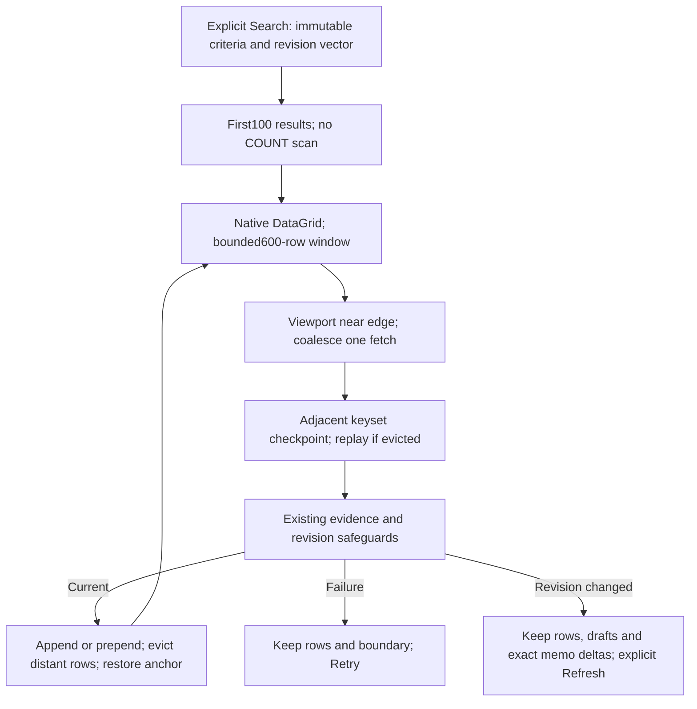

# V2 Gate5F — bounded infinite Search scrolling

**Date:** 2026-10-23. **Baseline:** clean `7558935` (committed Gate5E). **Status:** implemented, Debug-buildable and regression-verified. Ready for review/commit as a bounded-window functional checkpoint; not full Gate5F performance/manual acceptance. Smooth million-asset scrolling remains unproven and the measured page latency is a significant limitation.

## Implemented architecture

[V2SearchWindow](../../UABS/Script/ViewModels/V2SearchWindow.cs) wraps the existing immutable Gate3 keyset session. Internal requests remain100 results (engine maximum500 unchanged). The existing [Search ViewModel](../../UABS/Script/ViewModels/SearchWorkspaceViewModel.cs) and [DataGrid](../../UABS/Script/View/Pages/SearchWorkspaceView.axaml) retain one stable observable sliding collection, not all matches and not an invented million-row list.

- Publish at most600 rows (six pages). At most700 briefly coexist during an adjacent insertion/eviction, plus one separately selected row and at most128 lightweight opaque cursor checkpoints (cursor memos are stripped by the engine). Each engine request/worker remains bounded; no unbounded task or connection per result. DataGrid may maintain another bounded reference list; visual virtualization alone is not the memory bound.
- Prefetch within20 rows of either window edge using actual rendered-row geometry and native scrollbar notifications. Repeated requests coalesce behind one page fetch. A direction change cancels obsolete work; new Search, scope/unload and navigation guards reject old completions. Failure retains the current collection/checkpoint boundary and exposes **Retry loading**, never false exhaustion.
- Forward pages append and evict full leading pages; backward pages prepend and evict far trailing rows. Global positions are the actual displayed range plus discovered-at-least/exhausted-exact counts. The native scrollbar represents the **current window**, not a fabricated total. There is no arbitrary jump to an unknown/unseen global result.
- Checkpoints retain starts of actual emitted pages. At128 entries, spacing is compacted by powers of two while preserving the origin and a dense neighborhood around the live window. Missing older boundaries replay from the nearest earlier checkpoint in the **same session**, retaining only the requested page. No new Search admission, OFFSET or materialized prefix. Very deep backward replay can require multiple serial queries; that is an explicit bounded-memory/latency tradeoff, not true random access or constant-time history.
- Selection remains keyed by full occurrence and registration/location provenance, independent of the bounded collection. One selected row/Inspector/draft can remain outside the window; an explicit label explains this. Returning to its window reuses that row identity. Drafts remain owned by the original shared coordinator, not a page cache.
- The View captures the first visible immutable row/pixel anchor before changes and restores after publication layout. Native DataGrid may already preserve realized anchors; do not unnecessarily call ScrollIntoView on a partially visible row. Scrollbar Value alone moves its thumb, not DataGrid rows; fallback pixel correction uses the installed11.3.3 rows presenter's native DIP scroll-gesture route, not private reflection offsets, drag code or a new template. Hidden recycled row visuals are excluded from anchor lookup. Headless forward/backward tests preserve the same partial-row identity and Y position within1DIP, in light/dark themes and two window heights. An explicit replacement session invalidates queued old anchor restoration.
- V2 local fragment sorting is disabled to prevent a sorted600-row fragment masquerading as global order. The unchanged engine supplies deterministic global ordering. V1's local grid sorting remains available. A new server-side sorting UI is not introduced here.

## Refresh policy and D5 decision

Approved [D5 and section7.3](../03_design/package-format-v2-design.md#73-changes-counts-and-cancellation) explicitly require retention of old membership/order and **explicit Refresh Search** after memo/catalog changes, with no silent renewal or newer-revision append. Gate5F does not override that policy, even when a particular name-only query might be unaffected by a memo change.

Verified memo publication still updates all exact matching retained rows and the separately retained selection, without changing collection identity, criteria, ordering or scroll. Older cursors become unusable; uncached backward replay is also blocked because it would query a newer revision. The stale message explains that saved memos are visible and the user can Refresh when ready. No per-keystroke, per-save or background automatic Search rebuild, so active/failed drafts cannot be silently replaced.

**Proposal requiring separate approval:** permit a debounced session/cursor rebase only when a verified memo-only delta demonstrably cannot affect membership/ties, all selected generations/external evidence still match, no draft is actively being edited, and an exact anchor can be retained. Queries using memo matching/nonblank filtering require a separately approved non-disruptive refresh/selection policy. Existing opaque session-bound cursors cannot simply be reused with a new session. No such rebase/automatic-refresh API is implemented or implied accepted here.

## Automated verification

Sequential current-source `dotnet build Avalonia.sln -c Debug --no-restore -m:1 -nr:false --verbosity quiet` includes the actual startup application:0 warnings/errors (32.96s, then6.72s after a test-only correction). External standard in-process xUnit runner also builds0 warnings/errors. Controller7/7, actual headless viewport7/7 (final2.90s), existing Search18/18 (final2.87s) and existing memo integration23/23 pass. Final full standard in-process xUnit: **689 passed,1 existing permission-related skip,0 failures** (690 cases,63.29s). Baseline was675 passed/1 skipped;14 new cases. The unchanged skipped CreateHardLink fixture requires an authorized host. These are not VSTest results; known VSTest transport restrictions were not retried/bypassed.

The first full run discovered one timing-sensitive old test: manual continuation while an attached grid remained at the top could correctly cancel the obsolete forward load. Page-order/uniqueness assertions now run before attaching the view, retaining every assertion and adding explicit error checks; actual viewport triggering and cancellation remain tested separately. No production safety check was weakened to satisfy this test.

New deterministic coverage includes350-page forward/backward replay with compacted checkpoints and exact global order; unknown/exhausted counts; serialized/wait-cancellable fetches; actual realized-row bounds, partial-row anchors and retained selection; rapid coalescing/direction changes; Retry/exhaustion; navigation/unload; late old-session completion; and shared memo drafts, verified exact-row updates and stale cursors. Tests use disposable databases, controlled completion signals and no arbitrary sleeps. Headless layout is not desktop visual observation.

New [calibration helper](../../UABS.UnityAssets.Tests/V2SearchScrollMeasurements.cs) uses disposable packages, the production operation/ViewModel/shared memo coordinator, sequential forward/backward loads, memo save, explicit Refresh, cancellation/restart and unload. Model/inline dispatcher timings are not visual paint or production OWL measurements. No real Unity source is opened during metadata Search.

## Disposable calibration and performance limitation

One completed run per size; fixture creation excluded from operation timings. First results include explicit Search admission and first100 rows, after separate browse admission. No completed benchmark was rerun. Raw external `gate5f-scroll-{10000|100000|1000000}.jsonl` logs are retained outside the repository.

| Measurement |10k assets|100k assets|1M assets|
|---|---:|---:|---:|
| Browse admission, ms |55.75|434.82|3524.23|
| First results, model ms |124.52|640.60|5581.66|
| Forward loads sampled |80|140|12|
| Forward median (range), ms |33.97 (28.69–49.47)|228.71 (219.81–261.46)|2269.73 (2238.38–2533.42)|
| Backward loads sampled |12|12|7|
| Backward median (range), ms |29.69 (23.79–34.62)|225.46 (220.08–246.91)|2281.75 (2078.84–2323.27)|
| Forward median allocated bytes |6,463,572|52,502,016|504,664,192|
| Peak cursor checkpoints |82|128|14|
| Process lifetime peak bytes |71,352,320|77,352,960|258,359,296|
| Managed retained delta after unload, bytes |853,104|879,048|829,240|
| Memo Save Now/stale publication, ms |79.35|656.38|5244.72|
| Explicit Refresh, ms |58.34|610.11|5564.84|
| Cancel scroll / exact-query restart, ms |26.73 /43.59|218.93 /501.38|2165.75 /4513.15|
| Unload during scroll, ms |31.25|222.43|2124.19|

All runs retained at most600 published ViewModels and700 temporarily during insertion/eviction, plus the separately selected occurrence. These are row-count bounds, not constant bytes regardless of memo/string lengths. One raw fetched page and engine candidate/text buffers also exist transiently. Process peak includes fixture construction, runtime/native SQLite and all later operations; retained delta is after cleanup relative to a live initial window, not a leak proof or peak live-cache measurement. Allocation is process-wide managed churn per operation, not retained memory. No renderer/OS handle profiler, hardware durability or real-corpus latency claim is made.

One foreground window fetch is admitted at a time. The single-package runs measured engine peak workers1 and active workers0 after each operation; engine default worker cap2 and package-scope cap128 remain unchanged. Worker connections are scoped/disposed per phase, not retained in cursors. Admitted browse and lazy memo-writer connections are separately owned by their registration; measured worker counters are not an OS-wide connection count. Multi-package correctness remains covered by existing federation tests, not by these single-package timings.

**The million-row result is not smooth-scrolling acceptance:** about2.27s per fetched page and approximately505MB of managed allocation churn can cause noticeable gaps despite background execution and bounded retained rows. The100k measurement reached14,100 discovered rows and exercised checkpoint compaction;1M intentionally sampled only1,300 discovered rows, not the whole result set. The350-page controller test, not the1M fixture, exercises deep compacted backward replay. V1 still materializes its results; reproducing that unbounded strategy is not an acceptable optimization.

Read-only trace explains the remaining package-scale work, without claiming phase-level measured attribution: [V2SearchOperation.ReadPageAsync](../../UABS/Script/Services/V2SearchOperation.cs) calls full-file `CheckEvidenceAsync` before/after every page; [EvidenceAsync](../../UABS/Script/Services/V2BrowseCatalog.cs) defaults to SHA256 of the complete database. The unchanged [SearchQuery](../../UABS.PackageV2/Search/SearchQuery.cs) executes managed OrdinalIgnoreCase matching/key comparisons and `ORDER BY ... LIMIT` under keyset predicates; bounded emitted rows do not imply bounded candidates scanned or collation allocations. The [engine](../../UABS.PackageV2/Search/V2SearchService.cs) additionally verifies revisions within transactions and before publication, and hydrates only emitted memos. No unsafe admission cache, weaker Unicode order or skipped external-change check was introduced. A separately scoped evidence/query profiling and optimization follow-up is recommended before claiming large-corpus smoothness; deep backward gaps compound these serial-query costs.

## Scope and safety

Files: new V2SearchWindow.cs, V2SearchWindowTests.cs, V2SearchInfiniteScrollTests.cs, V2SearchScrollMeasurements.cs; SearchWorkspaceViewModel.cs, SearchWorkspaceView.axaml/.cs and V2SearchIntegrationTests.cs; this report, UI workflow/index and handoff. Core V1/SQLite engine/schema/identity/writer behavior stays unchanged.

Final canonical DDL equality, three-assembly/recursive Debug-output zero-Unity audit and both genuine fixture SHA256 checks pass. Legacy Unity, V1 core, entire V2 storage/Search engine/writer/schema, approved design and fixtures have no Git differences. No real OWL package or source was written; only disposable test/calibration packages were used. Staged and unstaged whitespace checks plus all12 changed/new files' conflict/control-character/trailing-whitespace scans pass; index remains empty. Fifteen relevant documents/186 local links and anchors have balanced fences;19 Mermaid blocks include one new syntax-reviewed flowchart, not renderer-tested. No stage/commit/reset/clean/branch/config changes, process termination, desktop control or screenshots.

**Continuation:** use the current Debug for user-operated acceptance below. Before full large-corpus acceptance, profile per-page evidence hashing versus managed predicate/collation costs and design a separately verified optimization without relaxing external-change or D5 guarantees. Do not restart this implementation or repeat completed million-row measurements without a changed hypothesis. No source file is half-implemented or known failing; the worktree is safe to review/commit with the documented performance caveat. Gate6 and other deferred features remain unauthorized.

## User-operated Debug acceptance

Use E:\Projects\UABS\Avalonia\UABS\bin\Debug\net9.0\UABS.exe with disposable packages:

1. Search many assets; scroll across several windows without a Next button. Check prefetch, backward reload and stable visible text, including partial rows and rapid reversals.
2. Select/edit a memo, scroll its row out of the window and back. Inspector/draft/selection must remain tied to the original asset. Save should update exact rows, mark stale and retain position; Refresh remains explicit.
3. Check Retry on a recoverable failure, cancellation/new Search and unload. No gaps/duplicates, false end-of-results or old completions. Verify V1 Search and its sorting remain unchanged.
4. Check light/dark zebra, selection/hover/focus, Kind52/min0/max80 resizing/restoration and independent Search panels. Native scrollbars describe the sliding window; count labels describe actual visited/exhausted results.

No desktop automation/screenshots or actual visual acceptance. Real-corpus/RID/very-deep replay latency remains unverified until separately tested. No V1 retirement, structural editor saving, schema changes, migration or shutdown/crash recovery. **Unity-exclusive features requiring decisions:** no new findings.

Suggested commit: `feat(search): add bounded infinite scrolling for V2 results`.
