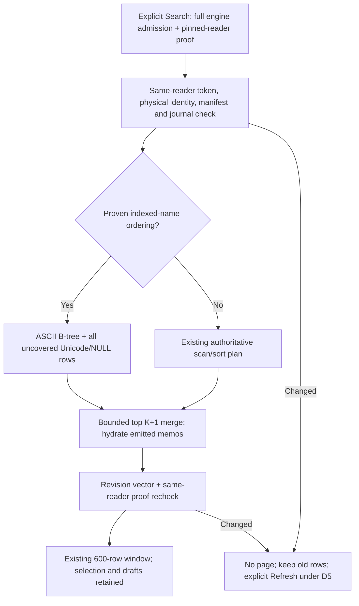

# V2 Gate5G — Search paging performance

**Date:** 2026-10-23. **Baseline:** clean committed `b08a8f6` (Gate5F). **Status:** scoped implementation, calibration and automated verification complete; ready for review/commit as an optimization checkpoint. User Debug acceptance remains pending. No canonical schema or memo-writer change. Targeted synthetic paging improvement, not universal or real-OWL performance acceptance.

## Confirmed baseline

Opt-in [SearchTrace](../../UABS.PackageV2/Search/SearchTrace.cs) and [disposable production-model calibration](../../UABS.UnityAssets.Tests/V2SearchPagingMeasurements.cs) separate admission, existing full-validation/hash spans, connection setup, candidate SQL, emitted-row mapping/federation, memo hydration, vector recheck and collection publication. Managed predicate/comparison counts and callback-body time are aggregated, not an activity per evaluated candidate. Timings are inclusive/overlapping: callback time is inside SQL and row mapping/merge inside candidate iteration. Native/provider decoding and string conversion are not individually profiled; callback-body CPU excludes those costs. No paths, criteria or memos are emitted by tracing. With no listener, no Activity is allocated.

Equivalent deterministic Gate5F single-source synthetic fixtures at10k/100k/1M; same machine/runtime, Debug,100-row pages, two-worker default. Three measured samples for explicit first Search, warm continuation, deep continuation, backward checkpoint replay and Refresh; one browse/external invalidation observation. First Search is after browse admission, not disk-cold. Deep samples are pages9–11, not full million-row traversal. External SQLite mutation is a separate connection in the fixture process. Model/inline dispatcher timings are not desktop paint. Raw external `gate5g-baseline-{count}.jsonl` logs are retained; all three completed, do not rerun blindly.

| Baseline median, ms |10k|100k|1M|
|---|---:|---:|---:|
| First Search including admission |74.29|612.71|5601.17|
| Warm next page |35.87|249.44|2534.25|
| Deep forward |35.86|244.84|2355.43|
| Backward after eviction |35.40|262.96|2316.54|
| Explicit Refresh after external memo |70.74|576.88|5560.32|
| Warm managed allocation, bytes |5,695,000|51,052,064|504,656,288|

Representative100k warm page:247.55ms total,32.78ms two full hashes,206.98ms candidate query,1.26ms three connection opens,0.31ms emitted row mapping,0.29ms merge,0.53ms memo hydration,1.52ms vector validation and0.29ms collection publication. It invokes100,101 predicates and200,312 text comparisons. Callback bodies consume only6.69/11.75ms; repeated provider conversions/native scanning/sorting account for much of the query remainder, not UI collection work. At1M, representative hashing344.05ms/query2181.19ms;1,000,101 predicate/2,000,312 comparisons. No full schema admission occurs in ordinary baseline page reads; full admission is per explicit Search.

## Implemented admission and query changes

- Immutable [reader admission](../../UABS.PackageV2/PackageReader.cs) reuses the **existing pinned browse-reader connection**, not a new connection per package/cursor or a global pathname cache. Its own data-version is read inside a snapshot pinned by a real manifest SELECT, with DELETE-journal and fresh package/generation/catalog checks. Every other-connection commit invalidates the old token, including writes not updating catalog counters. Explicit capture after a change performs full canonical validation; old tokens never inherit that renewal. Search admission metadata is separate from memo-read admission and does not mutate memo-writer authorization. Tokens own no extra connection or long read transaction. Unpinned/non-Windows readers retain conservative hash fallback. Production still performs full engine admission per explicit Search.
- [Production operation](../../UABS/Script/Services/V2SearchOperation.cs) captures that admission, verifies matching catalog on engine registration and checks before/after each page and on return to Search. [Registration](../../UABS/Script/Services/V2BrowseCatalog.cs) checks physical file identity and lifetime under its existing read gate. Disposal of the captured reader, unload or verified publication replacing it invalidates the token; a fresh connection's token is never compared with the old connection's integer. Current package/generation/location epoch remain required. Unload owns/drains reader/pin disposal; Search only borrows the proof.
- For compatible derived profiles, asset-only PackageName ordering with exact constant source-path/index-directory levels can split into existing indexed printable-ASCII keys and all uncovered NULL-key rows. ASCII uppercase-key BINARY plus raw-name BINARY is equivalent only in that printable partition. Full authoritative predicates and lexicographic boundary checks remain; the uncovered partition uses the existing .NET collation. Both bounded topK+1 streams merge with the unchanged global comparator. Other sorts/mixed-source paths/profiles fall back. Path ID, exact asset identity, Class ID, type and Memo-only gates also retain the general planner so a forced name index cannot displace their selective plans. Existing canonical B-tree only; no persistent index/FTS/NOCASE/LIKE or schema change.
- The optional `UseIndexedAsciiPaging=false` conservative plan supports differential tests/calibration; no UI toggle is added. Gate5F window, checkpoints, selection/drafts, Retry, stale cursors and explicit D5 Refresh remain.

The ASCII branch explicitly uses existing `ix_asset_ascii_name`; inclusive uppercase-key lower bounds apply only when every preceding global sort level equals the cursor's prefix. Original case/path/kind/immutable ties still use the full continuation predicate. Different packages cannot accidentally inherit another package's name lower bound. Each disjoint partition contributes at mostK+1 candidates, sufficient for the merged topK+1. The existing bounded global set, emitted-only memo hydration, budgets, worker cap and last-emitted cursor are unchanged. No full result list or cached sorted universe is introduced.

## Before/after calibration

Same generator/criteria/counts/page size/runtime and sequential isolated process per variant/size. These are equivalent newly created databases, not byte-identical UUID/path evidence or a real-corpus benchmark. Both variants include the same opt-in tracing; counters perturb wall time and are not a production p95. Three samples produce a median/range, not reliable tail percentiles. See the recorded baseline above rather than treating historical Gate5F timings as paired causal samples.

| Median baseline → optimized |10k|100k|1M|
|---|---:|---:|---:|
| First model results including Search admission, ms |74.29 →51.57|612.71 →413.33|5601.17 →3360.32|
| Warm forward, ms |35.87 →11.27|249.44 →28.86|2534.25 →188.27|
| Forward page9–11, ms |35.86 →9.36|244.84 →25.60|2355.43 →196.77|
| Backward checkpoint, ms |35.40 →9.24|262.96 →31.20|2316.54 →178.82|
| Refresh after external memo, ms |70.74 →46.26|576.88 →360.96|5560.32 →3369.35|
| Warm managed allocations, bytes |5,695,000 →541,144|51,052,064 →541,200|504,656,288 →541,192|
| External-change rejection, one observation ms |7.11 →6.40|21.77 →6.38|178.99 →6.08|

Optimized warm ranges:9.41–11.94 /27.04–32.37 /180.29–188.43ms. Million-row paging improves about13.5x in this workload; managed churn drops about99.9%, not a claim of99.9% less process memory. Optimized process lifetime peaks65,343,488 /81,993,728 /264,400,896B still include fixture creation/admission/runtime/native SQLite, versus baseline66–265MB-scale peaks. Post-Search-retirement managed heap samples~0.90MB include the still-loaded package owner; these are not isolated peak cache measurements or proof of zero OS handles. Worker peak1 in this single-package study and0 active at every completed operation; default cap2 and temporary worker connections remain. No new persistent connection is added.

Representative optimized1M warm page:188.27ms; physical checks0.30ms, same-reader admission checks0.44ms, candidate SQL180.41ms, three connection opens1.03ms, mapping0.31ms, merge0.28ms, memo hydration0.40ms, vector1.06ms and publication0.23ms. Predicate/comparison callbacks fall from1,000,101/2,000,312 to217/106, with the same100 emitted rows. Remaining SQLite-only scanning of the uncovered partition still scales with package size. There is no claim of constant-time arbitrary Unicode sorting. Dispatcher queue wait/desktop paint are not isolated by the inline model; collection-publication spans measure model mutation only.

Initial browse admission remains essentially unchanged:55.19/421.32/3462.23ms baseline versus58.64/411.92/3490.02ms optimized (single observations). Full Search admission remains package-scale. The first Refresh after an external write must revalidate the reader **and** engine:73.81/762.13/6794.88ms optimized, versus later warmed Refresh medians above. This cold invalidation cost is intentionally visible rather than hidden by the three-sample median. A verified local writer publication supplies a newly admitted reader, but no new local memo-save timing or changed writer behavior is claimed here.

Three-size optimized runs precede the final bounded journal recheck/planner-eligibility guard. Neither changes the broad benchmark SQL or data; a final current-source10k sanity run is recorded in verification below. The1M calibration was not rerun simply to polish numbers. Raw optimized and final-safety/final-verified logs remain outside Git alongside the baseline logs. No physical cold-I/O, p95, real OWL or whole-million-result traversal claim.

**Proposed budgets, not user-approved guarantees:** on this reference broad single-source shape, warm forward/backward median≤20/50/300ms at10k/100k/1M, page100. These leave measured headroom but need more repetitions/p95 and user Debug acceptance. Initial/external readmission is explicitly outside those warm budgets. Unicode-heavy, duplicate-heavy, mixed-source, different primary sorts and selective queries need their own measurements; fallback remains correct but may still be slow. Many-source OWL packages will commonly use that fallback; do not extrapolate the13.5x result to them.

## Consistency and remaining risks

Same-connection data-version is an invalidation signal, not a portable revision or hash. Each proof remains tied to its pinned owner, captured validated package/generation/catalog and the application's registration/location lifetime. Old tokens cannot be made fresh by a new capture, memo-reader refresh or a new reader at the same path. Schema/derived/generation/journal changes reject old evidence; invalid inputs cannot obtain a fresh proof. No path-only identity or cross-connection token comparison. New registrations/readers require admission.

This uses the established Gate5D/5E ordinary SQLite-writer/local Windows threat model: no authentication against hostile raw-byte editing, malicious counter/namespace ABA, unsupported hardlink aliases or broken filesystems. A Windows pin prevents ordinary same-path rename/replacement while admitted; physical checks reject mismatched locations. Non-Windows retains full hashing, so its latency improvement is not established. Per-package short snapshots plus final vector/proof checks are not an atomic all-package snapshot; a writer can still commit after the last check and before UI observation. The next operation/verified publication invalidates it. No idle watcher, silent renewal or automatic rerun is added.

Gate5F600-row/128-checkpoint retention and exact selected identity/shared draft behavior remain. D5 explicitly requires Refresh after memo/catalog changes: old rows receive verified exact memo deltas, but no newer-revision page is appended. Backward checkpoint compaction still trades bounded memory for multiple replay queries; very deep replay, large source distributions and long/duplicate values are not calibrated here. Persistent sort caches or broader admission sharing would require separately proven invalidation and resource bounds, not relaxed Unicode semantics.

## Verification and scope

Final sequential `dotnet build Avalonia.sln -c Debug --no-restore -m:1 -nr:false --verbosity quiet` includes the actual startup application: **0 warnings/errors,23.68s**. External Debug verification runner also0 warnings/errors(23.70s). New focused **20/20 passed,6.03s**. Final standard in-process xUnit **709 passed,1 existing permission-related skip,0 failed** (710 cases,65.63s); baseline689 passed/1 skipped,20 new cases. Earlier705-case run passed before final planner-eligibility safeguards; current-source rerun is warranted by that safety review, not a repeated performance attempt. Existing hardlink fixture remains skipped; native permission restrictions were not bypassed. Known VSTest transport restrictions are not retried; these are standard in-process xUnit results, not VSTest. All write fixtures are disposable.

New coverage includes full ordered equality against the conservative planner for all sorts/directions, mixed-source fallback, Unicode/NULL/case/control names, exclusions/memos/numeric filters, exact federation and no duplicates; selective planner eligibility; immutable token renewal/rejection; noncatalog external writes; mutation between query/publication; schema/derived/generation/journal rejection; replacement denial, unload and new epoch/old cursor rejection. Existing engine54/54, production Search18/18 and native-headless viewport7/7 passed focused at the earlier implementation checkpoint and are included in the final full suite. Existing cancellation, budgets, V1, memo concurrency/editor guards, exact-row publication, window compaction/selection/draft/anchor tests remain passing. No arbitrary sleeps or weakened tests.

Final current-source10k sanity calibration: first47.68ms, warm13.82ms, deep11.75ms, backward11.80ms and warm allocation543,400B. One representative page records two cursor-planning spans totaling0.50ms and two admission checks totaling0.59ms. It includes the final bounded journal check inside the pinned snapshot and selective-plan guard. This is a separate sanity run, not substituted into the earlier paired table; no changed broad algorithm warrants repeating the million-row benchmark.

Canonical DDL equality, genuine fixture SHA256, three-assembly/Debug-output zero-Unity and protected-path reviews pass. Legacy Unity, V1 core, V2 memo writer/draft coordination, builder/extractor, canonical schema/design, XAML and fixtures have no changes. No real OWL/user package or source was written. Staged/unstaged whitespace and13-file new/modified scope/conflict/control/whitespace checks pass; index empty. Sixteen relevant documents/193 local links/anchors and fences pass;20 Mermaid blocks include one new syntax-reviewed flowchart, not renderer-tested. No automatic stage/commit/reset/clean/restore/branch/config changes or user-process termination.

Changed files: reader token support in PackageReader.cs; SearchContracts.cs, SearchQuery.cs, V2SearchService.cs and new SearchTrace.cs; production V2BrowseCatalog.cs, V2SearchOperation.cs and a collection-publication trace in SearchWorkspaceViewModel.cs; new V2SearchPagingPerformanceTests.cs and V2SearchPagingMeasurements.cs; this report, index and session handoff (13 files). No XAML/redesign, package schema/builder/extractor, V1 service, memo writer/draft timer/save semantics, actual package/source or legacy Unity change.

## User-operated Debug acceptance

Launch E:\Projects\UABS\Avalonia\UABS\bin\Debug\net9.0\UABS.exe with disposable package copies; close an older instance normally first.

1. Compare first admission with repeated scrolling, including forward/backward eviction, rapid reversals and Retry. No Next button, skipped/duplicated rows or selection jumps; window/count labels stay honest.
2. Check ASCII, CJK/mixed names/memos, exact/excludes, Path ID/Class ID/type/Memo-only and multiple packages. Different source paths may remain slower; no matching semantics should change.
3. Keep an edited memo selected while its row leaves/returns. Save retains drafts/selection and updates exact rows; old paging stops with explicit Refresh, no implicit Search.
4. Unload/reopen disposable packages and externally change a disposable memo. Reject old cursors/completions; preserve last rows/drafts. Verify normal V1 Search, green rows, Kind resizing/restoration and Search panels.

No desktop control/screenshots or manual visual observation. **Unity-Exclusive Features Requiring Decisions:** none new. Suggested commit: `perf(search): optimize V2 infinite-scroll paging`.
