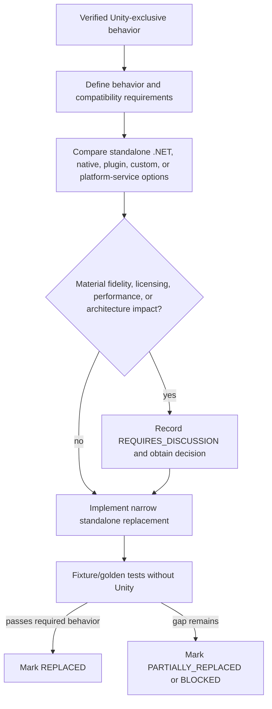

# Unity-Exclusive Features and Replacement Decisions

## Purpose and policy

This is the authoritative inventory of behavior that cannot run in the standalone Avalonia application because the legacy implementation relies on Unity Engine, Unity runtime behavior, or a Unity-bound plugin. Each finding has a stable identifier shared with any nearby Avalonia C# annotation.

AssetsTools.NET, Unity serialized-file concepts, class IDs, and asset names are not Unity-runtime dependencies. A native or managed library is classified here only when its use or deployment raises an actual Unity-runtime boundary or a replacement decision for Unity-provided behavior.

Status meanings:

- `NOT_IMPLEMENTED`: required behavior has no Avalonia implementation.
- `PARTIALLY_REPLACED`: a standalone path exists but important behavior is missing.
- `REPLACED`: verified standalone behavior exists.
- `BLOCKED`: no suitable replacement has been selected or a technical blocker remains.

## Inventory

| ID | Feature | Legacy dependency | Avalonia state | Status | Decision timing |
|---|---|---|---|---|---|
| UE-001 | Texture materialization and ETC-family decoding | `Texture2D`, `TextureFormat`, `LoadRawTextureData`, `Apply`, `GetPixels32` | No decoder/image pipeline | `BLOCKED` | Before Phase 6 decoder work |
| UE-002 | Sprite crop and square padding | `Rect`, `Texture2D`, `Color`, `Mathf`, pixel getters/setters | No neutral sprite processor | `NOT_IMPLEMENTED` | Before Phase 6 sprite work |
| UE-003 | Texture preview, cache, pan, and zoom | `RawImage`, `RectTransform`, EventSystems, `Texture2D` | No preview UI | `NOT_IMPLEMENTED` | Before Phase 7 preview work |
| UE-004 | PNG encoding during export | `Texture2D.EncodeToPNG` | No export pipeline | `NOT_IMPLEMENTED` | Before Phase 7 export work |
| UE-005 | Application lifecycle and scene-wide composition | `MonoBehaviour`, `Awake`, `FindObjectsOfType`, `GameObject` | Explicit Avalonia composition/lifetime | `REPLACED` | None; preserve boundary |
| UE-006 | Native file/folder dialogs | Unity StandaloneFileBrowser plugin | Avalonia `StorageProvider` adapter | `REPLACED` | None; preserve boundary |
| UE-007 | Package-build threading and UI completion | Raw `Thread` plus `UnityMainThreadDispatcher.Update` | Awaitable package service with cancellation/progress and staged persistence | `REPLACED` | None; preserve presentation boundary |
| UE-008 | Memo editing and debounce lifecycle | Coroutine, `WaitForSeconds`, TMP focus/events | No memo editor | `NOT_IMPLEMENTED` | Before Phase 5 memo work |

## Replacement decision flow

## UE-001 — Texture materialization and ETC-family decoding

- **Subsystem:** Texture decoding and neutral image creation.
- **Legacy source:** `Assets/Script/Reader/ImageDecoder/ImageReader.cs`; `ExtractImage` lines 156–284, especially `LoadImage` and the `IsAndroidFormat` branch; `IsAndroidFormat` lines 427–436.
- **Unity dependency:** `UnityEngine.Texture2D`, `TextureFormat`, `FilterMode`, `Color32`; `LoadRawTextureData`, `Apply`, and `GetPixels32`.
- **Why Unity is required:** For ETC, ETC2, crunched ETC, and RGBA4444 inputs, the legacy code asks Unity to interpret compressed/native texture bytes and return RGBA pixels. It also materializes all decoded output as a Unity texture object.
- **Existing Avalonia implementation:** None. Milestones 1–2 enumerate metadata only.
- **Behavior to preserve:** Correct per-format pixel output, dimensions, alpha, orientation, point-sampling intent, explicit unsupported-format errors, and bounded/cancellable memory use.
- **Migration status:** `BLOCKED`.
- **Replacement:** `REQUIRES_DISCUSSION`.
- **Candidate categories:** Standalone managed texture decoder; cross-platform native codec with RID-specific packaging; external standalone plugin; custom decoder for a deliberately limited format matrix.
- **Compatibility/performance considerations:** Format/version variants, crunched formats, byte order, alpha semantics, native ABI and architecture support, redistribution license, decode throughput, peak allocation, and deterministic golden-pixel parity.
- **Open questions:** Which formats/games/platforms define the required matrix? Is native deployment acceptable? What fidelity tolerance and licensing constraints apply?

## UE-002 — Sprite crop and square padding

- **Subsystem:** Sprite and atlas extraction.
- **Legacy source:** `Assets/Script/Reader/ImageDecoder/ImageReader.cs`; `SpriteToImage` lines 38–135, `PadToSquare` lines 468–484, and `CropTexture` lines 516–538. Atlas mapping also uses `UnityEngine.Rect` through dump processors.
- **Unity dependency:** `Rect`, `Texture2D`, `Color`/`Color32`, `Mathf`, `GetPixels`, `SetPixels`, and `Apply`.
- **Why Unity is required:** The legacy pipeline performs geometry conversion and pixel cropping/padding on Unity texture objects and uses Unity rectangle/math semantics.
- **Existing Avalonia implementation:** None. AssetsTools.NET pointer/atlas concepts are documented but not migrated.
- **Behavior to preserve:** Standalone and atlas sprite bounds, clamping, alpha-preserving crop, coordinate/orientation semantics, square padding placement, cross-file references, and malformed-reference reporting.
- **Migration status:** `NOT_IMPLEMENTED`.
- **Replacement:** `REQUIRES_DISCUSSION`.
- **Candidate categories:** Neutral RGBA buffer plus custom span-based crop/pad operations; managed image library; native image library; a hybrid with custom geometry and library-backed storage.
- **Compatibility/performance considerations:** Unity bottom-left versus image-library coordinate conventions, rotated/tight-packed atlas entries, copies versus slices, large-image allocation, and library licensing.
- **Open questions:** Must tight packing/rotation ship initially? Should padding remain legacy-compatible or be preview-only? Which neutral pixel representation will UE-001 produce?

## UE-003 — Texture preview, cache, pan, and zoom

- **Subsystem:** Interactive image preview.
- **Legacy source:** `Assets/Script/Controller/TextureDisplayForBundle.cs`; `OnEvent` and `GetTextureByPathID`. `Assets/Script/View/BundleView/TextureView.cs`; `Render`. `Assets/Script/UI/BundleView/PanZoomRawImage.cs`; `OnPointerDown`, `OnDrag`, `OnScroll`, and `ClampPosition`.
- **Unity dependency:** `MonoBehaviour`, `RawImage`, `Texture2D`, `RectTransform`, `PointerEventData`, Unity EventSystems, `Vector2`/`Vector3`, and `Mathf`.
- **Why Unity is required:** Rendering, input dispatch, transform mutation, viewport bounds, and cached preview objects are Unity UI/runtime objects.
- **Existing Avalonia implementation:** None. The current details panel displays metadata only.
- **Behavior to preserve:** Cancellable selected-image rendering, point-filtered pixel inspection where appropriate, bounded cache ownership/disposal, pan/zoom limits, viewport clamping, and clear failure/unsupported states.
- **Migration status:** `NOT_IMPLEMENTED`.
- **Replacement:** `REQUIRES_DISCUSSION`.
- **Candidate categories:** Avalonia `Bitmap`/`WriteableBitmap` adapter with custom control/behavior; Skia-backed rendering; another standalone rendering control; custom canvas implementation.
- **Compatibility/performance considerations:** Bitmap lifetime and UI-thread affinity, large texture upload cost, zoom quality, cache size, GPU versus CPU rendering, cross-platform pointer behavior, and chosen library license.
- **Open questions:** Is pixel-perfect point filtering required at all zoom levels? Should preview caching be byte-, bitmap-, or session-scoped? Is a Skia-specific dependency acceptable?

## UE-004 — PNG encoding during export

- **Subsystem:** Texture/sprite export.
- **Legacy source:** `Assets/Script/Writer/Exporter/ExportTextureAsImage2Path.cs`; `ExportAssetsToPath`, especially line 47 `textureWithMeta.texture2D.EncodeToPNG()`.
- **Unity dependency:** `UnityEngine.Texture2D.EncodeToPNG`.
- **Why Unity is required:** The legacy exporter delegates PNG encoding of the Unity texture object to the engine.
- **Existing Avalonia implementation:** None; export remains disabled.
- **Behavior to preserve:** Valid deterministic PNG output, alpha, orientation/color parity, batch scope, safe filenames, collision policy, cancellation/progress, and per-item failure reporting.
- **Migration status:** `NOT_IMPLEMENTED`.
- **Replacement:** `REQUIRES_DISCUSSION`.
- **Candidate categories:** Standalone managed PNG encoder such as ImageSharp; SkiaSharp encoder if already selected for preview; another native codec; minimal custom PNG writer only if the supported pixel contract is narrow and well tested.
- **Compatibility/performance considerations:** License, transitive/native deployment, compression speed/size, metadata/color-profile behavior, memory during batches, and consistency with UE-001/UE-002 pixel representation.
- **Open questions:** Must output bytes match Unity or only decoded pixels? What overwrite/collision policy is required? Should preview and export share one image library?

## UE-005 — Application lifecycle and scene-wide composition

- **Subsystem:** Startup, service composition, and lifetime.
- **Legacy source:** `Assets/Script/App.cs`; `Awake`, `RegisterListeners`, and `InitializeAllAppEnvironment`.
- **Unity dependency:** `MonoBehaviour`, `GameObject`, `Destroy`, `FindObjectsOfType`, and scene lifecycle.
- **Why Unity is required:** The legacy app discovers and initializes scene objects through the engine and uses `Awake` for singleton lifetime.
- **Existing Avalonia implementation:** `UABS/Script/MainWindow.axaml.cs` explicitly creates services/ViewModels, initializes on `Opened`, and disposes on `Closed`.
- **Behavior to preserve:** One composition root, deterministic initialization, explicit ownership, and shutdown cleanup.
- **Migration status:** `REPLACED`.
- **Verification:** Clean solution build, ViewModel/session lifecycle tests, and Milestone 2 UI smoke launch.
- **Inline annotation:** `UABS/Script/MainWindow.axaml.cs`.

## UE-006 — Native file/folder dialogs

- **Subsystem:** File and folder selection.
- **Legacy source:** `Assets/Script/Wrapper/FileBrowser/StandaloneFileBrowserWrapper.cs`; `OpenFilePanel` and `OpenFolderPanel`, called by `Assets/Script/DropdownOptions/Opener/OpenFile.cs::ClickButton` and `OpenFolder.cs::ClickButton`.
- **Unity dependency:** Unity StandaloneFileBrowser (`SFB`) plugin and Unity-bound UI invocation.
- **Why Unity is required:** The wrapper/plugin is integrated into the Unity application and its workflow/lifetime.
- **Existing Avalonia implementation:** `UABS/Script/Services/AvaloniaFilePickerService.cs` uses Avalonia `StorageProvider` behind `IFilePickerService`.
- **Behavior to preserve:** Native file/folder choice, local-path return, supported-file filters, cancel-without-state-change behavior, and no Unity runtime.
- **Migration status:** `REPLACED`.
- **Verification:** Milestone 1 file workflow tests, Milestone 2 folder/cancellation behavior, clean build, and zero-Unity assembly audit.
- **Inline annotation:** `UABS/Script/Services/AvaloniaFilePickerService.cs`.

## UE-007 — Package-build threading and UI completion

- **Subsystem:** Package indexing/build workflow.
- **Legacy source:** `Assets/Script/Writer/UserPackage/WriteUserPackage.cs`; `CreateAndSaveNewPackage`. `Assets/Script/Misc/Threads/UnityMainThreadDispatcher.cs`; `Enqueue` and `Update`.
- **Unity dependency:** `MonoBehaviour.Update` as a main-thread queue pump and `UnityEngine.Debug`; the caller-facing method is `async void` but starts an untracked raw `Thread`.
- **Why Unity is required:** Completion callbacks return to UI code through Unity's per-frame lifecycle rather than a standalone task/dispatcher contract.
- **Existing Avalonia implementation:** `UABS.UnityAssets.Packages.PackageService.BuildAndSaveAsync` is an awaitable, UI-neutral service. Directory enumeration, AssetsTools processing, serialization, and staging run off the presentation thread. Callers receive progress, cancellation, and exceptions directly.
- **Behavior to preserve:** Asynchronous scan/build, deterministic completion, progress, cancellation, surfaced failures, responsive UI, and safe/atomic output semantics.
- **Migration status:** `REPLACED`.
- **Replacement:** Task-based `IPackageService` with `CancellationToken`, `IProgress<PackageProgress>`, surfaced failures, and no Avalonia/Unity dependency. A complete package is written to a sibling staging directory; overwrite is explicit, the old target is retained during the swap, and failed/cancelled staging is removed.
- **Verification:** Real bundle and serialized-file construction tests; legacy fixture load/round-trip; cancellation leaves the old package unchanged; explicit replacement, failure preservation, repeated operations, and zero-Unity assembly audit. See the [Milestone 03 report](milestone-03-report.md).
- **Compatibility/performance considerations:** Scanning is currently sequential and opens each source twice (session enumeration plus dependency metadata). Large-tree measurement, bounded concurrency, cross-process writer coordination, and resumability remain potential enhancements rather than correctness blockers.
- **Open questions:** Whether very large games need resumable/incremental generation; no decision blocks the current backend or later presentation integration.
- **Inline annotation:** `UABS.UnityAssets/Packages/PackageService.cs`.

## UE-008 — Memo editing and debounce lifecycle

- **Subsystem:** Memo editing and persistence.
- **Legacy source:** `Assets/Script/UI/BundleView/MemoField.cs`; `Start`, `ManualEnterMemo`, `Debounce`, `DebounceRoutine`, and `HandleDebouncedInput`.
- **Unity dependency:** `MonoBehaviour`, `Coroutine`, `StartCoroutine`/`StopCoroutine`, `WaitForSeconds`, TMP input focus/events, serialized colors, and Unity UI interactability.
- **Why Unity is required:** Input state and delayed writes are driven by Unity components and coroutine timing.
- **Existing Avalonia implementation:** None; memo UI remains disabled.
- **Behavior to preserve:** Selection-aware memo loading, explicit package target, cancellation-safe debounce, no stale write after selection/package change, error visibility, and interruption-safe persistence.
- **Migration status:** `NOT_IMPLEMENTED`.
- **Replacement:** `REQUIRES_DISCUSSION`.
- **Candidate categories:** ViewModel-bound text state with cancellation-token debounce; explicit Save command; hybrid autosave with dirty state; repository-managed write queue.
- **Compatibility/performance considerations:** Write frequency, atomic JSON replacement, concurrent edits, crash recovery, stale selection identity, focus-loss semantics, and existing package compatibility.
- **Open questions:** Is autosave required, or should Save be explicit? What debounce interval and failure/dirty-state UI are expected? Are undo/backups required?

## Explicit exclusions and watch items

- **AssetsTools.NET:** standalone asset-format processing; not a Unity-runtime dependency.
- **BCn wrapper:** ordinary managed decoding candidate; requires fidelity tests but is not Unity-exclusive solely because it handles Unity textures.
- **`AstcDecoderNative` / `astc_decoder.dll`:** the wrapper is a normal `DllImport`, not proven to require Unity. Treat it as a native packaging, ABI, architecture, provenance, licensing, and golden-test decision—not as Unity-exclusive unless later evidence shows a Unity runtime dependency.
- **Unity UI wiring used only for already migrated browser/list behavior:** covered by UE-005 rather than duplicating a finding per `MonoBehaviour`.

## Synchronization requirements

When a finding changes, update this document and its inline annotation (when an actual Avalonia code boundary exists) in the same change. New migration milestone reports and final responses must include **Unity-Exclusive Features Requiring Decisions**, naming the unresolved findings that block the next scoped work or explicitly stating that none were discovered.
