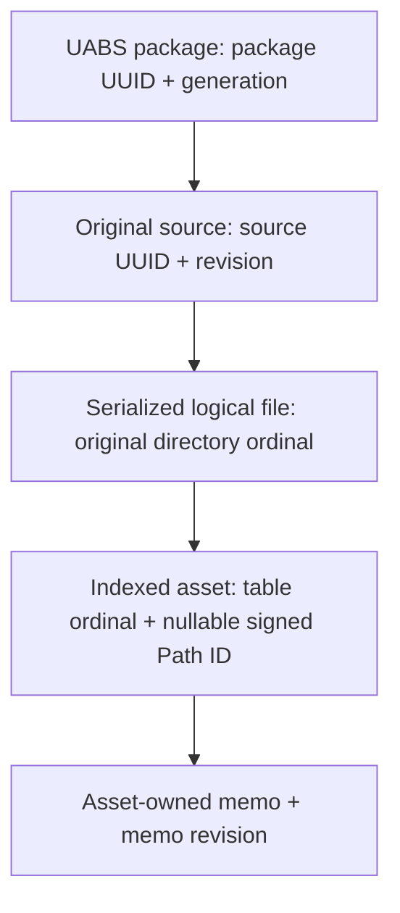

# V2 Recovery Phase 1A — Bundle Identity and Memo Audit

**Date:** 2026-10-23. **Baseline:** `f815443`. **Mode:** source/document inspection; documentation output only. No application/Unity execution, package queries/writes, builds or regression runs. This audit prepares [recovery issues #1/#2/#7/#3](v2-ui-workflow-recovery-roadmap.md); it implements none of them and closes none of the17 issues.

## Findings in brief

- Unity Search returned **original-source/bundle references** when bundle names or contained indexed asset names/memos matched. It did not return each matching asset as a result row.
- Legacy **memos belonged to individual assets**, not bundles. Its bundle-search rows had icons/name/size, not a bundle Memo column. Restoring bundle presentation and adding true bundle memos are different decisions.
- V2 already has the immutable source identities and relational data needed for source-level listing and source results derived from matching assets, **without a storage-schema change**. The current query does not implement that asset-to-source aggregation; selecting SourceFile results alone is insufficient.
- V2 memo persistence supports **addressable individual assets only**. Source, logical-file and package memo storage is absent. A genuine bundle memo requires a separately approved storage/API design, not an arbitrary asset's memo or a merged string.
- Current Search → Assets navigation is absent by explicit UI design; technical-column drift and individual-asset presentation are confirmed relative to the user's recovery requirements. These were earlier documented implementation choices, not evidence of corruption or a recently removed Avalonia feature.

## 1. Entities and immutable identity

The [canonical DDL](../../UABS.PackageV2/Schema.sql), [approved identity contract](../03_design/package-format-v2-design.md), [extractor records](../../UABS.UnityAssets/Metadata/V2MetadataContracts.cs) and [builder](../../UABS.PackageV2/PackageBuilder.cs) distinguish:

| Entity | Actual meaning / identity | Display / caveat |
|---|---|---|
| UABS package | One `.uabs.sqlite`; `package_uuid`, indexed snapshot `generation_uuid` | Stored package display name, not a Unity bundle |
| Original Unity source | One imported physical file; `source_uuid` + `source_revision_uuid`, scoped by package/generation | `original_name`, original path, index directory and kind (`bundle`, `serialized`, `unknown`) are evidence/labels, not identity |
| Unity bundle directory entry | Entry at the original index in `DirectoryInfos`, potentially serialized content or raw resource data | A `.resS`/raw resource entry is not an asset table. Not every directory entry becomes a persisted `logical_file` |
| Serialized logical file | `(source_uuid, source_revision_uuid, directory_ordinal)`, package/generation scoped | Logical/CAB names may repeat. Ordinal is the original directory index, not index-after-filtering; standalone serialized sources use0 |
| Indexed asset-table occurrence | Above logical identity + `table_ordinal`, with nullable signed Path ID and identity status | All captured rows, including ambiguous/incomplete records; not every occurrence is memo-writable |
| Addressable asset / memo target | `(package_uuid, generation_uuid, source_uuid, source_revision_uuid, directory_ordinal, signed path_id)` resolving uniquely | Name/Class ID/DB integer row ID are not write keys. Table ordinal distinguishes diagnostic/search occurrences but cannot bypass an ambiguous Path ID |

This diagram describes the **existing schema**, not proposed bundle-memo support. A serialized Unity object of class AssetBundle, if indexed, is also an asset row; it is not interchangeable with the physical source file.

[AssetsToolsV2MetadataExtractor.ExtractAsync](../../UABS.UnityAssets/Metadata/AssetsToolsV2MetadataExtractor.cs) iterates original directory ordinals, checks flags/serialized-header candidacy, skips raw resources and emits per-file status/evidence. `PackageBuilder.BuildAsync` inserts the source before extraction; it retains source status/issues, discards provisional child metadata after failed source verification, and publishes partial coverage only under its explicit acknowledgement contract. A source-level view must include coverage/status, including sources with no readable table; zero matching indexed assets does not prove the original source contains none.

**Recommended bundle-row identity (proposal):** `(package_uuid, generation_uuid, source_uuid, source_revision_uuid)` plus captured registration/location epoch and catalog revision for live operations. Source-only rows have **no logical ordinal**; an optional matched-asset witness adds original logical/table ordinals and Path ID separately. Do not use filename, CAB, content hash or SQLite `source_id` as a transport identity.

Collision and lifecycle consequences:

- Same filenames, CABs or asset names remain distinct source/asset occurrences. Show package/index/path context rather than merge by labels.
- One bundle with several serialized files is one proposed source row; retain every logical file and raw dependency declaration beneath it.
- The same source indexed in different packages remains package-specific, with potentially different asset memos. Deduplicating across packages needs approval and cannot throw away provenance.
- A deliberate verified source remap may preserve source UUID/revision under D1–D3; changed/unverified bytes cannot. Paths are locators, not identity. Current creation assigns new UUIDs ([V2PackageCreationService.CreateAsync](../../UABS/Script/Services/V2PackageCreationService.cs)); a source-remapping/reindex UI is not implemented by these contracts.
- Package moves preserve stored UUIDs but require appropriate registration/epoch invalidation. [V2BrowseCatalog.RegisterAsync](../../UABS/Script/Services/V2BrowseCatalog.cs) refuses another active independent copy with the same package UUID. An unload/reload or generation replacement cannot retarget a pending selection/draft.

## 2. Historical Unity workflow — code evidence, not runtime acceptance

### Search matching and result unit

[ReadSearchInfo.ReadInfoFor](../../../UABS/Assets/Script/Reader/Search/ReadSearchInfo.cs) normalizes comma-separated terms, then [FindDeriveInfoInPackage](../../../UABS/Assets/Script/Reader/Search/FindDeriveInfoInPackage.cs) scans package JSON:

- `FindInPackageBySearchOptions` (line58) adds one `DeriveInfo { name, path, cabCode }` per accepted **bundle index item**. Matching several assets inside that item does not add several results. Duplicate items across JSON files are not globally deduplicated.
- Nonexact `ShouldInclude` (line112) first checks the bundle name, then each asset name and optionally each asset memo. Includes are OR. **Excludes are field-local** in `PassSearchOptions` (line157): an excluded bundle name/asset/memo does not veto a different value that independently passes. That differs from the approved current candidate-wide V2 exclude semantics.
- Exact `ShouldInclude(item, sKeys[0])` (line137) checks only the first include term, with case-sensitive equality on bundle/asset names; it ignores excludes/memo searching in that branch. Empty includes can index an empty list and be caught/logged at JSON-file level. These quirks need an explicit compatibility decision, not silent reproduction or accidental reinterpretation.
- The historical package builder indexed Sprite/Texture2D names from the first loaded serialized file ([UserPackageBuildReader.ReadInfoForBuildPackage](../../../UABS/Assets/Script/Reader/UserPackage/UserPackageBuildReader.cs), line39). Preserve V2's all-class/all-file index; do not restore that legacy coverage restriction.

### Package scope and visible rows

[HoverSearchDerive](../../../UABS/Assets/Script/DropdownOptions/Search/HoverSearchDerive.cs) retains a set of included package-directory names; [SearchPackageButton.ClickButton](../../../UABS/Assets/Script/LocalController/BundleSearch/SearchPackageButton.cs) toggles membership. [SearchBundleByKeywordsButton](../../../UABS/Assets/Script/LocalController/BundleSearch/SearchBundleByKeywordsButton.cs) and [SearchBundleByMemosButton](../../../UABS/Assets/Script/LocalController/BundleSearch/SearchBundleByMemosButton.cs) dispatch one request per included package.

[SearchDataSource.OnEvent](../../../UABS/Assets/Script/DataSource/SearchDataSource.cs) (line27) obtains bundle paths, copies them into a generated Search cache folder and dispatches `FolderRead4DeriveEvent`. [LoadEntries2ScrollFolderView.ClearAndLoadFolder](../../../UABS/Assets/Script/Controller/LoadEntries2ScrollFolderView.cs) clears and replaces the displayed folder rows on each event. Thus the code supports multi-package **selection**, but does not establish today's single merged/federated multi-package result session; successive per-package events can replace the view. Do not cite it as proof of a correct legacy global merge.

[EntryFolderInfoView.Render](../../../UABS/Assets/Script/View/FolderView/EntryFolderInfoView.cs) (line74) displays file-kind icon, name and size; the underlying `DeriveInfo` retains path/CAB. These are source-file rows, not typed asset-result DataGrid rows with Memo headers. [ReadFolderContent](../../../UABS/Assets/Script/Reader/BundlesRead/ReadFolderContent.cs) treats `.bundle`, `.ab` **and standalone `.assets`** as bundle-style entries. The meaning of “bundles only” must not silently remove standalone serialized sources.

The original package picker enumerates package **directories** ([ReadUserPackage.GetPackagesInExternal](../../../UABS/Assets/Script/Reader/UserPackage/ReadUserPackage.cs)); its package action dispatches dependency lookup ([UserPackageSearch.ClickButton](../../../UABS/Assets/Script/LocalController/UserPackage/UserPackageSearch.cs)). [DependencyDataSource](../../../UABS/Assets/Script/DataSource/DependencyDataSource.cs) also presents copied bundle references through the folder flow. No equivalent modern Unity “Packages → Indexed assets” DataGrid is established by these paths. Distinguish package-directory menu entries, bundle-result rows and individual Assets rows rather than claim they were one historical list.

The later **Avalonia V1** Contents table is another distinct presentation: [PackageManagementViewModel.BuildContents](../../UABS/Script/ViewModels/PackageManagementViewModel.cs) (line931) emits a Source row followed by each asset reference. Source Memo is NULL; only asset rows carry their own memo. It is not a bundle-only list and is not evidence that V1 had owned bundle memos. Preserve those current workflows until their separately authorized replacement/retirement, rather than treating all “legacy” behavior as identical.

### Sorting, Inspector and opening Assets

- The inspected folder-result renderer has no DataGrid column sort route. [AssetsDataSortManager.SortedEntryInfos](../../../UABS/Assets/Script/DataSource/Manager/AssetsDataSortManager.cs) (line29) sorts **opened individual assets** by natural Name, numeric Type/Class ID or Path ID; [SortProp](../../../UABS/Assets/Script/DataStruct/BundleView/SortProp.cs) has no Memo sort. Legacy evidence does not establish global Name/Memo header sorting on bundle results.
- [EntryFolderInfoView.TriggerEvent](../../../UABS/Assets/Script/View/FolderView/EntryFolderInfoView.cs) (line45) activates the selected source/cache entry. [FolderDataDeriveManager.OnEvent](../../../UABS/Assets/Script/DataSource/Manager/FolderDataDeriveManager.cs) associates copied entries with original paths **by filename** and calls `ReadBundle4Derive`; [BundleReader](../../../UABS/Assets/Script/Reader/BundlesRead/BundleReader.cs) emits `AssetsRead4DeriveEvent`; [Segue.OnEvent](../../../UABS/Assets/Script/UI/Universal/Segue.cs) switches from folder to asset view. This is the verified code route for the desired Search → Assets workflow; no distinct command literally named “Go to Assets” was found in the inspected source/scene references.
- [CopyDeriveToSysFolder.CopyFromPaths](../../../UABS/Assets/Script/Writer/SystemCache/CopyDepToSysFolder.cs) (line8; class and filename differ) copies to a filename-only destination with overwrite. Equal filenames can collide, and original-path association is ambiguous. Preserve the workflow, **not** this cache/identity bug.
- Original-path propagation also has a code-path gap: [AssetsRead4DeriveEvent](../../../UABS/Assets/Script/Event/OnRead/AssetsRead4DeriveEvent.cs) carries `OverridePath`, but the active `AssetsOpenBundleManager` handler directly installs `ParsedAEs`; [AssetsReader.GetAssets](../../../UABS/Assets/Script/Reader/BundlesRead/AssetsReader.cs) sets their `originalPath` to the loaded file path (the copy). No override application appears in that traced route. Do not claim reliable legacy source/memo targeting merely because the event has an override field; this is static evidence, not a reproduced Unity runtime symptom.
- After opening, [DisplayInfoPanel.OnEvent](../../../UABS/Assets/Script/View/BundleView/DisplayInfoPanel.cs) displays individual asset name, Path ID, file ID, sizes, source path and the asset memo. No bundle-level memo Inspector is shown by this path. [FolderGoBackManager](../../../UABS/Assets/Script/DataSource/Manager/FolderGoBackManager.cs) restores prior derived folders and unloads AssetsTools state; this is not evidence of a modern immutable source-identity Back/Forward stack.

## 3. Current V2 Search and Packages

### Search projection and the presentation divergence

[SearchContracts](../../UABS.PackageV2/Search/SearchContracts.cs) and [PackageSearchModels](../../UABS.UnityAssets/Packages/Search/PackageSearchModels.cs) define Package, SourceFile and Asset result kinds, **not a separate logical-file result kind**. `SearchRowKey` carries only applicable identity fields. SourceFile keys have source UUID/revision and no directory/table ordinals; asset keys retain both ordinals. Revisions capture registration ID, location epoch, package/generation and catalog revision.

[SearchQuery.Command](../../UABS.PackageV2/Search/SearchQuery.cs) emits independent SQL branches:

- Package: package name/registered path matching.
- SourceFile: source name/path/index directory and CAB/dependency `EXISTS` evidence across logical files. It does **not** test child asset names/memos. Source rows project NULL asset name/Path ID/memo and memo revision0.
- Asset: each matching asset-table occurrence joined to its logical file/source, with raw name, nullable memo and exact provenance. Path ID/Class ID/type and Memo-only gates apply as defined by the approved contract.

Consequently enabling only SourceFile results loses asset-name/memo matches; grouping the current UI rows only loses unseen matches and produces duplicate/incorrect pages. [SearchWorkspaceViewModel](../../UABS/Script/ViewModels/SearchWorkspaceViewModel.cs), `SearchResultItemViewModel.Name`, wraps these rows directly: package display name, source name or raw asset name according to kind. **This independent candidate projection, already in the Avalonia V1 PackageSearchService and later retained by V2, is where presentation differs from Unity's bundle-returning Search**—not an extraction failure or Gate5G.1 sorting regression.

[SearchWorkspaceView](../../UABS/Script/View/Pages/SearchWorkspaceView.axaml) shows Kind, Name, Package, Source, Path ID and Memo; selected metadata/asset memo state feeds the Inspector. It explicitly says source loading/Show in Assets are deferred and has no source-open command. [V2SearchOperation](../../UABS/Script/Services/V2SearchOperation.cs) captures selected registrations, evidence and immutable criteria. [V2SearchWindow](../../UABS/Script/ViewModels/V2SearchWindow.cs) bounds100-row engine pages,600 retained rows and128 checkpoints. [SearchQuery.Compare](../../UABS.PackageV2/Search/SearchQuery.cs) and [V2SearchService.ReadPageAsync](../../UABS.PackageV2/Search/V2SearchService.cs) provide global ordering, keyset continuation and bounded federation, not a UI grouping engine.

Current Gate5G.1 supports Package, Source and Path ID globally, plus raw Name for Assets-only queries. Kind/Memo/mixed-result Name remain unsupported; selected assets/drafts survive sorting, and D5 still requires explicit Refresh after catalog changes. Future source-level Name could map to existing SourceName ordering, but membership, source-row cursor identity/ties and unavailable Memo semantics need approval and regression coverage.

### Packages / Assets controls and reuse boundaries

[PackageManagementView](../../UABS/Script/View/Pages/PackageManagementView.axaml) hosts [V2PackageView](../../UABS/Script/View/Pages/V2PackageView.axaml). Its **Indexed assets (read-only)** tab uses [V2AssetListView](../../UABS/Script/View/Pages/V2AssetListView.axaml), also used by indexed [AssetsWorkspaceView](../../UABS/Script/View/Pages/AssetsWorkspaceView.axaml). It displays **individual `V2AssetRow` records only**, not mixed bundle/logical/asset rows: icon, Name, Type, Class ID, Path ID, Directory ordinal, Table ordinal; no Memo column. The title's read-only qualification concerns metadata, not the shared eligible memo editor in [V2InspectorView](../../UABS/Script/View/Pages/V2InspectorView.axaml).

[V2BrowseViewModel.LoadAsync/LoadMetadataAsync](../../UABS/Script/ViewModels/V2BrowseViewModel.cs), [V2BrowseRegistration.AssetsAsync/MetadataAsync](../../UABS/Script/Services/V2BrowseCatalog.cs) and [PackageReader.ReadAssetsAsync/ReadMetadataAsync](../../UABS.PackageV2/PackageReader.cs) show:

- Assets pages are `asset_id > after` ordered, fetch101/publish100. Previous history is capped128; column sorting is current-page only. DB row IDs are paging positions within a generation, not immutable selection keys.
- Sources, logical files, dependencies and issues are separately selectable **raw metadata pages**. `ReadMetadataAsync(Sources)` already yields exactly one source record per stored source, UUID/revision and status included, with package/generation provenance. A typed source DTO/list and source Inspector would be application changes, not schema changes; do not filter an asset page into a source list.
- Existing metadata `V2MetadataItem` exposes raw Details and Cursor, not a typed bundle selection/navigation/memo contract. Source selection must retain the immutable identity in structured form. Dependency evidence can be joined through source→logical files→declarations without assuming CAB uniqueness; current V2 UI exposes evidence, not an integrated V2 dependency-resolution workflow.
- A bundle-only Packages listing can reuse source metadata paging, but must decide whether to include serialized/failed/unsupported/unknown sources. Its source-row pagination/selection cannot blindly reuse `V2AssetRow` or the asset cursor.

The filesystem/live-session [FolderView](../../UABS/Script/View/Pages/FolderView.axaml) is different: Kind, Name, Type, Class ID, Path ID, Size, File; no directory/table columns and no Memo column. Its [AssetEntry](../../UABS.UnityAssets/AssetEntry.cs) has logical **name** but not original directory/table ordinals. Recovery #3 must audit both paths without removing unrelated Size/File columns or technical Inspector evidence. Sharing `V2AssetListView` does not authorize forcing source-level Packages rows onto the individual-asset Assets list.

## 4. Memo ownership and intended Memo columns

| Entity | Unity reference | Current V2 persistence | Consequence |
|---|---|---|---|
| Individual asset | `AssetInfos[].Memo`; selected package + original bundle path + first matching asset name | `asset.memo`, memo revision/nullable state; unique addressable identity required | Assets individual-asset Memo can reuse the existing writer/publications |
| Original source/bundle | No owned memo field in inspected reader/writer | No source memo field/API/revision | Search/Packages bundle Memo is a new capability, not a missing binding |
| Serialized logical file | No separate owned memo in inspected path | No logical-file memo field/API | Cannot reinterpret a child asset's memo as a file memo |
| UABS package | Package selection chooses the asset-memo container | No package memo field/API | Package name/status is not a writable package memo |

Evidence: [legacy MemoWriter.WriteMemo](../../../UABS/Assets/Script/Writer/UserPackage/MemoWriter.cs) line19 and [MemoReader.ReadAssetMemo](../../../UABS/Assets/Script/Reader/UserPackage/MemoReader.cs) line18 locate a bundle by path and the **first asset by name**, then access `AssetInfos[].Memo`. [MemoField.GetMemoAndSet](../../../UABS/Assets/Script/UI/BundleView/MemoField.cs) line121 enables Sprite/Texture2D editing for a selected memo package and uses a0.4s Unity coroutine debounce. This is weaker identity than V2, not a reason to restore name-based writes or type restrictions.

[V2 MemoTarget/MemoWriteRequest](../../UABS.PackageV2/Memos/MemoContracts.cs), [V2MemoPersistenceService.PersistAsync](../../UABS.PackageV2/Memos/V2MemoPersistenceService.cs), [InspectorMemoService](../../UABS/Script/Services/InspectorMemoService.cs) and canonical asset triggers confirm exact individual-asset ownership: nullable original value and memo revision preconditions, generation/registration checks, editor exclusion, transaction, fresh verification and publication. Existing shared1.5s drafts/Retry remain protected. Class type is not the identity gate; ambiguous/incomplete targets are not writable.

**Recommendation, pending approval:** keep bundle-row Memo unavailable/explicitly “not owned” until source-memo storage is separately approved. Matching asset memos may be evidence or a count, but never masquerade as one bundle memo. An Inspector may present a deliberately selected exact child asset memo with clear attribution; never auto-pick the first match. For individual indexed Assets, bind Memo to `V2AssetRow.Memo` and its verified publication notifications. For live filesystem Assets, a per-row memo projection is still needed; do not fan out per-row source reads or weaken the existing exact resolver.

## 5. Proposed Search → Assets identity contract (not implemented)

Capture package UUID/generation, registration identity/location epoch/lifetime/catalog revision, source UUID/revision and source-status/fingerprint evidence. Resolve that exact source through the captured live registration; use its original path or an explicitly verified approved remap. Source-level navigation does **not** require a logical ordinal. If selecting a specific matching child after loading is requested, carry its original directory ordinal and exact asset identity as optional context, not a filename/CAB lookup.

[MainWindowViewModel.LoadFileAsync](../../UABS/Script/ViewModels/MainWindowViewModel.cs) already opens Unity sources via the existing session factory, commits only a successful/current load and preserves a previous valid session on failure; opening `.uabs.sqlite` instead switches to metadata browsing. Reuse the **Unity source** route, not package-file activation. Capture/verify the selected source revision before and after load and reject changed/unavailable evidence before publishing a misleading package association. Do not copy source payloads into filename-only Search caches.

[AssetsToolsAssetSessionFactory](../../UABS.UnityAssets/AssetsToolsAssetSessionFactory.cs) fingerprints source bytes around enumeration, but its live `AssetEntry` lacks immutable original ordinals. [InspectorMemoService.ResolveAssetAsync](../../UABS/Script/Services/InspectorMemoService.cs) currently bridges native selections using path + verified SHA256 + logical name + signed Path ID across loaded packages; [PackageReader.FindMemoTargetsAsync](../../UABS.PackageV2/PackageReader.cs) rejects ambiguous matches. Repeated logical labels or the same source indexed into multiple packages can therefore remain ambiguous even after opening the correct file. Preserving Search's package identity in native Assets needs a scoped bridge/provenance design; do not imply that passing a path alone restores exact memo ownership or child selection.

Retain Search criteria, selected packages, row identity, cursor/viewport and draft before switching. Flush navigation work through the existing coordinator without losing failed drafts; never retarget an old completion. [BrowserViewModel](../../UABS/Script/ViewModels/BrowserViewModel.cs) maintains filesystem **directory** Back/Forward/Up/Refresh history, not Search-source/workspace history; preserve that behavior and do not push fabricated cache/package paths into it. Decide whether the new action also navigates the parent directory and what Back should restore. Returning through the existing workspace switch should retain Search and perform its normal staleness check, not rerun it.

When the Unity source is missing, SQLite metadata browsing/search and exact indexed-asset memo persistence remain independent of source payload availability. Actual Unity-source loading/preview/export cannot work from metadata alone. Show an explicit unavailable-source result, retain the valid current session/Search context, and do not claim opening the package metadata is equivalent to opening the bundle.

## 6. Decision matrix — approval required before implementation

| Decision | Confirmed existing behavior | Proposed smallest recovery | Approval / dependencies / risks |
|---|---|---|---|
| 1. Bundle row identity | V2 has source UUID/revision scoped by package/generation; labels are nonunique | One source occurrence per row with live registration/revision context | Approve “bundle” = original source, including policy for standalone/failed sources; preserve cross-package provenance |
| 2. Bundle aggregation | Unity returns accepted bundle items; V2 independently emits assets/sources | Source candidate matched by own fields OR qualifying child-asset existence, before ordering/page limits | Approve field-local legacy vs candidate/source-wide exclusion, exact-case behavior, Memo-only and partial-coverage semantics; no loss of all-asset index |
| 3. Mixed-result Search | Current Package/Source/Asset controls and independent kinds are implemented | An explicitly approved bundle-oriented mode/projection, with matching-asset evidence kept separately | Decide how current controls and exact Path ID/Class/type filters map. Do not silently delete mixed-result functionality or emit an arbitrary asset per source |
| 4. Bundle memo | Both legacy and V2 own memos per asset only | No fake bundle value; defer editing until separately approved source memo schema/API, or label unavailable | Approve ownership, NULL/empty, revision/transaction/draft/publication/editor and D5 effects; requires storage design if true memo is wanted |
| 5. Search → Assets | No current command; safe Unity loader exists; native memo bridge lacks original ordinal/package binding | Capture exact source + registration and reuse loader; preserve Search return context | Approve action/gesture, parent-directory/history behavior and child auto-selection; verify bytes, missing paths, duplicate logical labels and package context |
| 6. Packages bundle projection | Indexed tab uses asset rows; source metadata reader already pages sources | Typed source listing + source/evidence Inspector, not filtered asset pages | Approve source-kind/status inclusion and scoped columns; separate source cursors from asset cursors; preserve shared Assets consumers |
| 7. Assets Memo mapping | Indexed row has Memo notifications; live AssetEntry does not; Inspectors already edit exact assets | Indexed asset Memo binding; bounded identity-aware live memo projection | Confirm both Assets paths in scope; do not change writer/schema, do per-row disk scans or weaken ambiguity rejection |
| 8. Sorting/pagination | Existing global Search order is over its current row universe; Packages sorts a100-row asset page locally | Global source order + source keyset/federation; retain bounded window/checkpoints and D5 | Approve source Name/Memo meaning before enabling headers; redesign result/cursor contract for source matches, never deduplicate after LIMIT or sort retained600 rows |

### Minimal implementation sequence to approve, not automatic authorization

1. Agree the source-row identity, matching/mixed-result/filter contract and memo boundary. Preserve current controls until their exact replacement/retention is approved.
2. Add a schema-free source-result query/projection using existing source/logical/asset relations and authoritative matching functions; perform child-match `EXISTS`/aggregation **inside** candidate selection before global order, cursor boundaries, counts and package merge. Keep match evidence bounded and coverage explicit; source-name results must remain possible even with unreadable asset tables.
3. Add typed source listing/selection for Packages and Search using their appropriate existing reader/search layers. Retain technical Inspector/evidence and all-asset Assets browsing; add only the separately approved column changes.
4. Add identity-aware Search → existing source loader plus approved navigation return context. Resolve the native ordinal/package-provenance gap before promising exact child memo selection.
5. Implement individual Assets Memo projection independently of any bundle memo proposal. Bundle memo storage, if wanted, is a separate approved schema/writer integration, not a shortcut in this phase.

Future focused verification should cover same filenames/CABs/Path IDs across sources/packages, multi-logical-file sources with raw directory entries, all-class and NULL names, failed tables/partial coverage, child-asset include/exclude/exact/memo aggregation, source-level global pagination/dedup/counts, stale cursor/revision rejection, missing/changed source navigation and retained drafts/history. Source-derived negative results are only as complete as indexed coverage. These are proposed tests, not results from this audit.

## 7. Audit verification and limitations

Inspected legacy reader/writer/presentation/event paths, current DDL/extractor/builder/registration, reader/search/VM/XAML, memo targeting/publication and navigation ownership. Source links and named methods above are evidence; no synthetic example or save/reopen test is claimed as legacy runtime proof. No real OWL package, bundle or Unity file was modified or opened through the application. No full V1 feature-parity audit, benchmark, UI acceptance or runtime regression verification was performed.

Only this new report and the roadmap/handoff references are authorized outputs. All17 roadmap issues remain Reported and unresolved. Existing approved D1–D8/schema/D5 remain unchanged; legacy quirks versus approved V2 matching require explicit decisions, not silent contract changes. Final documentation validation is recorded in the session handoff; no application verification is implied.

**Unity-Exclusive Features Requiring Decisions:** no newly discovered replacement blocker. The legacy MonoBehaviour/scene/coroutine and preview dependencies are already tracked as UE-005/UE-008/UE-001–003 in [unity-exclusive-features.md](unity-exclusive-features.md). Proposed identity/query/metadata navigation work must stay Unity-independent; no preview implementation or dependency choice is authorized here.
